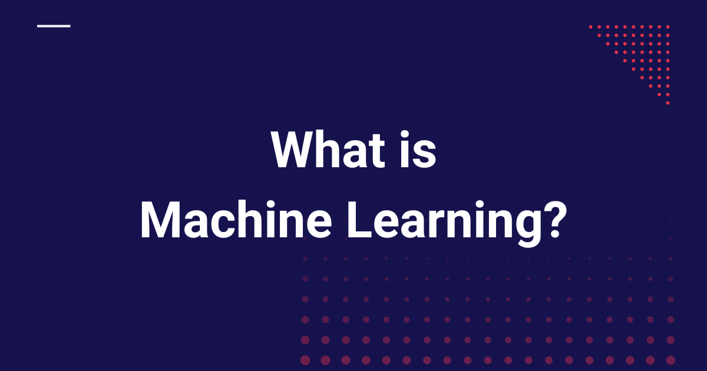
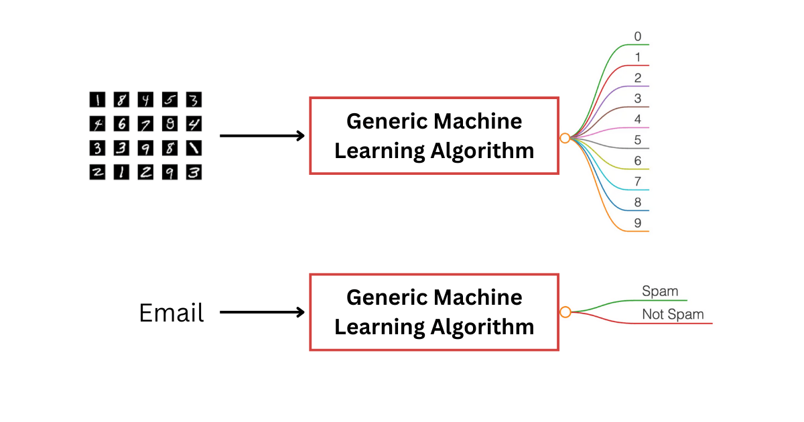
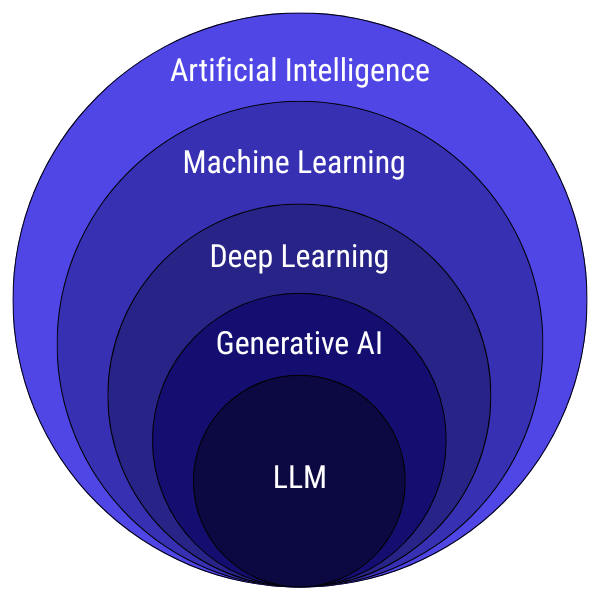

# What is Machine Learning?

> **Module 1 · Lesson 1.1**  
> Source: [Outcome School](https://outcomeschool.com/blog/machine-learning) · Published: August 2, 2019 · Reading time: ~10 min · Tags: `ai`, `machine-learning`

---



Machine Learning is a field of computer science that gives computers the ability to learn from data without being explicitly programmed.

Yet another article on - Introduction To Machine Learning. Believe me, this article is going to be the simplest introduction to the term **Machine Learning**. So, let’s start without wasting our time.

Let's get started.

## What is Machine Learning?

Let’s go through the Wikipedia definition.

> **Machine learning** is a field of computer science that gives computers the ability to learn without being explicitly programmed.

It means that there are **generic machine learning algorithms** that can tell you something interesting about a set of data without you having to write any custom code specific to the problem.

Instead of writing code specific to the problem, you feed data to the **generic machine learning algorithm**, and it finds the **pattern** hidden in the data.

For example, a classification algorithm is one that groups data into different categories. The same algorithm that recognizes handwritten digits can also classify emails into spam or not-spam. The algorithm remains the same, only the training data changes, so it learns different rules by finding different patterns in the data.



But the real question is: how does the machine get the ability to learn, and that too without being explicitly programmed?

And we all know that whatever a machine does, it does because it has been explicitly programmed to do so.

The ability to learn without being explicitly programmed is all about finding the **pattern**.

Let's figure out how it finds the **pattern** by examining the following dataset:

| x1 | x2 | y |
| --- | --- | --- |
| 4 | 2 | 8 |
| 1 | 2 | 5 |
| 0 | 5 | 10 |
| 2 | 1 | 4 |

Each row in the table is just a triplet: `x1`, `x2`, and `y`. There's a simple pattern hiding inside. For every row, `y` is tied to the values of `x1` and `x2`. Try to spot the pattern yourself before you read ahead.

In this case, with a bit of pencil-and-paper work, you can figure out that:

```python
y = x1 + 2 × x2
```

And we can also write it as below:

```python
y = w1 × x1 + w2 × x2
where w1 = 1 and w2 = 2
```

We found the **pattern** here. The relationship between `y`, `x1`, and `x2` comes from the constants `w1` and `w2`. These constants act as the **weights** in the linear equation that links `y` with `x1` and `x2`.

What we actually did here is:

We built a simple **model**: a linear one, because it represents a straight-line relationship between the inputs(`x1` and `x2`) and the output(`y`):

```python
y = w1 × x1 + w2 × x2
```

Then we learned the **weights** by observing the dataset.

Learned weights: **w1 = 1 and w2 = 2**

We found the **pattern** and learned the **weights**.

Once we've learned the weights, `w1` and `w2`, we can use them to **predict** `y` for any new `x1` and `x2`, even ones **not** in our original dataset. For example, if `x1 = 3` and `x2 = 4`, just plug them into the equation `y = x1 + 2 × x2`, and you get `y = 11`.

We just built a model that can **predict** for any new input.

But notice, we did all of this ourselves, without using any machines.

This was a small dataset representing a linear relationship between the inputs(`x1` and `x2`) and the output(`y`), and we were able to find the pattern manually. But imagine a dataset with thousands or millions of rows, and instead of just two inputs (`x1` and `x2`), you have hundreds or thousands of inputs. Suddenly, "finding the pattern" is no longer something you can do by hand.

This is exactly where Machine Learning shines.

The entire job of a Machine Learning model is:

**Take data → Find the pattern → Learn the weights (w1, w2).**

These weights become the "knowledge" of the model.

So when we say *the machine learns*, we simply mean: **It keeps adjusting the weights until the predicted y matches the actual y as closely as possible.**

- **Actual y** is the real value from your dataset, the ground truth, **represented by y**.
- **Predicted y** is the value the model computes using the current weights, **represented by ŷ**.

**But where do these weights come from?**

The learning process works like this:

- **Start with random weights**: The model doesn't know anything in the beginning.
- **Make a prediction using these weights**: `ŷ = w1 × x1 + w2 × x2`.
- **Compare the prediction with the actual value (y)**: This tells us how wrong the prediction was. **Error = actual y - predicted y = y - ŷ.**
- **Adjust the weights**: The model tweaks `w1` and `w2` slightly so the next prediction becomes a bit better.
- **Repeat this process thousands of times**: Each iteration moves the model closer to the true pattern.

This entire loop is called **training**.

Let's see, step by step, how this happens.

```python
ŷ = w1 × x1 + w2 × x2
```

```python
Error = actual y - predicted y = y - ŷ
```

### Step 1

Assume initial weights: **w1 = 0, w2 = 0**

Calculate the predicted `ŷ` with these weights for every row.

| x1 | x2 | actual y | predicted ŷ | error (y − ŷ) |
| --- | --- | --- | --- | --- |
| 4 | 2 | 8 | 0.0000 | 8.0000 |
| 1 | 2 | 5 | 0.0000 | 5.0000 |
| 0 | 5 | 10 | 0.0000 | 10.0000 |
| 2 | 1 | 4 | 0.0000 | 4.0000 |

### Step 2

Adjusted: **w1 = 0.225000, w2 = 0.400000**

| x1 | x2 | actual y | predicted ŷ | error (y − ŷ) |
| --- | --- | --- | --- | --- |
| 4 | 2 | 8 | 1.7000 | 6.3000 |
| 1 | 2 | 5 | 1.0250 | 3.9750 |
| 0 | 5 | 10 | 2.0000 | 8.0000 |
| 2 | 1 | 4 | 0.8500 | 3.1500 |

### Step 3

Adjusted: **w1 = 0.402375, w2 = 0.718500**

| x1 | x2 | actual y | predicted ŷ | error (y − ŷ) |
| --- | --- | --- | --- | --- |
| 4 | 2 | 8 | 3.0465 | 4.9535 |
| 1 | 2 | 5 | 1.8394 | 3.1606 |
| 0 | 5 | 10 | 3.5925 | 6.4075 |
| 2 | 1 | 4 | 1.5233 | 2.4767 |

### ...

### ...

### ...

### Step 1000

Adjusted: **w1 = 1 and w2 = 2**

| x1 | x2 | actual y | predicted ŷ | error (y − ŷ) |
| --- | --- | --- | --- | --- |
| 4 | 2 | 8 | 8 | 0 |
| 1 | 2 | 5 | 5 | 0 |
| 0 | 5 | 10 | 10 | 0 |
| 2 | 1 | 4 | 4 | 0 |

We are experimenting with the values of `w1` and `w2`. Over many iterations, the errors shrink and the weights move toward the values that explain the data (here exactly `w1 = 1`, `w2 = 2`).

The technique of gradually adjusting the weights is driven by something you will hear everywhere in Machine Learning: [**Gradient Descent**](https://outcomeschool.com/blog/math-behind-gradient-descent). This is the algorithm that helps the model move step-by-step towards better weights, so that the error decreases over time. Explaining Gradient Descent in depth is outside the scope of this post, but you now understand why we need it.

For now, just think of **Gradient Descent** as the mechanism that **guides** the model to find the best weights that match the data.

We can actually code this entire process ourselves. Every part of the learning loop: predicting, measuring error, adjusting weights, and repeating, can be written in just a few lines of code.

The following Python code demonstrates how to implement the linear model and learn the weights using gradient descent for 1000 steps. **We have skipped a few parts of the code and asked you to ignore certain details to keep it simple for educational purposes**.

```python
# Linear model example: y = w1*x1 + w2*x2
import numpy as np
# Dataset
X = np.array([[4, 2],
              [1, 2],
              [0, 5],
              [2, 1]], dtype=float)
y = np.array([8, 5, 10, 4], dtype=float)
# Initialize weights
w = np.array([0.0, 0.0])
learning_rate = 0.01 # Determines the size of each weight update, no need to focus on this detail now
steps = 1000
n = X.shape[0]  # number of data points
# Training loop
for step in range(steps):
    # Compute predictions
    y_pred = np.dot(X, w)
    # Compute error
    error = y - y_pred
    # Update weights using gradient descent
    gradient = -(2/n) * np.dot(X.T, error) # Computes the direction to adjust weights; no need to dive into the math now
    w = w - learning_rate * gradient
    # Optional: print every 10 steps
    if (step+1) % 10 == 0:
        print(f"After Step {step+1}: w1 = {w[0]:.6f}, w2 = {w[1]:.6f}")
# Final weights
print("\nFinal learned weights:")
print(f"w1 = {w[0]:.6f}, w2 = {w[1]:.6f}")
# Predict for a new input
x_new = np.array([3, 4])
y_new = np.dot(x_new, w)
print(f"\nPrediction for x1=3, x2=4: y = {y_new:.2f}")
```

You can run this code using a Python interpreter on your local machine, or an online editor, and observe how the weights gradually learn the pattern and predictions improve over time.

As Machine Learning engineers, our workflow looks like this:

- Understand the data.
- Choose the right model: a linear model if the relationship is simple, a tree-based model if the boundaries are complex, or a deep learning model when the patterns are highly nonlinear or the data is large.
- Train the model to learn the weights.
- Evaluate.
- [Deploy it](https://outcomeschool.com/blog/cloud-vs-on-device-model-deployment) to make predictions on new data.

Machine Learning = Learning the best weights from data.

Once the model learns the correct weights, it becomes capable of predicting outputs for new inputs it has never seen before. This is the "magic" of machine learning, but as you can see, there's no magic at all, just math.

Before closing, it's helpful to understand where Machine Learning sits in the broader world of Artificial Intelligence.



To put everything in context, here’s how different terms in AI relate to each other:

- **Artificial Intelligence (AI)**: The broadest field, any system that mimics human-like intelligence.
- **Machine Learning (ML)**: A subset of AI that learns patterns from data (like what we just explored).
- **Deep Learning (DL)**: A subset of ML that uses [neural networks](https://outcomeschool.com/blog/neural-network) with many layers.
- [**Generative AI**](https://outcomeschool.com/blog/what-is-generative-ai): Deep learning models capable of creating new content: text, image, audio, video.
- **LLMs (Large Language Models)**: A specific kind of generative AI specialized in understanding and generating human language.

That was all about Machine Learning.

## Frequently Asked Questions

### Is Machine Learning the same as Artificial Intelligence?

No. Artificial Intelligence is the broadest field, covering any system that mimics human-like intelligence. Machine Learning is a subset of AI that learns patterns from data. Deep Learning is a further subset of Machine Learning that uses neural networks with many layers.

### Do we need to write new code for every Machine Learning problem?

No. Machine Learning uses generic algorithms, so we feed data to the algorithm and it finds the pattern hidden in the data. The same classification algorithm that recognizes handwritten digits can also classify emails into spam or not-spam. Only the training data changes.

### What do the weights of a model actually represent?

The weights are the knowledge of the model. They are the constants that link the inputs to the output, like `w1` and `w2` in a linear equation. Once the model learns the correct weights, it can predict outputs for new inputs it has never seen before.

### What role does Gradient Descent play in training?

Gradient Descent is the mechanism that guides the model to find the best weights. It helps the model move step by step towards better weights, so that the error between the predicted value and the actual value decreases over time.

### Is there any magic in how a machine learns?

No. There is no magic at all, just math. The model starts with random weights, makes a prediction, compares it with the actual value, and adjusts the weights slightly. It repeats this loop thousands of times until the predicted value matches the actual value as closely as possible.
