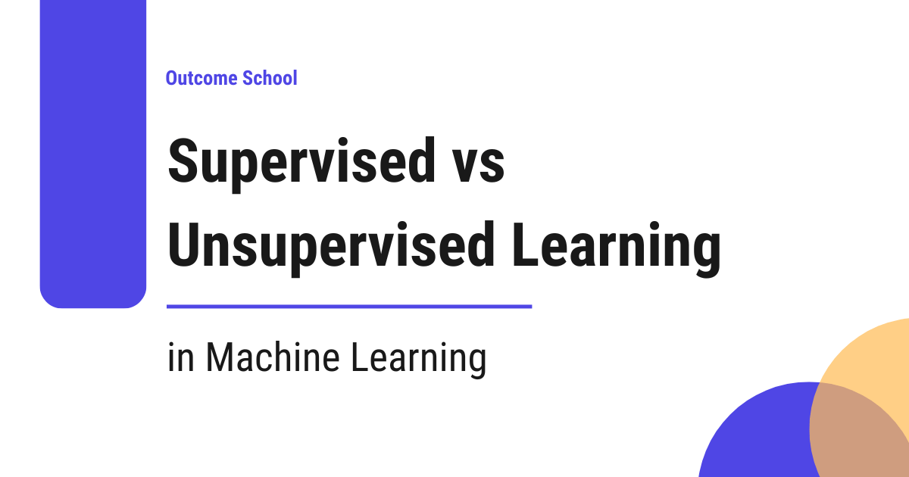

# Supervised vs Unsupervised Learning

> **Module 1 · Lesson 1.2**  
> Source: [Outcome School](https://outcomeschool.com/blog/supervised-vs-unsupervised-learning) · Published: December 9, 2025 · Reading time: ~6 min · Tags: `ai`, `machine-learning`

---

Supervised Learning learns from data that comes with labels (answers), just like learning with a teacher, whereas Unsupervised Learning finds patterns in data without any labels, just like learning without a teacher.

In this blog, we will learn about Supervised vs Unsupervised Learning in Machine Learning.

Let's get started.

Prerequisite: [What is Machine Learning?](https://outcomeschool.com/blog/machine-learning)

As we have learned, machine learning is all about enabling computers to learn patterns from data. But the way they learn depends on whether the data comes with labels (answers) or not. This brings us to two major learning categories:

- Supervised Learning
- Unsupervised Learning

Both solve completely different kinds of problems, and understanding the difference is essential before you start building any ML model.

## Supervised Learning

Supervised learning is like learning with a teacher.

You can also think of it this way: You’re solving math problems with the answer key next to you. You learn by comparing your answers to the correct ones.

You provide the model with:

- Input data
- Correct output labels

The goal is for the model to learn the mapping between inputs and outputs so that it can make predictions on new, unseen data.

Let's look at a few examples of supervised learning:

- Predicting house prices
- Classifying emails as spam or not spam
- Recognizing digits from images
- Predicting whether a customer will churn

How does it work?

- Feed the model data + correct labels (answers).
- Model makes predictions.
- Compare predictions with the correct labels (answers).
- Adjust weights using an optimization algorithm.
- Repeat until error is minimized.

Types of Supervised Learning

- Classification: Categorizing data into predefined classes (spam detection, image recognition)
- Regression: Predicting continuous numerical values (house prices, stock prices, temperature forecasting)

Now, let's look at the example dataset for supervised learning.

A simple example dataset used for house price prediction: This dataset contains features(Area, Bedrooms, Location Score) + label(Price), needed for supervised learning.

| Area (sq ft) | Bedrooms | Location Score | Price (₹ Lakhs) |
| --- | --- | --- | --- |
| 1200 | 2 | 7.5 | 85 |
| 1500 | 3 | 8.0 | 110 |
| 900 | 2 | 6.8 | 70 |
| 1800 | 3 | 8.5 | 130 |
| 1100 | 2 | 7.0 | 78 |

Here, **Price** is the label (the output variable). The model learns to predict price based on the features.

So, when you provide new unseen input data(area, number of bedrooms, and location score), the model can predict the price.

## Unsupervised Learning

Unsupervised learning is like learning without a teacher.

You can also think of it this way: You’re exploring a new city without a map. You observe patterns, such as busy areas and quiet areas, even though no one tells you which is which.

Here, the dataset contains **only the input data**, no labels, no predefined outputs.

The goal is to uncover hidden patterns, structures, or groupings within the data.

Let's look at a few examples of unsupervised learning:

- Grouping customers into segments
- Finding patterns in website user behavior
- Detecting anomalies (fraud, unusual transactions)
- Reducing dimensions (PCA - Principal Component Analysis)

How does it work?

- Feed the model only raw data.
- Model analyzes the structure.
- It tries to group, compress, or find relationships without external guidance.

Types of Unsupervised Learning

- Clustering: Grouping similar data points together (K-Means).
- Dimensionality Reduction: Compressing data while preserving important information (PCA - Principal Component Analysis).
- [Generative Modeling](https://outcomeschool.com/blog/what-is-generative-ai): Learning the structure of data to generate brand new samples ([Variational Autoencoders](https://outcomeschool.com/blog/variational-autoencoders)).

Now, let's look at the example dataset for unsupervised learning.

An example dataset used for fitness app user segmentation: Unlabeled Raw Fitness App User Data

A fitness app wants to understand user behavior and identify different types of users even though no labels exist.

| User ID | Daily Steps | Active Minutes | Weekly Workouts | Avg Heart Rate | Sleep Hours | Water Intake (L) | App Engagement Score |
| --- | --- | --- | --- | --- | --- | --- | --- |
| 1 | 12,500 | 75 | 5 | 72 | 7.5 | 2.8 | 88 |
| 2 | 9,200 | 50 | 3 | 78 | 6.8 | 2.1 | 75 |
| 3 | 4,800 | 18 | 1 | 85 | 6.0 | 1.5 | 52 |
| 4 | 15,000 | 92 | 6 | 68 | 8.0 | 3.2 | 93 |
| 5 | 8,000 | 40 | 2 | 80 | 6.5 | 1.9 | 67 |
| 6 | 13,400 | 80 | 4 | 74 | 7.2 | 2.6 | 85 |
| 7 | 5,600 | 25 | 1 | 82 | 6.2 | 1.7 | 58 |
| 8 | 10,500 | 60 | 3 | 76 | 7.0 | 2.3 | 78 |

There is **no label** here. An algorithm like K-Means will try to group customers into clusters based on these features.

After applying K-Means, the model finds natural patterns that map to real-world fitness personas.

| User ID | Daily Steps | Active Minutes | Weekly Workouts | Avg Heart Rate | Sleep Hours | Water Intake (L) | App Engagement Score | Segment |
| --- | --- | --- | --- | --- | --- | --- | --- | --- |
| 1 | 12,500 | 75 | 5 | 72 | 7.5 | 2.8 | 88 | **Active Lifestyle Enthusiasts** |
| 2 | 9,200 | 50 | 3 | 78 | 6.8 | 2.1 | 75 | **Moderate Fitness Users** |
| 3 | 4,800 | 18 | 1 | 85 | 6.0 | 1.5 | 52 | **Low Activity Busy Users** |
| 4 | 15,000 | 92 | 6 | 68 | 8.0 | 3.2 | 93 | **Active Lifestyle Enthusiasts** |
| 5 | 8,000 | 40 | 2 | 80 | 6.5 | 1.9 | 67 | **Moderate Fitness Users** |
| 6 | 13,400 | 80 | 4 | 74 | 7.2 | 2.6 | 85 | **Active Lifestyle Enthusiasts** |
| 7 | 5,600 | 25 | 1 | 82 | 6.2 | 1.7 | 58 | **Low Activity Busy Users** |
| 8 | 10,500 | 60 | 3 | 76 | 7.0 | 2.3 | 78 | **Moderate Fitness Users** |

**Without any labels**, the model still identifies meaningful clusters such as Active Lifestyle Enthusiasts, Moderate Fitness Users, and Low Activity Busy Users.

## Differences Between Supervised and Unsupervised Learning

Let's summarize the differences in a tabular format.

| Supervised Learning | Unsupervised Learning |
| --- | --- |
| Labeled Data | Unlabeled Data |
| Predicts output label. | Discovers hidden patterns, groups similar data, or reduces data dimensionality. |
| Types: Classification, Regression | Types: Clustering, Dimensionality Reduction |
| Examples: Spam detection, price prediction | Examples: Customer segmentation, anomaly detection |
| Algorithms: [Linear Regression, Logistic Regression](https://outcomeschool.com/blog/linear-regression-vs-logistic-regression), Decision Trees, Random Forests | Algorithms: K-Means Clustering, Hierarchical Clustering, Principal Component Analysis (PCA) |
| Use it when you know the target variable, you want predictions, and you have labeled data or can generate labels. | Use it when you want to explore the data, labels are not available, and you need natural groupings or structure. |

Both supervised and unsupervised learning are essential parts of machine learning. Supervised learning helps you predict, while unsupervised learning helps you discover.

## Frequently Asked Questions

### Is K-Means supervised or unsupervised learning?

K-Means is unsupervised learning. It is a clustering algorithm that groups similar data points together without any labels. For example, it can group fitness app users into segments like Active Lifestyle Enthusiasts, Moderate Fitness Users, and Low Activity Busy Users.

### What is the difference between classification and regression?

Both are types of supervised learning. Classification categorizes data into predefined classes, such as spam detection or image recognition. Regression predicts continuous numerical values, such as house prices, stock prices, or temperature forecasts.

### Is generative modeling a type of unsupervised learning?

Yes. Generative modeling is one of the types of unsupervised learning, along with clustering and dimensionality reduction. It learns the structure of the data to generate brand new samples, as Variational Autoencoders do.

### When should we choose unsupervised learning over supervised learning?

We should choose unsupervised learning when we want to explore the data, labels are not available, and we need natural groupings or structure. If we know the target variable, want predictions, and have labeled data, supervised learning is the better fit.
