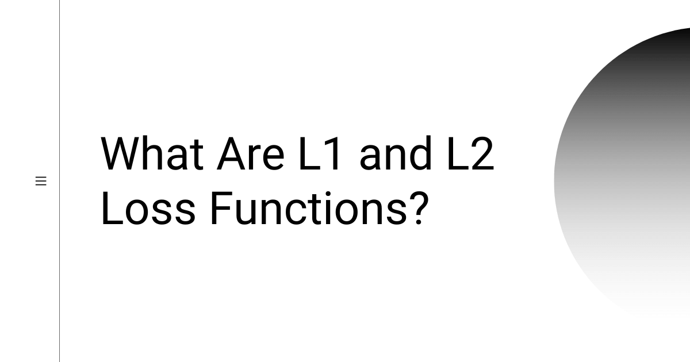
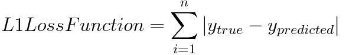
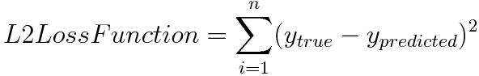

# What Are L1 and L2 Loss Functions?

> **Module 1 · Lesson 1.6**  
> Source: [Outcome School](https://outcomeschool.com/blog/l1-and-l2-loss-functions) · Published: August 2, 2019 · Reading time: ~3 min · Tags: `ai`, `machine-learning`

---

L1 and L2 are two loss functions in machine learning used to minimize the error. L1 Loss is the Least Absolute Deviations, and L2 Loss is the Least Square Errors. L2 is preferred in most cases, but L1 works better when there are outliers.

In this blog, we will learn about the L1 and L2 Loss functions.

Let's get started.

**L1 vs L2 Loss Function**

L1and L2 are two loss functions in [machine learning](https://outcomeschool.com/blog/machine-learning) which are used to minimize the error.

**L1 Loss function** stands for **Least Absolute Deviations**. Also known as **LAD**.

**L2 Loss function** stands for **Least Square Errors**. Also known as **LS**.

## L1 Loss Function

L1 Loss Function is used to minimize the error which is the sum of the all the **absolute** differences between the true value and the predicted value.

## L2 Loss Function

L2 Loss Function is used to minimize the error which is the sum of the all the **squared** differences between the true value and the predicted value.

## How to decide between L1 and L2 Loss Function?

Generally, L2 Loss Function is preferred in most of the cases. But when the outliers are present in the dataset, then the L2 Loss Function does not perform well. The reason behind this bad performance is that if the dataset is having outliers, then because of the consideration of the squared differences, it leads to the much larger error. Hence, L2 Loss Function is not useful here. Prefer L1 Loss Function as it is not affected by the outliers or remove the outliers and then use L2 Loss Function.

Watch the video format: [L1 and L2 Loss Functions in Machine Learning](https://www.youtube.com/watch?v=ToWgPhPbJ9U)

## Frequently Asked Questions

### What are the other names of L1 and L2 Loss Functions?

L1 Loss Function stands for Least Absolute Deviations, also known as LAD. L2 Loss Function stands for Least Square Errors, also known as LS. Both are loss functions in machine learning that are used to minimize the error.

### Is L1 Loss Function affected by outliers?

No. L1 Loss Function is not affected by the outliers. This is why we prefer L1 Loss Function when outliers are present in the dataset. L2 Loss Function does not perform well in that case.

### Why do outliers hurt L2 Loss Function?

L2 Loss Function uses the squared differences between the true value and the predicted value. When the dataset has outliers, squaring their differences leads to a much larger error. This is why L2 Loss Function does not perform well with outliers.

### Can we still use L2 Loss Function if the dataset has outliers?

Yes. We can remove the outliers first and then use L2 Loss Function. Removing them avoids the much larger error that their squared differences would cause. The other option is to prefer L1 Loss Function, as it is not affected by the outliers.
