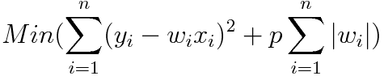
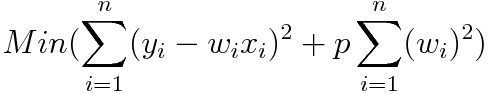

# What is Regularization in Machine Learning? L1 vs L2 Explained

> **Module 1 · Lesson 1.7**  
> Source: [Outcome School](https://outcomeschool.com/blog/regularization-in-machine-learning) · Published: August 2, 2019 · Reading time: ~3 min · Tags: `ai`, `machine-learning`

---

Regularization is a technique to reduce overfitting in Machine Learning by adding a penalty to the error function. L1 Regularization (Lasso) adds the sum of the absolute values of the weights, and L2 Regularization (Ridge) adds the sum of the squared values of the weights.

In this blog, we will learn about the Regularization In Machine Learning.

Let's get started.

**Regularization** is a technique which is used to solve the overfitting problem of the [machine learning](https://outcomeschool.com/blog/machine-learning) models.

**Solving overfitting problem with regularization**

## What is overfitting?

Overfitting is a phenomenon which occurs when a model learns the detail and noise in the training data to an extent that it negatively impacts the performance of the model on new data.

So the overfitting is a major problem as it negatively impacts the performance.

Regularization technique to the rescue.

Generally, a good model does not give more weight to a particular feature. The weights are evenly distributed. This can be achieved by doing regularization.

**There are two types of regularization as follows:**

- **L1 Regularization or Lasso Regularization**
- **L2 Regularization or Ridge Regularization**

## L1 Regularization or Lasso Regularization

L1 Regularization or Lasso Regularization adds a penalty to the error function. The penalty is the sum of the **absolute** values of weights.

`p` is the tuning parameter which decides how much we want to penalize the model.

## L2 Regularization or Ridge Regularization

L2 Regularization or Ridge Regularization also adds a penalty to the error function. But the penalty here is the sum of the **squared** values of weights.

Similar to L1, in L2 also, `p` is the tuning parameter which decides how much we want to penalize the model.

This is **Regularization**.

Apart from L1 and L2, there are other regularization techniques as well. We have a detailed blog on [Dropout in Neural Networks](https://outcomeschool.com/blog/dropout-in-neural-networks) that explains how randomly switching off neurons reduces overfitting in deep neural networks.

## Frequently Asked Questions

### What is the difference between L1 and L2 regularization?

Both add a penalty to the error function, but the penalty is different. L1, or Lasso, uses the sum of the absolute values of the weights. L2, or Ridge, uses the sum of the squared values of the weights.

### What does the tuning parameter p do in regularization?

The tuning parameter `p` decides how much we want to penalize the model. It plays the same role in both L1 and L2 regularization, controlling the strength of the penalty added to the error function.

### Why does regularization help with overfitting?

Overfitting happens when a model learns the detail and noise in the training data, which hurts its performance on new data. A good model does not give more weight to a particular feature, and its weights are evenly distributed. Regularization helps achieve this by penalizing the weights.

### Are L1 and L2 the only regularization techniques?

No. Apart from L1 and L2, there are other regularization techniques as well. For example, Dropout reduces overfitting in deep neural networks by randomly switching off neurons.
