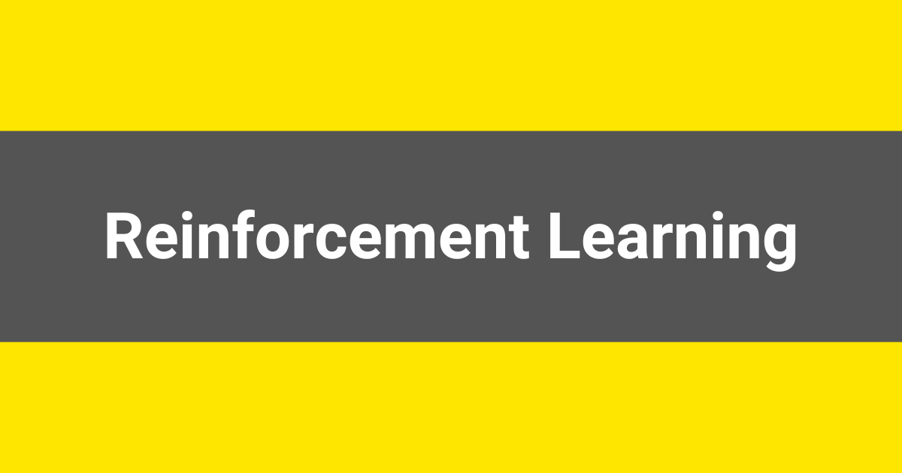

# What is Reinforcement Learning?

> **Module 1 · Lesson 1.8**  
> Source: [Outcome School](https://outcomeschool.com/blog/reinforcement-learning) · Published: August 2, 2019 · Reading time: ~14 min · Tags: `ai`, `machine-learning`

---



Reinforcement Learning (RL) is a type of machine learning where an Agent learns to make a sequence of decisions by interacting with an Environment, with the goal of getting the maximum Reward over time.

In this blog, we will learn about Reinforcement Learning, the branch of machine learning where an agent learns to make decisions by interacting with an environment and getting rewards or penalties for its actions.

We will cover the following:

- The Big Picture
- What is Reinforcement Learning?
- A Simple Real-World Analogy
- The Building Blocks of RL
- The Reinforcement Learning Loop
- Reinforcement Learning vs Supervised vs Unsupervised Learning
- Episode, Return, and Discount Factor
- Exploration vs Exploitation
- Common Families of RL Algorithms
- Where Is Reinforcement Learning Used?
- Why Reinforcement Learning Is Hard
- Quick Summary

Let's get started.

## The Big Picture

Before we go into the details, let's understand the big picture.

Reinforcement Learning is how a system learns by doing. It tries something, sees the result, and adjusts. This is the classic **trial and error** style of learning.

There is no teacher giving the right answer for every single situation. Instead, there is a reward signal that tells the system whether it is doing well or badly, and the system slowly figures out the best way to act.

**In simple words:**

**Reinforcement Learning = An Agent + An Environment + A Reward signal that guides the Agent to act better over time.**

## What is Reinforcement Learning?

Reinforcement Learning is one of the three main branches of [machine learning](https://outcomeschool.com/blog/machine-learning), along with supervised learning and unsupervised learning.

**Reinforcement Learning, often called RL, is a type of machine learning where an Agent learns to make a sequence of decisions by interacting with an Environment, with the goal of maximizing a Reward over time.**

In simple words, the Agent is the learner, the Environment is the world the Agent acts in, and the Reward is the feedback signal that tells the Agent how well it is doing.

The Agent is not told which action is correct. It must figure that out by trying actions and observing the results.

## A Simple Real-World Analogy

The best way to learn this is by taking an example.

Let's say we are training a puppy to sit.

- The puppy is the **Agent**.
- The room and the human are the **Environment**.
- When the puppy sits, we give it a treat. That treat is the **Reward**.
- When the puppy jumps on the sofa, we say "no". That is a negative reward.

The puppy does not understand our language. But over many tries, it learns:

- "When I sit, good things happen."
- "When I jump on the sofa, good things do not happen."

That is exactly how Reinforcement Learning works.

The Agent does not need a teacher who writes down the correct action for every situation. It learns the correct action by trying things and observing the reward.

## The Building Blocks of RL

This was the intuition behind RL using the puppy example. Now, let's name the parts of RL formally so we can use the right vocabulary going forward.

RL has a few core building blocks. Let's decode each one.

**Agent.** The decision maker. It is the thing that learns. In a game, the Agent is the player. In robotics, the Agent is the robot's brain. In an LLM trained with human feedback, the Agent is the LLM itself.

**Environment.** Everything outside the Agent. The world the Agent acts in. The chess board, the maze, the road in front of the self-driving car, the ongoing conversation.

**State.** A snapshot of the Environment at one moment in time. Where the player is on the board. The position and speed of the robot. The current conversation history.

**Action.** What the Agent decides to do in that state. Move the chess piece. Turn the robot left. Generate the next word.

**Reward.** A number the Environment gives back after the Agent takes an action. Positive means good. Negative means bad. Zero means nothing important happened.

**Policy.** The Agent's strategy. A mapping from states to actions. "When I am in this state, I will take this action." The whole goal of RL is to learn a good Policy.

**Value Function.** An estimate of how much total reward the Agent expects to collect from a given State (or from a given State-Action pair) in the long run. Some RL algorithms use the Value Function to derive the Policy. We will see this in the algorithms section later.

## The Reinforcement Learning Loop

Now that we know the building blocks, let's see how they interact with each other. The interaction between the Agent and the Environment happens in a loop.

```
+-----------------------+
|        Agent          |
+----------+------------+
           |
           |  Action
           v
+-----------------------+
|     Environment       |
+----------+------------+
           |
           |  New State + Reward
           v
+-----------------------+
|        Agent          |
+-----------------------+
```

Step by step:

**Step 1:** The Agent observes the current **State** of the Environment.

**Step 2:** The Agent picks an **Action** based on its current **Policy**.

**Step 3:** The Environment moves to a new state and gives back a **Reward**.

**Step 4:** The Agent updates its Policy using that reward.

**Step 5:** Repeat.

This loop runs millions of times. Slowly, the Policy gets better. The Agent learns which actions in which states lead to high reward.

This is exactly what was happening with the puppy. The puppy observed the State (us holding a treat), picked an Action (sit or jump), got a Reward (treat or no treat), and slowly updated its Policy. Same loop, just at a much smaller scale.

This is how Reinforcement Learning works at the core.

## Reinforcement Learning vs Supervised vs Unsupervised Learning

This was all about the RL loop. Now, let's compare RL with the other two main branches of machine learning so we can clearly see what makes RL special. This is the most important comparison to understand.

We have a detailed blog on [Supervised vs Unsupervised Learning](https://outcomeschool.com/blog/supervised-vs-unsupervised-learning) that explains the first two in depth. Here, we will quickly compare all three.

| Type | What the data looks like | What the model learns |
| --- | --- | --- |
| Supervised Learning | Inputs with correct outputs (labels) | Map each input to the correct output |
| Unsupervised Learning | Inputs only, no labels | Find hidden patterns, groups, or structure |
| Reinforcement Learning | No labeled data, only reward signals from interaction | A Policy that maximizes total reward over time |

Supervised learning has a teacher who shows the correct answer.

Unsupervised learning has no teacher and no rewards. It just looks for patterns.

Reinforcement learning has no teacher either. But it has an Environment that gives feedback in the form of a reward, and that reward is the only thing the Agent has to learn from.

Visually, the three look like this:

```
Supervised Learning:
   Input  -->  Model  -->  Output
                 ^
                 |
           Correct Output (label)
Unsupervised Learning:
   Input  -->  Model  -->  Patterns / Clusters
Reinforcement Learning:
                   Action
        +------------------------+
        |                        v
     Agent                 Environment
        ^                        |
        |                        |
        +------------------------+
              New State + Reward
```

Here, we can notice that supervised learning has labels guiding the Model, unsupervised learning has nothing but the input data, and reinforcement learning is the only one with a feedback loop between the Agent and the Environment.

## Episode, Return, and Discount Factor

Now that we have understood how RL is different from the other two, let's learn a few more terms that come up everywhere in RL.

**Episode.** One full run from start to end. One game of chess from move 1 to the final move. One round of a maze from start to finish. One conversation from the first message to the last. For our puppy, one episode is one full training round.

**Return.** The total reward collected during an episode. The Agent does not just want a single high reward in one step. It wants the highest total reward over the whole episode.

**Discount Factor (often written as gamma).** A number between 0 and 1 that tells the Agent how much to value future rewards compared to immediate rewards.

- A small gamma makes the Agent greedy for now. It cares mostly about the next reward.
- A large gamma makes the Agent patient. It is willing to give up a small reward now for a bigger reward later.

In simple words, the Discount Factor is how patient the Agent is.

Let's put this into perspective with real numbers:

```
Step:    t=0     t=1     t=2     t=3     t=4    (end)
          |       |       |       |       |
          v       v       v       v       v
Reward:   0       0      +1       0      +10
Weight: gamma^0 gamma^1 gamma^2 gamma^3 gamma^4
Return = (gamma^0 * 0) + (gamma^1 * 0) + (gamma^2 * 1) + (gamma^3 * 0) + (gamma^4 * 10)
For gamma = 0.9:
Return = (1 * 0) + (0.9 * 0) + (0.81 * 1) + (0.729 * 0) + (0.6561 * 10)
       = 0 + 0 + 0.81 + 0 + 6.561
       = 7.371
```

Here, we can see that the reward of +10 at the end is worth 6.561 to the Agent at the start, not the full 10. The further away a reward is, the more it is discounted. A smaller gamma would shrink that future reward even more.

## Exploration vs Exploitation

This was all about how rewards add up over time. Now, let's understand a key trade-off that every RL Agent has to deal with. This is one of the most important trade-offs in Reinforcement Learning.

- **Exploitation** = pick the action that is already known to give a good reward.
- **Exploration** = try a new action to see if it gives an even better reward.

Let's say we are in a new city and we want to find the best restaurant.

- If we only exploit, we go to the first decent restaurant we find and never try anything else. We will never know if there is a better place in town.
- If we only explore, we keep trying random new places forever and never settle on the good one.

A good RL Agent balances both. It exploits enough to use what it has already learned, and it explores enough to find something even better.

## Common Families of RL Algorithms

Now that we have understood the trade-off, let's see how actual RL algorithms learn the Policy. There are many RL algorithms. Most of them fall into three families. We do not need to memorize them right now. The goal is to understand the high-level idea behind each family.

**Value-based methods.** The Agent learns the **Value Function** we saw earlier in the building blocks. The Policy is then derived from it: in each State, pick the Action with the highest predicted value. **Q-learning** is the classic example.

**Policy-based methods.** The Agent directly learns the Policy. It adjusts the Policy in the direction that increases reward. **Policy Gradient** methods are the classic example.

**Actor-Critic methods.** A combination of the two. One network, the Actor, learns the Policy. Another network, the Critic, learns the **Value Function**. The Critic guides the Actor.

This family includes **[PPO (Proximal Policy Optimization)](https://outcomeschool.com/blog/proximal-policy-optimization-ppo)**, which is one of the most commonly used algorithms to [fine-tune](https://outcomeschool.com/blog/how-does-fine-tuning-work) large language models with human feedback.

The key idea is the same across all families. They are different ways of learning a good Policy from reward signals.

## Where Is Reinforcement Learning Used?

This was all about how RL works under the hood. Now, let's see where RL is actually used in the real world. RL shows up in many real-world systems.

- **Games.** AlphaGo learned to play Go at superhuman level using RL. AlphaZero went further and mastered Go, Chess, and Shogi using the same approach. Many Atari games have also been mastered by RL agents.
- **Robotics.** Robots learning to walk, grasp objects, or fly drones use RL.
- **Self-driving cars.** Decision making in traffic uses RL ideas.
- **Recommendation systems.** Some recommenders use RL to optimize long-term user engagement instead of just the next click.
- **Calibrated decision models.** Jev, the first [System One Model](https://outcomeschool.com/blog/jev-and-system-one-models-explained), is trained with RLCD (Reinforcement Learning for Calibrated Decisions), where the reward depends on both picking the right answer and reporting an honest probability.
- **Large Language Models.** Modern LLMs like ChatGPT are fine-tuned using **[RLHF (Reinforcement Learning from Human Feedback)](https://outcomeschool.com/blog/reinforcement-learning-from-human-feedback-rlhf)** to make them helpful, honest, and safe.

This last one is why RL has become so important in the AI world recently. RLHF has been a key reason modern LLMs behave as well as they do today.

## Why Reinforcement Learning Is Hard

Now that we know where RL is used, let's understand why RL is genuinely difficult to do well, so we appreciate the problem.

- **Reward signals are sparse.** Often, the Agent only gets a reward at the very end of an episode (win or lose, success or failure). It is hard to figure out which earlier action actually caused the outcome. This is called the **credit assignment problem**. Think back to the puppy. If we only said "good dog" at the very end of a long training session, the puppy would have a hard time figuring out which one of its many actions earned the praise. That is the credit assignment problem in real life.
- **The environment is changing.** As the Policy changes, the kinds of states the Agent visits also change. The training data is not fixed, which makes learning unstable.
- **Trial and error is expensive.** A simulated game can play a million episodes a day. A real robot cannot fall down a million times to learn how to walk. Real-world RL has to learn from very few tries.
- **Reward design is tricky.** A poorly designed reward can lead the Agent to game the system, finding ways to maximize the reward without actually doing what we wanted. This is called **reward hacking**. One way around this is to not write the reward at all and instead [learn it from human comparisons](https://outcomeschool.com/blog/decoding-deep-rl-from-human-preferences).

These problems are why a lot of modern RL research is about making the learning more stable and learning from fewer attempts.

One powerful way to learn from fewer real-world attempts is to let the Agent learn inside a learned simulator of the environment instead of the real world. We have a detailed blog on [How do World Models work?](https://outcomeschool.com/blog/how-do-world-models-work) that explains this approach step by step.

## Quick Summary

Let's recap what we have learned:

- **Reinforcement Learning = Agent + Environment + Reward signal.**
- The **Agent** learns by interacting with the **Environment** and getting **Rewards** back.
- The **Policy** is the Agent's strategy, mapping each state to an action.
- The **goal** of RL is to learn a Policy that maximizes the total reward over time.
- RL is different from **supervised learning** (no labels) and **unsupervised learning** (no rewards). RL learns purely from reward signals through interaction.
- Key terms to remember: **State, Action, Reward, Policy, Episode, Return, Discount Factor, Exploration vs Exploitation.**
- RL algorithms fall into three families: **value-based, policy-based, and actor-critic.**
- RL powers game-playing AIs, robots, recommendation systems, and the alignment stage of modern LLMs through **RLHF**.

Now we have understood Reinforcement Learning end to end.

In the next blog, we will learn about **RLHF (Reinforcement Learning from Human Feedback)** in detail, which is how RL is used to align large language models like ChatGPT with human preferences.

## Frequently Asked Questions

### Does Reinforcement Learning need labeled data?

No. Reinforcement Learning has no teacher who shows the correct answer, so there are no labels. The Agent learns purely from the reward signal it gets by interacting with the Environment. It figures out the correct action by trying things and observing the reward.

### What are the Agent, State, and Action when RL is used on an LLM?

The Agent is the LLM itself. The State is the current conversation history, and the Action is generating the next word. The reward then tells the LLM whether its response was good or bad, which is how RLHF uses RL to fine-tune models like ChatGPT.

### Which family of RL algorithms does PPO belong to?

PPO belongs to the Actor-Critic family. In this family, one network, the Actor, learns the Policy, and another network, the Critic, learns the Value Function and guides the Actor. PPO is one of the most commonly used algorithms to fine-tune large language models with human feedback.

### What is the credit assignment problem in RL?

The credit assignment problem is the difficulty of figuring out which earlier action caused the final outcome. It happens because reward signals are often sparse, and the Agent may only get a reward at the very end of an episode, such as a win or a loss.

### Why is RL hard to use on real robots?

Trial and error is expensive in the real world. A simulated game can play a million episodes a day, but a real robot cannot fall down a million times to learn how to walk. One way around this is to let the Agent learn inside a learned simulator of the environment, called a World Model.
