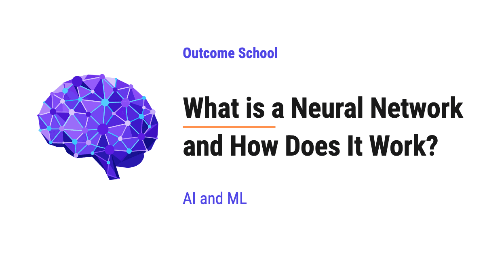

# What is a Neural Network and How Does It Work?

> **Module 2 · Lesson 2.1**  
> Source: [Outcome School](https://outcomeschool.com/blog/neural-network) · Published: October 20, 2026 · Reading time: ~16 min · Tags: `ai`, `machine-learning`

---



A Neural Network is a model made of many small units called neurons, arranged in layers, that turn input numbers into a prediction. It learns by adjusting its numbers again and again until its predictions become close to the correct answers.

In this blog, we will learn about what a Neural Network is and how it works. We will also see what a single neuron does with its weights, bias, and activation function, how neurons are arranged into layers, how a forward pass turns numbers into a prediction with a small worked example, how the network learns from its mistakes using loss, gradient descent, and backpropagation, and where Neural Networks are used.

We will cover the following:

- What is a Neural Network?
- What is a neuron?
- Weights and bias
- Activation function
- Layers: input, hidden, and output
- Forward pass: a worked example
- How does a Neural Network learn?
- The training loop
- Where are Neural Networks used?

Let's get started.

## What is a Neural Network?

**A Neural Network is a model that takes some numbers as input, passes them through many small connected units called neurons, and gives a prediction as output.**

The idea is inspired by the human brain, where billions of cells called neurons receive signals and pass signals forward. In a Neural Network, each neuron receives numbers, does a small calculation, and passes a number forward.

The best way to learn this is by taking an example.

Let's say we want to predict the test score of a student, out of 10. We know two things about the student:

- Hours studied: 2
- Hours slept: 3

We give these two numbers to a Neural Network, and it gives us one number back: the predicted test score.

So, a Neural Network does two things:

- It **predicts**: input numbers go in, a prediction comes out.
- It **learns**: at the start, its predictions are bad. We show it many students with their real scores, and every time it makes a mistake, it adjusts itself a little. After many such adjustments, its predictions become good.

To understand both, we must start with the smallest building block: the neuron.

## What is a neuron?

A **neuron** is the smallest unit of a Neural Network. It does three things:

- It takes some numbers as input.
- It multiplies each input by a number called a **weight**, and adds them all up along with one more number called a **[bias](https://outcomeschool.com/blog/bias-in-artificial-neural-network)**.
- It passes this total through a function called an **activation function** and gives one number as output.

Let's see a single neuron as a diagram:

```text
       x1 = 2                    x2 = 3
      (studied)                  (slept)
          │                         │
          ↓                         ↓
┌───────────────────┐     ┌───────────────────┐
│ x1 * w1           │     │ x2 * w2           │
│ 2 * 0.5 = 1.0     │     │ 3 * 0.25 = 0.75   │
└─────────┬─────────┘     └─────────┬─────────┘
          │                         │
          └────────────┬────────────┘
                       ↓
┌─────────────────────────────────────────────┐
│ weighted sum z = 1.0 + 0.75 + b             │
│ bias b = 0.25                               │
│ z = 2.0                                     │
└──────────────────────┬──────────────────────┘
                       ↓
┌─────────────────────────────────────────────┐
│ activation: ReLU(2.0) = 2.0                 │
└──────────────────────┬──────────────────────┘
                       ↓
                 output = 2.0
```

Here, we can see that the neuron takes two inputs, multiplies each one by its own weight, adds the bias, and then passes the total through the activation function to get the output.

Now, let's understand each part one by one.

## Weights and bias

A **weight** tells the neuron how important an input is.

- A big weight means the input matters a lot.
- A small weight means the input matters a little.
- A negative weight means the input pushes the output down.

Let's say hours studied matters more for the test score than hours slept. Then, the weight for hours studied will be bigger than the weight for hours slept.

The **bias** is one extra number that the neuron adds no matter what the inputs are. It lets the neuron shift its output up or down. For example, even a student who studied 0 hours can get some score, and the bias helps the neuron capture that.

The neuron multiplies each input by its weight, adds them all up, and then adds the bias. The total is called the **weighted sum**. We write it as below:

**z = (w1 \* x1) + (w2 \* x2) + b**

Here, `x1` and `x2` are the inputs, `w1` and `w2` are the weights, and `b` is the bias.

With our numbers, w1 = 0.5, w2 = 0.25, and b = 0.25, we get:

**z = (0.5 \* 2) + (0.25 \* 3) + 0.25 = 1.0 + 0.75 + 0.25 = 2.0**

**Very important:** We do not set the weights and the bias by hand. The network finds the right values on its own during learning. These numbers are called the **parameters** of the network. When we say a model has 7 billion parameters, it means it has 7 billion such weights and biases.

## Activation function

After the weighted sum, the neuron passes the result through an **activation function**.

Now, the question is: why do we need it?

If a neuron only multiplies and adds, then stacking many neurons together still gives us only multiplying and adding. The whole network becomes one big straight-line formula, no matter how many neurons we use. A straight line cannot capture complex patterns like recognizing a face in a photo.

The activation function adds a small bend to the output. When we stack many neurons with these bends, the network can learn curved and complex patterns.

The most common activation function is **ReLU** (Rectified Linear Unit). Its rule is:

- If the number is positive, keep it as it is.
- If the number is negative, make it 0.

**ReLU(z) = max(0, z)**

In our neuron, the weighted sum is 2.0. So, the output of the neuron is ReLU(2.0) = 2.0. If the weighted sum were -0.5, the output would be ReLU(-0.5) = 0.

There are other activation functions too, such as Sigmoid and Tanh, but their job is the same.

This is how a single neuron works. Now, let's see how many neurons work together.

## Layers: input, hidden, and output

One neuron alone can learn only simple patterns. So, we connect many neurons together and arrange them in **layers**.

There are three types of layers:

- **Input layer:** It holds the input numbers. It does no calculation. In our example, it holds hours studied and hours slept.
- **Hidden layer:** It sits between the input and the output. Its neurons find useful patterns in the inputs. We call it hidden because we see only the input and the final output, not its values. A network can have one or many hidden layers.
- **Output layer:** It gives the final prediction. In our example, it gives the predicted test score.

Let's see a small network with 2 inputs, 2 hidden neurons, and 1 output neuron as a diagram:

```text
INPUT LAYER
┌───────────────────┐     ┌───────────────────┐
│ x1 = 2 (studied)  │     │ x2 = 3 (slept)    │
└─────────┬─────────┘     └─────────┬─────────┘
          │                         │
          └────────────┬────────────┘
                       │
          ┌────────────┴────────────┐
          ↓                         ↓
HIDDEN LAYER
┌───────────────────┐     ┌───────────────────┐
│ neuron h1         │     │ neuron h2         │
└─────────┬─────────┘     └─────────┬─────────┘
          │                         │
          └────────────┬────────────┘
                       ↓
OUTPUT LAYER
┌─────────────────────────────────────────────┐
│ neuron y (predicted test score)             │
└─────────────────────────────────────────────┘
```

Here, we can see that both inputs go to both hidden neurons, and both hidden neurons go to the output neuron. Each connection has its own weight. So, this small network has 4 weights between the input layer and the hidden layer, and 2 weights between the hidden layer and the output layer.

When every neuron in one layer is connected to every neuron in the next layer, we call it a **fully connected layer**.

When a network has many hidden layers, we call it a **Deep Neural Network**, and learning with such networks is called **Deep Learning**.

## Forward pass: a worked example

The **forward pass** is the process of moving the input numbers through the network, layer by layer, from the input layer to the output layer, to get a prediction.

Let's do a complete forward pass on our small network with the same inputs, x1 = 2 (hours studied) and x2 = 3 (hours slept).

The weights and biases are given below. For the sake of understanding, we have picked simple numbers. In a real network, they start as small random numbers.

- Hidden neuron h1: weights 0.5 and 0.25, bias 0.25
- Hidden neuron h2: weights -1.0 and 0.5, bias 0
- Output neuron y: weights 1.5 (from h1) and 2.0 (from h2), bias 0.5

**Step 1:** We calculate the hidden neuron h1.

**z1 = (0.5 \* 2) + (0.25 \* 3) + 0.25 = 1.0 + 0.75 + 0.25 = 2.0**

**h1 = ReLU(2.0) = 2.0**

**Step 2:** We calculate the hidden neuron h2.

**z2 = (-1.0 \* 2) + (0.5 \* 3) + 0 = -2.0 + 1.5 + 0 = -0.5**

**h2 = ReLU(-0.5) = 0**

Here, we can see ReLU in action. The weighted sum was negative, so ReLU turned it into 0.

**Step 3:** We calculate the output neuron y. It takes h1 and h2 as its inputs.

**y = (1.5 \* 2.0) + (2.0 \* 0) + 0.5 = 3.0 + 0 + 0.5 = 3.5**

Here, we do not use ReLU in the output neuron, because we want the raw number as the predicted score. So, the network predicts a test score of 3.5.

This is how the forward pass works: multiply, add, activate, and pass forward, layer by layer.

Real networks have thousands to billions of weights, so they do all these multiplications together [using matrices](https://outcomeschool.com/blog/matrix-multiplication-in-neural-networks), but the core idea stays the same.

## How does a Neural Network learn?

Now, the next big question is: how does the network fix its mistakes?

Let's say the real score of our student was 5, but our network predicted 3.5. The network learns from this mistake using three ideas:

- **Loss:** measures how wrong the prediction is.
- **Gradient descent:** adjusts each weight and bias a little in the direction that reduces the loss.
- **Backpropagation:** finds that direction for every weight and bias in the network.

Let's understand each of them.

### Loss

The **loss** is a single number that tells how wrong the prediction is. A big loss means a big mistake. A loss of 0 means a perfect prediction.

One common way to calculate the loss is to take the difference between the correct answer and the prediction, and square it. This is called the **squared error**.

**loss = (target - prediction)^2**

In our example:

**loss = (5 - 3.5)^2 = 1.5^2 = 2.25**

We square the difference so that the loss is always positive, and bigger mistakes get a much bigger loss.

We have a detailed blog on [L1 and L2 Loss Functions](https://outcomeschool.com/blog/l1-and-l2-loss-functions) that explains the squared error and other loss functions in depth.

The goal of learning is to **change the weights and biases so that the loss becomes as small as possible.**

### Gradient descent

Now, the question is: which way should we change each weight? Should we increase it or decrease it? And by how much?

Let's say we are standing on a hill in thick fog, and we want to reach the lowest point of the valley. We cannot see the valley, but we can feel the slope of the ground under our feet. So, we take a small step downhill, feel the slope again, and take another small step. Step by step, we reach the bottom.

This is exactly what **[gradient descent](https://outcomeschool.com/blog/math-behind-gradient-descent)** does.

- The height of the hill is the loss.
- Our position on the hill is the current values of the weights and biases.
- The slope under our feet is called the **gradient**. It tells us, for each weight, whether increasing it will increase or decrease the loss, and how strongly.

So, for every weight, we move it a small step in the direction that reduces the loss:

**new weight = old weight - learning rate \* gradient**

The **learning rate** is a small number, like 0.01, that controls the size of each step. If the step is too big, we can jump over the bottom of the valley. If the step is too small, learning becomes very slow.

### Backpropagation

Now, the next question is: how do we find the gradient for every weight, especially the weights deep inside the hidden layers?

Here comes the **[backpropagation](https://outcomeschool.com/blog/math-behind-backpropagation)** into the picture.

**Backpropagation** is the method to find the gradient of every weight and bias by moving backward through the network, from the output layer to the input layer.

The idea is to start from the mistake at the output and move backward, layer by layer, to find how much each weight contributed to that mistake.

- First, we look at the output. The prediction 3.5 was too low by 1.5. So, the output needs to go up.
- Then, we check which weights of the output neuron caused this. The weight from h1 was multiplied by h1 = 2.0, so it had a big effect. The weight from h2 was multiplied by h2 = 0, so it had no effect on this prediction.
- After that, we move one layer back to h1. Since h1 feeds the output through a positive weight of 1.5, a bigger h1 gives a bigger prediction. So, the weights and the bias going into h1 must also increase.
- Finally, h2 was 0 because of ReLU, so it did not take part in this prediction. Its weights did not contribute to this mistake, so they do not change this time.

Let's see the numbers. For the output weight from h1, backpropagation gives a gradient of -6. The minus sign means that increasing this weight reduces the loss. With a learning rate of 0.01, gradient descent updates it as below:

**new weight = 1.5 - 0.01 \* (-6) = 1.5 + 0.06 = 1.56**

Doing the same for every weight and bias, one round changes the values like below:

- Output weight from h1: 1.5 becomes 1.56
- Output bias: 0.5 becomes 0.53
- Weights going into h1: 0.5 becomes 0.59, and 0.25 becomes 0.385
- Bias of h1: 0.25 becomes 0.295
- Everything connected to h2: no change, because h2 was 0

Now, let's do the forward pass again with these new values:

**h1 = ReLU((0.59 \* 2) + (0.385 \* 3) + 0.295) = ReLU(1.18 + 1.155 + 0.295) = 2.63**

**y = (1.56 \* 2.63) + (2.0 \* 0) + 0.53 = 4.1028 + 0.53 = 4.6328**

**loss = (5 - 4.6328)^2 = 0.1348** (rounded)

The prediction moved from 3.5 to about 4.63, and the loss dropped from 2.25 to about 0.13, in just one round. The network has learned a little.

Backpropagation uses the chain rule from calculus to do this calculation exactly for every weight. In practice, libraries like [PyTorch](https://outcomeschool.com/blog/how-does-pytorch-work) calculate all the gradients for us automatically.

## The training loop

Learning does not happen in one round. The network repeats the same steps again and again. This repetition is called the **training loop**.

Let's see the training loop as a diagram:

```text
┌──────────────────────────────────────┐
│ Step 1: Forward pass                 │
│ inputs 2 and 3 give prediction 3.5   │
└──────────────────┬───────────────────┘
                   ↓
┌──────────────────────────────────────┐
│ Step 2: Calculate the loss           │
│ (5 - 3.5)^2 = 2.25                   │
└──────────────────┬───────────────────┘
                   ↓
┌──────────────────────────────────────┐
│ Step 3: Backpropagation              │
│ find the gradient of every weight    │
└──────────────────┬───────────────────┘
                   ↓
┌──────────────────────────────────────┐
│ Step 4: Gradient descent             │
│ update every weight by a small step  │
└──────────────────┬───────────────────┘
                   ↓
          repeat from Step 1
```

Here, we can see that each round does a forward pass, measures the loss, finds the gradients by moving backward, and updates the weights. Then, the loop starts again with the updated weights.

If we keep repeating these steps on our single student, the loss goes down like below (numbers rounded):

| Round | Prediction | Loss |
| --- | --- | --- |
| 1 | 3.5 | 2.25 |
| 2 | 4.6328 | 0.1348 |
| 3 | 4.9443 | 0.0031 |
| 4 | 4.9931 | 0.00005 |

Here, we can see that the prediction gets closer to the real score of 5 in every round.

In real training, we use thousands or millions of examples, not one student, and we repeat this loop over all of them many times. This way, the network learns weights that work well for all students.

This is how a Neural Network learns.

## Where are Neural Networks used?

Neural Networks are used almost everywhere in modern AI. A few examples:

- **Image recognition:** finding faces in photos, reading handwritten digits, and detecting objects in self-driving cars.
- **Speech:** converting our voice into text.
- **Language:** ChatGPT, Claude, and Gemini are based on LLMs (Large Language Models), which are very large Neural Networks that [predict the next token](https://outcomeschool.com/blog/autoregressive-models).
- **Recommendations:** suggesting videos, songs, and products based on what we liked before.
- **Healthcare:** finding signs of disease in medical scans.

All of these use the same core idea that we learned in this blog: neurons with weights and biases, arranged in layers, making predictions with a forward pass, and learning with loss, backpropagation, and gradient descent. The main differences are the size of the network, the way the layers are arranged, and the data it learns from.

Now we must have understood what a Neural Network is, how it works, and where it is used.

## Frequently Asked Questions

### Is a Neural Network the same as the human brain?

No. A Neural Network is only inspired by the human brain. In the brain, billions of cells called neurons receive signals and pass signals forward. In a Neural Network, each neuron is a small calculation: it receives numbers, multiplies them by weights, adds a bias, applies an activation function, and passes one number forward.

### What is the difference between a Neural Network and Deep Learning?

A Deep Neural Network is a Neural Network with many hidden layers, and learning with such networks is called Deep Learning. So, Deep Learning uses the same building blocks: neurons with weights and biases, arranged in layers, just with many hidden layers between the input and the output.

### What does it mean when a model has 7 billion parameters?

It means the model has 7 billion weights and biases. These numbers are called the parameters of the network. We do not set them by hand. The network finds the right values on its own during learning, by adjusting them again and again until its predictions become close to the correct answers.

### What is the learning rate in a Neural Network?

The learning rate is a small number, like 0.01, that controls the size of each step when gradient descent updates a weight. If the step is too big, the network can jump over the lowest point of the loss. If the step is too small, learning becomes very slow.

### Is an LLM a Neural Network?

Yes. LLMs (Large Language Models) like the ones behind ChatGPT, Claude, and Gemini are very large Neural Networks that predict the next token. They use the same core idea of neurons with weights and biases arranged in layers. The main differences are the size of the network, the way the layers are arranged, and the data it learns from.
