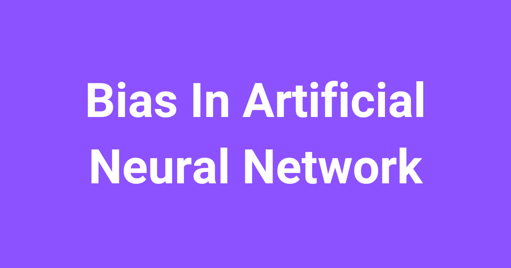
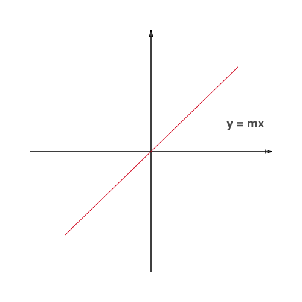
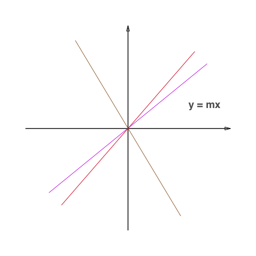
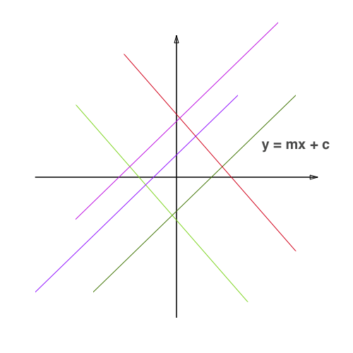

# What is Bias In Artificial Neural Network?

> **Module 2 · Lesson 2.2**  
> Source: [Outcome School](https://outcomeschool.com/blog/bias-in-artificial-neural-network) · Published: August 2, 2019 · Reading time: ~3 min · Tags: `ai`, `machine-learning`

---

Bias in an Artificial Neural Network is the constant `c` in the model `y = mx + c`. Without bias, the line must pass through the origin. With bias, the model can shift the line and fit the data better.

In this blog, we will learn what is Bias In Artificial Neural Network.

Let's get started.

**Understanding bias in simple words**

**Bias** is one of the important terminologies in [machine learning](https://outcomeschool.com/blog/machine-learning). Often we add bias while creating any model in the [artificial neural network](https://outcomeschool.com/blog/neural-network).

So, let's understand what is this mysterious bias.

In the neural network, we are given the input(`x`) and for that input, we need to predict the output(`y`). Here, we create a model(`mx + c`), which predicts the output.

While training, the model itself finds the appropriate value of the constants `m`and `c`.

Let's say we have the model as `y = mx` instead of the `y = mx + c`.

Here, the model is having constraint to train itself and find a line which passes only through the origin.

Many times for the given data, it is impossible for the algorithm to fit the model so that it passes through the origin.

Who doesn't need the freedom to perform well?

Let's give some freedom to the algorithm by changing the model as `mx + c` instead of `mx`, so that the model can find a line which fits the given data.

Now, it is having the full freedom to train itself and find a model that fits the best for the given data.

Here, the constant `c` is the **bias**.

**Bias** is a constant which helps the model in a way that it can fit best for the given data.

In other words, **Bias** is a constant which gives freedom to perform best. This is **Bias**.

## Frequently Asked Questions

### What happens if a neural network model has no bias?

Without bias, the model is `y = mx`, so it is forced to find a line that passes only through the origin. Many times, for the given data, it is impossible to fit such a line. Adding the bias gives the model the freedom to fit the data well.

### Who decides the value of the bias in a neural network?

The model itself decides it. While training, the model finds the appropriate values of the constants `m` and `c` on its own. Here, the constant `c` is the bias.

### Why is bias described as giving freedom to the model?

Bias removes the constraint that the line must pass through the origin. With the model `mx + c` instead of `mx`, the model has full freedom to train itself and find the line that fits best for the given data. So, bias is a constant that gives the model freedom to perform best.
