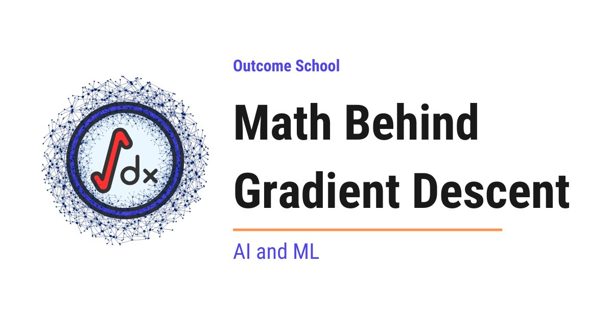

# How Does Gradient Descent Work?

> **Module 2 · Lesson 2.4**  
> Source: [Outcome School](https://outcomeschool.com/blog/math-behind-gradient-descent) · Published: April 17, 2026 · Reading time: ~13 min · Tags: `math`, `llm`, `ai`, `machine-learning`
> Video: [Epoch, Batch, Batch Size, Iteration](https://www.youtube.com/watch?v=NFLlXE-6vno)

---



Gradient Descent is the optimization algorithm used to train machine learning models. It reduces the loss by moving the model's weights, step by step, in the direction where the loss goes down the fastest.

In this blog, we will learn about the math behind gradient descent with a step-by-step numeric example.

Gradient descent is the most fundamental optimization algorithm used to train [machine learning](https://outcomeschool.com/blog/machine-learning) and deep learning models. Understanding the math behind it gives us a clear picture of how models actually learn. Do not worry, we will go through each concept step by step so that everything is easy to understand.

We will cover the following topics:

- What is a Loss Function?
- What is Gradient Descent?
- The Intuition Behind Gradient Descent
- The Math Behind Gradient Descent
- Step-by-Step Numeric Example
- Gradient Descent with Multiple Parameters
- The Role of Learning Rate
- Types of Gradient Descent
- Gradient Descent in Python

Let's get started.

## The Big Picture

Before we go into the details, let's understand the big picture.

A model learns by adjusting its weights so that its predictions become closer to the actual values. Gradient descent is the algorithm that tells the model how to adjust these weights. It keeps nudging the weights in the direction that reduces the error, step by step, until the error is as small as possible.

In simple words:

**Gradient Descent = A simple way to slide down the error curve step by step until we reach the lowest point.**

## What is a Loss Function?

Before we learn about gradient descent, we must first understand what a **loss function** is.

A **loss function** is a function that measures how far the model's prediction is from the actual value. In simple words, it tells us how wrong the model is.

Let's say we are building a model that predicts house prices. The actual price of a house is 60 and our model predicts 50. The error is 60 - 50 = 10. One common way to measure this error is to square it. So, the loss becomes (60 - 50)² = 100.

We square the error for two reasons. First, squaring makes all errors positive so that negative and positive errors do not cancel each other out. Second, squaring penalizes larger errors more than smaller ones.

When we have many examples, we average these squared errors across the dataset. This is called **Mean Squared Error (MSE)**, and it is one of the most common loss functions in machine learning.

**Our goal during training is to make this loss as small as possible.** And this is where gradient descent comes into the picture.

## What is Gradient Descent?

Let's break down the term: **Gradient Descent = Gradient + Descent**.

- **Gradient** means the slope or steepness of a surface in a particular direction.
- **Descent** means going downward.

So, **Gradient Descent** means going downward in the direction of the steepest slope.

In simple words, **gradient descent is an optimization algorithm that finds the values of weights that minimize the loss function.** It does this by repeatedly adjusting the weights in the direction that reduces the loss.

## The Intuition Behind Gradient Descent

The best way to learn this is by taking an example.

Suppose we are standing on a hill and it is completely foggy. We cannot see the bottom of the valley. The only thing we can feel is the slope of the ground under our feet. Our goal is to reach the bottom of the valley (the lowest point).

So, what would we do? We would feel the slope and take a step in the direction where the ground goes down. If the slope is steep, we take a bigger step. If the slope is gentle, we take a smaller step. We keep repeating this until the ground feels flat, which means we have reached the bottom.

This is exactly what gradient descent does. The hill is the loss function. The bottom of the valley is the minimum loss. The slope we feel is the gradient. And each step we take is a weight update.

## The Math Behind Gradient Descent

Now, let's understand the actual math behind gradient descent. We will keep it simple and go step by step.

### What is a Derivative?

A **derivative** tells us the rate of change of a function. In simple words, it tells us the slope of the function at a given point.

Let's say we are driving a car. The speedometer tells us how fast our position is changing with time. That speed is the derivative of our position with respect to time.

Similarly, in gradient descent, we need to know the slope of the loss function at the current weight value. The derivative tells us exactly that.

For a function `f(w)`, the derivative is written as below:

```
f'(w) = df(w)/dw
```

Here, `f'(w)` tells us how much the output of `f` changes when we change `w` by a tiny amount.

- If the derivative is **positive**, the function is going up (slope is upward).
- If the derivative is **negative**, the function is going down (slope is downward).
- If the derivative is **zero**, the function is flat (we are at a minimum or maximum).

### The Update Rule

Now that we know what the derivative (gradient) tells us, we can define how to update the weight. The update rule of gradient descent is as below:

```
w_new = w_old - α * f'(w_old)
```

Here:

- `w_old` is the current value of the weight
- `w_new` is the updated value of the weight
- `α` (alpha) is the **learning rate**, a small positive number that controls the step size
- `f'(w_old)` is the gradient (derivative) at the current weight

Now, the question is: why do we subtract the gradient?

Because we want to go downhill (reduce the loss). If the gradient is positive (slope going up), subtracting it moves us to the left (downhill). If the gradient is negative (slope going down), subtracting a negative number means adding, so we move to the right (also downhill). This way, no matter which side of the minimum we are on, we always move toward the minimum.

This is the beauty of the minus sign in the update rule.

## Step-by-Step Numeric Example

The best way to understand this is by taking a concrete example with actual numbers.

Let's say our loss function is:

```
f(w) = (w - 3)²
```

Here, the minimum of this function is at `w = 3` because `(3 - 3)² = 0`. But let's assume the model does not know this. It starts with an initial guess and uses gradient descent to find the minimum.

The derivative of `f(w) = (w - 3)²` is:

```
f'(w) = 2 * (w - 3)
```

Now, let's start with `w = 0` and a learning rate `α = 0.1`, and apply the update rule step by step.

| Step | w (before) | Gradient: 2(w - 3) | New w: w - 0.1 \* gradient |
| --- | --- | --- | --- |
| 1 | 0 | 2(0 - 3) = -6 | 0 - 0.1 \* (-6) = 0.6 |
| 2 | 0.6 | 2(0.6 - 3) = -4.8 | 0.6 - 0.1 \* (-4.8) = 1.08 |
| 3 | 1.08 | 2(1.08 - 3) = -3.84 | 1.08 - 0.1 \* (-3.84) = 1.464 |
| 4 | 1.464 | 2(1.464 - 3) = -3.072 | 1.464 - 0.1 \* (-3.072) = 1.7712 |
| 5 | 1.7712 | 2(1.7712 - 3) = -2.4576 | 1.7712 - 0.1 \* (-2.4576) = 2.0170 |

Here, we can see that `w` is getting closer and closer to 3 with each step. The gradient is also getting smaller with each step, which means the steps are getting smaller as we approach the minimum. This is exactly how gradient descent converges to the minimum.

## Gradient Descent with Multiple Parameters

In the example above, we had only one weight `w`. But in a real [neural network](https://outcomeschool.com/blog/neural-network), we have millions of weights. So, how does gradient descent handle multiple weights?

Let's say we have two weights `w1` and `w2`, and our loss function is `L(w1, w2)`. We need to find how the loss changes with respect to each weight separately. This is called a **partial derivative**.

Think of it this way. Suppose we are adjusting a TV. The TV has two knobs - one for volume and one for brightness. To understand the effect of each knob, we turn one knob at a time while keeping the other fixed. That is exactly what a partial derivative does.

The partial derivative of `L` with respect to `w1` is written as below:

```
∂L/∂w1
```

Here, the symbol `∂` is just a fancy way of writing "derivative with respect to one variable while keeping everything else fixed."

The **gradient** is the collection of all partial derivatives. For two weights, the gradient is:

```
gradient = [∂L/∂w1, ∂L/∂w2]
```

And the update rule for each weight becomes:

```
w1_new = w1_old - α * ∂L/∂w1
w2_new = w2_old - α * ∂L/∂w2
```

Each weight gets updated independently using its own partial derivative. This is how gradient descent scales to millions or even billions of parameters in a neural network.

## The Role of Learning Rate

The **learning rate** (`α`) controls how big each step is during gradient descent. Choosing the right learning rate is very important. Let's see what happens with different learning rates using our same function `f(w) = (w - 3)²` starting from `w = 0`.

**Learning rate too small (α = 0.01):**

```
Step 1: gradient = 2(0 - 3) = -6, new w = 0 - 0.01 * (-6) = 0.06
Step 2: gradient = 2(0.06 - 3) = -5.88, new w = 0.06 - 0.01 * (-5.88) = 0.1188
```

Here, we can see that `w` is barely moving. In fact, after 20 steps at `α = 0.01`, `w` is only around `0.997`, still nowhere near 3. Compare this with `α = 0.1`, which reached around 2.02 in just 4 steps. Training with a tiny learning rate will be extremely slow.

**Learning rate just right (α = 0.1):**

As we saw in our numeric example above, `w` moves steadily toward 3. This is the ideal case.

**Learning rate too large (α = 1.5):**

```
Step 1: gradient = 2(0 - 3) = -6, new w = 0 - 1.5 * (-6) = 9
Step 2: gradient = 2(9 - 3) = 12, new w = 9 - 1.5 * 12 = -9
```

Here, `w` jumped from 0 to 9 (overshooting past 3), and then from 9 to -9 (even farther away). The value is diverging instead of converging. This means the learning rate is too large and gradient descent will never find the minimum.

So, the learning rate must be chosen carefully. If it is too small, training is slow. If it is too large, training becomes unstable. In practice, values like 0.001 or 0.01 are commonly used as a starting point. For large models like Transformers, even smaller values like `1e-4` are common.

The same learning rate shows up when we take a pre-trained model and adapt it to our own data. We have a detailed blog on [How does fine-tuning work?](https://outcomeschool.com/blog/how-does-fine-tuning-work) that shows this update loop in action.

## Types of Gradient Descent

So far, we have worked with a simple function `f(w) = (w - 3)²` to learn the math. But in practice, the loss is computed over a training dataset. The dataset can be very large (millions of examples), and computing the gradient over all examples at once can be very slow. This is where different types of gradient descent come into the picture.

**Batch Gradient Descent:** This is what we have been discussing. It uses the entire training dataset to compute the gradient at each step. The gradient is accurate, but it is slow for large datasets.

**Stochastic Gradient Descent (SGD):** Instead of using the entire dataset, SGD uses only one randomly chosen data point to compute the gradient at each step. This makes each step much faster, but the gradient is noisy because it is based on just one example.

**Note:** In modern deep learning, the term "SGD" is often used loosely to mean mini-batch SGD. For example, `torch.optim.SGD` in PyTorch works with any batch size, not just one. The name stuck even though the batch size is usually greater than one in practice.

**Mini-Batch Gradient Descent:** This is the middle ground. It uses a small batch of data points (commonly 32, 64, or 128, and sometimes much larger for big models on modern GPUs) to compute the gradient. It is faster than batch gradient descent and less noisy than SGD.

Let me tabulate the differences for your better understanding:

| Type | Data Used Per Step | Speed | Gradient Accuracy |
| --- | --- | --- | --- |
| Batch Gradient Descent | Entire dataset | Slow | High |
| Stochastic Gradient Descent | 1 data point | Fast | Low (noisy) |
| Mini-Batch Gradient Descent | A batch (e.g., 32 to 1024) | Moderate | Moderate |

In practice, **mini-batch gradient descent** is the most commonly used approach because it provides a good balance between speed and accuracy.

## Gradient Descent in Python

Now, let's see gradient descent in action with Python code. We will use the same function `f(w) = (w - 3)²` as below:

```python
w = 0.0
learning_rate = 0.1
for step in range(50):
    gradient = 2 * (w - 3)
    w = w - learning_rate * gradient
    loss = (w - 3) ** 2
    print(f"Step {step + 1}: w = {w:.4f}, loss = {loss:.6f}")
```

Here, we start with `w = 0.0` and a learning rate of `0.1`. At each step, we compute the gradient, update the weight, and print the current value of `w` and the loss.

The final step prints:

```
Step 50: w = 3.0000, loss = 0.000000
```

After 50 steps, `w` is essentially 3 and the loss is essentially 0. The model has found the minimum.

This is how gradient descent works in code. In real deep learning frameworks like [PyTorch](https://outcomeschool.com/blog/how-does-pytorch-work) and TensorFlow, the same principle is applied but the gradients are computed automatically using backpropagation. We have a detailed blog on [Math Behind Backpropagation](https://outcomeschool.com/blog/math-behind-backpropagation) that explains how these gradients are actually computed step by step.

## Putting It All Together

Let's recap what we have learned:

- The **loss function** measures how wrong the model's prediction is.
- **Gradient descent** is the algorithm that minimizes the loss by adjusting the weights.
- The **gradient** (derivative) tells us the direction and steepness of the slope.
- The **update rule** `w_new = w_old - α * gradient` moves the weight toward the minimum.
- The **learning rate** controls how big each step is.
- In practice, **mini-batch gradient descent** is used for training large models.

This is how the math behind gradient descent works, and this is the foundation of how every neural network learns.

## Frequently Asked Questions

### Why do we subtract the gradient instead of adding it?

Because we want to go downhill and reduce the loss. If the gradient is positive, subtracting it moves the weight to the left, which is downhill. If the gradient is negative, subtracting it means adding, so the weight moves to the right, which is also downhill. Either way, we move toward the minimum.

### What learning rate should we start with?

In practice, values like 0.001 or 0.01 are commonly used as a starting point. For large models like Transformers, even smaller values like `1e-4` are common. If the learning rate is too small, training is slow, and if it is too large, training becomes unstable.

### Does SGD in PyTorch always use only one data point?

No. In modern deep learning, the term SGD is often used loosely to mean mini-batch SGD. For example, `torch.optim.SGD` in PyTorch works with any batch size, not just one. The name stuck even though the batch size is usually greater than one in practice.

### Why do we square the error in Mean Squared Error?

We square the error for two reasons. First, squaring makes all errors positive, so negative and positive errors do not cancel each other out. Second, squaring penalizes larger errors more than smaller ones.

### Do we compute gradients by hand in PyTorch and TensorFlow?

No. Frameworks like PyTorch and TensorFlow apply the same principle of gradient descent, but the gradients are computed automatically using backpropagation.
