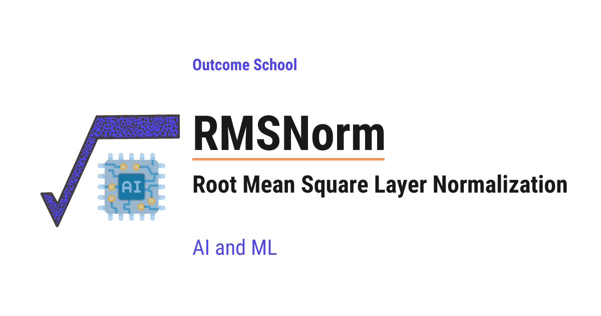

# What is RMSNorm? Root Mean Square Layer Normalization Explained

> **Module 2 · Lesson 2.9**  
> Source: [Outcome School](https://outcomeschool.com/blog/rmsnorm-root-mean-square-layer-normalization) · Published: April 25, 2026 · Reading time: ~12 min · Tags: `math`, `llm`, `ai`, `machine-learning`

---



RMSNorm (Root Mean Square Normalization) is a simpler and faster version of Layer Normalization that keeps only the re-scaling step and drops the re-centering step. It powers most modern Large Language Models.

In this blog, we will learn about RMSNorm, a faster and simpler alternative to [Layer Normalization](https://outcomeschool.com/blog/batch-normalization-vs-layer-normalization) that powers most modern Large Language Models like Llama, Mistral, Gemma, Qwen, PaLM, and DeepSeek.

Our goal is to decode RMSNorm so clearly that by the end, we will be able to explain how it works to anyone.

We will cover the following:

- Why normalization is needed in deep networks
- A quick recap of Layer Normalization (LayerNorm)
- What RMSNorm is and how it works
- The math behind RMSNorm with a concrete numeric example
- LayerNorm vs RMSNorm - the key differences
- Why modern LLMs prefer RMSNorm
- A code example
- Where RMSNorm fits in a Transformer
- Quick Summary

Let's get started.

## The Big Picture

Before we go into the details, let's understand the big picture.

[Neural networks](https://outcomeschool.com/blog/neural-network) like LLMs stack many layers on top of each other. As numbers flow through these layers, they can become very big or very small. This makes training slow and unstable.

To fix this, we scale the numbers at each layer to keep them in a healthy range. This scaling step is called **normalization**.

In simple words:

**RMSNorm = A simpler and faster way to normalize numbers inside a neural network.**

Instead of centering and scaling the numbers (like LayerNorm does), RMSNorm just scales them using their **root mean square** value. Same stabilizing effect, less work.

## Why Do We Need Normalization?

Let's say we have a deep neural network with 100 layers. At each layer, numbers get multiplied by weights, added together, and passed through activation functions.

Here is the problem. After many layers, these numbers can:

- Become very **large** - during training, this causes the **exploding gradient problem**
- Become very **small** - during training, this causes the **vanishing gradient problem**

When this happens, the network becomes unstable. Training slows down. Sometimes it does not learn at all.

So, here comes **normalization** to the rescue. Normalization keeps the numbers at each layer in a stable, healthy range - not too big, not too small. This makes training faster and more stable.

## A Quick Recap of Layer Normalization

Before jumping into RMSNorm, we must quickly recall how **Layer Normalization (LayerNorm)** works, because RMSNorm is a simplification of it.

LayerNorm takes a vector of numbers and does two things:

**Step 1: Re-center.** Subtract the mean so the numbers are centered around zero.

**Step 2: Re-scale.** Divide by the standard deviation so the numbers have a consistent spread.

Then it applies two learned parameters - `gamma` and `beta` - to allow the network to adjust the output if needed.

The formula is:

```
LayerNorm(x) = gamma * (x - mean) / sqrt(variance + eps) + beta
```

Here:

- `mean` is the average of the values in the vector
- `variance` is how spread out the values are
- `eps` is a tiny number to avoid division by zero
- `gamma` and `beta` are learned parameters

LayerNorm works very well. It was used in the original Transformer paper. But there is one question researchers asked:

> Do we really need both steps, re-centering and re-scaling? Or is one of them enough?

This question led to RMSNorm.

## What Is RMSNorm?

**RMSNorm (Root Mean Square Normalization)** is a simpler version of LayerNorm that keeps only the re-scaling step and drops the re-centering step.

In simple words:

**RMSNorm = LayerNorm with only the re-scaling step.**

It was introduced in 2019 by Biao Zhang and Rico Sennrich in their paper "Root Mean Square Layer Normalization".

The key insight was this:

> Most of the benefit of LayerNorm comes from the re-scaling step, not from the re-centering step.

So, if we skip the mean subtraction, we save computation without losing accuracy.

Here is a mental model that sticks:

**LayerNorm controls both *shift* and *scale*. RMSNorm controls only *scale* - and that turns out to be enough.**

Now, a natural question arises - if we do not re-center the values, how does the network handle mean shifts? The answer is that Transformers have residual connections and learned projections all over the place. These can absorb mean shifts on their own. So the network does not need normalization to do that job for it. The scale is the part that really needs a dedicated fix, which is why RMSNorm is enough in practice.

Let's see exactly how it works.

## The Math Behind RMSNorm

RMSNorm uses the **Root Mean Square (RMS)** of the input vector to scale the values.

We do three things, in order:

**Step 1:** Square each value in the vector.

**Step 2:** Take the mean (average) of those squared values.

**Step 3:** Take the square root of that mean.

That is it. The result is the RMS value.

Intuitively, the RMS value tells us the **typical magnitude** of the numbers in the vector. A vector like `[100, 200, 300]` has a large RMS. A vector like `[0.01, 0.02, 0.03]` has a tiny RMS. By dividing each value by the RMS, we strip away the overall size and keep only the relative shape. That is exactly what we want from normalization.

The formula is:

```
RMS(x) = sqrt( (x1^2 + x2^2 + ... + xn^2) / n )
```

Where `n` is the number of values in the vector.

Once we have the RMS, the RMSNorm formula is:

```
RMSNorm(x) = gamma * x / RMS(x)
```

Here:

- `x` is the input vector
- `RMS(x)` is the root mean square of the vector
- `gamma` is a learned parameter (one per dimension)

Why do we need `gamma` at all? Because dividing by the RMS forces every vector to a fixed magnitude, which is too restrictive. `gamma` gives the network a knob to stretch or shrink each dimension back to whatever scale is actually useful for the task. So normalization stabilizes training, and `gamma` makes sure we do not lose expressiveness along the way.

In practice, we add a tiny number `eps` inside the square root to avoid division by zero:

```
RMSNorm(x) = gamma * x / sqrt( mean(x^2) + eps )
```

Notice there is no `beta` in RMSNorm. We do not need to shift the output because we never subtracted the mean in the first place.

## Let's Put This Into Perspective With Real Numbers

Learning by example is the best way to learn.

Let's say we have an input vector with 4 values:

```
x = [2, 4, 4, 8]
```

**Step 1: Square each value.**

```
[2^2, 4^2, 4^2, 8^2] = [4, 16, 16, 64]
```

**Step 2: Take the mean of the squares.**

```
mean = (4 + 16 + 16 + 64) / 4 = 100 / 4 = 25
```

**Step 3: Take the square root.**

```
RMS(x) = sqrt(25) = 5
```

**Step 4: Divide each input value by the RMS.**

```
x / RMS(x) = [2/5, 4/5, 4/5, 8/5] = [0.4, 0.8, 0.8, 1.6]
```

**Step 5: Multiply by gamma.** For the sake of understanding, let's assume gamma is `[1, 1, 1, 1]`.

```
RMSNorm(x) = [0.4, 0.8, 0.8, 1.6]
```

The numbers are now scaled to a healthy range. That is all RMSNorm does.

## LayerNorm vs RMSNorm - The Key Differences

Let me tabulate the differences between LayerNorm and RMSNorm for your better understanding.

| LayerNorm | RMSNorm |
| --- | --- |
| Re-centers (subtracts mean) and re-scales (divides by std) | Only re-scales (divides by RMS) |
| Has two learned parameters: `gamma` and `beta` | Has one learned parameter: `gamma` |
| Slower - computes both mean and variance | Faster - only computes the RMS |
| Used in the original Transformer, BERT, GPT-2 | Used in Llama, Mistral, Gemma, Qwen, PaLM, DeepSeek |

To see the difference visually, here are the two pipelines side by side:

```
LayerNorm:
  x  -->  [ subtract mean ]  -->  [ divide by std ]  -->  [ * gamma + beta ]  -->  output
RMSNorm:
  x  -->  [    skipped     ]  -->  [ divide by RMS ]  -->  [    * gamma     ]  -->  output
              ^^^^^^^                                            ^^^^^^^
        re-centering step                                     no beta,
            removed                                        one parameter
```

Here, we can see that RMSNorm drops the mean subtraction step completely and also drops the `beta` parameter. Everything else follows the same idea as LayerNorm.

## Why Modern LLMs Prefer RMSNorm

Now, a natural question arises - why do most modern LLMs use RMSNorm instead of LayerNorm?

The answer comes down to three reasons.

**Reason 1: Speed.** RMSNorm does less math than LayerNorm. It skips the mean subtraction and the variance calculation. On a small vector, this may not look like much. But LLMs have billions of parameters, trillions of tokens, and dozens to hundreds of normalization calls per forward pass (two per Transformer block, stacked across many blocks). A small saving per call adds up to a big saving overall. The original paper reported training time reductions of 7% to 64% depending on the model and task. Training becomes faster. Inference becomes faster.

**Reason 2: Broadly the same accuracy.** The original RMSNorm paper showed that models trained with RMSNorm reach the same accuracy as models trained with LayerNorm - sometimes slightly better, sometimes slightly worse, but broadly the same. We get the speed benefit without losing quality.

**Reason 3: Simpler implementation.** RMSNorm has fewer moving parts than LayerNorm. It is easier to implement and easier to reason about. With one less parameter (`beta`) and one less statistic to compute (the mean), the kernel is cleaner and easier to fuse efficiently on GPUs. This simplicity matters when we are training at the scale of trillions of tokens across thousands of GPUs.

This is why the modern LLM stack has almost completely switched to RMSNorm.

## A Code Example

Let's see the code for RMSNorm as below:

```python
import torch
import torch.nn as nn
class RMSNorm(nn.Module):
    def __init__(self, dim, eps=1e-6):
        super().__init__()
        self.eps = eps
        self.gamma = nn.Parameter(torch.ones(dim))
    def forward(self, x):
        # Square each value and take the mean along the last dimension
        mean_square = x.pow(2).mean(dim=-1, keepdim=True)
        # Take the square root to get RMS (eps added for stability)
        rms = torch.sqrt(mean_square + self.eps)
        # Scale the input: divide by RMS and multiply by gamma
        return self.gamma * x / rms
```

Here, we can see that:

- We only have one learned parameter - `gamma`. There is no `beta`.
- We compute the mean of the squared values along the last dimension.
- We take the square root of that mean to get the RMS.
- We divide the input by the RMS and multiply by `gamma`.

That is the entire implementation. It is very simple.

## Where RMSNorm Fits in a Transformer

In a modern LLM like Llama, RMSNorm is applied at two places inside each Transformer block:

- Before the attention block
- Before the [feed-forward block](https://outcomeschool.com/blog/feed-forward-networks-in-llms)

This style is called **pre-norm**, which means we normalize the input first, then pass it through the attention or feed-forward layer. Pre-norm helps training stability in very deep networks, which is why almost all modern LLMs use it.

Here is how one Transformer block looks with pre-norm RMSNorm:

```
              input x
                 |
      +----------+              <- residual path
      |          v
      |      [ RMSNorm ]
      |          |
      |          v
      |      [ Attention ]
      |          |
      +--------> (+)
                 |
      +----------+              <- residual path
      |          v
      |      [ RMSNorm ]
      |          |
      |          v
      |       [ FFN ]
      |          |
      +--------> (+)
                 |
                 v
              output
```

Here, we can see that each RMSNorm sits **before** the heavy layer (Attention or FFN), not after. The residual path skips around the whole block so the original input can flow through untouched.

One additional RMSNorm is also applied at the very end of the model, right before the final output projection. This last normalization keeps the hidden state in a stable range before it gets projected into logits.

We have a detailed blog on [Transformer Architecture](https://outcomeschool.com/blog/decoding-transformer-architecture) that explains where normalization fits in the overall flow.

## Quick Summary

Let's recap what we have learned:

- **Normalization** keeps the numbers flowing through a deep network in a healthy range, which makes training faster and more stable.
- **LayerNorm** does two things - it re-centers the values (subtracts the mean) and re-scales them (divides by standard deviation).
- **RMSNorm** keeps only the re-scaling step. It divides the input by its Root Mean Square value.
- **Root Mean Square** is exactly what the name says - the square root of the mean of the squares.
- **RMSNorm is faster than LayerNorm** because it skips the mean subtraction and the variance calculation.
- **Accuracy is broadly the same.** The original paper showed RMSNorm matches LayerNorm on quality - sometimes slightly better, sometimes slightly worse. We get the speed benefit essentially for free.
- **Modern LLMs like Llama, Mistral, Gemma, Qwen, PaLM, and DeepSeek** all use RMSNorm.
- **Only one learned parameter** - `gamma`. It has one value per dimension of the vector. There is no `beta` in RMSNorm.

We have learnt how RMSNorm works, why it is faster than LayerNorm, and why most modern LLMs have adopted it.

## Frequently Asked Questions

### Is RMSNorm less accurate than LayerNorm?

No. The original RMSNorm paper showed that models trained with RMSNorm reach broadly the same accuracy as models trained with LayerNorm, sometimes slightly better and sometimes slightly worse. So we get the speed benefit without losing quality.

### How does a Transformer handle mean shifts if RMSNorm does not re-center?

Transformers have residual connections and learned projections all over the place, and these can absorb mean shifts on their own. So the network does not need normalization to do that job. The scale is the part that really needs a dedicated fix, which is why RMSNorm is enough in practice.

### Why does RMSNorm not have a beta parameter?

RMSNorm does not need `beta` because it never subtracts the mean in the first place, so there is nothing to shift back. It keeps only one learned parameter, `gamma`, with one value per dimension. This lets the network stretch or shrink each dimension to a useful scale.

### What is eps used for in RMSNorm?

The `eps` value is a tiny number added inside the square root to avoid division by zero. So the formula in practice becomes `gamma * x / sqrt(mean(x^2) + eps)`. In the code example, `eps` defaults to `1e-6`.

### Who introduced RMSNorm?

RMSNorm was introduced in 2019 by Biao Zhang and Rico Sennrich in their paper "Root Mean Square Layer Normalization". Their key insight was that most of the benefit of LayerNorm comes from the re-scaling step, not from the re-centering step.
