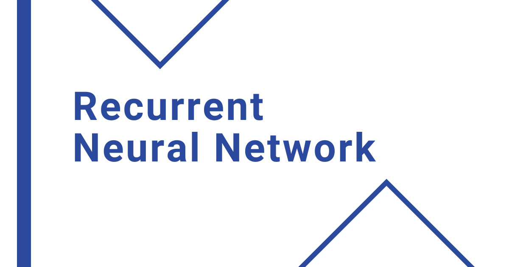
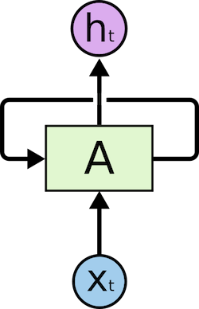
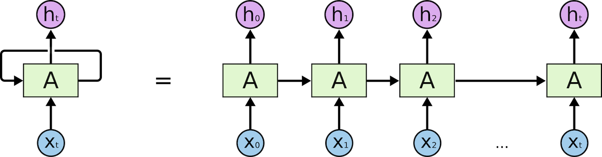

# What is a Recurrent Neural Network (RNN)?

> **Module 2 · Lesson 2.10**  
> Source: [Outcome School](https://outcomeschool.com/blog/recurrent-neural-network) · Published: August 2, 2019 · Reading time: ~4 min · Tags: `ai`, `machine-learning`

---

A Recurrent Neural Network (RNN) is a type of neural network that remembers the context from the earlier inputs in a sequence, and uses that context to predict the right output. That is why it works well for sequences like text.

In this blog, we will learn about the Recurrent Neural Network.

Let's get started.

## What is Recurrent Neural Network (RNN)?

As per Wikipedia, a recurrent neural network (RNN) is a class of [artificial neural network](https://outcomeschool.com/blog/neural-network) where connections between units form a directed graph along a sequence. This allows it to exhibit dynamic temporal behavior for a time sequence. Unlike feedforward neural networks, RNNs can use their internal state (memory) to process sequences of inputs. This makes them applicable to tasks such as unsegmented, connected handwriting recognition or speech recognition.

Recurrent Neural Network comes into the picture when any model needs context to be able to provide the output based on the input.

Sometimes the context is the single most important thing for the model to predict the most appropriate output.

Let's understand this by an analogy. Suppose you are watching a movie, you keep watching the movie as at any point in time, you have the context because you have seen the movie until that point, then only you are able to relate everything correctly. It means that you remember everything that you have watched.

Similarly, RNN remembers everything. In other neural networks, all the inputs are independent of each other. But in RNN, all the inputs are related to each other. Let's say you have to predict the next word in a given sentence, in that case, the relation among all the previous words helps in predicting the better output. The RNN remembers all these relations while training itself.

In order to achieve it, the RNN creates the networks with loops in them, which allows it to persist the information.

Image Source: colah's blog

This loop structure allows the neural network to take the sequence of input. If you see the unrolled version, you will understand it better.

Image Source: colah's blog

As you can see in the unrolled version. First, it takes the x(0) from the sequence of input and then it outputs h(0) which together with x(1) is the input for the next step. So, the h(0) and x(1) is the input for the next step. Similarly, h(1) from the next is the input with x(2) for the next step and so on. This way, it keeps remembering the context while training.

This way the RNN works.RNN helps wherever we need the context from the previous input.

**The following are the few applications of the RNN:**

- Next word prediction.
- Music composition.
- Image captioning
- Speech recognition
- Time series anomaly detection
- Stock market prediction

Now a days, RNN has become very popular as it helps in solving many real-life problems which the industries are facing.

We have a blog on [how RNNs and Transformers differ](https://outcomeschool.com/blog/how-do-rnns-and-transformers-differ) that explains why most modern language models use the Transformer instead, and another on the [Evolution of LLM Architecture](https://outcomeschool.com/blog/evolution-of-llm-architecture) that covers the full journey from RNN to today's LLMs.

## Frequently Asked Questions

### How is an RNN different from a feedforward neural network?

Unlike feedforward neural networks, RNNs can use their internal state, which is their memory, to process sequences of inputs. In other neural networks, all the inputs are independent of each other. In an RNN, all the inputs are related to each other, so the model keeps the context from previous inputs.

### Why does an RNN have loops in it?

The loops allow the network to persist information. At each step, the output from the previous step is fed in together with the next input. This way, the RNN keeps remembering the context while it processes the sequence.

### What tasks are RNNs used for?

RNNs help wherever we need the context from the previous input. Common applications include next word prediction, music composition, image captioning, speech recognition, time series anomaly detection, and stock market prediction.

### Do modern language models use RNNs?

Mostly no. Most modern language models use the Transformer instead of the RNN. The RNN is where the journey to today's LLM architectures started.
