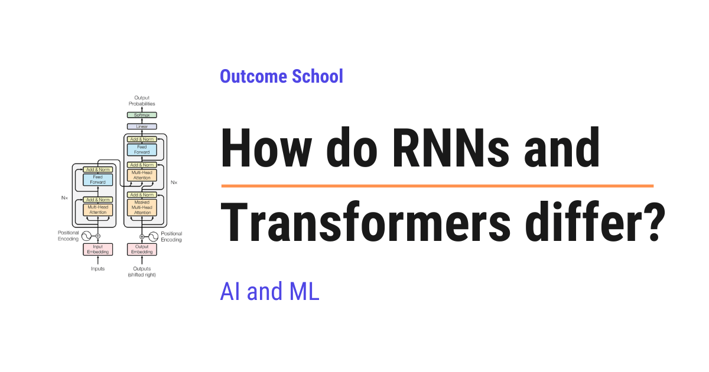

# How do RNNs and Transformers differ?

> **Module 3 · Lesson 3.6**  
> Source: [Outcome School](https://outcomeschool.com/blog/how-do-rnns-and-transformers-differ) · Published: August 27, 2026 · Reading time: ~7 min · Tags: `llm`, `ai`, `machine-learning`

---



An RNN reads a sequence one word at a time, carrying a memory of what it has seen so far, whereas a Transformer reads the whole sequence at once and uses attention, so that every word can look directly at every other word.

In this blog, we will learn about how RNNs and Transformers differ. These are the two main ways a computer reads a sequence like a sentence, and we will learn why one of them reads word by word, why the other reads everything at once, and when to use which one.

We will cover the following:

- What both of them are for
- What is an RNN?
- The problem with an RNN
- What is a Transformer?
- The key difference in one line
- RNN vs Transformer side by side
- Let's tabulate the difference
- When to use which one?
- Summary

Let's get started.

## What both of them are for

Both [RNNs](https://outcomeschool.com/blog/recurrent-neural-network) and [Transformers](https://outcomeschool.com/blog/decoding-transformer-architecture) are built to handle sequences. A sequence is data that comes in order, like the words in a sentence or the values in a time series.

The goal for both is the same: read a sequence and understand it. But they do it in two very different ways. Let's understand each one.

## What is an RNN?

**An RNN, or Recurrent Neural Network, reads a sequence one step at a time, carrying a memory of what it has seen so far.**

In simple words, it reads word by word, left to right. At each step, it combines the current word with a memory called the hidden state. Then it passes the updated memory to the next step.

```
   word 1  ->  word 2  ->  word 3  ->  word 4
     |           |           |           |
   memory  ->  memory  ->  memory  ->  memory
   (each step passes its memory to the next)
```

Here, we can see that an RNN works in order, one step after another. Each step must wait for the previous step to finish, because it needs that memory.

## The problem with an RNN

But, here is the catch. The step-by-step style causes two problems.

- **It is slow.** Because each step waits for the one before it, an RNN cannot process the whole sequence at once. This makes training slow.
- **It forgets long-range information.** By the time the RNN reaches the end of a long sentence, the memory of the early words has faded. So it struggles to connect words that are far apart.

```
   "The cat, which we found last summer near the old house, was ___"
   By the time the RNN reaches the blank, the memory of "cat"
   has faded, so it may struggle to fill it correctly.
```

Here, we can see the weakness. Long-range links are hard for an RNN. We needed a better solution, and [the Transformer was introduced to solve this](https://outcomeschool.com/blog/evolution-of-llm-architecture).

## What is a Transformer?

Now that we have learned about RNNs, it's time to learn about Transformers.

**A Transformer reads the whole sequence at once and uses attention, which lets every word look directly at every other word.**

In simple words, it does not go step by step. It looks at all the words together. Through a mechanism called **[attention](https://outcomeschool.com/blog/self-attention-in-transformers)**, each word can directly focus on any other word, no matter how far away it is.

```
   All words are seen together:
   The   cat   was   on   the   mat
    \_____\_____\____/____/_____/
        every word can look directly
        at every other word (attention)
```

Here, we can see the big change. Because a Transformer sees all words at once, it can process them in parallel, which makes training fast. And because every word can look directly at every other word, long-range links are easy. The word at the end can look straight back at the word at the start.

We have a detailed blog on [Encoder vs Decoder in Transformers](https://outcomeschool.com/blog/encoder-vs-decoder-in-transformers) that explains how the two parts of a Transformer work.

## The key difference in one line

> An RNN reads a sequence step by step with a fading memory. A Transformer reads it all at once, and every word can look directly at every other word.

## RNN vs Transformer side by side

Let's place both next to each other so that the difference becomes very clear.

```
        RNN                                 TRANSFORMER
   read one step at a time             read all words at once
   w1 -> w2 -> w3 -> w4                 w1  w2  w3  w4  (together)
   memory passed along                 attention connects all
   sequential, so slower               parallel, so faster
   long-range links fade               long-range links stay strong
```

## Let's tabulate the difference

Let me tabulate the differences between RNNs and Transformers for your better understanding.

| Point | RNN | Transformer |
| --- | --- | --- |
| How it reads | One step at a time | All words at once |
| Speed of training | Slow, steps wait for each other | Fast, done in parallel |
| Long-range links | Fade over distance | Stay strong through attention |
| Memory of the past | A single hidden state that fades | Direct attention to any word |
| Cost on long sequences | Grows gently with length | Grows quickly, since every word looks at every word |
| Main use today | Small or streaming tasks | Most modern language and vision models |

## When to use which one?

This is the real question. Let's make it very simple.

- Use a **Transformer** for most modern tasks, especially language. Transformers power today's large language models, because they train fast and handle long-range links well.
- Use an **RNN** for smaller tasks, or when data arrives one piece at a time in a stream, or on tiny devices where a Transformer would be too heavy. An RNN can also be lighter on very long sequences, where the Transformer's all-to-all attention becomes expensive.

We have a blog on [Flash Attention in LLMs](https://outcomeschool.com/blog/decoding-flash-attention) that explains how this attention cost is brought down on modern hardware, and another on [Sliding Window Attention](https://outcomeschool.com/blog/how-does-sliding-window-attention-work) that explains how the cost is cut by letting every word look only at its neighbors.

## Summary

Let's quickly recap what we have learned.

- Both RNNs and Transformers handle sequences, but in very different ways.
- An RNN reads step by step and carries a memory, which is slow and forgets long-range information.
- A Transformer reads all words at once and uses attention, so every word can look at every other word.
- This makes Transformers fast to train and strong at long-range links, which is why they dominate today.
- RNNs still help on smaller tasks, streaming data, and tiny devices.

This is how RNNs and Transformers differ, and why Transformers power most modern models.

## Frequently Asked Questions

### Are RNNs obsolete now that we have Transformers?

No. RNNs still help on smaller tasks, when data arrives one piece at a time in a stream, and on tiny devices where a Transformer would be too heavy. An RNN can also be lighter on very long sequences, where the Transformer's all-to-all attention becomes expensive.

### Is a Transformer always cheaper to run than an RNN?

No. On long sequences, the cost of a Transformer grows quickly, since every word looks at every other word. The cost of an RNN grows gently with length. Techniques like Flash Attention and Sliding Window Attention are used to bring this attention cost down.

### Why do Transformers train faster than RNNs?

Transformers train faster because they read all the words at once and process them in parallel. An RNN reads one step at a time, and each step must wait for the previous step to finish because it needs that memory. This sequential style makes RNN training slow.

### Why do large language models use Transformers instead of RNNs?

Large language models use Transformers because they train fast and handle long-range links well. In an RNN, the memory of early words fades by the end of a long sentence. In a Transformer, attention lets the word at the end look straight back at the word at the start.
