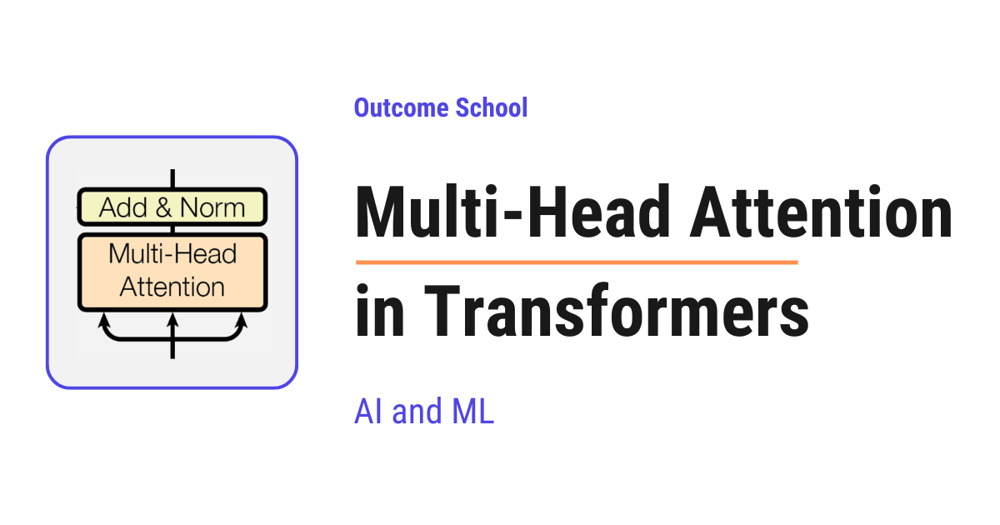

# What is Multi-Head Attention in Transformers and How Does It Work?

> **Module 3 · Lesson 3.13**  
> Source: [Outcome School](https://outcomeschool.com/blog/multi-head-attention-in-transformers) · Published: May 31, 2026 · Reading time: ~13 min · Tags: `llm`, `ai`, `machine-learning`

---



Multi-Head Attention is a mechanism that runs many Self Attention operations in parallel and then combines their outputs. In simple words, the model looks at the sentence with many pairs of eyes, and each pair focuses on a different aspect.

In this blog, we will learn about Multi-Head Attention in Transformers. We will understand what it is, how it works step by step, and why it gives Transformers their power to understand language so well.

We will cover the following:

- What is Multi-Head Attention?
- A quick recap of Self Attention
- Why do we need Multi-Head Attention?
- Step-by-step working of Multi-Head Attention
- A simple example walk-through
- Where Multi-Head Attention is used
- Advantages of Multi-Head Attention

Let's get started.

### What is Multi-Head Attention?

**Multi-Head Attention is a mechanism that runs many Self Attention operations in parallel, each with its own set of Q, K, and V projections, and then combines their outputs into a single richer representation.**

In simple words, **Multi-Head Attention = Multi + Head + Attention**. The word "Head" means one independent Self Attention. The word "Multi" means we run many such heads in parallel. The word "Attention" means each head decides how much to focus on every other token.

So, instead of looking at the sentence with one pair of eyes, the model looks at the sentence with many pairs of eyes at the same time, and each pair of eyes focuses on a different aspect of the sentence.

For the sake of understanding, let's take an analogy.

Suppose we are reading a sentence and we want to fully understand it. One person reads the sentence and focuses on who is doing the action. Another person reads the same sentence and focuses on where the action is happening. Another person focuses on why the action is happening. At the end, we collect the notes from every person and combine them into one final understanding of the sentence.

That is exactly what Multi-Head Attention does. Each head is one expert reader, and the final answer is the combination of all the experts.

Multi-Head Attention was introduced in the famous paper "Attention Is All You Need" in 2017, the paper that gave us the [Transformer](https://outcomeschool.com/blog/decoding-transformer-architecture).

We have a detailed blog on the [Evolution of LLM Architecture](https://outcomeschool.com/blog/evolution-of-llm-architecture) that explains what came before this paper and what came after it.

### A quick recap of Self Attention

Before jumping into Multi-Head Attention, we must know what [Self Attention](https://outcomeschool.com/blog/self-attention-in-transformers) is.

In Self Attention, every token in a sentence looks at every other token in the same sentence to understand its meaning in context.

Self Attention uses three vectors for every token:

- **Query (Q):** what this token is looking for.
- **Key (K):** what this token offers to others.
- **Value (V):** the actual information this token carries.

All three, `Q`, `K`, and `V`, come from the same input sequence. That is why it is called Self Attention.

We have a detailed blog on the [Math behind Attention - Q, K, and V](https://outcomeschool.com/blog/math-behind-attention-qkv) that explains how these three vectors are created.

The Self Attention formula is:

**Attention(Q, K, V) = softmax((Q . K^T) / sqrt(d\_k)) . V**

Here, we have done the following:

- Multiply `Q` and `K^T` to find how much each token relates to every other token.
- Divide by [`sqrt(d_k)`](https://outcomeschool.com/blog/scaling-dot-product-attention) to keep the numbers stable.
- Apply `softmax` to turn the scores into probabilities.
- Multiply by `V` to get a weighted sum of values.

This is how Self Attention works for a single set of `Q`, `K`, and `V`. We call this a **single attention head**.

This was all about Self Attention. Now, it's time to learn about Multi-Head Attention.

### Why do we need Multi-Head Attention?

The best way to learn this is by taking an example.

Consider the sentence:

> I love AI

This is a short sentence, but there are many different relationships hidden in it.

- `I` is the subject of the sentence.
- `love` is the action.
- `AI` is the object that the subject loves.
- `I` and `love` form a subject-verb relationship.
- `love` and `AI` form a verb-object relationship.
- `I` and `AI` are connected through the meaning of `love`.

Now, the question is: can a single attention head learn all of these relationships at the same time?

The answer is no. A single Self Attention head can only learn one type of relationship at a time. If one head is busy learning the subject-verb link, it cannot also learn the verb-object link with the same focus.

So, here comes Multi-Head Attention into the picture.

With multiple heads, each head can focus on a different type of relationship. One head can learn the subject-verb link. Another head can learn the verb-object link. Another head can learn the long-range link between the subject and the object. And so on.

This way, the model gets a much richer understanding of the same sentence.

### Step-by-step working of Multi-Head Attention

Now, it's time to learn the exact steps of Multi-Head Attention.

Assume that we have an input sequence with `d_model = 512` and we want to use `h = 8` heads.

Here, `d_model` is the size of the vector that represents each token. In simple words, every token in the sentence is converted into a list of numbers, and `d_model = 512` means each token is represented by 512 numbers. The bigger this number, the more information each token can carry.

**Step 1:** We start with the input embeddings. Every token in the sentence is converted into a vector of size `d_model`.

**Step 2:** We split the work across heads. We divide `d_model` by the number of heads. So, each head works with a smaller dimension.

- d\_k = d\_model / h = 512 / 8 = 64

Each head gets a dimension of 64 for its `Q`, `K`, and `V`.

**Step 3:** For every head, we use its own learned linear projections to create the `Q`, `K`, and `V` vectors.

- Q\_i = Input x W\_i\_Q
- K\_i = Input x W\_i\_K
- V\_i = Input x W\_i\_V

Here, `W_i_Q`, `W_i_K`, and `W_i_V` are the weight matrices for head `i` that the model learns during training.

**Note:** Every head has its own set of weight matrices. This is what allows different heads to learn different patterns.

We can visualize how each head creates its own `Q`, `K`, and `V` as below:

```
                  Input token embedding
                     (d_model = 512)
                           |
       +-------------------+-------------------+
       |                   |                   |
   own W_Q, W_K, W_V   own W_Q, W_K, W_V   own W_Q, W_K, W_V
       |                   |        ...        |
       ↓                   ↓                   ↓
    Q1  K1  V1          Q2  K2  V2          Q8  K8  V8
    (each 64)           (each 64)           (each 64)
      Head 1              Head 2              Head 8
```

Here, we can see that the same input embedding of size 512 goes into every head, but each head uses its own weight matrices to create its own smaller `Q`, `K`, and `V` vectors of size 64.

**Step 4:** Each head now runs Self Attention independently using its own `Q_i`, `K_i`, and `V_i`.

- head\_i = Attention(Q\_i, K\_i, V\_i) = softmax((Q\_i . K\_i^T) / sqrt(d\_k)) . V\_i

All 8 heads do this in parallel.

**Step 5:** We concatenate the output of all heads side by side.

- Concat(head\_1, head\_2, ..., head\_8)

After concatenation, we get a vector of size `h x d_k = 8 x 64 = 512`, which is the same as `d_model`. So, the output dimension matches the input dimension.

**Step 6:** We pass the concatenated output through one more learned linear layer to mix the information from all heads.

- MultiHead(Q, K, V) = Concat(head\_1, ..., head\_8) . W\_O

Here, `W_O` is a learned weight matrix.

This is the final output of Multi-Head Attention.

Here, we can visualize the full flow of Multi-Head Attention as below:

```
                  Input Embeddings (512)
                              |
        +---------+-----------+-----------+----------+
        |         |                       |          |
        ↓         ↓           ...         ↓          ↓
      Head 1    Head 2                  Head N-1   Head N
   (each head creates its own Q, K, V of size 64)
        |         |                       |          |
        ↓         ↓                       ↓          ↓
     Output 1  Output 2       ...      Output N-1 Output N
       (64)      (64)                    (64)       (64)
        |         |                       |          |
        +---------+-----------+-----------+----------+
                              |
                              ↓
                     Concatenate -> (512)
                              |
                              ↓
                Linear Layer W_O (512 -> 512)
                              |
                              ↓
                     Final Output (512)
```

Here, we can see that every head runs Self Attention in parallel with its own `W_Q`, `W_K`, and `W_V`. Their outputs are joined together and passed through one more linear layer to produce the final output.

So, **Multi-Head Attention = many Self Attentions running in parallel + one final mixing step**.

### A simple example walk-through

Let's take a small example to make this concrete.

Consider the same sentence:

> I love AI

We have three tokens: `I`, `love`, `AI`.

Just for the sake of understanding, let's say we are using only 2 heads instead of 8. The idea remains exactly the same.

**Step 1:** Every token is converted into an embedding vector.

**Step 2:** We split the work across 2 heads. Each head gets its own smaller dimension.

**Step 3:** For each head, we create its own `Q`, `K`, and `V` using its own learned weight matrices. So now, we have:

- Head 1: Q1, K1, V1 for all three tokens
- Head 2: Q2, K2, V2 for all three tokens

**Step 4:** Each head runs Self Attention independently. Each head produces its own attention weight matrix.

Just for the sake of understanding, let's say **Head 1** focuses on the subject-verb relationship. Its attention weights look like below:

```
Head 1 (subject-verb focus)
                  Attends to
                 I     love    AI
            +-------+-------+-------+
         I  | 0.100 | 0.800 | 0.100 |
            +-------+-------+-------+
From   love | 0.700 | 0.200 | 0.100 |
            +-------+-------+-------+
         AI | 0.300 | 0.400 | 0.300 |
            +-------+-------+-------+
```

Here, the token `I` is paying strong attention to `love`, and the token `love` is paying strong attention to `I`. This head has learned the subject-verb link.

Now, let's say **Head 2** focuses on the verb-object relationship. Its attention weights look like below:

```
Head 2 (verb-object focus)
                  Attends to
                 I     love    AI
            +-------+-------+-------+
         I  | 0.300 | 0.400 | 0.300 |
            +-------+-------+-------+
From   love | 0.100 | 0.200 | 0.700 |
            +-------+-------+-------+
         AI | 0.100 | 0.800 | 0.100 |
            +-------+-------+-------+
```

Here, the token `love` is paying strong attention to `AI`, and the token `AI` is paying strong attention to `love`. This head has learned the verb-object link.

The numbers are just for the sake of understanding. Each row sums to 1 because of softmax.

Notice the key point. The same sentence "I love AI" produced two different attention patterns from two different heads. Head 1 saw the subject-verb structure. Head 2 saw the verb-object structure. Both views are correct, and both are useful.

**Step 5:** Each head produces its own output for every token. For the token `love`, Head 1 produces an output that is heavily influenced by `I`, and Head 2 produces an output that is heavily influenced by `AI`.

- Head 1 output for `love` = 0.700 x V1(`I`) + 0.200 x V1(`love`) + 0.100 x V1(`AI`)
- Head 2 output for `love` = 0.100 x V2(`I`) + 0.200 x V2(`love`) + 0.700 x V2(`AI`)

**Step 6:** We concatenate the outputs of both heads and pass them through the final linear layer `W_O`.

- Final output for `love` = Concat(Head 1 output, Head 2 output) . W\_O

This final output is the new representation of `love` that carries both the subject-verb context and the verb-object context at the same time.

**Very important:** we do not tell the heads what to focus on. Every head learns its own focus pattern automatically during training. This is the magic of Multi-Head Attention.

The same process happens for every token in the sentence at the same time. So, in one shot, we get a much richer context-aware representation of every token than what a single head could ever produce.

It works perfectly.

### Where Multi-Head Attention is used

Now, let's see where Multi-Head Attention is used.

Multi-Head Attention is used in three places inside a Transformer:

- **Encoder Multi-Head Self Attention:** Every input token attends to every other input token. This is the core of the encoder.
- **Decoder Masked Multi-Head Self Attention:** Every output token attends only to itself and the tokens before it. The future tokens are hidden using [a mask](https://outcomeschool.com/blog/causal-masking-in-attention), because the decoder generates one token at a time and must not look at future tokens.
- **Decoder Multi-Head [Cross Attention](https://outcomeschool.com/blog/cross-attention-in-transformers):** The decoder attends to the encoder output. Here, `Q` comes from the decoder, and `K` and `V` come from the encoder. This is the bridge between [the encoder and the decoder](https://outcomeschool.com/blog/encoder-vs-decoder-in-transformers).

So, Multi-Head Attention is the core building block of the entire Transformer.

### Advantages of Multi-Head Attention

Now, let's understand why Multi-Head Attention works so well.

- **Richer representations:** Every head learns a different pattern, so the final output captures many relationships at once.
- **Parallel computation:** All heads run in parallel, so it is very fast on modern GPUs.
- **Same total cost:** Since each head uses a smaller dimension (`d_model / h`), the total computation is similar to one big attention with the full dimension.
- **Better learning:** Every head learns from the data on its own, so the model can capture both short-range and long-range patterns at the same time.
- **Flexibility:** Different heads can specialize in different things - syntax, meaning, position, long-range links, and etc.

That's the beauty of Multi-Head Attention.

The original Transformer used 8 heads. Modern Large Language Models go much higher. Many LLMs today use 32, 64, or even more attention heads in every layer, because more heads can capture more relationships in the data.

Having more heads also makes inference more memory-hungry, so many modern LLMs use a variant called [Grouped Query Attention](https://outcomeschool.com/blog/grouped-query-attention) that keeps the quality close to Multi-Head Attention while using far less memory. This is one of the [KV Cache Compression](https://outcomeschool.com/blog/kv-cache-compression) techniques, and it is built into the model design itself.

This is how Multi-Head Attention gives Transformers their power. Without Multi-Head Attention, models like BERT, GPT, and other modern Large Language Models would not work as well as they do today.

This was all about Multi-Head Attention in Transformers.

Now we must have understood what Multi-Head Attention is, how it works step by step, and why it gives Transformers their power to understand language so well.

## Frequently Asked Questions

### Does Multi-Head Attention cost more compute than a single attention head?

Not much. Each head uses a smaller dimension, which is `d_model` divided by the number of heads. So, the total computation is similar to one big attention with the full dimension. All heads also run in parallel, which makes it very fast on modern GPUs.

### Do we tell each head what to focus on?

No. Every head learns its own focus pattern automatically during training. One head may end up learning the subject-verb link and another the verb-object link, but nobody assigns these roles. Each head has its own weight matrices, which is what allows different heads to learn different patterns.

### How many attention heads do modern LLMs use?

Many Large Language Models today use 32, 64, or even more attention heads in every layer, because more heads can capture more relationships in the data. The original Transformer used 8 heads.

### Why do we need the final linear layer after concatenating the heads?

The final linear layer `W_O` mixes the information from all heads. After concatenation, the outputs of the heads just sit side by side. Passing them through `W_O` combines them into one richer representation that carries every head's view at the same time.

### Why do many modern LLMs use Grouped Query Attention instead?

Because more heads make inference more memory-hungry. Grouped Query Attention keeps the quality close to Multi-Head Attention while using far less memory. It is one of the KV Cache Compression techniques, and it is built into the model design itself.
