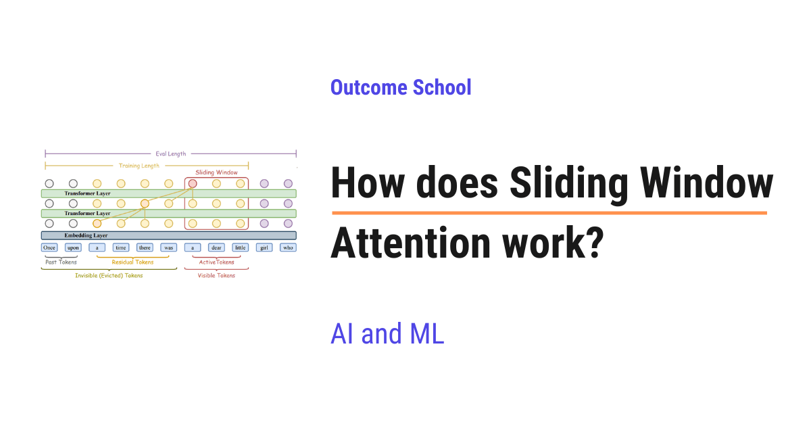

# How does Sliding Window Attention work?

> **Module 5 · Lesson 5.4**  
> Source: [Outcome School](https://outcomeschool.com/blog/how-does-sliding-window-attention-work) · Published: September 5, 2026 · Reading time: ~13 min · Tags: `llm`, `ai`, `machine-learning`

---



Sliding Window Attention is a type of attention where each word looks only at a fixed number of nearby words, instead of looking at all the words. This keeps attention fast and cheap, even for very long text.

In this blog, we will learn about how sliding window attention works. We will also see why normal attention becomes slow and expensive for long text, and how sliding window attention comes to the rescue.

We will cover the following:

- What is attention?
- The problem with normal attention
- What is sliding window attention?
- A simple step-by-step walkthrough
- How information still travels far away
- Comparing normal attention and sliding window attention
- Where sliding window attention is used
- Advantages and trade-offs

Let's get started.

### What is attention?

Before we learn about sliding window attention, we must first understand what attention means.

A modern language model, like the one behind a chatbot, reads text and tries to predict the next word. To do this well, it must understand how words connect to each other.

Let's say we read this sentence:

> The cat sat on the mat because it was tired.

Now, the word `it` refers to the `cat`. As humans, we know this without thinking. But a model has to figure it out.

**[Attention](https://outcomeschool.com/blog/self-attention-in-transformers)** is the mechanism a model uses to look back at earlier words and decide which ones matter for understanding the current word.

In simple words, attention lets every word "pay attention" to other words in the text.

Let's use a simple analogy. Imagine we are in a classroom, and each student is a word. When a new student speaks, that student looks around the room to see who else is relevant to the topic. The new student listens more carefully to some students and ignores others. This act of looking around and deciding who to listen to is attention.

So, attention is how a word gathers information from other words.

Now, we have understood attention. Let's see the problem with it.

### The problem with normal attention

In normal attention, every word looks at every other word. This is called **full attention**, because nothing is left out.

Let's understand this with our classroom analogy again.

Suppose there are 10 students in the room. When a new student speaks, that student looks at all 10 students. That is fine. The room is small.

But now, suppose there are 10,000 students in a giant hall. When a new student speaks, that student must still look at all 10,000 students. This becomes very slow and tiring.

This is exactly the problem with normal attention.

Let's put it in numbers. If we have a piece of text with `100` words, then each word looks at `100` words. So the total number of connections is `100 x 100`, which is `10,000`.

Now, suppose the text has `1,000` words. Then the total connections become `1,000 x 1,000`, which is `1,000,000`.

Here, we can notice that when the text gets 10 times longer, the work becomes 100 times bigger.

This is because the cost grows with the square of the number of words. In simple words, doubling the text makes the work four times bigger. Making the text 10 times longer makes the work 100 times bigger.

So, full attention works perfectly for short text. But for very long text, like a full book or a long document, it becomes extremely slow and uses a huge amount of memory.

We needed a solution for that, and sliding window attention was introduced to solve this problem.

### What is sliding window attention?

Let's break the term down.

Sliding Window Attention = Sliding + Window + Attention

A **window** is a small range of nearby words. Instead of looking at all words, a word only looks at a fixed number of words around it.

**Sliding** means this window moves along as we move from one word to the next. Each word has its own window centered on its neighbors.

So, **sliding window attention** is a method where every word only pays attention to a small, fixed number of nearby words, instead of all the words in the text.

Let's go back to our classroom analogy.

Earlier, when a new student spoke, that student looked at all 10,000 students. That was the slow part.

Now, with sliding window attention, the student only looks at the few students sitting nearby. For example, the student looks at the 3 students on the left and the 3 students on the right. That is it.

This small group of nearby students is the window.

When the next student speaks, that student also looks at their own nearby students. So the window slides along the room, one seat at a time.

This is the core idea. A word does not look at everyone. A word looks only at its neighbors.

The size of this window is fixed. We choose a number, for example `4`, `512`, or `4096`. This number is called the **window size**. It tells us how many nearby words each word is allowed to look at.

Now, the work no longer grows with the square of the text length. Instead, it grows in a straight line with the text length. If the text becomes 10 times longer, the work becomes only 10 times bigger, not 100 times bigger.

So, here comes sliding window attention to the rescue.

### A simple step-by-step walkthrough

The best way to learn this is by taking an example.

Let's say we have a short sentence with 6 words. We will give each word a number so it is easy to follow:

```
Position:  1    2    3    4    5    6
Word:      I    love  to   learn  new  things
```

Here, we have 6 words placed at positions 1 to 6.

Now, let's choose a small window size. For the sake of understanding, assume that each word can look at itself and the 2 words before it. So the window covers 3 words at a time.

**Note:** In a chatbot, a word usually looks only at past words and itself, not at future words, because the model reads from left to right and predicts the next word. So in our example, each word looks backward.

We have a detailed blog on [Causal Masking in Attention](https://outcomeschool.com/blog/causal-masking-in-attention) that explains how a model blocks future words step by step.

Let's now go word by word and see which words each one pays attention to.

**Position 1 (`I`)**: There are no words before it. So `I` looks only at itself.

**Position 2 (`love`)**: It looks at itself and one word before it. So `love` looks at `I` and `love`.

**Position 3 (`to`)**: It looks at itself and the 2 words before it. So `to` looks at `I`, `love`, and `to`.

**Position 4 (`learn`)**: The window now slides. So `learn` looks at `love`, `to`, and `learn`. Notice that `I` is now outside the window.

**Position 5 (`new`)**: It looks at `to`, `learn`, and `new`.

**Position 6 (`things`)**: It looks at `learn`, `new`, and `things`.

Here, we can see that the window slides forward by one position each time. Every word looks at a small, fixed group of nearby words.

Let's see it as below:

```
Words:     I    love   to   learn  new  things
Position:  1     2     3     4     5     6
Pos 1:   [ I ]
Pos 2:   [ I    love ]
Pos 3:   [ I    love   to ]
Pos 4:         [ love   to    learn ]
Pos 5:                [ to    learn  new ]
Pos 6:                      [ learn  new   things ]
```

Here, we can see that each row is the window for one word. The box holds the small group of words that the current word looks at. At position 4, the window has moved forward and `I` has dropped out. The box keeps sliding one step to the right, one word at a time.

This is how sliding window attention keeps the work small and steady.

Now, a very natural question comes to mind. If a word only looks at its neighbors, how does it ever connect to words that are far away?

Do not worry, we will learn about that next.

### How information still travels far away

This is the most beautiful part of sliding window attention.

At first, it looks like a problem. Word number 100 cannot directly look at word number 1, because word 1 is far outside its window. So how can far away words still connect?

The answer is layers.

A modern model is not a single step. It is made of many **layers** stacked on top of each other. A layer is one full round of attention. The output of one layer becomes the input of the next layer.

We have a detailed blog on [Decoding Transformer Architecture](https://outcomeschool.com/blog/decoding-transformer-architecture) that covers how these layers are stacked end to end.

Let's understand this with a simple chain analogy.

Suppose information can only pass between neighbors who are sitting next to each other.

In layer 1, student A whispers to student B, who is sitting right next to A. Student B now knows a little about A.

In layer 2, student B whispers to student C. Now C knows a little about B, and since B already knew about A, C indirectly learns a little about A too.

In layer 3, student C whispers to student D. Now D indirectly learns about A as well.

So, even though no one talks to a far away person directly, information slowly travels across the whole room, one neighbor at a time, through the layers.

Here is the flow:

```
            A     B     C     D
Layer 1:    A --> B
                  B --> C
                        C --> D
Layer 2:    A ......... C  (A reaches C through B)
                  B ......... D  (B reaches D through C)
Layer 3:    A ............... D  (A reaches D through B and C)
```

Here, we can see that in layer 1 each person only talks to a direct neighbor. After layer 2, A has reached C. After layer 3, A has reached D, even though A and D never talked directly. The dotted lines show the indirect path that information takes through the layers.

This is exactly how sliding window attention reaches far away words.

Let's put a simple number to it. Suppose the window allows a word to look 4 words back in each layer. With 1 layer, a word reaches 4 words back. With 2 layers, it reaches about 8 words back. With 10 layers, it reaches about 40 words back.

So, the more layers we stack, the farther the information can travel.

In simple words, one layer connects nearby words directly, and many layers connect far away words indirectly.

The problem is solved.

### Comparing normal attention and sliding window attention

Let me tabulate the differences between normal attention and sliding window attention for your better understanding.

| Point | Normal attention | Sliding window attention |
| --- | --- | --- |
| What each word looks at | Every other word | Only nearby words in a fixed window |
| Cost as text grows | Grows with the square of the length | Grows in a straight line with the length |
| Speed on long text | Slow | Fast |
| Memory on long text | Very high | Low |
| Far away connections | Direct, in a single layer | Indirect, through many layers |
| Best for | Short text | Long text |

Here, we can see that normal attention is powerful but expensive. Sliding window attention is lighter and scales nicely for long text.

So, now we know where each one fits.

### Where sliding window attention is used

Sliding window attention is used in [many modern language models that need to handle long inputs](https://outcomeschool.com/blog/evolution-of-llm-architecture).

The reason is simple. When we want a model to read a very long input, full attention becomes too slow and too costly. Sliding window attention lets the model handle that long input quickly while still understanding the overall meaning through its layers.

A real use case is a chatbot that remembers a long conversation. The conversation can grow very long over time. With sliding window attention, the model can keep up without slowing down too much. It also stops the model's memory of the conversation from growing without limit, which is why a sliding window shows up as one of the [KV Cache Compression](https://outcomeschool.com/blog/kv-cache-compression) techniques.

Another real use case is reading a long legal document or a long book. The model can process page after page efficiently, because each word only looks at its neighbors directly and reaches far away words through layers.

This is how sliding window attention makes long text practical.

### Advantages and trade-offs

Now, let's summarize the good parts and the things we must keep in mind.

**Advantages:**

- It is much faster on long text, because the work grows in a straight line instead of the square of the length.
- It uses much less memory, which means we can handle longer inputs on the same hardware.
- It still understands long range connections, through the stacking of many layers.
- It is simple to reason about, because each word focuses on a clear, fixed neighborhood.

**Trade-offs:**

- Far away words are connected only indirectly, through layers. So we need enough layers and a reasonable window size for distant information to travel well.
- A very small window with very few layers can miss some long range connections. We must choose the window size based on our use case.
- For short text, full attention is already fast enough, so sliding window attention gives little benefit there.
- If the window slides far enough that the very first tokens fall out, the quality can collapse, because those tokens act as [attention sinks](https://outcomeschool.com/blog/how-do-attention-sinks-work) that soak up the leftover attention.

So, sliding window attention is the right choice when the text is long. For short text, normal full attention works perfectly well.

This way we can use sliding window attention to solve the problem of long text in a very simple way. A word looks only at its neighbors, the window slides along, and many layers carry information across the whole text.

## Frequently Asked Questions

### Can a word look at future words in sliding window attention?

Not in a chatbot. In a chatbot, a word usually looks only at past words and itself, because the model reads from left to right and predicts the next word. So the window covers the current word and a fixed number of words before it, and it slides forward one word at a time.

### How far back can a word reach with sliding window attention?

It depends on the window size and the number of layers. If a word can look 4 words back in each layer, it reaches 4 words back with 1 layer, about 8 with 2 layers, and about 40 with 10 layers. The more layers we stack, the farther the information can travel.

### Does sliding window attention reduce memory in long conversations?

Yes. Each word only looks at a fixed number of nearby words, so memory use stays low even for long text. It also stops the model's memory of the conversation from growing without limit, which is why a sliding window is one of the KV Cache Compression techniques.

### What happens if the first tokens slide out of the window?

The quality can collapse. The very first tokens act as attention sinks that soak up the leftover attention. If the window slides far enough that these tokens fall out, the model loses them and its output can break down.
