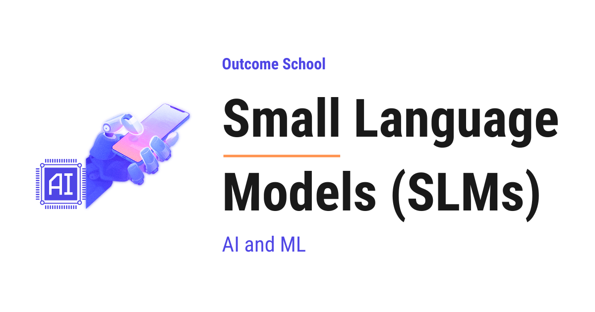

# What are Small Language Models (SLMs) and When Should We Use Them?

> **Module 6 · Lesson 6.1**  
> Source: [Outcome School](https://outcomeschool.com/blog/small-language-models-slms) · Published: May 11, 2026 · Reading time: ~19 min · Tags: `llm`, `ai`, `machine-learning`

---



A Small Language Model (SLM) is a language model that typically has less than 10 billion parameters. It is cheaper and faster than a Large Language Model, and it can even run on our own devices.

In this blog, we will learn about Small Language Models (SLMs), what counts as small, why they matter, where they shine, and the trade-offs we must keep in mind.

We will cover the following:

- SLM = Small + Language Model
- What is a Language Model?
- What Counts as "Small"?
- Popular SLMs we should know
- How SLMs Stay Capable Despite Being Small
- Why SLMs Matter
- SLM vs LLM
- The Size Spectrum
- Where SLMs Shine - Use Cases
- Trade-offs of SLMs
- When to Pick an SLM
- Quick Summary

Let's get started.

## SLM = Small + Language Model

A **Small Language Model (SLM)** is a language model that is small enough to run cheaply, quickly, and even on our own laptop or phone, while still being good enough for many real tasks.

Let's decompose the name:

**SLM = Small + Language Model.**

- **Small** - the model has very few parameters compared to a large model. Typically less than `10` billion parameters, and often as small as `0.5` billion or `1` billion.
- **Language Model** - a neural network that learns to predict the next word in a sequence.

So, when we say "Small Language Model", we are simply saying "a language model with a small number of parameters". An SLM is a deliberate design choice. We trade some general knowledge and heavy reasoning power for speed, low cost, and the ability to run on a laptop or phone.

Now, the question is: what is a parameter? And what is a language model exactly? Let's understand both before we move forward.

## What is a Language Model?

A **Language Model** is a neural network trained to predict the next token (i.e. the next small chunk of text) based on the previous tokens.

A token is roughly a small piece of text - sometimes a full word, sometimes part of a word. For example, the sentence "I love AI" might be split into `3` tokens: `I`, `love`, `AI`. The model works on tokens, not characters or words directly.

Let's say we give the model the text:

```
The sky is
```

The model predicts the next token. It might predict `blue`. Then we feed the new sequence back in and it predicts the next token, and so on. This is how the model writes full sentences, paragraphs, and even code.

The "knowledge" of the model is stored inside its **parameters**. A parameter is just a number that the model has learned during training. More parameters means more capacity to memorize patterns, facts, and reasoning shortcuts.

For example, a `1B` model has `1` billion (`1,000,000,000`) such numbers. A `70B` model has `70` billion of them. That is a `70x` jump in capacity.

So, a Language Model = a neural network + a huge number of learned parameters + the goal of predicting the next token.

Now that we know what a language model is, let's understand what makes one "small".

## What Counts as "Small"?

There is no strict rule, but in practice:

- **Small Language Model (SLM)** - typically **less than 10 billion parameters**. Often `0.5B`, `1B`, `2B`, `3B`, `4B`, or up to about `9B`.
- **Large Language Model (LLM)** - typically `30B` and above. Frontier LLMs are often `70B`, `400B`, or even larger.

So, the line is roughly drawn at `10B` parameters. Anything well below that is comfortably an SLM. Anything well above that is comfortably an LLM. The middle zone (around `10B` to `30B`) is fuzzy and depends on whom we ask.

**Note:** "Small" is a moving target. A `7B` model was considered very small a few years back. A few years from now, today's `1B` model may feel like the new midsize. The key idea is relative size, not a fixed number.

To make this concrete, let's see real examples.

## Popular SLMs we should know

Here are some well-known SLMs we should know about:

| Model | Size | Developer | Notes |
| --- | --- | --- | --- |
| Phi-4-mini | 3.8B | Microsoft | Strong reasoning, `128K` context |
| Gemma 4 E2B | 2B (effective) | Google | Built for phones; `128K` context, text, image, and audio input |
| Gemma 4 E4B | 4B (effective) | Google | Built for edge devices; `128K` context, audio input |
| Llama 3.2 1B | 1B | Meta | Designed for mobile and edge, `128K` context |
| Llama 3.2 3B | 3B | Meta | Stronger on-device option, `128K` context |
| Qwen 3.5 0.8B | 0.8B | Alibaba | Among the smallest usable models, `256K` context |
| Qwen 3.5 2B | 2B | Alibaba | Multimodal, thinking-mode toggle, `256K` context |
| Qwen 3.5 4B | 4B | Alibaba | Multimodal, `256K` context |
| Qwen 3.5 9B | 9B | Alibaba | Sweet spot of small series, rivals older `30B` models, `256K` context |
| SmolLM3 3B | 3B | Hugging Face | Open instruct and reasoning, `128K` context |

**Note:** The "E" in Gemma 4 E2B and E4B stands for "Effective" parameters. Gemma 4 uses Per-Layer Embeddings, so the parameter count that matters at inference time is smaller than the total parameter count.

Here, we can see that the parameter counts range from `0.8B` to `9B`. The smaller ones can run on a phone, while the larger ones run on a laptop with a decent GPU. Compare this to a `70B` LLM, which needs a heavy GPU server to run at all.

Now, a natural question arises - how can a `3B` model be useful at all when a `70B` model has so much more capacity? Let's understand.

## How SLMs Stay Capable Despite Being Small

A few years back, a `3B` model was very weak. Today, a `3B` SLM can be surprisingly capable. So, what changed? I am sure many of us must be knowing the headline answer - better data, better training, better architecture. Let's see all three:

**1. Better training data.**

Modern SLMs are trained on carefully filtered, very high-quality data. Instead of dumping the whole internet into the training pipeline, teams now filter, clean, and pick the best `1` to `15` trillion tokens. Quality beats quantity.

**2. Better training techniques.**

Techniques like [**knowledge distillation**](https://outcomeschool.com/blog/how-does-knowledge-distillation-work) (where a small "student" model learns from a large "teacher" model), better optimizers, and longer training runs squeeze more capability out of every parameter.

**3. Smarter architecture choices.**

Choices like Grouped-Query Attention, [RoPE (Rotary Position Embedding)](https://outcomeschool.com/blog/math-behind-rope-rotary-position-embedding), and other recent ideas make small models faster and stronger without needing more parameters. If we want to go deeper, we have a detailed blog on [Grouped Query Attention](https://outcomeschool.com/blog/grouped-query-attention) that explains one such technique.

So, a modern `3B` SLM today is far stronger than a `3B` model from a few years ago, thanks to better data and better training.

Now, let's understand why we even care about SLMs.

## Why SLMs Matter

Now, the question is: why do we need SLMs when LLMs are so powerful? The answer is: SLMs win on cost, speed, privacy, and [on-device deployment](https://outcomeschool.com/blog/cloud-vs-on-device-model-deployment).

Let's go through each reason.

**1. Lower cost.**

LLMs are expensive to run. Every token we generate costs money, either in API (Application Programming Interface, i.e. the cloud service we call to use the model) charges or in GPU (Graphics Processing Unit) time. SLMs cost a tiny fraction of that.

Let's put this into perspective with real numbers. For a typical workload of `1` million output tokens:

- A frontier LLM might cost around `$25` per million output tokens via an API.
- A `3B` SLM running on our own GPU might cost around `$0.10` to `$0.20` per million output tokens in electricity and hardware time.

That is roughly a `100x` to `200x` cost reduction. For a product that processes `100` million tokens per day, this is the difference between `$2,500` per day and around `$15` per day.

**2. Lower latency.**

Smaller models respond faster. Less computation per token means less time per token.

For the same prompt, the **[time to first token](https://outcomeschool.com/blog/how-does-token-streaming-work)** (i.e. how long before the first word appears) looks like:

- A `70B` model on a single GPU might take around `2` seconds.
- A `3B` SLM on the same hardware might take around `100` milliseconds (`0.1` second).

That is a `20x` speedup. For a chat or [voice assistant](https://outcomeschool.com/blog/design-a-real-time-voice-ai-agent), that difference is the gap between "feels slow" and "feels instant".

**3. Privacy.**

SLMs are small enough to run on our own machine. No data leaves our laptop or our server. This matters for medical records, financial data, internal company documents, and any case where sending data to a cloud API is not allowed.

We have a detailed blog on [how Ollama works](https://outcomeschool.com/blog/how-does-ollama-work) that explains step by step how we run a model on our own computer.

**4. On-device and edge deployment.**

A `3B` model can run on a modern phone. A `1B` model can run on a small laptop CPU. A `0.5B` model can run on tiny edge devices. This opens up offline AI - apps that work without internet, on the user's own device. For example, a smart keyboard that suggests the next sentence, a note-taking app that summarizes our notes locally, or a translator that works on a long flight without WiFi. These on-device models are usually packaged in the GGUF format and run through an engine like [llama.cpp](https://outcomeschool.com/blog/how-does-llama-cpp-run-llms-on-everyday-hardware). We have a detailed blog on [how GGUF works](https://outcomeschool.com/blog/how-does-gguf-work) that explains the single-file format these models run from.

**5. Easier fine-tuning.**

[Fine-tuning](https://outcomeschool.com/blog/how-does-fine-tuning-work) means we take a pre-trained model and train it a little more on our own data so that it gets better at our specific task. Fine-tuning a `70B` model needs a small data center. Fine-tuning a `3B` model can be done on a single consumer GPU in a few hours. So, teams can build their own custom models for their specific domain very easily.

**6. Reliability and control.**

There is no API rate limit when we run an SLM ourselves. No outages from a third party. No surprise price changes. We own the model and we own the deployment.

So, SLMs open up use cases that LLMs cannot reach at all - on-device, fully offline, fully private, and fully under our control.

Now, let's compare SLMs and LLMs side by side.

## SLM vs LLM

Let me tabulate the differences between SLMs and LLMs for your better understanding so that you can decide which one to use based on your use case.

| Aspect | SLM | LLM |
| --- | --- | --- |
| Parameters | `0.5B` to `~10B` | `30B` to `400B+` |
| Memory needed | `1` to `18 GB` | `60` to `800+ GB` |
| Hardware | Phone, laptop, single GPU | Multi-GPU server |
| Latency (first token) | `~50-200 ms` | `~500 ms - 3 s` |
| Cost per `1M` output tokens | `~$0.10 - $1` | `~$5 - $30` |
| General knowledge | Decent, but limited | Very broad |
| Complex reasoning | Weak to medium | Strong |
| Long context quality | Decent at `128K` | Strong at `1M+` |
| Privacy | Easy (run locally) | Hard (cloud APIs) |
| Fine-tuning effort | Easy and cheap | Hard and expensive |

Here, we can see that each side has its own strengths. SLMs win in deployment, cost, latency, and privacy. LLMs win in general knowledge, reasoning depth, and handling very long contexts.

There is no clear winner here. It depends on our use case.

Let's put this into perspective with a small example. Suppose we want to summarize a paragraph of text into one line:

- With a `1B` SLM: takes around `100 ms`, uses around `2 GB` of memory, costs almost nothing.
- With a `70B` LLM: takes around `2` seconds, uses around `140 GB` of memory, costs around `$0.0002` per call via API.

For one user, both are fine. For `1` million calls per day, the SLM saves us thousands of dollars and gives a much better user experience. I have used round numbers here for the sake of understanding, the real numbers depend on the exact hardware and the exact API price.

Now, let's visualize where SLMs sit on the size spectrum.

## The Size Spectrum

Here is a simple diagram showing where SLMs fit:

```
   Tiny         Small (SLM)         Mid           Large (LLM)         Frontier
   ----         -----------         ---           -----------         --------
   < 0.5B       0.5B - 10B        10B - 30B       30B - 70B          100B - 1T+
   |              |                  |                 |                   |
   |              |                  |                 |                   |
   v              v                  v                 v                   v
   tiny          phone /            single            single              multi-GPU
   embedded      laptop /           server            server              cluster
   devices       single GPU         GPU               (multi-GPU)         (data center)
```

Here, we can see five rough buckets along the size axis:

- **Tiny** (`<0.5B`) - very small models for embedded use.
- **Small / SLM** (`0.5B` to `~10B`) - the SLM zone. Smaller ones run on a phone; larger ones on a laptop or single GPU.
- **Mid** (`10B` to `30B`) - the fuzzy middle between SLM and LLM. Could go either way.
- **Large / LLM** (`30B` to `70B`) - serious GPU servers needed.
- **Frontier** (`100B` and beyond) - large clusters needed.

The SLM bucket is the sweet spot for most production use cases that do not need deep reasoning. It is small enough to deploy easily and large enough to do useful work.

Now, let's see where SLMs really shine in practice.

## Where SLMs Shine - Use Cases

SLMs are the right tool for many real tasks. Let's go through the most common ones.

**1. On-device assistants.**

A `1B` to `3B` SLM can run on a phone or laptop. So, we can build a writing assistant, a code helper, or a chat assistant that works offline. No internet, no cloud, no API key. The model lives inside the app.

For example, a `1B` model uses around `2 GB` of memory and can produce around `30` tokens per second on a modern phone. That is fast enough for real-time chat.

**2. Classification.**

Many real tasks are simply: "given this input, pick one label out of N categories". For example, classifying a support ticket as `billing`, `technical`, or `account`. An SLM, especially after a small fine-tune, handles this very well.

A `0.5B` fine-tuned model can classify thousands of inputs per second on a single CPU. For high-volume classification, this is hard to beat.

A newer option for this exact job is a [System One Model](https://outcomeschool.com/blog/jev-and-system-one-models-explained) like Jev, which does not generate text at all and returns the label with a calibrated probability in a single pass.

**3. Structured extraction.**

Pulling structured data out of unstructured text. For example, given an email, extract the sender, the date, the action item, and the deadline. SLMs do this very well, especially when we use constrained decoding (i.e. forcing the model to produce valid JSON).

**4. Agent task heads.**

In a larger agent system, many small steps do not need a heavy [reasoning model](https://outcomeschool.com/blog/large-reasoning-models). Routing a request, selecting a tool from a list, formatting an output - all of these can be done by an SLM. The big LLM is only called when complex reasoning is actually needed.

If we want to go deeper into how agents work end to end, we can read [AI Agent](https://outcomeschool.com/blog/ai-agent).

**5. Fine-tuned domain models.**

Suppose we work in a niche field - for example, a specific style of legal contracts in our country. Fine-tuning a `3B` SLM on `10,000` examples of our domain often beats a generic `70B` LLM on that specific task. We get a model that is small, fast, cheap, and very accurate within our domain.

**6. High-volume pipelines.**

Imagine processing `10` million customer reviews per day to extract sentiment. An LLM API would cost around `$10,000` per day. A self-hosted SLM might cost around `$100` per day for the same job. The math speaks for itself.

So, SLMs shine wherever the task is narrow, latency-sensitive, or privacy-sensitive.

Now, let's be honest about where SLMs do not shine.

## Trade-offs of SLMs

SLMs are great, but they are not magic. Let's understand the trade-offs.

**1. Less general knowledge.**

A `1B` model has `70x` fewer parameters than a `70B` model. So, it has memorized far fewer facts about the world. Ask it about a niche historical event or a rare scientific concept, and it may simply not know.

**2. Weaker complex reasoning.**

For multi-step reasoning - long math chains or complex planning - SLMs often struggle. They may give wrong answers with high confidence.

**3. Weaker long-context quality.**

Most modern SLMs already support `128K` tokens or more, so the size of the context window is no longer the main limit. The real gap is in **how well** the model actually uses that window. For tasks like needle-in-haystack search across `100K` tokens, or long multi-document reasoning, a `3B` SLM is meaningfully weaker than a `200B+` frontier LLM, even when both technically support the same window size. We have a detailed blog on [Recursive Language Models (RLMs)](https://outcomeschool.com/blog/recursive-language-models) that sidesteps this entirely by splitting a long input into small pieces and letting an SLM-sized model work on one piece at a time.

**4. More fragile.**

SLMs can be more sensitive to prompt wording. A small change in phrasing can lead to a very different answer. So, we often need careful prompting or fine-tuning to get reliable behavior.

**5. Less polished writing.**

For long-form creative writing, marketing copy, or careful multi-step reasoning, the gap between an SLM and a top LLM is real. The SLM may sound less natural and less coherent.

This trade-off - **less reasoning power and general knowledge, more speed and lower cost** - is the core deal we are making when we choose an SLM.

**Note:** The gap between SLMs and LLMs keeps shrinking with every new generation. A `3B` SLM today often matches or beats a `13B` model from two years ago. So, the trade-off list above is correct today, but the gap will keep getting smaller.

Now, the natural question is: when do we pick an SLM?

## When to Pick an SLM

Based on our use case, here is a simple decision guide:

**Pick an SLM when:**

- The task is narrow and well-defined (classification, extraction, routing).
- We expect very high volume (millions of calls per day).
- We need very low latency (under `200 ms`).
- The data is sensitive and must stay on our own server or device.
- We need offline / on-device deployment.
- We have training data and can fine-tune for our domain.

**Pick an LLM when:**

- The task needs deep reasoning over multiple steps.
- The task needs broad world knowledge.
- The task needs very long context (i.e. large documents or long histories).
- The volume is low enough that API cost is not a concern.
- We need the highest possible quality and we are willing to pay for it.

**Pick a hybrid (SLM + LLM) when:**

- Most steps in our workflow are simple, but a few need heavy reasoning.

This is where the hybrid setup comes into the picture. The SLM handles routing, classification, extraction, and tool-selection, while the LLM is called only for the hard reasoning steps. This gives us the speed and cost of an SLM with the depth of an LLM where it really matters.

Here is a simple diagram of the hybrid pattern:

```
            +---------------------+
  Input --> |  SLM (router)       |
            |  small + fast       |
            +----------+----------+
                       |
            simple?    |    complex?
            +----------+----------+
            |                     |
            v                     v
       +---------+          +-----------+
       |  SLM    |          |    LLM    |
       | handles |          |  handles  |
       | task    |          |  task     |
       +---------+          +-----------+
            |                     |
            +----------+----------+
                       |
                       v
                    Output
```

Here, we can see that the SLM acts as the front-line router. For simple tasks (let's say `90%` of traffic), the SLM handles the work end to end. For complex tasks (the remaining `10%`), the LLM is called. So, we pay LLM cost on only `10%` of the traffic, while still getting LLM-quality answers when we need them. This pattern is a form of [LLM Routing](https://outcomeschool.com/blog/llm-routing), where each query is sent to the right model based on cost, latency, and quality.

I will highly recommend starting with an SLM whenever the task allows it. We get faster iteration, lower cost, and full control. We can always upgrade to an LLM later if the task truly needs it.

## Quick Summary

Let's recap what we have learned:

- **SLM = Small + Language Model.** A language model with a small number of parameters, typically less than `10` billion.
- **Language Model.** A neural network that predicts the next token given the previous tokens. The "knowledge" is stored in its parameters.
- **Popular SLMs we should know.** Phi-4-mini (`3.8B`), Gemma 4 (`E2B` / `E4B`), Llama 3.2 (`1B` / `3B`), Qwen 3.5 (`0.8B` / `2B` / `4B` / `9B`), SmolLM3 (`3B`).
- **Why modern SLMs are strong.** Better training data, knowledge distillation from larger teacher models, and smarter architecture choices.
- **Why SLMs matter.** Lower cost, lower latency, privacy, on-device deployment, easier fine-tuning, and full control.
- **Cost example.** A `3B` SLM can be around `100x` to `200x` cheaper per million tokens than a frontier LLM.
- **Latency example.** A `3B` SLM responds in around `100 ms` while a `70B` LLM may take around `2` seconds.
- **Memory example.** A `1B` SLM needs around `2 GB` while a `70B` LLM needs around `140 GB`.
- **Where SLMs shine.** On-device assistants, classification, structured extraction, agent task heads, fine-tuned domain models, and high-volume pipelines.
- **Trade-offs.** Less general knowledge, weaker complex reasoning, weaker long-context quality, more sensitive to prompt wording.
- **When to pick an SLM.** Narrow tasks, high volume, low latency, privacy needs, on-device, or when we have data to fine-tune.
- **Hybrid setup.** SLM for routine steps, LLM for the few hard reasoning steps. Best of both worlds, based on our use case.

Now, we have understood Small Language Models (SLMs).

## Frequently Asked Questions

### Can a Small Language Model beat a Large Language Model?

Yes, on a narrow task. Fine-tuning a `3B` SLM on `10,000` examples of our domain often beats a generic `70B` LLM on that specific task. We get a model that is small, fast, cheap, and very accurate within our domain, though it still has less general knowledge.

### Can an SLM run on a phone?

Yes. A `3B` model can run on a modern phone, and a `1B` model can run on a small laptop CPU. For example, a `1B` model uses around `2 GB` of memory and can produce around `30` tokens per second on a modern phone, which is fast enough for real-time chat.

### Do SLMs support long context?

Yes. Most modern SLMs already support `128K` tokens or more. The real gap is in how well the model uses that window. For tasks like needle-in-haystack search across `100K` tokens, a `3B` SLM is meaningfully weaker than a `200B+` frontier LLM.

### Will the gap between SLMs and LLMs keep shrinking?

Yes. The gap keeps shrinking with every new generation. A `3B` SLM today often matches or beats a `13B` model from two years ago.

### Are SLMs sensitive to how we write the prompt?

Yes. SLMs can be more sensitive to prompt wording, and a small change in phrasing can lead to a very different answer. So, we often need careful prompting or fine-tuning to get reliable behavior from an SLM.
