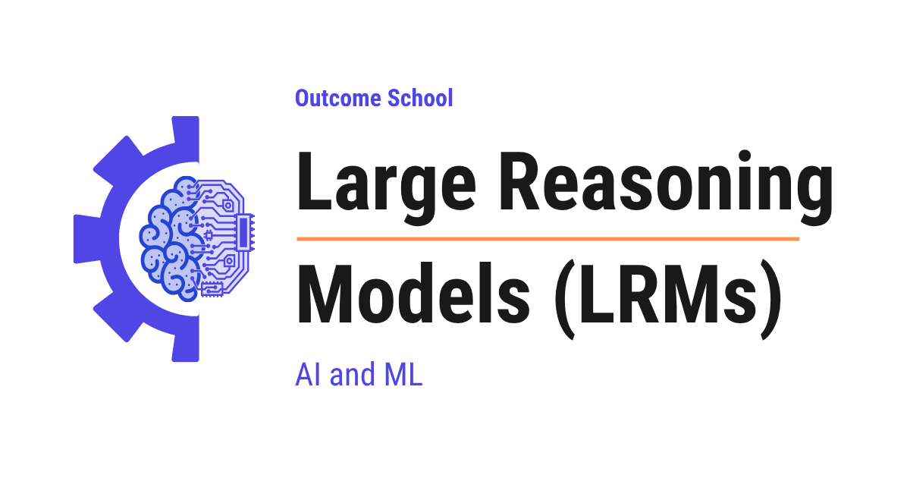

# What are Large Reasoning Models (LRMs) and How Are They Different from LLMs?

> **Module 6 · Lesson 6.2**  
> Source: [Outcome School](https://outcomeschool.com/blog/large-reasoning-models) · Published: May 12, 2026 · Reading time: ~20 min · Tags: `llm`, `ai`, `machine-learning`

---



A Large Reasoning Model (LRM) is a large language model that does not jump straight to the answer. It first produces a long chain of intermediate reasoning steps, and then gives the final answer.

In this blog, we will learn about Large Reasoning Models (LRMs), how they are different from standard Large Language Models, how they think before they answer, how they are trained, and when we must use them.

We will cover the following:

- The Big Picture
- What is a Large Reasoning Model (LRM)?
- LLM vs LRM
- How does an LRM actually think?
- Test-time compute: thinking longer makes them smarter
- How are LRMs trained?
- Input and Output: training phase vs prediction phase
- When to use an LRM, and when to use a regular LLM
- Popular LRMs we should know
- Common Mistakes when using LRMs
- Quick Summary

Let's get started.

## The Big Picture

Before we go further, a quick word on **tokens**. A token is a small piece of text, roughly a word or a part of a word. The model reads and writes text one token at a time. When we say "next token", we mean the next small piece of text the model produces.

A standard Large Language Model answers as soon as we ask. It predicts the next token, one after the other, and we get the reply.

A Large Reasoning Model does something different. Before it gives the final answer, it first thinks. It writes out a long internal scratchpad of steps, checks itself, sometimes changes its mind, and only then it speaks.

In simple words:

**Large Reasoning Model = A Large Language Model that is trained to think first, and answer later.**

## What is a Large Reasoning Model (LRM)?

Let's decompose the name:

**LRM = Large + Reasoning + Model**

- **Large** - it has billions of parameters, often in the range of `7B` to `700B+`, just like a normal Large Language Model.
- **Reasoning** - it does not jump straight to the answer. It produces a long chain of intermediate steps first.
- **Model** - it is still a neural network that predicts the next token.

So, a Large Reasoning Model is a Large Language Model that has been specially trained to spend extra tokens thinking before it gives the final answer.

These models are also called **reasoning models** or **thinking models**. They all mean the same thing.

Examples we may have heard of: OpenAI's `GPT-5.5 Thinking`, DeepSeek `R1`, Qwen3, Google's Gemini 3 with `Deep Think`, Anthropic's `extended thinking` mode in Claude, and xAI's Grok 4.1 with `Think` mode.

## LLM vs LRM

The best way to understand LRMs is to compare them with a regular LLM.

Let's say we ask both a small word problem. We will reuse this same problem throughout the blog to keep the comparisons clean.

> A shop sells pens at `2` for `5` rupees, and notebooks at `3` for `12` rupees. We buy `6` pens and `9` notebooks. How much do we pay in total?

A regular LLM may answer in `1` second, generate just a few tokens like "`51` rupees", and sometimes get the answer wrong because it tries to guess in one shot.

A Large Reasoning Model takes a different path. It first thinks - working out the per-unit cost, multiplying, adding, and verifying the total - and only then writes the final answer. For a small problem like this, the trace may use a few hundred reasoning tokens. For harder problems, it can stretch into thousands or tens of thousands of tokens.

The reasoning tokens are usually hidden from the end user. We only see the final answer. But the model paid the cost of thinking, and that is why the answer is more accurate.

A quick visual of what each one is doing:

```
LLM:   [question] ---> [short answer]            (fast, sometimes wrong)
LRM:   [question] ---> [long thinking trace]
                          ---> [short answer]    (slow, more often right)
```

Here, we can see that the LRM adds a thinking step in the middle, which the LLM skips entirely.

Let me tabulate the differences between LLM and LRM for your better understanding so that you can decide which one to use based on your use case.

| Aspect | Standard LLM | Large Reasoning Model (LRM) |
| --- | --- | --- |
| Answering style | Direct, one shot | Thinks first, answers later |
| Tokens used | Few (`100` to `500`) | Many (`5,000` to `50,000`) |
| Latency | `1` to `3` seconds | `10` to `120` seconds |
| Cost per query | Low | `10x` to `30x` higher |
| Strength | Simple chat, summaries, drafting | Math, code, logic, planning |
| Weakness | Hard multi-step problems | Slow and expensive for easy tasks |

Both are useful, just for different jobs.

## How does an LRM actually think?

This was all about the difference between LLMs and LRMs. Now, let's understand what really happens inside an LRM when it thinks.

The thinking inside an LRM is just more text. There is no magic new component. The model writes out its thought process as tokens, the same way it writes any other tokens.

This long block of internal text is often called the **reasoning trace** or **thinking trace**. For our pen and notebook question above, it looks somewhat like below:

```
<think>
Pens: 2 pens cost 5 rupees, so 1 pen costs 2.5 rupees.
6 pens cost 6 * 2.5 = 15 rupees.
Notebooks: 3 notebooks cost 12 rupees, so 1 notebook costs 4 rupees.
9 notebooks cost 9 * 4 = 36 rupees.
Total = 15 + 36 = 51 rupees.
Let me verify. 6 pens means 3 packs of 2 pens, each pack 5 rupees, so 3 * 5 = 15. Correct.
9 notebooks means 3 packs of 3 notebooks, each pack 12 rupees, so 3 * 12 = 36. Correct.
Total 15 + 36 = 51. Correct.
</think>
We pay 51 rupees in total.
```

Here, we can see three things happening:

- The model breaks the problem into smaller steps.
- It tries an approach, computes intermediate values, and writes them down.
- It checks its own answer at the end before giving the final reply.

This is the same pattern a careful student follows on a rough sheet during an exam. The rough sheet is the reasoning trace. The final answer is what the student writes on the answer sheet.

A simple flow diagram:

```
   User question
        |
        v
   +-------------------+
   |   LRM thinking    |    <-- long internal scratchpad
   |  (reasoning trace)|        (often hidden from user)
   +-------------------+
        |
        v
   Final short answer
```

The reasoning trace is hidden in many products (like `GPT-5.5 Thinking`, where we only see a short summary), and visible in some others (like DeepSeek `R1`).

## Test-time compute: thinking longer makes them smarter

Here comes one of the most important ideas behind LRMs.

In a normal LLM, we make the model smarter by [training a bigger model on more data](https://outcomeschool.com/blog/evolution-of-llm-architecture). That is **train-time compute**. We pay once during training, and then every answer is fast.

LRMs add a second knob, called **test-time compute**. This means the model becomes smarter at the moment of answering, by thinking for longer.

Let's put this into perspective with the actual published numbers from OpenAI on the AIME 2024 math competition (a hard high school contest):

- **GPT-4o** (a regular LLM, no extended reasoning): around `12%` correct.
- **o1** (an LRM with one full reasoning attempt): around `74%` correct.
- **o1** with majority vote across `64` parallel attempts: around `83%` correct.
- **o1** re-ranking across `1,000` attempts: around `93%` correct.

The first row is a regular LLM shown for baseline. The next three rows are the same `o1` model - what changes from row to row is purely how much test-time compute we let it spend at answer time. This is why we say LRMs scale with **test-time compute**.

In our student analogy, this is like giving the same student more pages of rough sheet during an exam. Same student, same brain, but a longer rough sheet often leads to a better final answer.

We can also spend extra compute at answer time from the outside, by making a regular LLM try many reasoning paths, judge them, and keep only the good ones. We have a detailed blog on [Tree of Thoughts](https://outcomeschool.com/blog/how-does-tree-of-thoughts-work) that covers this end to end.

But, here is the catch. More thinking is not free. More tokens means more time and more cost. Doubling the thinking tokens roughly doubles the output cost of that query, and the output cost is usually most of the bill for an LRM.

This trade-off - **less speed, more accuracy** - is the core reason LRMs exist as a separate class of models.

How fast those thinking tokens actually come out is a hardware question, and we have a detailed blog on [how an LPU works](https://outcomeschool.com/blog/how-does-an-lpu-work) that explains a chip built to make exactly this part fast.

**Note:** Many LRM APIs let us control how much the model is allowed to think. For example, we can set a thinking budget of `1,024`, `8,192`, or `32,768` tokens. A small budget gives a fast and cheap answer. A large budget gives a slow but more accurate answer. We can tune this knob based on our use case. Newer APIs are moving toward **adaptive thinking**, where the model decides how much to think based on the complexity of the query, instead of us setting a fixed budget.

## How are LRMs trained?

Now that we have understood how an LRM thinks at answer time, let's understand how it learns to think in the first place.

A regular LLM is trained in two main stages: pre-training on a huge amount of text from the internet, and [instruction tuning](https://outcomeschool.com/blog/how-does-fine-tuning-work) so it learns to follow our prompts.

LRMs add one more stage on top: **[reinforcement learning](https://outcomeschool.com/blog/reinforcement-learning) on reasoning tasks**.

The idea is simple:

- Give the model a hard problem with a known correct answer.
- Let it generate many long reasoning traces in parallel (a group of `16`, `32`, or `64` traces for the same problem).
- Check which traces lead to the correct final answer. Math problems have a clear right answer, so this check is easy and automatic.
- Score each trace relative to the rest of the group. The traces that did better than the group average are reinforced. The ones that did worse are penalised.
- Update the model so it becomes more likely to follow the good reasoning patterns next time.

**Note:** This group-relative scoring is the heart of **[GRPO (Group Relative Policy Optimization)](https://outcomeschool.com/blog/group-relative-policy-optimization-grpo)**, the algorithm used to train DeepSeek `R1`. The "compare to the group, not to an absolute target" trick is what makes RLVR stable at this scale.

This is called **Reinforcement Learning with Verifiable Rewards (RLVR)**. The word **verifiable** is important. Means, the reward comes from a simple automatic checker, not from a human opinion the way it does in [Deep RL from Human Preferences](https://outcomeschool.com/blog/decoding-deep-rl-from-human-preferences). The checker can be:

- Math: does the final number match the correct answer?
- Code: does the generated code pass all unit tests?
- Logic: does the answer match the puzzle's known solution?

Because the reward is automatic, we can run this training loop millions of times without any human in the middle. In our student analogy, we are teaching the student which kinds of rough sheet patterns lead to the right final answer. We let them try many times, score each attempt, and reward the winners. Over time, the model learns useful habits like:

- Break the problem down before solving.
- Try a step, check the unit, then continue.
- Spot a mistake, go back, and try a different approach.

This is exactly what we see in the long reasoning traces.

## Input and Output: training phase vs prediction phase

Now, let's put everything together by looking at exact examples of what went into the model and what came out, in both the training phase and the prediction phase, for both LLM and LRM.

### Training phase: Standard LLM

In LLM training, the model is shown a piece of text with the next token hidden. It must predict that token.

**Input to the model:**

```
The capital of France is
```

**Output from the model (the predicted next token):**

```
Paris
```

The actual next token in the data is also "Paris". The model got it right, so the loss is small. If the model had predicted "London", the loss would be large, and the weights would be nudged to fix this.

### Training phase: Large Reasoning Model

In LRM training, the model is shown a hard problem with a known correct answer. It generates several full attempts to solve it.

**Input to the model:**

```
A shop sells pens at 2 for 5 rupees, and notebooks at 3 for 12 rupees.
We buy 6 pens and 9 notebooks. How much do we pay in total?
```

**Output from the model (one of the `16` attempted traces):**

```
<think>
Pens: 2 pens cost 5 rupees, so 1 pen costs 2.5 rupees.
6 pens cost 6 * 2.5 = 15 rupees.
Notebooks: 3 notebooks cost 12 rupees, so 1 notebook costs 4 rupees.
9 notebooks cost 9 * 4 = 36 rupees.
Total = 15 + 36 = 51 rupees.
Let me verify. 6 pens means 3 packs of 2 pens, each pack 5 rupees, so 3 * 5 = 15. Correct.
9 notebooks means 3 packs of 3 notebooks, each pack 12 rupees, so 3 * 12 = 36. Correct.
Total 15 + 36 = 51. Correct.
</think>
We pay 51 rupees in total.
```

During training, the model is asked to produce many such attempts for the same problem - say `16` traces in parallel. A simple checker compares the final answer of each trace against the known correct answer "51 rupees". Maybe `6` traces got `51`, and `10` got something wrong like `48` or `54`. The `6` good ones score above the group average and are reinforced. The `10` wrong ones score below the group average and are penalised. The model is then updated to produce more of the rewarding kinds of traces.

### Prediction phase: Standard LLM

The model is already trained. We give it a prompt, it produces an answer.

**Input to the model:**

```
Write a haiku about rain.
```

**Output from the model:**

```
Soft drops on the leaves,
A grey sky weeps to the earth,
Spring whispers goodbye.
```

The model goes straight from prompt to answer. There is no internal thinking step. The user sees the full output.

### Prediction phase: Large Reasoning Model

The model is already trained. We give it a prompt, it produces a thinking trace and then the final answer.

**Input to the model:**

```
A shop sells pens at 2 for 5 rupees, and notebooks at 3 for 12 rupees.
We buy 6 pens and 9 notebooks. How much do we pay in total?
```

**Output from the model:**

```
<think>
Pens: 2 pens cost 5 rupees, so 1 pen costs 2.5 rupees.
6 pens cost 6 * 2.5 = 15 rupees.
Notebooks: 3 notebooks cost 12 rupees, so 1 notebook costs 4 rupees.
9 notebooks cost 9 * 4 = 36 rupees.
Total = 15 + 36 = 51 rupees.
Let me verify. 6 pens means 3 packs of 2 pens, each pack 5 rupees, so 3 * 5 = 15. Correct.
9 notebooks means 3 packs of 3 notebooks, each pack 12 rupees, so 3 * 12 = 36. Correct.
Total 15 + 36 = 51. Correct.
</think>
We pay 51 rupees in total.
```

The text inside `<think>...</think>` is the long reasoning trace. The line after it is the final answer. In many products, the user only sees "We pay 51 rupees in total." - the trace is hidden.

Notice that this is the same problem we used in the training example above. During training, this was one of `16` attempted traces that got scored against the known answer "51". During prediction, the model now produces the same kind of trace because that is exactly what training rewarded it to do.

### Quick recap of the four cases

In LLM training, the input is a chunk of text and the output is the next token. The loss measures how close the predicted token is to the actual next token. In LRM training, the input is a hard problem with a known answer, and the output is a full reasoning trace ending in a final answer. The reward checks if the final answer is correct.

In LLM prediction, the input is a user prompt and the output is a direct answer. In LRM prediction, the input is a user prompt and the output is a long internal thinking trace followed by a short final answer.

## When to use an LRM, and when to use a regular LLM

Now that we have seen exactly what goes in and what comes out of both models, the most practical question for any AI Engineer: when to use an LRM and when to use a regular LLM.

We use a **regular LLM** when:

- The task is short and direct.
- We want a quick chat reply, a simple summary, or a draft email.
- Latency matters more than perfect correctness.
- Cost per query must be low because we are doing millions of calls.

We use an **LRM** when:

- The task needs multiple steps of careful thought.
- A wrong answer is costly. Examples: complex math, hard coding problems, scientific questions, multi-step planning, deep data analysis, debugging tricky logic.
- We can afford to wait `30` seconds or more.
- We can afford the higher token cost.

And when the answer is not text at all but a decision, like which category, which team, or safe or not, there is a third option built just for that. We have a detailed blog on [Jev and System One Models](https://outcomeschool.com/blog/jev-and-system-one-models-explained) that explains how such a model returns a typed decision with a calibrated probability in a fraction of a second.

## Popular LRMs we should know

Now, let's look at the popular LRMs we should know:

- **OpenAI GPT-5.5 Thinking** - the current OpenAI reasoning flagship. The raw reasoning trace is hidden, and we only see a short summary plus the final answer.
- **DeepSeek `R1` and `R1-Zero`** - open weights, shows the full reasoning trace, uses RLVR as a key training stage. `R1-Zero` is the purest RLVR demonstration, trained with only rule-based rewards on top of the base model, with no **SFT (Supervised Fine-Tuning, i.e. training on human-written examples)** in between. DeepSeek's newer line ([V3.1 and V4](https://outcomeschool.com/blog/decoding-deepseek-v4)) packs both thinking and non-thinking modes into one model.
- **Qwen3** - open weights from Alibaba. One unified model that supports both a thinking mode and a non-thinking mode, with an explicit thinking budget knob.
- **Google Gemini 3 with Deep Think** - Google's reasoning mode inside the Gemini family. It can spend tens of seconds, and sometimes minutes, of test-time compute on a truly hard problem.
- **Anthropic Claude Opus 4.7 with extended thinking** - Anthropic's reasoning mode, available as a first-class feature across the Claude 4.7 family.
- **xAI Grok 4.1 with Think mode** - xAI's reasoning model. It pairs the thinking step with DeepSearch over X and the web.

All of them share the same core idea: think first, answer later. The differences are in the size of the model, the training data, and whether the reasoning trace is shown to us or hidden.

## Common Mistakes when using LRMs

Now, let's look at a few common mistakes we must avoid.

**Mistake 1: Using an LRM for everything.**

If we use an LRM for a simple "translate this sentence" or "summarize this paragraph", we are paying `10x` to `30x` more cost and waiting `30` seconds for a task that a normal LLM would finish in `1` second. We must route only the hard tasks to the LRM.

**Mistake 2: Ignoring the cost of reasoning tokens.**

Even if the reasoning trace is hidden, we still pay for it. A query that returns `200` visible tokens may have used `15,000` reasoning tokens behind the scenes. We must always check the billing model.

**Mistake 3: Adding "think step by step" to an LRM prompt.**

The model is already trained to think step by step. Adding extra "think carefully" instructions usually does not help, and sometimes confuses the model. Keep the prompt clean and just state the problem.

**Mistake 4: Not setting a thinking budget on production traffic.**

If we let an LRM think for as long as it wants, a single hard prompt can burn through tens of thousands of reasoning tokens. The cost per query swings wildly, and one bad input can dominate the day's bill. For production traffic, we must set a thinking budget - for example, `8,192` tokens for most paths, and `32,768` only for the truly hard ones. Adaptive thinking helps, but a hard upper bound is the safer default.

**Mistake 5: Treating the reasoning trace as the final answer.**

The reasoning trace is a draft. It can contain wrong intermediate steps, scratch values, and corrections. We must only show the final answer to the end user, not the raw trace.

## Quick Summary

Let's recap what we have learned:

- **LRM** stands for **Large Reasoning Model**. It is a Large Language Model that is trained to think first and answer later.
- **Reasoning trace** is the long internal scratchpad of tokens the model produces before the final answer.
- **Test-time compute** is the idea that we can make a model smarter by letting it think longer at answer time.
- **RLVR** (Reinforcement Learning with Verifiable Rewards) is the training trick that teaches the model to write good reasoning traces, using automatic checkers like math answers and unit tests.
- **LRMs are best for hard, multi-step problems.** For simple tasks, a regular LLM is faster and cheaper.
- **Popular LRMs**: `GPT-5.5 Thinking`, DeepSeek `R1`, Qwen3, Gemini 3 with Deep Think, Claude Opus 4.7 with extended thinking, and Grok 4.1 with Think mode.

Now, we have understood Large Reasoning Models (LRMs).

## Frequently Asked Questions

### Is a Large Reasoning Model a different kind of neural network from an LLM?

No. A Large Reasoning Model is still a neural network that predicts the next token, just like a Large Language Model. The thinking inside an LRM is just more text, and there is no magic new component. The difference is that it has been specially trained to spend extra tokens thinking before the final answer.

### Can we see the reasoning trace of an LRM?

It depends on the product. The reasoning trace is hidden in many products, like `GPT-5.5 Thinking`, where we only see a short summary and the final answer. It is visible in some others, like DeepSeek `R1`, which shows the full reasoning trace.

### Does RLVR training need humans to score the answers?

No. In RLVR, the reward comes from a simple automatic checker, not from a human opinion. For math, it checks if the final number matches the correct answer, and for code, it checks if the code passes all unit tests. Because of this, the training loop can run millions of times without any human in the middle.

### Can one model support both a thinking mode and a non-thinking mode?

Yes. Qwen3 is one unified model that supports both a thinking mode and a non-thinking mode, with an explicit thinking budget knob. DeepSeek's newer line, V3.1 and V4, also packs both thinking and non-thinking modes into one model.

### What is adaptive thinking in LRMs?

Adaptive thinking is when the model decides how much to think based on the complexity of the query. This is different from us setting a fixed thinking budget, like `1,024` or `32,768` tokens. Adaptive thinking helps, but for production traffic, a hard upper bound is the safer default.
