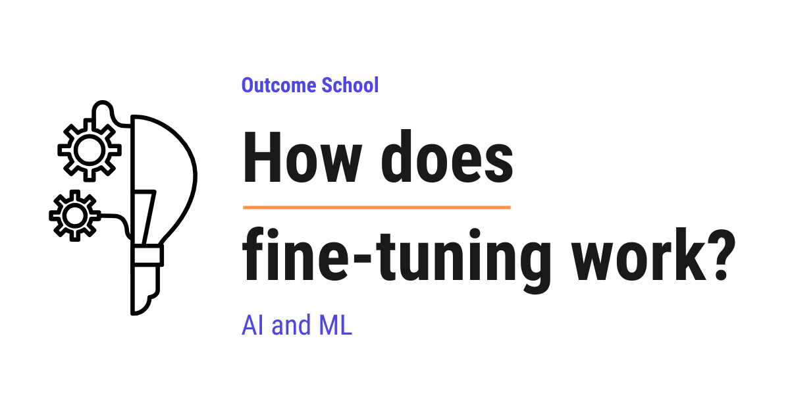

# How does fine-tuning work?

> **Module 7 · Lesson 7.1**  
> Source: [Outcome School](https://outcomeschool.com/blog/how-does-fine-tuning-work) · Published: July 27, 2026 · Reading time: ~13 min · Tags: `llm`, `ai`, `machine-learning`

---



Fine-tuning is the process of taking a model that is already trained and training it a little more on our own specific data, so that it becomes good at our specific task.

In this blog, we will learn about how Fine-tuning works. We will also see why we need it, how it works step by step with a simple example, how full fine-tuning and LoRA differ and when to use which one based on our use case.

We will cover the following:

- What is Fine-tuning?
- Why do we need Fine-tuning?
- How does Fine-tuning work step by step?
- A simple worked example with numbers
- Full Fine-tuning vs LoRA
- When to use Fine-tuning
- Tips before we Fine-tune
- Summary

Let's get started.

## What is Fine-tuning?

**Fine-tuning is the process of taking a model that is already trained and training it a little more on our own specific data so that it becomes good at our specific task.**

Fine-tuning means making small and careful adjustments to a model that already exists.

Consider a person who already knows how to cook many dishes. They have years of general cooking experience. Now, we want them to become an expert in only Italian food. We do not teach them cooking from zero. We only train them on Italian recipes for some time. Very soon, they become great at Italian food, while keeping most of the old cooking skills.

**Note:** Some of those old skills do get a little rusty, because all the recent practice was Italian. The same thing happens with models, so we must keep this in mind.

This is exactly what Fine-tuning does. We take a model that already knows a lot, and we teach it our special skill on top of that.

Let's visualize this as below:

```
   +---------------------+        +------------------+
   |   Base model        |        |   Our own        |
   | (already trained on |  +     |   examples       |
   |  huge general data) |        | (our task data)  |
   +---------------------+        +------------------+
              |                            |
              +-------------+--------------+
                            |
                            v
                   +------------------+
                   |   Fine-tuning    |
                   +------------------+
                            |
                            v
                   +------------------+
                   |  Fine-tuned model|
                   | (expert at our   |
                   |   task)          |
                   +------------------+
```

Here, we can see that we start with a base model that already knows a lot, add our own examples on top, and after Fine-tuning we get a new model that is an expert at our specific task.

The model we start with is called the **base model** or the **pre-trained model**. It is the cook who already knows general cooking.

Now, there is one more word that we will use again and again in this blog, so let's understand it right here. Inside a model, there are millions or even billions of small numbers. These numbers are called **weights**.

A **weight** is just a number inside the model that decides how much importance to give to something.

In simple words, weights are the "knowledge" of the model. When a model learns, it is simply adjusting these numbers again and again until it gets things right.

So, Fine-tuning means slightly adjusting these numbers by showing our own examples to the model.

## Why do we need Fine-tuning?

Let's understand the problem first, and then Fine-tuning will make complete sense.

Training a large model from zero is very costly. It needs a huge amount of data. It needs very powerful and expensive computers. It can take weeks or even months. Most people and most companies cannot afford this.

So, here comes Fine-tuning to the rescue.

Instead of building a model from zero, we take a model that big companies have already trained on massive data. This base model already understands language, grammar, facts, and general reasoning.

But, here is the catch. This general model does not know our specific needs.

Let's say we run a medical company. The general model can talk about many topics, but it does not answer in the exact medical style and accuracy we want. We do not want to spend millions to build a new model. We only want to adjust the existing one.

This way we can use Fine-tuning to solve the interesting problem of making a general model behave the way we want, without huge cost.

## How does Fine-tuning work step by step?

Now, let's understand how Fine-tuning actually works, step by step.

**Step 1: Pick a base model.**

First, we choose a pre-trained model. This is the model that already learned from huge general data. It already has good values for its weights.

**Step 2: Prepare our own dataset.**

Then, we collect examples that match our task. Each example usually has an input and the correct output.

Suppose we want our model to reply like a polite customer support agent. Our dataset will have customer questions as input and ideal polite answers as output.

The quality of this data is very important. Good examples lead to a good model. Bad examples lead to a bad model.

**Step 3: Show the examples to the model.**

After that, we feed our examples to the model one by one. For each input, the model makes a prediction.

**Step 4: Measure the mistake.**

The model's prediction is compared with the correct answer. How far apart the two are is called the **[loss](https://outcomeschool.com/blog/l1-and-l2-loss-functions)**.

In simple words, loss is a number that tells us how wrong the model is. It is always zero or more, because it measures the size of the mistake and not its direction. A big loss means a big mistake. A small loss means the model is close to correct. A loss of zero means the answer is exactly right.

**Step 5: Adjust the weights.**

Now comes the heart of Fine-tuning. The model slightly changes its weights to reduce the loss. This adjustment is done using a method called **[backpropagation](https://outcomeschool.com/blog/math-behind-backpropagation)** with **[gradient descent](https://outcomeschool.com/blog/math-behind-gradient-descent)**.

We do not need to go deep into the math here. For the sake of understanding, just remember this: the model figures out which direction to nudge each weight so that the next prediction is a little better.

**Step 6: Repeat many times.**

Finally, Steps 3 to 5 are repeated again and again over all our examples. Each full pass over the data is called an **epoch**. After enough epochs, the loss becomes small. The model now answers the way we want.

We can picture the flow as below:

```
+---------+   +------------+   +-----------+   +-------------+
| Input   |   |   Model    |   |  Compare  |   |   Adjust    |
| (our    |-->| predicts   |-->| with the  |-->| the weights |
| example)|   | an output  |   |  answer   |   | (less loss) |
+---------+   +------------+   +-----------+   +-------------+
                    ^                                 |
                    |   the updated weights go back   |
                    +---------------------------------+
```

Here, we can see that each example flows from input to a prediction, then we compare that prediction with the correct answer to get the loss, then we adjust the weights to reduce that loss. The arrow at the bottom means the updated weights go back into the model, and then the next example flows through the same path. We repeat this again and again, until the loss becomes small.

This is how Fine-tuning works from start to finish.

## A simple worked example with numbers

The best way to learn this is by taking an example.

Let's say our model has only one weight, and we call it `w`. Right now `w = 2.0`. For a given input, the correct answer should be `10`, but the model predicts using a simple rule of `input * w`.

Suppose the input is `4`.

```python
# Our tiny model
weight = 2.0
input_value = 4
correct_answer = 10
prediction = input_value * weight  # 4 * 2.0 = 8.0
error = correct_answer - prediction  # 10 - 8.0 = 2.0
```

Here, we can see that the prediction is `8.0`, but the correct answer is `10`. So our model is short by `2.0`. We call this gap the **error**.

Now, the model adjusts the weight a little to reduce the mistake.

```python
# A small adjustment to the weight
learning_rate = 0.05
adjustment = learning_rate * error * input_value  # 0.05 * 2.0 * 4 = 0.4
weight = weight + adjustment  # 2.0 + 0.4 = 2.4
```

Here, we have nudged the weight from `2.0` to `2.4`. The `learning_rate` is a small number that controls how big each adjustment is. We keep it small so the model does not over-correct and jump past the answer.

Let's check the prediction again with the new weight.

```python
prediction = input_value * weight  # 4 * 2.4 = 9.6
```

Here, we can notice that the prediction moved from `8.0` to `9.6`. It is much closer to `10` than before. The model will keep repeating this nudging, and the prediction will keep getting closer as below:

```
   8.00  ->  9.60  ->  9.92  ->  9.98  ->  10.00
```

Here, we can see that each round moves the prediction closer to the correct answer, and after a few rounds it settles at `10`. This is exactly what learning looks like.

This tiny example uses only one weight. A real model does the same thing, but for billions of weights at the same time. That is the only difference.

This is how the model slowly learns during Fine-tuning.

## Full Fine-tuning vs LoRA

Now that we have learned the basic process, it is time to learn about the two common ways of doing Fine-tuning.

The first way is **Full Fine-tuning**. Here, we adjust every single weight in the model.

**Advantage:** The model can learn deeply and change a lot.

**Disadvantage:** It needs a lot of memory and powerful machines, because billions of weights are being updated and stored.

So, here is the catch with Full Fine-tuning. It is heavy and expensive for large models.

But again, we can have a better solution than this too.

The second way is **[LoRA](https://outcomeschool.com/blog/lora-low-rank-adaptation-of-llms)**, which stands for **Low-Rank Adaptation**.

In simple words, LoRA keeps the original weights frozen and only trains a small set of new, extra weights on the side. The big model stays untouched, and these small extra pieces carry our new learning.

Consider a thick book that is already printed. We do not want to reprint the whole book to add our notes. Instead, we add a few small sticky notes on the pages. The book stays the same, and our notes hold the new information.

LoRA works like those sticky notes. This makes Fine-tuning much cheaper and faster.

The structure looks like below:

```
   Full Fine-tuning                 LoRA
   ----------------                 ----
  +----------------+         +----------------+
  | All weights    |         | Original       |
  | get updated    |         | weights FROZEN |
  | (billions of   |         | (not touched)  |
  |  numbers)      |         +----------------+
  +----------------+                  +
                                +----------------+
                                | Small extra    |
                                | weights trained|
                                | (the sticky    |
                                |  notes)        |
                                +----------------+
```

Here, we can see that Full Fine-tuning updates every single weight in the model, while LoRA freezes the big original weights and only trains a small set of extra weights on the side. That is why LoRA needs much less memory and runs much faster.

LoRA is not the only cheap option here. [Prefix Tuning](https://outcomeschool.com/blog/how-does-prefix-tuning-work) also keeps the model frozen, but instead of extra weights on the side, it trains a small prefix that steers every attention layer.

Let me tabulate the differences between Full Fine-tuning and LoRA for your better understanding so that you can decide which one to use based on your use case.

| Point | Full Fine-tuning | LoRA |
| --- | --- | --- |
| What it changes | All weights of the model | Only add small extra weights |
| Memory needed | Very high | Low |
| Speed | Slow | Fast |
| Cost | High | Low |

We must choose based on our use case. If we have limited machines, LoRA is the practical choice. If we have heavy resources and need deep changes, Full Fine-tuning works well.

## When to use Fine-tuning

Now, the next big question is: when must we use Fine-tuning?

We must use Fine-tuning when we want the model to learn a specific style, tone, or skill that simple instructions cannot give.

Let's say we want every answer in the exact voice of our brand. Or we want the model to follow a strict medical or legal format. Or we want it to understand the special words used inside our company. In all these cases, Fine-tuning is a strong choice.

But, here is an important note.

**Note:** Fine-tuning is not always the first answer. If we only need to give the model some facts to read, a simpler method like giving the information directly in the prompt is often enough. We must Fine-tune when we want to change the model's behavior, not just feed it some facts.

So, now we know where we can use Fine-tuning.

The most famous example of this is InstructGPT, where Fine-tuning on human-written answers was the first step that turned GPT-3 into an assistant. We have a detailed blog on [Decoding InstructGPT](https://outcomeschool.com/blog/decoding-instructgpt) that covers that story from start to finish.

## Tips before we Fine-tune

Before we end, let's go through a few important tips.

First, focus on data quality. A small set of clean and correct examples beats a large set of messy examples.

Then, keep our examples consistent. If we want a polite tone, every example must be polite. Mixed signals confuse the model.

After that, start with LoRA if we have limited machines. It gives good results at low cost.

Finally, always test the model after Fine-tuning. We must check it on new examples that it never saw during training. This tells us if it truly learned or just memorized. We have a detailed blog on [LLM Evaluation](https://outcomeschool.com/blog/llm-evaluation) that covers this end to end.

If we follow these tips, our Fine-tuning will give strong and reliable results.

## Summary

Now, we have understood how Fine-tuning works.

We started with a model that already learned from huge general data. Then we showed it our own examples. For each example, the model made a prediction, measured the loss, and slightly adjusted its weights to reduce that loss. We repeated this many times until the model answered the way we wanted.

We also learned the two ways to do it. Full Fine-tuning changes all the weights, while LoRA only trains small extra weights to save cost and time.

This way we can use Fine-tuning to turn a general model into a specialist for our own task in a very simple way.

## Frequently Asked Questions

### Is fine-tuning the same as training a model from scratch?

No. Training a model from zero needs a huge amount of data, very powerful computers, and weeks or even months. Fine-tuning starts from a pre-trained base model that already understands language, grammar, facts, and general reasoning, and only trains it a little more on our own examples. This makes it far cheaper.

### Should we fine-tune a model just to give it some new facts?

No. If we only need to give the model some facts to read, a simpler method like putting the information directly in the prompt is often enough. We should fine-tune when we want to change the model's behavior, such as its style, tone, or format, not just feed it facts.

### Does fine-tuning make the model forget what it already knew?

Partly. The model keeps most of its general skills, but some old skills can get a little rusty, because all the recent training was on our specific task. It is like a cook who trains only on Italian recipes for a while. We must keep this in mind when we fine-tune.

### Do we need a lot of data to fine-tune a model?

No. Data quality matters more than size. A small set of clean and correct examples beats a large set of messy examples. The examples should also be consistent, because mixed signals confuse the model.

### How do we know if a fine-tuned model truly learned the task?

We test it on new examples that it never saw during training. This tells us if the model truly learned the task or just memorized the training data. We should always run this check after fine-tuning.
