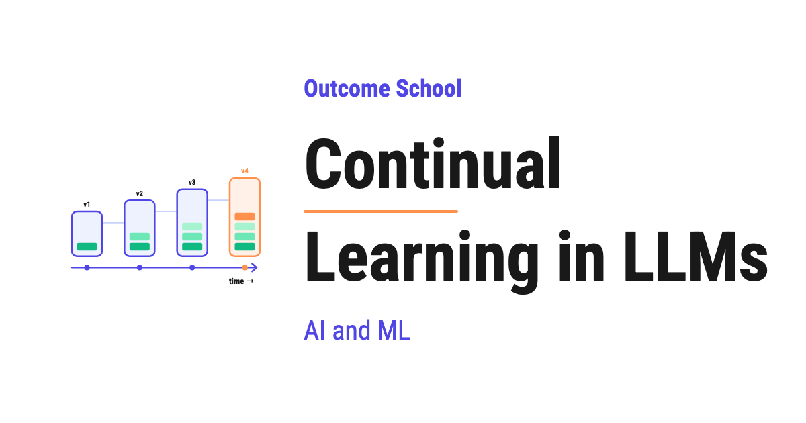

# What is Continual Learning in LLMs? Solving Catastrophic Forgetting

> **Module 7 · Lesson 7.5**  
> Source: [Outcome School](https://outcomeschool.com/blog/continual-learning-in-llms) · Published: June 1, 2026 · Reading time: ~12 min · Tags: `llm`, `ai`, `machine-learning`

---



Continual Learning is the ability of a model, like an LLM, to keep learning new information over time, without forgetting what it has already learned.

In this blog, we will learn about Continual Learning in LLMs. We will understand what it is, why we need it, the big problem of catastrophic forgetting, the approaches used to solve it, and where it is used in the real world.

We will cover the following:

- What is Continual Learning?
- Why do we need Continual Learning in LLMs?
- The big problem: Catastrophic Forgetting
- Approaches to Continual Learning in LLMs
- Challenges in Continual Learning
- Real-world use cases

Let's get started.

### What is Continual Learning?

**Continual Learning is the ability of a model to keep learning new information over time, without forgetting what it has already learned.**

In simple words, Continual Learning = Continual + Learning. The model continues to learn, again and again, as new data arrives.

The best way to learn this is by taking an example. Let's say we have a child. The child learns how to walk. Then the child learns how to talk. Then the child learns how to read. The child does not forget how to walk just because the child learned how to read. The child keeps adding new skills on top of the old skills.

This is exactly what we want from our LLMs. We want them to keep learning new things, without losing the knowledge they already have.

### Why do we need Continual Learning in LLMs?

The world keeps changing every single day. New events happen. New facts arrive. New technologies come into the picture. New words get added to our language. Our LLMs must keep up with this changing world.

Let's say we trained an LLM in the year 2023. The LLM knows everything till 2023. But what about the events of 2024, 2025, and 2026? The LLM does not know about them. The knowledge of the LLM becomes outdated.

So, we have two options to keep the LLM updated:

- **Option 1:** Train the LLM again from scratch with all the old data and the new data. This is very expensive. It takes a lot of time, money, and computing power.
- **Option 2:** Take the existing LLM and teach it only the new information. This is cheap and fast.

Option 2 is what we call Continual Learning. We keep updating the LLM with new knowledge, without training it from scratch.

The training step inside Option 2 is Fine-tuning. We have a detailed blog on [How does fine-tuning work?](https://outcomeschool.com/blog/how-does-fine-tuning-work) that explains it step by step.

But, here is the catch. Option 2 has a big problem. The problem is called Catastrophic Forgetting.

### The big problem: Catastrophic Forgetting

**Catastrophic Forgetting is when a model forgets the old knowledge while learning new knowledge.**

The best way to understand this is by taking an example. Let's say we have an LLM that knows about Math, History, and Science. Now, we want to teach it about Sports. We take the LLM and train it only on Sports data.

What happens? The LLM now knows about Sports very well. But, the LLM has forgotten Math, History, and Science.

This is Catastrophic Forgetting. The model forgets the old things in a catastrophic way when it learns new things.

Why does this happen? Inside an LLM, there are billions of parameters. These parameters store all the knowledge. When we train the LLM on new data, these parameters get updated. The updation of these parameters overwrites the old knowledge.

It is like writing on a whiteboard. If we write new things on top of the old things, the old things get erased.

Here is a simple diagram showing what happens.

```
  Before training on Sports:
  +------+---------+---------+
  | Math | History | Science |
  +------+---------+---------+
  Train ONLY on Sports:
  +---------------------------+
  | Sports  Sports  Sports    |
  +---------------------------+
   ^ old knowledge overwritten
```

Here, we can see that the old knowledge of Math, History, and Science gets overwritten by the new Sports knowledge. The model is left knowing only the new thing.

So, the question is: how can we teach the LLM new things, without erasing the old things? The answer is the different approaches of Continual Learning. Let's learn about them.

### Approaches to Continual Learning in LLMs

There are mainly three approaches to solve this problem. Do not worry, we will learn about each of them in detail.

- Replay-based methods
- Regularization-based methods
- Parameter isolation methods

Let's understand each one.

#### Approach 1: Replay-based methods

**In Replay-based methods, we mix the new data with some of the old data, and then train the model.**

Let's take the same example. We have an LLM that knows about Math, History, and Science. Now, we want to teach it about Sports.

Instead of training the LLM only on Sports data, we mix some Math, History, and Science examples along with the Sports data. Then, we train the LLM on this mixed data.

This way, the LLM learns Sports, but it also keeps practicing Math, History, and Science. The LLM does not forget the old things.

It is like a student preparing for an exam. The student does not study only the new chapter. The student also revises the old chapters. So, the student remembers everything.

**Advantage:** It is simple and works well in practice.

**Disadvantage:** It brings back the training cost. To avoid forgetting, we mix the old data with the new data, so we end up training on a lot of extra data every time. This costs more computing power, more time, and more money. If we mix in too much old data, it becomes almost as expensive as training the model from scratch. That is the very thing we were trying to avoid.

The issue with this approach is the high training cost. Let's see how the next approach solve this issue.

#### Approach 2: Regularization-based methods

**In Regularization-based methods, we protect the important parameters of the model from being changed too much.**

Let's understand this with an example.

Inside an LLM, there are billions of parameters. Some parameters are very important for the old knowledge. Some parameters are not so important.

When we train the LLM on new data, we tell the model: "Hey, you can change the unimportant parameters freely. But, please do not change the important parameters too much."

This way, the important parameters stay almost the same. The old knowledge is preserved. The model uses the unimportant parameters to learn the new knowledge.

A popular method here is called **Elastic Weight Consolidation (EWC)**. EWC figures out which parameters are important for the old knowledge, and it protects them during the new training.

It is like a person who is moving to a new city. The person learns the new roads, the new shops, and the new people. But, the person does not forget their family and old friends, because those memories are very important. The brain protects the important memories.

**Advantage:** We do not need to store the old data.

**Disadvantage:** It is hard to figure out which parameters are important. Also, if we protect too many parameters, the model cannot learn new things well.

The issue with this approach is the balance between protecting old knowledge and learning new knowledge. Let's see how the next approach solve this issue.

#### Approach 3: Parameter isolation methods

**In Parameter isolation methods, we keep the old parameters frozen, and we add a small set of new parameters to learn the new knowledge.**

Let's say we have an LLM with billions of parameters. We do not touch these parameters at all. We freeze them.

Then, we add a small set of new parameters on top of the LLM. We train only these new parameters on the new data.

This way, the old knowledge stays safe inside the frozen parameters. The new knowledge gets stored in the new parameters.

Here comes **[LoRA (Low-Rank Adaptation)](https://outcomeschool.com/blog/lora-low-rank-adaptation-of-llms)** to the rescue. In LoRA, we add small matrices to the LLM. We train only these small matrices on the new data. The original LLM is not touched.

It is like adding a new chapter to a book. The old chapters stay the same. The new chapter is added at the end.

[Prefix Tuning](https://outcomeschool.com/blog/how-does-prefix-tuning-work) belongs to this same family. There, the new parameters are a small prefix that supplies extra keys and values inside every attention layer, while the original LLM stays frozen.

Here, we can see that the old knowledge is fully safe, because we never touch the original parameters of the LLM.

**Advantage:** The old knowledge is fully preserved. It is also cheap because we train only a few parameters.

**Disadvantage:** Over time, if we keep adding new parameters for every new task, the model becomes bigger and bigger.

Now that we have learned about all three approaches, let's see them side by side. Here is a simple diagram comparing them.

```
  Replay-based:
    New Data + Old Data
        |
        v
    Train whole model
  Regularization-based (EWC):
    Important params .... [LOCKED]
    Unimportant params .. [free to change]
        |
        v
    Train on New Data
  Parameter isolation (LoRA):
    Original params ..... [FROZEN]
    Small new params .... [trainable]
        |
        v
    Train only new params
```

Here, we can notice the key difference. Replay-based methods retrain the whole model with old data mixed in. Regularization-based methods protect the important parameters while training. Parameter isolation methods freeze the original parameters completely and train only a small set of new parameters.

### An alternative: Retrieval-Augmented Generation (RAG)

Now, the question is: do we always need to update the LLM to give it new knowledge? The answer is no. Here comes RAG into the picture.

There is another way. We can keep the LLM as it is, and we can give it the new knowledge from outside.

This approach is called **[Retrieval-Augmented Generation (RAG)](https://outcomeschool.com/blog/agentic-rag)**.

In RAG, we store the new knowledge in an external database. When the user asks a question, we first fetch the relevant information from the database. Then, we give this information to the LLM along with the question. The LLM uses this information to answer.

That external store is usually a vector database. We have a detailed blog on [How does a Vector Database work?](https://outcomeschool.com/blog/how-does-a-vector-database-work) that explains how it stores and searches by meaning.

Here is a simple diagram showing how RAG works.

```
      User Question
           |
           v
  +-----------------+      +------------------+
  |   Retrieve      |<-----|  External        |
  |   relevant      |      |  Knowledge       |
  |   information   |      |  Database        |
  +-----------------+      +------------------+
           |
           v
  +-----------------------------+
  |   LLM                       |
  | (Question + Information)    |
  +-----------------------------+
           |
           v
        Answer
```

Here, we can see that the LLM itself is never changed. The new knowledge lives in the external database. The LLM simply reads the relevant information at the time of answering.

It is like a student giving an open-book exam. The student does not need to remember everything. The student can look up the book whenever needed.

**Advantage:** The LLM does not need to be retrained. New information can be added instantly by just updating the database.

**Disadvantage:** The LLM does not truly learn the new information. It just reads it when needed.

So, RAG is not exactly Continual Learning. But, it is a very popular way to keep LLMs updated with new information, without the problem of Catastrophic Forgetting.

### Challenges in Continual Learning

Continual Learning is a hard problem. Let's see the main challenges.

- **Catastrophic Forgetting:** As we discussed, this is the biggest problem.
- **Cost of replay:** If we use replay-based methods, we train on the old data again and again, which adds a lot of extra training cost.
- **Computing cost:** Training an LLM, even partially, is expensive.
- **Evaluation:** How do we know if the LLM has actually learned the new knowledge without forgetting the old? We need good evaluation methods.
- **Stability vs Plasticity:** The model must be stable enough to remember old things, and plastic enough to learn new things. Getting this balance right is hard.
- **Data quality:** If the new data has mistakes or bias, the LLM will learn those mistakes too. We must be very careful about the quality of the new data.

### Real-world use cases

Where do we use Continual Learning in LLMs? Let's see a few important use cases.

- **Keeping the LLM updated with current events:** News, sports scores, stock prices, and etc.
- **Domain adaptation:** Teaching a general LLM to become an expert in a specific field, like medicine or law.
- **Personalization:** Teaching the LLM about a specific user's preferences and style.
- **Fixing mistakes:** If the LLM gives a wrong answer, we can teach it the correct answer without retraining from scratch.
- **Adding new languages:** Teaching the LLM a new language without losing the old languages.

So, now we know where we can use Continual Learning in LLMs.

### Summary

This was all about Continual Learning in LLMs. Let's quickly recap what we have learned:

- Continual Learning is the ability of a model to keep learning new information, without forgetting the old.
- The main problem is Catastrophic Forgetting, where the model forgets old knowledge while learning new knowledge.
- There are three main approaches: Replay-based, Regularization-based, and Parameter isolation.
- RAG is a popular alternative that gives the LLM new knowledge from outside, instead of updating the LLM itself.
- Continual Learning is hard because of storage cost, computing cost, and the stability vs plasticity trade-off.

Now we must have understood Continual Learning in LLMs. The world of AI is changing very fast. Continual Learning is one of the most important areas of research today, because it helps our LLMs stay relevant in a world that never stops changing. It is a beautiful idea, because it brings our LLMs one step closer to how we humans learn.

## Frequently Asked Questions

### Is RAG the same as Continual Learning?

No. RAG is not exactly Continual Learning. In RAG, the LLM is never changed, and it just reads the new knowledge from an external database when needed. The LLM does not truly learn the new information, but RAG avoids Catastrophic Forgetting and new information can be added instantly.

### Why not just retrain the LLM from scratch with the new data?

Training the LLM again from scratch with all the old data and the new data is very expensive. It takes a lot of time, money, and computing power. Teaching the existing LLM only the new information is cheap and fast, and that is Continual Learning.

### Is LoRA a good choice for Continual Learning?

Yes. LoRA is a parameter isolation method, where the original LLM is frozen and only small new matrices are trained. The old knowledge is fully preserved, and it is cheap because we train only a few parameters. The downside is that the model keeps growing if we add new parameters for every new task.

### What is Elastic Weight Consolidation (EWC)?

Elastic Weight Consolidation (EWC) is a popular Regularization-based method for Continual Learning. It figures out which parameters are important for the old knowledge and protects them during the new training. The model then uses the unimportant parameters to learn the new knowledge.
