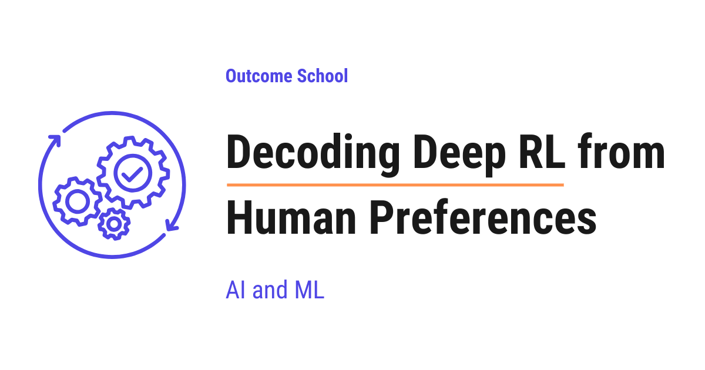

# What is Deep RL from Human Preferences? The Paper That Started RLHF

> **Module 7 · Lesson 7.6**  
> Source: [Outcome School](https://outcomeschool.com/blog/decoding-deep-rl-from-human-preferences) · Published: August 17, 2026 · Reading time: ~15 min · Tags: `ai`, `machine-learning`

---



Deep Reinforcement Learning from Human Preferences is the 2017 paper that taught machines a goal without writing down a reward. A human simply picks the better of two short clips, and the machine learns from these choices.

In this blog, we are going to learn about Deep Reinforcement Learning from Human Preferences, the 2017 paper that started it all. It taught machines what we want by simply asking us to pick which of two behaviors looks better. This is the origin of RLHF, the technique behind ChatGPT.

We will cover the following:

- The building blocks we must know first
- The big picture: what the paper does
- Why it was needed: the reward problem
- Trajectory segments, or clips
- The human comparison
- The reward model and the preference math
- Training the reward model
- Training the agent with reinforcement learning
- The loop and the smart bits
- The results: the backflip and beyond
- The legacy: this is RLHF
- What this looks like today
- Quick Summary

Let's get started.

**The paper showed how to teach a machine a goal without ever writing down a reward. Instead of hand-coding what "good" means, we show a human two short clips of the agent's behavior and let them pick the better one. From thousands of these simple choices, the machine learns what we want.**

The paper is "Deep Reinforcement Learning from Human Preferences" by Paul Christiano, Jan Leike, and their team, a collaboration between OpenAI and DeepMind.

This is the **origin of RLHF** (Reinforcement Learning from Human Feedback), the exact technique that later aligned [InstructGPT](https://outcomeschool.com/blog/decoding-instructgpt) and ChatGPT. Here, the agent learned to play games and control robots. Later, the same idea was used on language models, where the game clips became text answers.

## The building blocks we must know first

Before jumping into the paper, we must know a few simple words.

- **Agent** - the thing being trained to act, like a game player or a robot.
- **Reward** - a number telling the agent how well it is doing. Normal [reinforcement learning](https://outcomeschool.com/blog/reinforcement-learning) maximizes this.
- **Reward function** - the rule that produces the reward. Usually hand-written, and that is the problem.
- **Policy** - the agent's strategy: given a situation, which action to take.
- **Trajectory** - a sequence of the agent's observations and actions over time.

That is everything we need. Now, let's move to the big picture.

## The big picture: what the paper does

Before going into the details, let's see the simple input-to-output view.

```
   Agent acts  ->  produces short clips of behavior
                            |
                            v
   Human is shown two clips  ->  picks the better one
                            |
                            v
   A reward model learns what "better" means
                            |
                            v
   Agent is trained by RL to get more of that "better"
                            |
                            +--------> loops back, again and again
```

These three pieces, the agent, the human comparisons, and the reward model, run together in a loop. The human never gives a number. They only compare. From those comparisons, the machine figures out the reward on its own.

## Why it was needed: the reward problem

Normal reinforcement learning needs a **reward function**: a rule that scores how well the agent is doing. But for many real tasks, **we cannot write a good reward function.**

How do we write a number for "do a backflip"? Or "summarize this article well"? These goals are easy to recognize but very hard to put into a formula. And when we try, the agent often **games** our formula: it maximizes the literal number in a way that misses what we actually wanted. A famous example: a boat-racing agent rewarded for points learned to drive in circles collecting points forever, instead of finishing the race. This is called **reward hacking**.

So the question was: **what if we never write the reward at all, and instead learn it from human judgment?** That is exactly what this paper did.

## Trajectory segments, or clips

The agent's behavior is broken into short **clips**, called trajectory segments, each about one to two seconds long. A clip is a little movie of what the agent did: its observations and its actions over that short window.

Why clips and not single frames? Because behavior only makes sense over time. We cannot tell if a robot is doing a backflip from a single freeze-frame; we need to see the motion. So the unit of comparison is a short clip.

## The human comparison

Here is the key human step. We show a person **two** clips side by side, and they simply click the one that looks **better** (or mark them equal, or skip if they cannot tell).

This is what the person sees:

```
   +------------------+          +------------------+
   |      Clip 1      |          |      Clip 2      |
   |   (1-2 seconds)  |    vs    |   (1-2 seconds)  |
   +------------------+          +------------------+
             |                             |
             +--------------+--------------+
                            |
                            v
                  The human picks one of:
             [ Clip 1 ]          [ Clip 2 ]
             [ Both equal ]      [ Cannot tell ]
```

Here, we can see that the human has only four buttons. Two of them say which clip is better, one says they are the same, and one says the person cannot tell. There is no place to type a number anywhere on this screen.

That is all the human does. No scores, no numbers, no writing a reward function. Just "this one is better than that one." Comparing two things is far easier and more reliable for people than assigning an absolute score. From many such comparisons, the machine will learn the reward.

## The reward model and the preference math

Now the math, and it is the same idea later used in [RLHF](https://outcomeschool.com/blog/reinforcement-learning-from-human-feedback-rlhf) for language models. We train a small neural network, the **reward model** `r`, that predicts a reward for each step. For a clip, we **add up** its predicted rewards to get the clip's total.

Let's see how one clip gets its total:

```
   Clip 1 (a short window of the agent's behavior)
    step 1        step 2        step 3
      |             |             |
      v             v             v
   [ reward ]    [ reward ]    [ reward ]     <- the same reward model
   [ model  ]    [ model  ]    [ model  ]        runs on every step
      |             |             |
      v             v             v
      1      +      0      +      1      =  2   <- the clip's total
```

Here, we can see that the reward model looks at one step at a time and gives each step a number. We then add those numbers to get one total for the whole clip. So a clip is not scored by a special "clip model", it is just the sum of the step scores.

Then we turn two clip totals into a probability that one is preferred, using the Bradley-Terry formula:

```
P(clip 1 preferred) = exp(total reward of clip 1) / ( exp(total of clip 1) + exp(total of clip 2) )
```

Let's define every symbol:

- `total reward of a clip` is the sum of the reward model's predictions over every step in that clip.
- `exp` means `e` to the power of that total.
- `P(clip 1 preferred)` is the probability the model thinks clip 1 is the better one.

Suppose clip 1 has predicted step rewards `[1, 0, 1]`, so its total is `1 + 0 + 1 = 2`. And clip 2 has `[0, 0, 1]`, so its total is `1`. Now:

```
exp(2) = 7.389
exp(1) = 2.718
P(clip 1 preferred) = 7.389 / (7.389 + 2.718) = 7.389 / 10.107 = 0.731
P(clip 2 preferred) = 2.718 / 10.107 = 0.269
```

So the model is about 73% sure clip 1 is better. The two probabilities add to 1.0. And if both clips have the same total, say both `2`, then `7.389 / (7.389 + 7.389) = 0.5`, a coin flip, exactly as it should be.

## Training the reward model

Now we train the reward model so its predictions match the human's choices. We use cross-entropy loss (see the [math behind cross-entropy loss](https://outcomeschool.com/blog/math-behind-cross-entropy-loss)): if the human picked clip 1, the loss is `-log(P(clip 1 preferred))`.

Let's see it. The human picked clip 1, and our model said `P(clip 1 preferred) = 0.731`:

```
loss = -log(0.731) = 0.313
```

Now suppose the model had been wrong, saying only `P(clip 1 preferred) = 0.20`:

```
loss = -log(0.20) = 1.609
```

The loss is much bigger when the model disagrees with the human. So training pushes the reward model to give the human's preferred clip a higher total reward. Over thousands of comparisons, the reward model learns to score behavior the way the human would.

So the whole training of the reward model is this one formula:

```
loss = -log( exp(total of the clip the human picked) / ( exp(total of clip 1) + exp(total of clip 2) ) )
```

Now, every part of this formula is clear. We run the reward model on every step of a clip and add up the numbers to get the clip's total. We turn the two totals into a probability with the Bradley-Terry formula. Then we take the negative log of the probability of the clip the human actually picked, and we train the reward model to make that loss small.

**Note:** the numbers we used, like `[1, 0, 1]`, are just for the sake of understanding. In real training, a clip is one to two seconds long, so it holds many more steps than three, and the reward model is a neural network whose predictions are any real numbers, not neat `0`s and `1`s. The weights of that network are learned during training. But the math is exactly the one we just did by hand.

## Training the agent with reinforcement learning

Once we have a reward model, the rest is ordinary reinforcement learning. The agent is trained with a standard RL algorithm, the paper used A2C for Atari games and TRPO for robots, modern RLHF uses [PPO](https://outcomeschool.com/blog/proximal-policy-optimization-ppo) to maximize the **predicted** reward from the reward model. The agent never sees a true game score. It only chases the learned reward.

So the missing reward function has been **replaced** by one learned from human preferences, and normal RL takes over from there.

## The loop and the smart bits

All three pieces run together. The agent keeps acting and producing clips, humans keep comparing some of them, the reward model keeps improving, and the agent keeps chasing the latest reward model. The reward is a moving target that gets better over time.

Two clever touches made it efficient:

- **Ask about the confusing clips.** They trained several reward models, called an ensemble, and asked the human to compare the clip pairs where these models **disagreed** the most. The idea is to spend scarce human attention where the machine is most unsure. The paper is honest about this one: it calls the trick a crude approximation, and its own ablation experiments show that on some tasks it actually made the results worse. So this is a good idea, not a solved problem.
- **Normalize the rewards.** Only the relative reward matters, so they scaled the reward model's outputs to have zero mean and a constant standard deviation. This keeps the numbers in a steady range and keeps training stable, even while the reward model itself keeps changing.

## The results: the backflip and beyond

- **The backflip.** A simulated robot learned to do a backflip from only about **900 human comparisons**, collected in under an hour. There is no natural reward function for "do a backflip", yet the behavior was learned purely from human clicks.
- **Less than 1% feedback.** Across Atari games and robot tasks, the agent learned complex behaviors with human feedback on **less than 1%** of its interactions, never seeing the true reward.
- **Sometimes better than the true reward.** On the game Enduro, learning from preferences matched or beat training on the real game score. Human labelers reward any small progress, which gives a smoother, easier-to-learn signal than the sparse true score.

## The legacy: this is RLHF

This paper is the seed of everything.

- **2017, this paper**: learn a reward from human preferences, for games and robots.
- **2020, Learning to Summarize**: the same recipe applied to a language task, summarization.
- **2022, [InstructGPT](https://outcomeschool.com/blog/decoding-instructgpt)**: RLHF applied to GPT-3, which produced helpful, instruction-following models.
- **Late 2022, ChatGPT**: the same recipe in a chat product, which changed the world.

The recipe never changed: collect human comparisons, train a Bradley-Terry reward model, optimize a policy with reinforcement learning. The only difference is that game clips became pairs of text answers, and A2C became PPO.

## What this looks like today

The core idea is still here, but the field has learned a lot since 2017. Now, let's see what changed.

- **Reward hacking came back, and we found a leash for it.** The agent chases the learned reward, so it learns to fool the reward model instead of doing the real task. In language models, this shows up as weird text that scores high and reads like nonsense. The fix used in [RLHF](https://outcomeschool.com/blog/reinforcement-learning-from-human-feedback-rlhf) today is a KL penalty: we subtract a small amount of reward when the model drifts too far from the original model. Notice that the problem this paper solved for hand-written rewards comes right back for learned ones, just in a milder form.
- **The separate reward model became optional.** [DPO](https://outcomeschool.com/blog/direct-preference-optimization-dpo) showed that the same Bradley-Terry math can be rearranged so the language model is its own reward model. So we train directly on the preference pairs, with no reward model and no RL loop.
- **AI feedback replaced a lot of human feedback.** Paying people to compare clips is slow and expensive. So labs now often use another model as the judge, an idea called [LLM as a judge](https://outcomeschool.com/blog/llm-as-a-judge). Constitutional AI goes further, where the model critiques its own answers against a written list of principles.
- **For checkable tasks, we do not need an opinion at all.** In math and code, we can simply check whether the answer is correct. This is called reinforcement learning with verifiable rewards, and it powers the newest [large reasoning models](https://outcomeschool.com/blog/large-reasoning-models). The popular algorithm here is [GRPO](https://outcomeschool.com/blog/group-relative-policy-optimization-grpo), which grades a whole group of answers against each other instead of training a separate scorer.

So today, human preferences are used for taste and safety, where there is no right answer, and verifiable rewards are used for reasoning, where there is one. But it all traces back to this one idea: **do not write the reward, learn it from what humans prefer.**

## Quick Summary

We have decoded the Deep RL from Human Preferences paper piece by piece. Let's recap each piece in one line.

- **The paper** learns a reward from human preferences instead of hand-coding it; this is the origin of RLHF.
- **The reward problem**: many goals (a backflip, a good summary) cannot be written as a formula, and bad formulas get hacked.
- **Clips**: behavior is broken into short one-to-two-second clips, because behavior only makes sense over time.
- **The human comparison**: a person just picks the better of two clips, no scores, which is easy and reliable.
- **The preference math**: a reward model sums each clip's rewards, and the Bradley-Terry formula turns two totals into a preference probability.
- **Training the reward model**: cross-entropy loss pushes the human's preferred clip to a higher reward.
- **Training the agent**: ordinary RL (A2C, TRPO, or modern PPO) maximizes the learned reward.
- **The loop**: agent, human, and reward model run together, asking about the most confusing clips, though the paper admits that trick does not always help.
- **The results**: a backflip from about 900 comparisons, complex tasks with under 1% feedback, sometimes beating the true reward.
- **The legacy**: this exact recipe became RLHF, the technique behind InstructGPT and ChatGPT.
- **Today**: a KL leash holds back reward hacking, DPO removes the separate reward model, AI feedback replaces much of the human labeling, and verifiable rewards with GRPO power reasoning models.

Now, we have decoded Deep RL from Human Preferences piece by piece and understood how learning a reward from simple human comparisons became the foundation of how we align AI today.

## Frequently Asked Questions

### Why do humans compare two clips instead of giving each clip a score?

Comparing two things is far easier and more reliable for people than assigning an absolute score. The human only picks the better clip, marks them equal, or says they cannot tell. From many such comparisons, the reward model learns what "better" means, so no one ever has to write down a number.

### Does the agent ever see the true game score?

No. The agent never sees a true game score. It is trained with ordinary reinforcement learning to maximize the predicted reward from the reward model. So the missing reward function is replaced by one learned from human preferences, and the agent only chases that learned reward.

### Is Deep RL from Human Preferences the same thing as RLHF?

It is the origin of RLHF, and the recipe never changed. We collect human comparisons, train a Bradley-Terry reward model, and optimize a policy with reinforcement learning. The only difference is that game clips became pairs of text answers, and A2C became PPO.

### Does learning the reward from humans stop reward hacking?

No. The agent chases the learned reward, so it can learn to fool the reward model instead of doing the real task. In language models, this shows up as weird text that scores high. The fix used in RLHF today is a KL penalty, which subtracts reward when the model drifts too far from the original model.

### Do we still need a separate reward model today?

Not always, since the separate reward model became optional. DPO showed that the same Bradley-Terry math can be rearranged so the language model is its own reward model. So we can train directly on the preference pairs, with no reward model and no RL loop. For checkable tasks like math and code, verifiable rewards with GRPO are also used.
