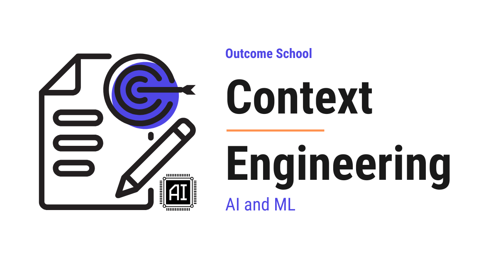

# What is Context Engineering?

> **Module 8 · Lesson 8.5**  
> Source: [Outcome School](https://outcomeschool.com/blog/context-engineering) · Published: May 8, 2026 · Reading time: ~19 min · Tags: `ai-agent`, `llm`, `ai`, `machine-learning`

---



Context Engineering is the practice of designing, organizing, and managing everything that goes into an LLM's context window, so that the model can do its task reliably.

In this blog, we will learn about Context Engineering - what it is, why it has become the most important skill for building reliable AI applications, how it differs from Prompt Engineering, the components that make up the context, common patterns like RAG, few-shot examples, tools, and memory, and the best practices and common mistakes to keep in mind.

We will cover the following:

- What is Context Engineering?
- The Big Picture
- Why Context Engineering matters
- Prompt Engineering vs Context Engineering
- The components of the context
- Common patterns in Context Engineering
- Common mistakes to avoid
- Best practices
- Quick Summary

Let's get started.

## What is Context Engineering?

**Context Engineering is the practice of designing, organizing, and managing everything that goes into an LLM's context window so that the model can do its task reliably.**

In simple words, Context Engineering is the work of deciding **what information** to give the model, **how to organize it**, and **when to include it**, so that the model produces the right output.

The LLM itself is just a function. It takes whatever is in the context window and predicts the next tokens. Whatever the model says or does is decided entirely by what we have put into the context.

If the context is good, the output is good. If the context is bad, the output is bad. That is the whole story.

## The Big Picture

Before we go into the details, let's understand the big picture.

Imagine we are about to brief a brilliant new colleague who has just joined our team. This colleague is extremely smart and a fast worker. But there is one catch - they have no memory of anything we have discussed before. Every time we ask them to do a task, we have to brief them from scratch.

To get good work out of them, we need to give them, in one short briefing:

- Who they are and what role they are playing.
- What the task is.
- Any background documents they need to read.
- Examples of past work that look like what we want.
- The tools they can use.
- The format we want the answer in.

If we miss something, they cannot guess. They will do their best with whatever we hand them.

This is exactly what we are doing with an LLM. The LLM is the brilliant colleague. The context window is the briefing. Context Engineering is the discipline of writing that briefing well.

In simple words: **Context Engineering = Briefing the LLM with the right information, in the right shape, at the right time.**

## Why Context Engineering Matters

LLMs are **stateless**. They do not remember anything between calls. Every time we send a request, the model starts fresh. The only thing the model knows about our task is whatever we have included in the context window.

This means three things:

- The output of the LLM is decided entirely by the input context.
- A weak model with a great context can outperform a strong model with a poor context.
- As we move from simple chat to RAG, agents, and multi-step workflows, the context becomes more and more crucial. The complexity of the application is now mostly about context, not about the model.

Earlier, we used to spend most of our time picking the right model and tweaking the wording of the prompt. That is **Prompt Engineering**. Prompt Engineering is still useful, but it is now just one small part of a much bigger discipline.

Today, the real bottleneck for building reliable AI applications is Context Engineering. We have powerful models. What we need is the ability to feed them the right information at the right time.

This was all about why Context Engineering matters. Now, let's compare it with Prompt Engineering.

## Prompt Engineering vs Context Engineering

These two terms get mixed up a lot. Let's draw a clean line between them.

**Prompt Engineering** is the art of writing the **wording** of a single instruction well. For example, the difference between "summarize this article" and "summarize this article in three bullet points, written for a non-technical reader". The task is the same, but the wording produces different results.

**Context Engineering** is the bigger discipline of designing the **entire information environment** the model sees. It includes the prompt, but also the system instructions, the retrieved documents, the examples, the tool outputs, the memory, the conversation history, and the output format.

Let me tabulate the differences between Prompt Engineering and Context Engineering for your better understanding.

| Aspect | Prompt Engineering | Context Engineering |
| --- | --- | --- |
| **Scope** | One instruction at a time | The full context window |
| **Concerns** | Wording, phrasing, structure of one prompt | Everything the model sees: system prompt, RAG, tools, examples, memory, history |
| **When it matters most** | Simple one-shot tasks | RAG, agents, multi-step workflows, production systems |
| **Failure mode** | Bad wording leads to a bad answer | Missing or wrong context leads to wrong answers, hallucinations, or wrong tool use |
| **Example fix** | Rewriting a sentence in the prompt | Adding a retrieved document, adjusting memory, reordering the system prompt |

In short - Prompt Engineering is a subset of Context Engineering. Every prompt we write is part of the context, but the context is much more than just the prompt.

Let's see this as a diagram:

```
   +-------------------------------------------------+
   |  CONTEXT WINDOW (Context Engineering scope)     |
   |                                                 |
   |   System prompt                                 |
   |   Examples (few-shot)                           |
   |   Retrieved documents (RAG)                     |
   |   Tools and tool descriptions                   |
   |   Memory                                        |
   |   Conversation history                          |
   |   Tool results                                  |
   |                                                 |
   |   +-----------------------------------------+   |
   |   |  PROMPT (Prompt Engineering scope)      |   |
   |   |                                         |   |
   |   |  "Summarize this article in three       |   |
   |   |   bullet points for a non-technical     |   |
   |   |   reader."                              |   |
   |   +-----------------------------------------+   |
   |                                                 |
   +-------------------------------------------------+
```

Prompt Engineering tunes the small inner box - the wording of one instruction. Context Engineering designs the whole outer box - everything the model sees at this moment. Both matter, but Context Engineering is the bigger discipline.

This was all about Prompt Engineering vs Context Engineering. Now, let's see what actually goes into the context.

## The Components of the Context

When we look at the context window of a real LLM application, it is not just one prompt. It is a structured stack of pieces, each playing a different role.

Let's see this as a diagram:

```
       +------------------------------------------+
       |  CONTEXT WINDOW (what the LLM sees)      |
       +------------------------------------------+
       |                                          |
       |  1. System prompt                        |
       |     (role, rules, persona, format)       |
       |                                          |
       |  2. Examples (few-shot)                  |
       |     (input -> output samples)            |
       |                                          |
       |  3. Retrieved documents (RAG)            |
       |     (relevant external knowledge)        |
       |                                          |
       |  4. Tools and tool descriptions          |
       |     (what the agent can do)              |
       |                                          |
       |  5. Memory                               |
       |     (long-term facts, user preferences)  |
       |                                          |
       |  6. Conversation history                 |
       |     (previous turns)                     |
       |                                          |
       |  7. Tool results                         |
       |     (outputs from tool calls)            |
       |                                          |
       |  8. Current user message                 |
       |     (the latest question or instruction) |
       |                                          |
       +------------------------------------------+
                          |
                          ↓
                  LLM produces output
```

Let's decode each one.

**1. System prompt.** The system prompt sets the role, the rules, and the format. It is the "you are an X, you must do Y, you must not do Z, you must respond in Z format" piece. It defines the personality and the boundaries.

**2. Examples (few-shot).** A few input-output samples that show the model the pattern we want. Even one good example can dramatically improve the output. This is sometimes called in-context learning.

**3. Retrieved documents (RAG).** When the answer depends on external knowledge (a knowledge base, a docs site, a database), we retrieve the most relevant chunks and put them in the context. We have a detailed blog on [Agentic RAG](https://outcomeschool.com/blog/agentic-rag) that goes deeper into this.

**4. Tools and tool descriptions.** When the LLM is acting as an agent, the context includes a list of tools available to it (function names, descriptions, parameter schemas). This is what tells the LLM what it can do.

**5. Memory.** Long-term facts about the user, past conversations, learned preferences. We have a detailed blog on [AI Agent Memory](https://outcomeschool.com/blog/ai-agent-memory) that explains how memory is structured for agents.

**6. Conversation history.** The previous turns in the current session. This is what gives the model continuity in a chat.

**7. Tool results.** When the LLM has recommended a tool (search, calculator, database query) and the runtime has executed it, the result of that tool comes back into the context for the next turn.

**8. Current user message.** The fresh question or instruction the user just sent.

All eight of these compete for the same finite context window. Context Engineering is the discipline of deciding what goes in, in what order, and at what size.

Coming back to our briefing analogy - the system prompt is the job role we hand the colleague, the examples are the past work we point them at, the retrieved documents are the binder of background reading, the tools are the equipment they can use, the memory is what we have learned about them and the user across past meetings, the conversation history is the meeting we are currently in, the tool results are the answers they got back from running their equipment, and the current user message is the latest thing the user just said. Every briefing has to fit on one page. That one page is the context window.

This was all about the components of the context. Now, let's see the common patterns we use to fill them.

## Common Patterns in Context Engineering

Before we go through the patterns, let's see what actually happens at every turn.

The context is not stored anywhere. It is rebuilt from scratch every single turn. We pull pieces from different sources and assemble them into one fresh context for that one call.

Let's see this as a diagram:

```
   For each new turn, we pull from these sources:
      +----------+   +----------+   +----------+   +----------+
      |  System  |   |  Memory  |   |   RAG    |   |Few-shot  |
      |  prompt  |   |  store   |   |retrieval |   |examples  |
      +----------+   +----------+   +----------+   +----------+
      +----------+   +----------+   +----------+   +----------+
      |  Tool    |   |   Tool   |   |  Conv.   |   | Latest   |
      |  list    |   |  results |   | history  |   |  user    |
      |          |   |(if any)  |   |          |   | message  |
      +----------+   +----------+   +----------+   +----------+
              All combined into one single input:
                                  ↓
                  +-------------------------------+
                  |     Assembled context         |
                  |     (sent to the LLM)         |
                  +-------------------------------+
                                  |
                                  ↓
                         LLM produces output
                                  |
                                  ↓
                  Next turn rebuilds the context
                  from scratch (with any new tool
                  results from this turn included)
```

Here, we can see that Context Engineering is not a one-time setup. It is a fresh decision on every turn. Each pattern below is a tool we use to fill one of these boxes well.

Now, let's go through the most important patterns.

**1. RAG (Retrieval-Augmented Generation).**

Instead of stuffing the entire knowledge base into the context, we retrieve only the most relevant pieces and inject them. This keeps the context small and focused.

We pair RAG with [chunking](https://outcomeschool.com/blog/chunking-strategies-for-rag), [embedding-based search](https://outcomeschool.com/blog/how-does-a-vector-database-work), and [re-ranking](https://outcomeschool.com/blog/how-does-a-reranker-work) to make sure the right pieces land in the context.

**2. Few-shot examples.**

We include a handful of example pairs of input and the desired output (2-5 is a good starting range, but the optimum varies by task). The model learns the pattern from the examples and follows it. This is one of the cheapest ways to lift quality.

**3. Tool calling.**

Instead of asking the model to do everything itself, we give it tools and let it recommend which tool to use when needed. The runtime then executes the recommended tool. The tool definitions live in the context, and so do the tool results when they come back.

This is the foundation of building an [AI Agent](https://outcomeschool.com/blog/ai-agent), and it overlaps closely with [Harness Engineering](https://outcomeschool.com/blog/harness-engineering-in-ai), which is the broader design of the loop, tools, and context that an agent runs inside. It also overlaps with [Loop Engineering](https://outcomeschool.com/blog/what-is-loop-engineering), which is the design of the repeating cycle itself - how many turns the agent gets, what carries forward, and when it must stop.

**4. Memory injection.**

For agents and chat systems, we keep a memory of important facts and inject only the relevant slices into the context for each new turn. We do not put the entire memory in every time. We pick what is relevant to the current task.

**5. Conversation history management.**

In a long chat, the full history grows past the context window. We use techniques like [summarization](https://outcomeschool.com/blog/how-does-context-compaction-work), sliding windows, or selective inclusion to keep the conversation history within budget.

**6. Output formatting.**

We tell the model the exact output format we want - JSON, a specific schema, a markdown table, a structured form. Putting the format requirement in the context makes downstream parsing reliable.

For truly reliable parsing, structured output APIs and JSON schema constraints (offered by most modern model providers) are stronger than prompt-based formatting alone. The prompt asks for the format, the schema enforces it.

**7. Context compression.**

When the raw context is too long, we compress it. This can be summarization, key-fact extraction, or structured rewriting. The goal is to keep the meaning while shrinking the token count.

**8. Per-step context rebuilding (for agents).**

In an AI agent, every step in [the loop](https://outcomeschool.com/blog/ai-agent-loop) is a fresh LLM call with a freshly built context. Between steps, the agent's state changes - new tool results come in, sub-tasks get completed, plans get revised. We rebuild the context for the next step using only what is relevant **right now**: the current sub-task, the latest tool result, the relevant facts from memory. We do not just append everything endlessly.

The agent that does this well stays focused. The agent that does not gets buried under old, useless information and fails the task.

This was all about the patterns. Now, let's see the common mistakes to avoid.

## Common Mistakes to Avoid

Most failures in LLM applications are actually Context Engineering failures. Here are the most common mistakes.

**Mistake 1: Stuffing the context with everything.**

A bigger context is not always a better context. When too much information is in the context, the model gets distracted, slows down, costs more, and often produces worse answers. The model has to pick the relevant signal out of a lot of noise, and the more noise we add, the harder it gets. The community is now calling this **context rot** or **context degradation** - the slow decay in answer quality as the context grows past what the task actually needs.

The fix is to be ruthless about what goes in. Only include what is needed for this turn.

**Mistake 2: Not including enough.**

The opposite mistake. The model cannot guess what it does not see. If we expect the model to know our company's policy on refunds, that policy must be in the context.

The fix is to ask: "If I were doing this task, what would I need to know? Is all of that in the context?"

The harder part is that this knowledge usually lives in people's heads, wikis, and code comments, so there is nothing to put in the context in the first place. OKF is an open standard for writing exactly that knowledge down as plain markdown files an agent can read. We have a detailed blog on [What is OKF (Open Knowledge Format)?](https://outcomeschool.com/blog/what-is-okf-open-knowledge-format) that explains how it works.

**Mistake 3: Bad ordering.**

Order matters. The model pays more attention to information at the start (the system prompt area) and the end (the most recent message). Putting critical instructions in the middle of a long context is a recipe for the model ignoring them. This is a well-studied phenomenon called **["lost in the middle"](https://outcomeschool.com/blog/lost-in-the-middle-problem-in-llms)** - models genuinely under-attend to information buried deep inside a long context.

The fix is to put rules and instructions at the start, and the current task at the end.

**Mistake 4: Stale context.**

Old conversation history, old tool results, old retrieved documents that are no longer relevant - all of this clutters the context and confuses the model.

The fix is to actively prune the context. If something is not relevant to the current step, remove it.

**Mistake 5: No structure.**

Pasting a wall of text into the context with no headers, no separators, no labels makes it hard for the model to parse. Even though LLMs can read unstructured text, structure helps them focus.

The fix is to use clear section markers, headers, and consistent formatting.

**Mistake 6: Confusing instructions.**

When the system prompt says one thing and the user message says another, the model has to guess which one to follow. When two retrieved documents contradict each other, the model has to pick one.

The fix is to design the context so that there is one clear answer to "what should the model do right now".

This was all about the common mistakes. Now, let's see the best practices.

## Best Practices

Here are the best practices that experienced teams follow.

**1. Treat the context as a budget.**

Every token costs money and attention. Decide upfront how much of the context goes to the system prompt, how much to retrieval, how much to history, and how much to the current task. Stick to the budget.

**2. Keep the context focused on the current task.**

For each call, ask: "What does the model actually need to do this one task?" Include exactly that. Nothing more. [Agent Skills](https://outcomeschool.com/blog/what-are-agent-skills) apply this rule to instructions - only a one-line description of each procedure stays loaded, and the full steps are read only when a request matches.

**3. Order from most stable to most fresh.**

System prompt at the top (stable, rarely changes), then examples, then retrieved knowledge, then memory, then conversation history, then the current message at the end. This works with [caching](https://outcomeschool.com/blog/how-does-prompt-caching-work) too - stable parts of the context can be cached and reused.

**4. Use clear section markers.**

Headers, dividers, and labels make it easy for the model to know where each piece begins and ends. For example:

```
### SYSTEM
You are a helpful assistant...
### EXAMPLES
Example 1: ...
Example 2: ...
### RETRIEVED DOCUMENTS
[Doc 1]: ...
[Doc 2]: ...
### CONVERSATION
User: ...
Assistant: ...
### CURRENT TASK
User: ...
```

This kind of structure helps the model find what it needs.

**5. Test the context, not just the model.**

When something goes wrong, the first question should be "what was in the context when this failed?" Log the full context for failures. The bug is usually there, not in the model.

**6. Iterate on the context like any other piece of software.**

Version it. Diff it. A/B test it. Build evals that measure how the context performs on real tasks. Treat it as a first-class engineering artifact, not as a free-text afterthought.

**7. Compress when needed, but be careful.**

Summarization and compression save tokens, but they also lose information. Compress only what we are sure we will not need in detail later.

**8. Build for the worst case.**

In production, the context will sometimes grow unexpectedly - long conversations, big retrieved documents, repeated [tool calls](https://outcomeschool.com/blog/how-does-function-calling-work-in-llms). Design the context so that it gracefully handles the worst case, not just the average case.

This was all about the best practices. Now, let's wrap it up.

## Quick Summary

Let's recap what we have learned:

- **Context Engineering** is the practice of designing, organizing, and managing everything that goes into the LLM's context window so that the model can do its task reliably.
- **The big idea:** The LLM is a brilliant colleague with no memory. Context Engineering is the briefing we give them every single time.
- **Why it matters:** LLMs are stateless. The output is decided entirely by what is in the context. As applications get more complex (RAG, agents, multi-step), the context becomes the main place where the work happens.
- **Prompt Engineering vs Context Engineering:** Prompt Engineering is the wording of one instruction. Context Engineering is the design of the entire information environment. Prompt Engineering is a subset of Context Engineering.
- **The components:** System prompt, examples (few-shot), retrieved documents (RAG), tools and tool descriptions, memory, conversation history, tool results, and the current user message.
- **Common patterns:** RAG, few-shot examples, tool calling, memory injection, conversation history management, output formatting, context compression, per-step context rebuilding for agents.
- **Common mistakes:** Stuffing too much, not including enough, bad ordering, stale context, no structure, confusing instructions.
- **Best practices:** Treat the context as a budget, keep it focused on the current task, order from most stable to most fresh, use clear section markers, log and test the context, iterate on it like software, compress carefully, build for the worst case.
- **In simple words:** Context Engineering = Briefing the LLM with the right information, in the right shape, at the right time.

Context Engineering is the new most important skill for building reliable AI applications. The model is the engine, but the context is the fuel. A great context with an average model often beats an average context with a great model.

So, the next time we are debugging an AI application that is not behaving well, the first question should not be "is the model wrong?" - it should be "is the context right?"

## Frequently Asked Questions

### Is a bigger context always better for an LLM?

No. When too much information is in the context, the model gets distracted, slows down, costs more, and often produces worse answers. This slow decay in answer quality as the context grows past what the task needs is called context rot or context degradation. We must include only what is needed for the current turn.

### Can a weaker model beat a stronger model with better context?

Yes. A weak model with a great context can outperform a strong model with a poor context. The output of the LLM is decided entirely by the input context. The model is the engine, but the context is the fuel.

### Does an LLM remember previous calls?

No. LLMs are stateless, so they do not remember anything between calls. Every request starts fresh, and the only thing the model knows is what we include in the context window. That is why the context is rebuilt from scratch on every single turn.

### Where should we place important instructions in a long context?

We should place rules and instructions at the start and the current task at the end. The model pays more attention to the start and the end, and it under-attends to information buried in the middle. This is known as the "lost in the middle" problem.

### Is asking for JSON in the prompt enough for reliable parsing?

Not for truly reliable parsing. Putting the format requirement in the context helps, but structured output APIs and JSON schema constraints are stronger than prompt-based formatting alone. The prompt asks for the format, and the schema enforces it.
