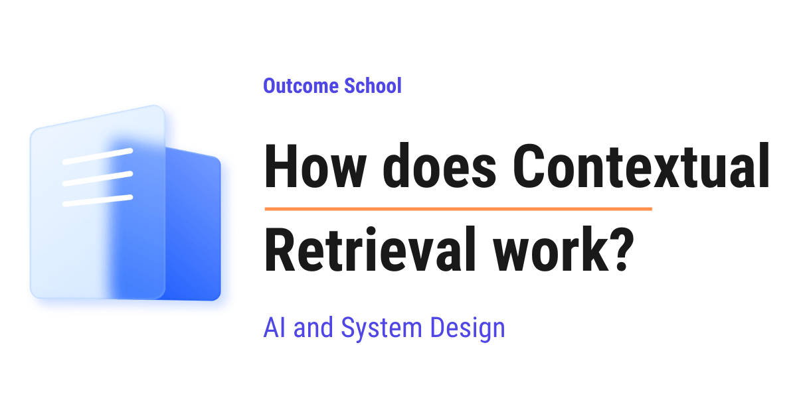

# How does Contextual Retrieval work?

> **Module 9 · Lesson 9.8**  
> Source: [Outcome School](https://outcomeschool.com/blog/how-does-contextual-retrieval-work) · Published: October 6, 2026 · Reading time: ~15 min · Tags: `llm`, `ai`, `system-design`

---



Contextual Retrieval is a way to improve RAG by adding a short note to every chunk of a document before we store it. The note explains where the chunk comes from, so the system can find the right chunk even when the chunk alone does not say enough.

In this blog, we will learn about how Contextual Retrieval works. We will also see why splitting documents into chunks loses important information, how an LLM writes a short context note for every chunk, how Contextual Embeddings and Contextual BM25 use that note, how reranking makes the results better, how prompt caching keeps the cost low, and where it works well and where it fails.

We will cover the following:

- What is a chunk?
- How does normal retrieval find chunks?
- The problem: chunks lose their context
- What is Contextual Retrieval?
- How does Contextual Retrieval work step by step?
- Contextual Embeddings
- Contextual BM25
- Combining both and adding reranking
- How much does it help?
- How is the cost kept low?
- A simple code example
- When to use it and when not to use it

Let's get started.

## What is a chunk?

Before jumping into Contextual Retrieval, we must know where it is used. In **RAG** (Retrieval-Augmented Generation), we find the right pieces of text from our own documents and give them to an LLM along with the question. If retrieval fails, the LLM gets the wrong text, and the answer is often wrong. Contextual Retrieval improves exactly this step.

Our documents are usually long. A single report can have 100 pages. We cannot give the full 100 pages to the LLM for every question. It is slow and costly.

So, we cut every document into small pieces. Each piece is called a **[chunk](https://outcomeschool.com/blog/chunking-strategies-for-rag)**. A chunk is usually a few hundred words long.

```
       One long document
 +-----------------------------+
 | Page 1 ... Page 100         |
 +-----------------------------+
               ↓
        cut into pieces
               ↓
 [chunk 1] [chunk 2] [chunk 3] ... [chunk 500]
```

Here, we can see that one big document becomes many small chunks. When a question comes, we search among these chunks and pick the top few. Only those chunks go to the LLM.

## How does normal retrieval find chunks?

There are two popular ways to search the chunks. Let's understand both, because Contextual Retrieval improves both of them.

**Way 1: Embeddings (search by meaning)**

**An embedding is a list of numbers that represents the meaning of a piece of text.**

An [embedding model](https://outcomeschool.com/blog/what-are-embeddings) reads a chunk and turns it into a list of numbers. Texts with similar meaning get similar numbers. So, "How do I reset my password?" and "Steps to change a forgotten password" end up close to each other, even though they use different words.

When a question comes, we turn the question into an embedding too, and then pick the chunks whose numbers are closest to it. This is called **[semantic search](https://outcomeschool.com/blog/how-does-semantic-search-work)**, which means search by meaning.

**Way 2: BM25 (search by exact words)**

**BM25 is a classic keyword search method. It scores a chunk higher when it contains the exact words of the question, especially rare words.**

Embeddings are great at meaning, but they are weak at exact matches. Let's say we search for an error code like `TS-999`. The embedding thinks it is "some error code" and brings back chunks about any error code. BM25 looks for the exact word `TS-999` and finds the right chunk.

So, most good RAG systems use both and merge the results. This is called **[hybrid search](https://outcomeschool.com/blog/how-does-hybrid-search-work)**.

Now, let's see the problem.

## The problem: chunks lose their context

When we cut a document into chunks, each chunk is torn away from the rest of the document. It loses its **context**, which means the surrounding information that tells us what the chunk is about.

The best way to learn this is by taking an example.

Suppose we have a financial report of a company named ACME Corp for the second quarter of 2023, which is written as Q2 2023. Somewhere in the middle of it, there is a chunk like below:

```
The company's revenue grew by 3% over the previous quarter.
```

Now, a user asks: "What was the revenue growth for ACME Corp in Q2 2023?"

Let's look at this chunk with fresh eyes. Which company? It just says "the company". Which quarter? It just says "the previous quarter". The words "ACME" and "Q2 2023" are nowhere in the chunk. They were written on page 1 of the report, and that page went into a different chunk.

So, the following issues arise:

- The embedding of this chunk does not carry the meaning "ACME" or "Q2 2023", so semantic search does not rank it high.
- BM25 finds no match for the words "ACME" and "Q2", so keyword search also misses it.
- If we have reports of ten companies, all of them have chunks like "the company's revenue grew by...", and the system cannot tell them apart.

It is like tearing one page out of a book and handing it to someone. The page says "He opened the door", but the person has no idea who "he" is.

## What is Contextual Retrieval?

So, here comes Contextual Retrieval to the rescue.

**Contextual Retrieval is a technique where, before storing each chunk, we ask an LLM to write a short note that explains where the chunk fits in the whole document, and we attach that note to the front of the chunk.**

This technique was introduced by Anthropic in 2024.

Let's take our chunk again. After Contextual Retrieval, it becomes like below:

```
This chunk is from an SEC filing on ACME Corp's performance in Q2 2023;
the previous quarter's revenue was $314 million.
The company's revenue grew by 3% over the previous quarter.
```

Here, the first two lines are the new context note written by the LLM. The last line is the original chunk. An SEC filing is an official financial report that a US company submits to the government.

Now, the chunk says "ACME Corp" and "Q2 2023" clearly. Both the embedding search and the keyword search can find it.

## How does Contextual Retrieval work step by step?

Let's see the full flow.

**Step 1:** We split the document into chunks. This is the same as normal RAG.

**Step 2:** For every chunk, we ask an LLM to write a context note. We give the LLM two things: the full document and the one chunk. We ask it to write a short note that places the chunk inside the document.

Anthropic used a prompt like below:

```
<document>
{{WHOLE_DOCUMENT}}
</document>
Here is the chunk we want to situate within the whole document
<chunk>
{{CHUNK_CONTENT}}
</chunk>
Please give a short succinct context to situate this chunk within the
overall document for the purposes of improving search retrieval of the
chunk. Answer only with the succinct context and nothing else.
```

Here, `{{WHOLE_DOCUMENT}}` is replaced with the full text of the document, and `{{CHUNK_CONTENT}}` is replaced with the chunk. The LLM reads the whole document, so it knows the company name, the date, the section, and etc. Then it writes a short note, usually 50 to 100 tokens, which is roughly 2 to 4 sentences.

**Step 3:** We glue the note to the front of the chunk. Now we have a "contextualized chunk".

**Step 4:** We index the contextualized chunk. We create the embedding from it, and we also add it to the BM25 keyword index.

**Step 5:** We answer questions as usual. When a question comes, we search, pick the top chunks, and give them to the LLM to write the answer.

```
                Document
                    ↓
            Split into chunks
                    ↓
    LLM writes a note for each chunk
                    ↓
   Note + chunk (contextualized chunk)
           ↓                 ↓
    Embedding index     BM25 index
           ↓                 ↓
      Search both with the question
                    ↓
               Top chunks
                    ↓
                   LLM
                    ↓
                 Answer
```

Here, we can see that the only new part is the step where the LLM writes a note for each chunk. Everything else is a normal RAG pipeline.

**Note:** The note is added only once, while preparing the data. At question time, there is no extra LLM call for the notes. So, answering questions is not slower.

## Contextual Embeddings

When we create embeddings from the contextualized chunks, Anthropic calls them **Contextual Embeddings**.

Earlier, the embedding of "The company's revenue grew by 3%..." only meant "some company's revenue grew". Now, the embedding means "ACME Corp's revenue grew 3% in Q2 2023". So, when the user asks about ACME's Q2 growth, the meanings are close, and the chunk comes up near the top.

## Contextual BM25

Similarly, when we build the BM25 keyword index from the contextualized chunks, it is called **Contextual BM25**.

Earlier, the word "ACME" was not in the chunk, so BM25 could never match it. Now, "ACME", "Q2", and "2023" are inside the chunk text, so BM25 gives the chunk a high score.

This is important because keyword search is very strong for names, product codes, IDs, and dates, and these are exactly the things that chunks usually lose.

## Combining both and adding reranking

Now, let's put the pieces together.

First, we run both searches. We take the top chunks from the contextual embeddings and the top chunks from contextual BM25. Then, we merge the two lists into one list, removing duplicates. A chunk that ranks high in both lists gets a better final position. This is hybrid search.

After that, we can add one more step called **[reranking](https://outcomeschool.com/blog/how-does-a-reranker-work)**.

**A reranker is a model that reads the question and each candidate chunk together, and gives a precise score for how relevant that chunk is.**

Let's say the first search brings back 150 candidate chunks. The reranker carefully reads each one with the question and reorders them. Then, we keep only the best 20 and send them to the LLM.

Why not use the reranker on all chunks from the start? Because it is slow. It reads every chunk with the question one pair at a time. Running it on millions of chunks would take too long. So, we use the fast search to shortlist, and the careful reranker to pick the final chunks.

It is like a job hiring process. First, a quick screening of resumes gives a shortlist of 150. Then, a detailed interview picks the best 20.

## How much does it help?

Anthropic tested this on many kinds of data, like codebases, fiction, research papers, and science papers. They measured the **retrieval failure rate**, which means how often the correct chunk was missing from the top 20 results. Lower is better.

Let me tabulate the results for your better understanding.

| Setup | Failure rate in top 20 | Reduction |
| --- | --- | --- |
| Normal embeddings | 5.7% | baseline |
| Contextual Embeddings | 3.7% | 35% fewer failures |
| Contextual Embeddings + Contextual BM25 | 2.9% | 49% fewer failures |
| Contextual Embeddings + Contextual BM25 + Reranking | 1.9% | 67% fewer failures |

Here, we can see that each layer helps. Adding the context note alone removes about one-third of the failures. Adding keyword search and reranking on top removes about two-thirds of the failures.

## How is the cost kept low?

Now, the question is: if we have 500 chunks in a document, we have to send the full document to the LLM 500 times. Is that not very costly?

Here comes **[prompt caching](https://outcomeschool.com/blog/how-does-prompt-caching-work)** into the picture.

**Prompt caching means the LLM provider remembers the processed version of a long, repeated part of the prompt, so the next request with the same part is cheaper and faster.**

In our prompt, the full document is the same for all 500 chunks of that document. Only the small chunk part changes. So, we load the document into the cache once, and for every chunk we reuse it. We pay full price for the document only once, and the rest of the calls cost much less.

Anthropic estimated the one-time cost to be about $1.02 per million document tokens when using Claude 3 Haiku, a small and fast LLM from Anthropic, with prompt caching. A small, cheap model is enough here because writing a two-line note is an easy job.

**Note:** This cost is paid once when we prepare the data. If the documents change, we only redo the notes for the changed documents.

## A simple code example

Let's see the code for creating contextualized chunks. For the sake of understanding, we will keep it short and use a placeholder function `call_llm` that sends a prompt to any LLM and returns the reply.

```python
PROMPT = """<document>
{doc}
</document>
Here is the chunk we want to situate within the whole document
<chunk>
{chunk}
</chunk>
Please give a short succinct context to situate this chunk within the
overall document for the purposes of improving search retrieval of the
chunk. Answer only with the succinct context and nothing else."""
def contextualize(document, chunks):
    result = []
    for chunk in chunks:
        note = call_llm(PROMPT.format(doc=document, chunk=chunk))
        result.append(note + "\n" + chunk)
    return result
```

Here, we have:

- `PROMPT`: the same prompt that we saw earlier, with two blanks for the document and the chunk.
- `contextualize`: it takes one document and its chunks.
- For every chunk, we fill the prompt and call the LLM to get the `note`.
- We glue the note in front of the chunk and save it.

After this, we index these contextualized chunks as below:

```python
contextual_chunks = contextualize(document, chunks)
vectors = embed_model.embed(contextual_chunks)  # Contextual Embeddings
vector_db.add(vectors, contextual_chunks)
bm25_index.add(contextual_chunks)               # Contextual BM25
```

Here, we can see that the rest of the pipeline is unchanged. We just pass the contextualized chunks instead of the raw chunks. `embed_model`, `vector_db`, and `bm25_index` stand for whatever embedding model, [vector database](https://outcomeschool.com/blog/how-does-a-vector-database-work), and keyword index we already use.

**Note:** In real code, we turn on prompt caching for the document part so that the repeated document is not charged at full price every time.

## When to use it and when not to use it

Contextual Retrieval works well when:

- Chunks often use words like "the company", "it", "this method", or "the above table" that point to something outside the chunk.
- We have many similar documents, like reports of many companies or many versions of a manual.
- Our users search with names, codes, and dates that usually appear only at the top of a document.

It has some limits:

- It adds one LLM call per chunk while preparing data. For a huge collection, this takes time and money, even with caching.
- The note is written by an LLM, and an LLM can get things wrong. A wrong note can mislead the search.
- If our chunks are already self-contained, like an FAQ where each answer repeats the question, the gain is small.
- If our whole knowledge base is small, we often do not need RAG at all. Anthropic suggests that if the knowledge base is smaller than about 200,000 tokens (roughly 500 pages), we can put the whole thing in the prompt.

We can also customize the prompt for our domain. For example, for a legal knowledge base, we can ask the LLM to always mention the case name and the section number in the note.

Contextual Retrieval improves the chunk side of the search. There is also a trick that improves the question side, where the model first writes a hypothetical answer and we search with that. Another one is [Query Rewriting and Multi-Query Retrieval](https://outcomeschool.com/blog/how-do-query-rewriting-and-multi-query-retrieval-work), where an LLM turns the question into one clearer query or several different ones. We have a detailed blog on [how HyDE works in RAG](https://outcomeschool.com/blog/how-does-hyde-work) that explains this step by step.

Let me tabulate the differences between normal retrieval and Contextual Retrieval for your better understanding so that you can decide which one to use based on your use case.

| Point | Normal retrieval | Contextual Retrieval |
| --- | --- | --- |
| What we store | Raw chunk | Context note + chunk |
| Knows the company, date, section | Only if written inside the chunk | Yes, the note adds it |
| Extra work while preparing data | None | One LLM call per chunk |
| Extra work at question time | None | None |
| Cost | Lower | Slightly higher, one time |
| Retrieval quality | Good | Better, fewer missed chunks |

Now we must have understood how Contextual Retrieval works, how it adds the lost context back to every chunk, and when to use it.

## Frequently Asked Questions

### Does Contextual Retrieval make answering questions slower?

No. Contextual Retrieval does not slow down answering questions. The context note is written only once, while we prepare the data. When a question comes, there is no extra LLM call for the notes. We search the contextualized chunks, pick the top ones, and give them to the LLM, just like normal RAG.

### Do we need a large LLM to write the context notes?

No. A small, cheap model is enough, because writing a short two-line note is an easy job. Anthropic used Claude 3 Haiku, a small and fast LLM, with prompt caching and estimated the one-time cost to be about $1.02 per million document tokens.

### Can we use Contextual Embeddings without BM25 and reranking?

Yes. Contextual Embeddings alone reduce the retrieval failure rate in the top 20 results from 5.7% to 3.7%, which is 35% fewer failures. Adding Contextual BM25 brings it to 2.9%, and adding reranking on top brings it to 1.9%, which is 67% fewer failures.

### What happens when our documents change?

We only redo the context notes for the documents that changed. The cost of writing the notes is paid once when we prepare the data, so the unchanged documents keep their existing contextualized chunks and do not need any new LLM calls.

### Do we always need RAG and Contextual Retrieval?

No. If our whole knowledge base is small, we often do not need RAG at all. Anthropic suggests that if the knowledge base is smaller than about 200,000 tokens, which is roughly 500 pages, we can put the whole thing in the prompt instead.
