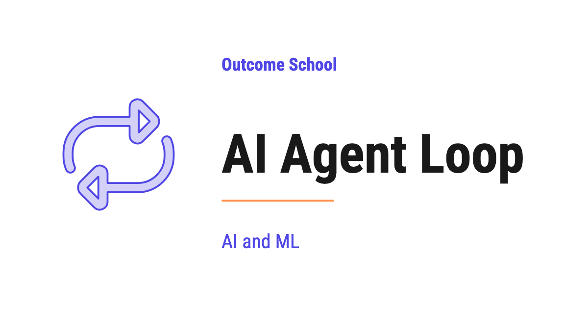

# What is an AI Agent Loop?

> **Module 10 · Lesson 10.3**  
> Source: [Outcome School](https://outcomeschool.com/blog/ai-agent-loop) · Published: May 28, 2026 · Reading time: ~18 min · Tags: `ai-agent`, `llm`, `ai`, `machine-learning`

---



The AI Agent Loop is the piece of code that runs an AI Agent. It sends the current situation to the LLM, runs the action the LLM picks, feeds the result back, and repeats until the task is done.

In this blog, we will learn about the AI Agent Loop - what it is, why an AI Agent needs it, the think-act-observe cycle that powers it, how the loop knows when to stop, and the common ways the loop fails.

We will cover the following:

- The Big Picture
- What is the AI Agent Loop?
- Why an AI Agent Needs a Loop
- The Think-Act-Observe Cycle
- The Loop Step by Step
- The Loop in Real Code
- Parallel Tool Calls in One Turn
- How the Loop Knows When to Stop
- Common Loop Failures
- Quick Summary

Let's get started.

## The Big Picture

Before we go into the details, let's understand the big picture.

An [AI Agent](https://outcomeschool.com/blog/ai-agent) is a system built around an LLM that does not just answer once and stop. It keeps working on a goal - thinking, taking actions, checking results, and thinking again - until the goal is done. The part that keeps it going is the **AI Agent Loop**.

The AI Agent Loop is the engine of every AI Agent. It is the code that sends the goal to the LLM, runs the tool the LLM picks, feeds the result back, and repeats - again and again - until the task is complete.

In simple words:

**AI Agent Loop = Think -> Act -> Observe -> repeat until the goal is achieved.**

Think of the loop like the workday of a new intern. The intern does not finish the whole job in one go. They read the task, decide what to do first, do it, check the result, and decide the next step. They repeat this all day until the work is done. The AI Agent Loop is that same workday - just running in code, faster, and without breaks.

Remove the loop, and the LLM can only answer one question and stop. Add the loop, and the same LLM becomes an agent that can finish real, multi-step tasks.

## What is the AI Agent Loop?

Now that we have the big picture, let's define it clearly.

**The AI Agent Loop is the runtime - the piece of code that actually runs the agent.** It is also called the **agentic loop** or simply the **agent loop**. It repeatedly sends the current situation to the LLM, reads the action the LLM decides on, executes that action, and feeds the result back to the LLM for the next decision.

It is called a loop because it literally runs in a cycle. One pass through the cycle is called a **step** or a **turn**. Here is where the loop sits in the agent, as below:

```
+------------------------------------------------+
|                      Loop                      |
|                                                |
|   Instructions --->  +-------+                 |
|                      |       |                 |
|   Memory       --->  |  LLM  | <-----+         |
|                      +-------+       |         |
|                          |           |         |
|                          | pick      | result  |
|                          v           |         |
|                      +-------+       |         |
|                      | Tools | ------+         |
|                      +-------+                 |
+------------------------------------------------+
```

Here, we can see that the loop is the outer box. It wraps everything - the LLM, the Instructions, the Memory, and the Tools. The Instructions and Memory go into the LLM, the LLM picks a tool, the tool returns a result, and that result goes back to the LLM. The loop is what carries this cycle around and around.

Now, here is the most important thing to understand:

**The LLM does not call tools itself. The loop does.** The LLM only decides which tool to use and what inputs to pass. The loop is the one that actually runs the tool and feeds the result back. The LLM is the brain. The loop is the runtime that turns the brain's decisions into real actions.

So, here the loop comes into the picture the moment a task is too big to solve in a single LLM call.

Designing this loop on purpose - how many turns it gets, what carries forward, and when it must stop - is called [Loop Engineering](https://outcomeschool.com/blog/what-is-loop-engineering), and we have a detailed blog on it that explains this in depth.

## Why an AI Agent Needs a Loop

Now, a natural question arises - why do we even need a loop? Why not just ask the LLM once and be done?

There are two solid reasons.

**Reason 1: One LLM call cannot finish a multi-step task.** Suppose the task is "Find me the cheapest flight to Delhi tomorrow." The LLM cannot answer this from its own knowledge - it needs to search live flight data, read the results, compare the prices, and then pick the cheapest one. That is many steps, and each step depends on the result of the step before it. A single call cannot do this. The loop is what lets the LLM take one step, see the result, and then take the next step.

**Reason 2: The LLM is stateless.** This one surprises many people. The LLM does not remember anything between calls. Every time we call it, it starts fresh, with no memory of the previous call. So, how does the agent keep track of progress across many steps?

The answer is the loop. On every turn, the loop sends the **entire history so far** back to the LLM - the original goal, every tool the LLM picked, and every result that came back. This growing history is the agent's short-term memory, and the loop is what carries it from one turn to the next. Without the loop holding this history and re-sending it, the LLM would forget everything after each call.

In simple words:

**The LLM is the brain, but it has no memory of its own and can only think once per call. The loop gives it memory across calls and lets it think again and again until the job is done.**

This is why the loop is not optional. It is the part that turns a one-shot LLM into a goal-completing agent. To go deeper on how the agent stores and reuses this history, we have a detailed blog on [AI Agent Memory](https://outcomeschool.com/blog/ai-agent-memory).

## The Think-Act-Observe Cycle

Now, let's zoom into a single turn of the loop. Every turn, no matter how complex the agent, follows the same three-beat cycle. Let's decode each beat.

**1. Think.** The loop sends the goal, the instructions, the list of tools, and the full history to the LLM. The LLM reads all of it and decides the next action - either "use this tool with these inputs" or "I am done, here is the final answer." This decision is the think beat. All the reasoning happens here, inside the LLM.

**2. Act.** If the LLM picked a tool, the loop runs that tool with the inputs the LLM gave - it searches the web, runs the query, calls the API, whatever the tool does. This is the act beat. Remember, the loop does the acting, not the LLM.

**3. Observe.** The tool returns a result. The loop takes that result and adds it to the history as an **observation**, then feeds the whole history back to the LLM on the next turn. This is the observe beat. The observation is how the LLM learns what happened when its chosen action ran.

Then the cycle repeats. Think, act, observe. Think, act, observe. Each turn, the LLM knows a little more than the turn before, because the observation from the previous turn is now part of the history. The agent keeps closing in on the goal, one turn at a time.

> Think -> Act -> Observe is the heartbeat of every AI Agent.

This is the core idea behind the most common agent pattern, the [ReAct Agent](https://outcomeschool.com/blog/react-agent), where "ReAct" stands for Reason and Act. But the cycle is bigger than any single pattern - every agent loop is some version of think, act, and observe.

## The Loop Step by Step

Now, let's put the cycle into the full picture. Here is the shape of the AI Agent Loop, as below:

```
   +----------------+
   |  User's Goal   |
   +----------------+
            |
            v
   +----------------+        +-------------+
   |      LLM       |------->|    Tool     |
   |  (decides:     |        +-------------+
   |   pick a tool  |              |
   |   or return    |              v
   |   final answer)|        +-------------+
   |                |<-------| Observation |
   +----------------+        +-------------+
            |
            | when goal is achieved
            v
   +----------------+
   |  Final Answer  |
   +----------------+
```

The goal comes in at the top. The LLM looks at it and decides one of two things - which tool the loop should call next, or the final answer directly. When the LLM picks a tool, the loop runs it and produces an observation, which is fed back to the LLM. The LLM then decides again. This little loop between the LLM, the Tool, and the Observation keeps running until the LLM decides the goal is achieved and returns the final answer.

The best way to learn this is by taking an example. Suppose the user gives the agent this goal: "Find me the 3 cheapest direct flights to Delhi tomorrow under 8000 rupees."

Here is what happens on every turn of the loop:

**Step 1:** The user gives the agent the goal - "Find me the 3 cheapest direct flights to Delhi tomorrow under 8000 rupees."

**Step 2:** The loop sends the goal, the instructions, and the history so far to the LLM.

**Step 3:** The LLM thinks and decides the next action. For example, "First I need to search for flights." (Think)

**Step 4:** The loop runs the tool the LLM asked for - the flight search tool. (Act)

**Step 5:** The tool returns a result. The loop feeds it back to the LLM as an observation. (Observe)

**Step 6:** The LLM reads the observation and decides the next action. Maybe filter by price. Maybe pick the top 3 cheapest. (Think again)

**Step 7:** The loop runs the next tool, and the cycle repeats - think, act, observe.

**Step 8:** When the LLM decides the goal is achieved, it returns a final answer to the user - "Done. Here are the 3 cheapest direct flights - AI-123 at 6500 rupees, IX-201 at 7200 rupees, and SG-312 at 7800 rupees."

Here, we can notice that the flow is not hardcoded. The loop does not know in advance how many turns it will take or which tools it will use. The LLM decides that as it goes, one turn at a time, based on what it observes. The loop just keeps the cycle running.

That's the beauty of the AI Agent Loop. Every decision comes from the LLM. Every action is executed by the loop. The history holds the progress. The loop keeps them going together until the job is done.

## The Loop in Real Code

Now, here is the important realization:

**If we write code that takes the input, sends it to an LLM, executes the actions, and repeats this loop until the task is complete - our piece of code is an AI Agent.**

That is all the loop is. No magic. No black box. Just a cycle, an LLM, some tools, and a growing history - all wired together in code.

Let's see what the loop looks like in real Python code, as below. Here, `call_llm` is any function that sends the messages and the list of tools to the LLM of our choice - Claude, GPT, Gemini, or any other - and returns its response. And `call_tool` is any function that runs a tool by name with the given arguments and returns the result. The code below is independent of any specific provider.

```python
async def run_agent(user_goal, tools, max_steps=10):
    messages = [{"role": "user", "content": user_goal}]
    step = 0
    while True:
        # Safety stop: bail out if we hit the step limit
        if step >= max_steps:
            return "Reached step limit without completing the task."
        step += 1
        # Ask the LLM what to do next
        response = await call_llm(messages, tools)
        # If the LLM says "I am done", stop the loop and return the final answer
        if response.is_done:
            return response.final_answer
        # Otherwise, run each tool the LLM picked and feed the result back
        for tool_call in response.tool_calls:
            result = await call_tool(tool_call.name, tool_call.arguments)
            messages.append({
                "role": "tool",
                "name": tool_call.name,
                "content": str(result),
            })
```

Here, we have the entire AI Agent Loop in about 20 lines of Python. Let's walk through the important parts:

- **The `while True` loop.** This is the loop itself - the runtime of the agent. It keeps going until either the LLM says it is done or we hit the step limit.
- **The step limit.** We bail out after `max_steps` turns. This protects us from infinite loops - one of the most common loop failures, which we will cover soon.
- **The LLM call (Think).** We send the full conversation history along with the list of tools. The `await` is what makes this asynchronous - while the LLM is thinking, our program can do other work.
- **The stop check.** If `response.is_done` is `True`, the LLM is telling us "I am done, here is the final answer." We return that answer and exit the loop.
- **The tool-call branch (Act and Observe).** If the LLM picked one or more tools, we run each one with `call_tool` using the arguments the LLM gave, and append the result to `messages` so it is fed back to the LLM on the next turn.

That is the complete skeleton of an AI Agent Loop - a `while` loop, an LLM call inside it, a check for the stop signal, and a tool-call branch that feeds results back. Everything else we add on top - long-term memory, parallel tool calls, retries, logging - is polish around this core loop.

Notice that `messages` is the history. It starts with the user's goal, and on every turn we append the tool results to it. This is exactly the short-term memory we talked about earlier. The loop holds it, grows it, and re-sends it every turn, because the LLM itself remembers nothing.

## Parallel Tool Calls in One Turn

Till now, we have shown the loop running one tool per turn. But the loop can do more.

Modern LLMs like Claude and GPT can output multiple [tool calls](https://outcomeschool.com/blog/how-does-function-calling-work-in-llms) in a single turn. For example, if the agent needs to check the weather in three cities, the LLM can ask for all three searches at once instead of one at a time. The loop can then run all three tools in parallel and feed all three results back together.

This is why, in the code above, we loop over `response.tool_calls` - there can be more than one. A real runtime runs these in parallel to save time.

The shape of the loop stays exactly the same - the LLM decides, the tools run, the observations feed back. The only difference is that a single turn can carry more than one action when the LLM chooses to. Running independent tools in parallel makes the agent faster without changing how the loop works.

The same loop also powers agents whose actions are not API calls at all but clicks and keystrokes on a screen. We have a detailed blog on [How do Computer-Use Agents work?](https://outcomeschool.com/blog/how-do-computer-use-agents-work) that explains this end to end.

## How the Loop Knows When to Stop

A loop that never stops is a serious problem. So, the next big question is: how does the loop know when to stop?

There are two stop conditions, and a good loop has both.

**1. The natural stop - the LLM says it is done.** This is the normal way a loop ends. On some turn, the LLM looks at the history, decides the goal is achieved, and returns a final answer instead of picking another tool. The loop sees this and exits. In our code, this is the `if response.is_done` check. This is the stop we want - the agent finished the job.

**2. The safety stop - the step limit.** What if the LLM never says it is done? Then it keeps picking tools forever. To protect against this, the loop counts its turns and bails out after a maximum number of steps - the `max_steps` check in our code. This is a safety net, not the goal. If the loop hits this limit often, it usually means the instructions or tools need fixing.

In practice, production loops add a few more guards on top of these two:

- **A time budget** - stop if the agent has been running too long.
- **A cost budget** - stop if the agent has spent too many tokens or too much money.
- **A human interrupt** - let a person stop the loop at any time.

**Note:** The natural stop comes from the LLM's decision. The safety stop comes from our code. We must always have both. Trusting the LLM to always stop on its own is risky - the step limit is what keeps a misbehaving agent from running forever.

Claude Code is a real coding agent that runs exactly this loop - gather context, take action, verify, and repeat until the task is done. We have a detailed blog on [how Claude Code works](https://outcomeschool.com/blog/how-does-claude-code-work) that walks through it end to end.

## Common Loop Failures

The loop is simple, but it fails in specific ways. Knowing these failures helps us build more reliable agents. Let's decode each one.

**1. Infinite loops.** The agent keeps picking tools and never returns a final answer. Without a guard, the loop runs forever, burning time and money.

**How to fix:** Set a hard step limit, like the `max_steps` in our code. This is the single most important safety guard in any loop.

**2. Getting stuck repeating the same action.** The agent calls the same tool with the same inputs over and over, gets the same result each time, and never makes progress.

**How to fix:** Detect repeated tool calls and feed a clear note back to the LLM, like "You already tried this and got this result - try a different approach." Often, better instructions also fix this.

**3. Context overflow.** Because the loop re-sends the full history every turn, that history keeps growing. After many turns, it can grow too large to fit in the model's [context window](https://outcomeschool.com/blog/context-engineering) - the maximum amount of text the model can read in one go.

**How to fix:** [Summarize older turns](https://outcomeschool.com/blog/how-does-context-compaction-work) or drop stale observations once the history gets long, so the most useful information stays in the window.

**4. Premature stopping.** This is the opposite of an infinite loop. The agent returns a final answer too early, before the task is actually complete.

**How to fix:** Make the instructions very clear about [when the task is truly done](https://outcomeschool.com/blog/ai-is-only-as-good-as-our-definition-of-done), so the LLM does not stop too soon.

**Very important:** Production-grade AI Agents are mostly about handling these loop failures well. The happy path - where the loop runs a few turns and finishes - is easy. The edge cases are where the real engineering happens. To learn how to systematically measure outcome, trajectory, and tool use for AI Agents, we have a detailed blog on [AI Agent Evaluation](https://outcomeschool.com/blog/ai-agent-evaluation).

Now, we have understood what the AI Agent Loop is, how it runs, and how it fails. Let's wrap up with a quick recap.

## Quick Summary

Let's recap what we have decoded:

- **AI Agent Loop = Think -> Act -> Observe -> repeat until the goal is achieved.** It is the runtime that keeps the agent going.
- **The loop is the engine.** Remove it, and the LLM can only answer once and stop. Add it, and the LLM becomes a goal-completing agent.
- **The LLM does not call tools - the loop does.** The LLM only decides which tool to use. The loop runs it and feeds the result back.
- **Two reasons the loop is needed.** One LLM call cannot finish a multi-step task, and the LLM is stateless - the loop carries the history from turn to turn.
- **The three-beat cycle.** Think (the LLM decides), Act (the loop runs the tool), Observe (the result feeds back). Repeat.
- **Two stop conditions.** The natural stop (the LLM says it is done) and the safety stop (the step limit). Always have both.
- **Loop failures.** Infinite loops, getting stuck repeating an action, context overflow, and premature stopping. Handling these is the real work.

The AI Agent Loop is a small piece of code - about 20 lines - but it is the piece that turns a one-shot LLM into a system that can pursue a goal on its own. Once we understand the loop, we understand the heart of every AI Agent.

## Frequently Asked Questions

### Does the LLM remember earlier steps of the agent loop?

No. The LLM is stateless and remembers nothing between calls. On every turn, the loop sends the entire history back to the LLM, including the goal, every tool it picked, and every result. This growing history is the agent's short-term memory, and the loop is what carries it forward.

### Is the AI Agent Loop the same as a ReAct Agent?

No. ReAct is the most common agent pattern built on the think, act, observe cycle, where ReAct stands for Reason and Act. But the cycle is bigger than any single pattern. Every agent loop is some version of think, act, and observe.

### How much code does it take to build an AI Agent Loop?

The whole loop fits in about 20 lines of Python. It is just a `while` loop, an LLM call inside it, a check for the stop signal, and a branch that runs tools and feeds results back. Memory, parallel tool calls, retries, and logging are polish around this core.

### What does it mean if an agent keeps hitting the step limit?

It usually means the instructions or tools need fixing. The step limit is a safety net, not the goal, and the normal way a loop ends is the LLM saying it is done. Hitting the limit often is a sign the agent is not reaching the goal on its own.

### Why does a long-running agent run out of context?

The loop re-sends the full history every turn, so that history keeps growing. After many turns, it can grow too large to fit in the model's context window. We fix this by summarizing older turns or dropping stale observations, so the most useful information stays in the window.
