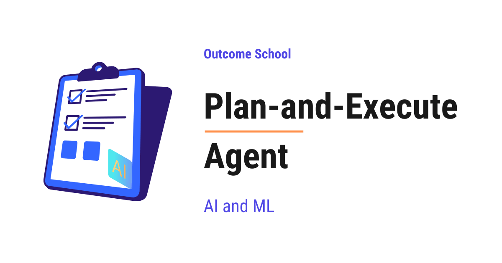

# What is a Plan-and-Execute Agent and How Does It Work?

> **Module 10 · Lesson 10.5**  
> Source: [Outcome School](https://outcomeschool.com/blog/plan-and-execute-agent) · Published: May 4, 2026 · Reading time: ~14 min · Tags: `ai-agent`, `llm`, `ai`, `machine-learning`

---



A Plan-and-Execute Agent is an AI Agent that first writes the full plan up front, and then runs that plan step by step, instead of figuring out the next step after every action.

In this blog, we will learn about the Plan-and-Execute Agent - what it is, its anatomy, how it plans and runs the steps, how it differs from a ReAct Agent, and how to handle its common failure modes.

We will cover the following:

- What is a Plan-and-Execute Agent?
- Plan-and-Execute Agent vs AI Agent
- Anatomy of a Plan-and-Execute Agent
- How a Plan-and-Execute Agent Works
- A Full Trace Example
- Plan-and-Execute Agent vs ReAct Agent
- Common Failure Modes and How to Fix Them
- Quick Summary

Let's get started.

## What is a Plan-and-Execute Agent?

A **Plan-and-Execute Agent** is an [**AI Agent**](https://outcomeschool.com/blog/ai-agent) built using the **Plan-and-Execute** pattern. In this pattern, the agent first writes the full plan up front, and then runs the plan step by step. It does not figure out the next step on the fly at every turn. It thinks once at the start, walks through the plan, and re-plans only when reality does not match the plan.

Let's decompose the term:

**Plan-and-Execute Agent = Plan + Execute + Agent**

**Plan** is the thinking part - a strong LLM reads the user's task and writes a full step-by-step plan to solve it. **Execute** is the doing part - typically a smaller, cheaper LLM picks a tool for each step, and the runtime calls the tool. **Agent** is the wrapper around both that connects the Planner and the Executor, tracks progress, and decides when the task is done.

In simple words:

**Plan-and-Execute Agent = A Planner that writes the steps + An Executor that runs the steps + A loop that connects them.**

Think of a Plan-and-Execute Agent like a project manager and a worker on a team. The project manager reads the requirement, writes a clear list of tasks, and hands it over. The worker picks up each task, finishes it, and reports back. If things go off track, the project manager updates the plan. A Plan-and-Execute Agent works the exact same way - one part plans, the other part executes.

A plain LLM call gives us one response and stops. A Plan-and-Execute Agent gives us a full plan, runs each step, and keeps going until every step is complete. So, the Plan-and-Execute Agent pattern is used whenever a task has many steps and we want the agent to think through the whole journey before starting.

Before an agent plans and executes on its own, the simplest way to run a task as a series of steps is [Prompt Chaining](https://outcomeschool.com/blog/how-does-prompt-chaining-work), where we pass the output of one prompt into the next by hand.

## Plan-and-Execute Agent vs AI Agent

Now, a natural question arises - if a Plan-and-Execute Agent is an LLM in a loop with tools, isn't that just an AI Agent? Let's clear this up.

**Plan-and-Execute is a pattern to build AI Agents. It is not a different category.**

[**AI Agent**](https://outcomeschool.com/blog/ai-agent) is the category - any system where an LLM is wrapped in [a loop](https://outcomeschool.com/blog/ai-agent-loop) with tools and memory. It does not say *how* the loop is structured, *whether* the agent plans ahead, or *whether* the planning and execution are split across different LLM calls.

**Plan-and-Execute** is a pattern for building that loop, where the agent first generates the full plan in one LLM call, and then runs each step of the plan with another LLM call (or a series of them). The planning is done once at the start. The execution happens step by step after that.

So when we say "Plan-and-Execute Agent," we mean an AI Agent built with the Plan-and-Execute pattern. Other patterns like [ReAct](https://outcomeschool.com/blog/react-agent), [Reflection](https://outcomeschool.com/blog/reflection-agent), and [Agentic RAG](https://outcomeschool.com/blog/agentic-rag) also build AI Agents - they just shape the loop differently.

In simple words:

**Plan-and-Execute is a way to build an AI Agent. It is one of the common patterns, especially for tasks with many steps.**

## Anatomy of a Plan-and-Execute Agent

A Plan-and-Execute Agent has five parts. Let's decode each one.

```
+--------------------------------------------------------+
|                     The Agent Loop                     |
|                                                        |
|   User Task                                            |
|       |                                                |
|       v                                                |
|   +---------+                                          |
|   | Planner |  --->  Plan: [Step 1, Step 2, Step 3]    |
|   +---------+                                          |
|       |                                                |
|       v                                                |
|   +----------+         +-------+                       |
|   | Executor |  <--->  | Tools |                       |
|   +----------+         +-------+                       |
|       |     ^                                          |
|       v     | (updated plan, if needed)                |
|   +------------+                                       |
|   | Re-Planner |                                       |
|   +------------+                                       |
|       |                                                |
|       v                                                |
|   Final Answer (when the task is done)                 |
+--------------------------------------------------------+
```

**1. The Planner.** This is the LLM that writes the plan. It reads the user's task and produces a list of steps to solve it. The plan is usually a numbered list, where each step is a small, clear instruction. A good Planner breaks the task into steps that the Executor can run one at a time.

**2. The Executor.** This is the part that runs each step of the plan. The LLM inside the Executor is usually smaller and cheaper than the Planner, since each step is much narrower than the full task. The LLM picks a tool for the current step, the runtime calls the tool, and the result is saved into memory. In some setups, the Executor is itself a small [sub-agent](https://outcomeschool.com/blog/ai-subagents) like a ReAct loop. The Executor does not plan ahead - it only handles the current step and moves on.

**3. The Tools.** These are the actions the Executor can take - search the web, query a database, run a calculator, send an email, read a file, and etc. Each tool has a name, a description, and an input schema.

**4. The [Memory](https://outcomeschool.com/blog/ai-agent-memory).** This is the running history of the agent - the original task, the plan, every step that has been executed, and every result. The Planner reads it when revising the plan. The Executor reads it to know what has already been done.

**5. The Re-Planner.** This is the LLM that decides what to do after each step is executed. It checks the result, compares it to the plan, and decides one of three things - keep going with the next step, update the plan if something has changed, or stop because the task is done. In some setups, the Re-Planner is the same LLM as the Planner, just called again with the latest state.

All five parts work together. The first four - Planner, Executor, Tools, and Memory - are the must-have parts. The Re-Planner is optional in the simplest setups, but most production agents include it to handle the cases where reality does not match the plan.

## How a Plan-and-Execute Agent Works

The flow is simple. The agent runs through three phases - Plan, Execute, and Re-Plan.

**Phase 1: Plan.** The user gives the agent a task. The Planner reads the task and writes a step-by-step plan. The plan is saved into memory.

**Phase 2: Execute.** The Executor picks the first step of the plan. The LLM recommends the right tool, the runtime calls it, reads the result, and saves the result into memory. Then it moves to the next step.

**Phase 3: Re-Plan.** After every step (or after a few steps), the Re-Planner reads the current state. If everything is on track, the Executor continues. If a step failed, returned an unexpected result, or made the rest of the plan invalid, the Re-Planner updates the plan. If the task is done, the agent stops and returns the final answer.

The loop continues until the plan is fully executed or the Re-Planner decides we have the final answer. Shaping that repeat - the step budget, the re-plan trigger, and the exit - is [Loop Engineering](https://outcomeschool.com/blog/what-is-loop-engineering).

In simple words:

**Plan once. Execute step by step. Re-plan when reality does not match the plan.**

## A Full Trace Example

Let's see this in action. Just for the sake of understanding, suppose the user gives the agent this task:

> "Find the current population of India and Japan, and tell me which country has more people and by how much."

**Phase 1: Plan.**

The Planner writes the plan:

```
1. Search for the current population of India.
2. Search for the current population of Japan.
3. Compare the two numbers.
4. Return the country with the larger population and the difference.
```

**Phase 2: Execute.**

**Step 1.** The Executor calls the search tool with the query `"current population of India"`. Suppose the tool returns `1.43 billion`. The result is saved into memory.

**Step 2.** The Executor calls the search tool with the query `"current population of Japan"`. Suppose the tool returns `124 million`. The result is saved into memory.

**Step 3.** The Executor calls the calculator tool with `1,430,000,000 - 124,000,000`. The tool returns `1,306,000,000`. The result is saved into memory.

**Step 4.** The Executor reads the memory and produces the final answer.

**Phase 3: Re-Plan.**

After each step, the Re-Planner checks the state. Everything is on track, so it does not change the plan. After Step 4, the Re-Planner sees that the task is done. The agent stops.

**Final Answer:**

> "India has more people than Japan by about 1.31 billion. India has 1.43 billion people, and Japan has 124 million people."

Here, we can notice that the agent did not figure out the steps one at a time. It planned the whole journey first, then walked through it.

## Plan-and-Execute Agent vs ReAct Agent

A [**ReAct Agent**](https://outcomeschool.com/blog/react-agent) and a Plan-and-Execute Agent are two different patterns to build an AI Agent. Both are common. The difference is about *when* the thinking happens.

A ReAct Agent thinks one step at a time. At every turn, it writes a Thought, picks an Action, reads the Observation, and thinks again. It does not plan ahead. It decides the next step only after seeing the latest result.

A Plan-and-Execute Agent thinks once at the start. It writes the whole plan up front, then runs each step. It re-plans only if something goes wrong.

Let's see this difference visually.

```
ReAct Agent - the LLM thinks at every step:
  +---------+   +--------+   +-------------+
  | Thought |-->| Action |-->| Observation |--+
  +---------+   +--------+   +-------------+  |
       ^                                      |
       +-- (loop until final answer) ---------+
Plan-and-Execute Agent - the LLM thinks once, then runs:
  +------+   +--------+   +--------+   +--------+
  | Plan |-->| Step 1 |-->| Step 2 |-->| Step 3 |--> Final Answer
  +------+   +--------+   +--------+   +--------+
                              ^
                              +-- (re-plan only if a step fails)
```

Here, we can see that the ReAct Agent loops back to the LLM on every step, while the Plan-and-Execute Agent calls the LLM once for planning and then runs each step in sequence. The ReAct Agent pays for thinking at every turn. The Plan-and-Execute Agent pays for thinking once up front.

Let me tabulate the differences between a ReAct Agent and a Plan-and-Execute Agent for your better understanding so that you can decide which one to use based on your use case.

| Property | ReAct Agent | Plan-and-Execute Agent |
| --- | --- | --- |
| When the LLM plans | One step at a time | Full plan up front, then re-plan only if needed |
| LLM calls per task | One LLM call per step | One big planning call + smaller calls per step |
| Cost | Higher when many steps are needed | Lower for tasks with many predictable steps |
| Latency | Slower for long tasks (many big calls) | Faster for long tasks (Executor calls can be smaller) |
| Adaptability | Very high - adapts at every turn | Lower - adapts only when re-planning |
| Best for | Open-ended tasks where the next step is unclear | Multi-step tasks with a clear path to the answer |
| Visibility | Reasoning is visible at every turn | The whole plan is visible up front |

In simple words:

**Use ReAct when the next step depends on the last result. Use Plan-and-Execute when the steps can be planned ahead.**

## Common Failure Modes and How to Fix Them

A Plan-and-Execute Agent is powerful, but it has its own set of mistakes that we must handle.

**1. Bad Plan.** The Planner writes a plan that is incomplete, in the wrong order, or skips important steps. The whole run goes off track from the start. To fix this, we must give the Planner a clear system prompt with examples of good plans, list the available tools, and ask it to write small, concrete steps instead of vague ones.

**2. Step Drift.** The Executor reads a step like "search the docs for the retry policy" and runs a public web search instead. The result is technically a search, but it does not fit what the Planner had in mind. To fix this, we must make each step in the plan specific - include the exact tool name, the exact input, and the expected output. The smaller and clearer the step, the less the Executor can drift.

**3. No Re-Planning.** A step fails or returns a surprise, but the agent keeps running the rest of the plan blindly. The final answer is wrong. To fix this, we must always run the Re-Planner after each step, or at least after any step that returns an error or an unexpected result. The Re-Planner reads the new state and decides whether the rest of the plan is still valid.

**4. Over-Planning.** The Planner writes a giant plan with 30 steps for a task that needs 3. Each extra step costs an LLM call and a [tool call](https://outcomeschool.com/blog/how-does-function-calling-work-in-llms). To fix this, we must tell the Planner to write the smallest plan that solves the task and to merge steps that can be done together.

**5. Plan Becomes Outdated.** The plan was correct at the start, but after a few steps, the situation has changed - a search returned new information, a tool returned data in a different format, or a step revealed that an assumption was wrong. The rest of the plan no longer fits. To fix this, the Re-Planner must rewrite the remaining steps based on the latest state, not just continue with the original plan.

**6. Infinite Re-Planning.** The Re-Planner keeps rewriting the plan without making progress. The agent loops forever. To fix this, we must set a maximum number of re-plans, a maximum number of total steps, and a stop condition that triggers when the plan has not changed for two re-plans in a row.

Now, we have understood what a Plan-and-Execute Agent is and how to handle the common failure modes.

## Quick Summary

Let's recap what we have learned:

- **Plan-and-Execute Agent** is an AI Agent built using the Plan-and-Execute pattern - plan the whole task up front, then run the plan step by step.
- **Plan-and-Execute Agent = Plan + Execute + Agent** - the Planner writes the plan, the Executor runs each step, and the Agent loop connects them.
- **Anatomy** has five parts - the Planner, the Executor, the Tools, the Memory, and the Re-Planner.
- **The flow** has three phases - Plan once, Execute step by step, Re-Plan when reality does not match the plan.
- **Plan-and-Execute vs ReAct** - ReAct thinks one step at a time, Plan-and-Execute thinks once up front. Use ReAct for open-ended tasks. Use Plan-and-Execute for multi-step tasks with a clear path.
- **Common failure modes** are Bad Plan, Step Drift, No Re-Planning, Over-Planning, Plan Becomes Outdated, and Infinite Re-Planning - all of them can be handled with a clear system prompt, small steps, and a strict Re-Planner.
- **Plan-and-Execute** is one of the most common patterns to build AI Agents that need to handle long, multi-step tasks reliably.

## Frequently Asked Questions

### Do the Planner and the Executor use the same LLM?

Usually not. The Planner is a strong LLM that writes the full plan, while the LLM inside the Executor is usually smaller and cheaper, since each step is much narrower than the full task. In some setups, the Re-Planner is the same LLM as the Planner, just called again with the latest state.

### Is the Re-Planner required in a Plan-and-Execute Agent?

No. The Re-Planner is optional in the simplest setups. The Planner, Executor, Tools, and Memory are the must-have parts. Still, most production agents include a Re-Planner to handle the cases where reality does not match the plan.

### Can the Executor itself be an agent?

Yes. In some setups, the Executor is itself a small sub-agent, like a ReAct loop. Either way, the Executor does not plan ahead. It only handles the current step, saves the result into memory, and moves on to the next step.

### How do we stop a Plan-and-Execute Agent from re-planning forever?

We put hard limits on the loop. We set a maximum number of re-plans, a maximum number of total steps, and a stop condition that triggers when the plan has not changed for two re-plans in a row. This way, the agent cannot keep rewriting the plan without making progress.
