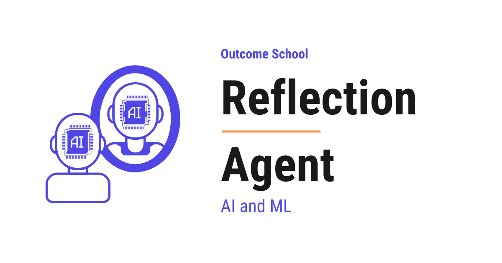

# What is a Reflection Agent? How It Generates, Critiques, and Revises

> **Module 10 · Lesson 10.6**  
> Source: [Outcome School](https://outcomeschool.com/blog/reflection-agent) · Published: May 7, 2026 · Reading time: ~15 min · Tags: `ai-agent`, `llm`, `ai`, `machine-learning`

---



A Reflection Agent is an AI Agent that first writes a draft, then reads and critiques its own draft, and then writes a better version using that critique. It repeats this until the work is good enough.

In this blog, we will learn about the Reflection Agent - what it is, how it is built, its anatomy, how it generates, critiques, and revises its own work, and how to handle its common failure modes.

We will cover the following:

- What is a Reflection Agent?
- Reflection Agent vs AI Agent
- Anatomy of a Reflection Agent
- How a Reflection Agent Works
- A Full Trace Example
- Reflection Agent vs ReAct Agent
- Common Failure Modes and How to Fix Them
- Quick Summary

Let's get started.

## What is a Reflection Agent?

A **Reflection Agent** is an [**AI Agent**](https://outcomeschool.com/blog/ai-agent) built using the **Reflection** pattern. In this pattern, the agent first writes a draft, then reads its own draft and critiques it, then writes a better version using that critique. It repeats this loop until the work is good enough.

Let's decompose the term:

**Reflection Agent = Reflection + Agent**

**Reflection** is the self-review part - the agent reads its own output, judges what is wrong with it, and writes feedback for the next round. **Agent** is the wrapper around the LLM that runs this loop, keeps track of the drafts and critiques, and decides when to stop.

In simple words:

**Reflection Agent = A Generator that writes a draft + A Critic that reviews the draft + A loop that revises until the work is good.**

Think of a Reflection Agent like a writer working with an editor on the same essay. The writer puts down a first draft. The editor reads it and points out what is weak, what is missing, and what is unclear. The writer reads the feedback and writes a better second draft. The editor reads the new draft and points out what still needs work. The loop continues until the editor has nothing more to say. A Reflection Agent works the exact same way - one part writes, the other part reviews, and they keep improving the work together.

A plain LLM call gives us one draft and stops. A Reflection Agent gives us a draft, reviews it, revises it, and keeps going until the work passes its own quality bar. So, the Reflection Agent is useful whenever the first attempt is rarely good enough and we want the agent to improve its own work before handing it back.

Reflection is what we reach for when no exact checker exists for the task. We have a detailed blog on [AI Is Only as Good as Our Definition of Done](https://outcomeschool.com/blog/ai-is-only-as-good-as-our-definition-of-done) that explains this step by step.

## Reflection Agent vs AI Agent

Now, a natural question arises - if a Reflection Agent is an LLM in a loop, isn't that just an AI Agent? Let's clear this up.

**Reflection is a pattern to build AI Agents. It is not a different category.**

[**AI Agent**](https://outcomeschool.com/blog/ai-agent) is the broad category - any system where an LLM is wrapped in [a loop](https://outcomeschool.com/blog/ai-agent-loop) with tools and memory. **Reflection** is one specific way to shape that loop, where the agent generates an output, critiques it, and uses the critique to produce a better one. Other patterns like [ReAct](https://outcomeschool.com/blog/react-agent), [Plan-and-Execute](https://outcomeschool.com/blog/plan-and-execute-agent), and [Agentic RAG](https://outcomeschool.com/blog/agentic-rag) shape the loop differently.

In simple words:

**Reflection is a way to build an AI Agent. It is one of the common patterns, especially for tasks where quality matters more than speed.**

## Anatomy of a Reflection Agent

A Reflection Agent has five parts. Let's decode each one.

```
+--------------------------------------------------------+
|                    The Agent Loop                      |
|                                                        |
|   User Task                                            |
|       |                                                |
|       v                                                |
|   +-----------+         +--------+                     |
|   | Generator |  ---->  | Critic |                     |
|   +-----------+         +--------+                     |
|       ^                     |                          |
|       |                     v                          |
|       |               +------------+                   |
|       +-- (revise) -- | Stop Check | -> Final Output   |
|                       +------------+                   |
+--------------------------------------------------------+
```

**1. The Generator.** This is the LLM that writes the draft. It reads the user's task and produces the first version of the output. On later rounds, it reads the previous draft and the critique, and writes a revised version that addresses the feedback.

**2. The Critic.** This is the LLM that reviews the draft. It reads the draft and writes a critique - what is wrong, what is missing, what could be better. The critique is the signal the Generator uses to improve the next draft. In most setups, the Critic is the same LLM as the Generator, just called with a different prompt that asks it to review the draft. Using two separate models is also possible. The Critic is essentially [LLM as a Judge](https://outcomeschool.com/blog/llm-as-a-judge) used inside the loop - one LLM reading and scoring another LLM's output against a set of criteria.

**3. The Tools.** These are optional helpers the Critic can use to back up its review - search the web to check a claim, run a unit test to check the code, query a database to verify a fact, etc. Reflection Agents with no tools will rely only on the Critic's own judgement. A Critic that can actually run the code, check a citation, or verify a fact is much stronger than one critiquing from its own knowledge alone.

**4. The [Memory](https://outcomeschool.com/blog/ai-agent-memory).** This is the running history of the agent - the original task, every draft, every critique, and the revision count. The Generator reads it to know what to fix. The Critic reads it to track what has already been pointed out so it does not repeat the same feedback. In practice, keeping the full history blows up the context window after a few rounds, so most setups keep only the latest draft and critique, or summarize the older rounds.

**5. The Stop Check.** This is the part that decides when to stop the loop. It can stop when the Critic says the draft is good enough, when the maximum number of rounds is hit, or when two rounds in a row produce the same critique. Without a Stop Check, the loop can run forever. Deciding when a loop stops is one of the core problems of [Loop Engineering](https://outcomeschool.com/blog/what-is-loop-engineering).

All five parts work together.

## How a Reflection Agent Works

The flow is simple. The agent runs through three phases - Generate, Critique, and Revise - with a Stop Check after each Critique that decides whether to revise again or to stop.

**Phase 1: Generate.** The user gives the agent a task. The Generator writes the first draft. The draft is saved into memory.

**Phase 2: Critique.** The Critic reads the draft and writes a critique - what is wrong, what is missing, what can be better. The critique is saved into memory. The Stop Check then reads the critique and decides one of three things - the draft is good enough (stop and return it), the maximum number of rounds has been hit (stop and return the latest draft), or the loop continues to Revise.

**Phase 3: Revise.** The Generator reads the latest draft and the latest critique, and writes a new draft that addresses the feedback. The new draft is saved into memory. The loop returns to Phase 2 (Critique).

The loop continues until the Stop Check fires.

```
+----------+      +----------+      +-------+
| Generate | ---> | Critique | ---> | Stop? | ---> [yes] ---> Final Output
+----------+      +----------+      +-------+
                       ^                |
                       |                v [no]
                       |           +--------+
                       +---<-------| Revise |
                                   +--------+
```

Here, we can see that the Stop Check sits right after Critique - so the agent never wastes a Revise round when the first draft is already good enough.

This shape, where every step is a node and every arrow is an edge, is exactly what we design in [Graph Engineering](https://outcomeschool.com/blog/what-is-graph-engineering), and we have a detailed blog on it that covers this end to end.

**Generate a draft. Critique the draft. Stop if good enough, otherwise revise.**

## A Full Trace Example

Let's see this in action. Just for the sake of understanding, suppose the user gives the agent this task:

> "Write a one-paragraph product description for a wireless mouse aimed at office workers."

**Phase 1: Generate.**

The Generator writes the first draft:

```
This wireless mouse is good for office work. It connects to your computer
and lets you click and scroll. The battery lasts a long time. It is
comfortable to hold.
```

The draft is saved into memory.

**Phase 2: Critique.**

The Critic reads the draft and writes the critique:

```
- The draft is too generic. It does not mention any specific features
  that office workers care about, like silent clicks or a comfortable grip.
- The draft does not mention battery life in concrete numbers.
- The phrase "good for office work" is weak. The reader does not learn
  why it is good.
- The draft does not have a clear opening hook.
```

The critique is saved into memory.

**Phase 3: Revise.**

The Generator reads the previous draft and the critique, and writes a second draft:

```
Stay focused through long meetings and quiet workdays with our silent-click
wireless mouse, designed for office workers who care about a clean,
distraction-free desk. The contoured grip keeps your hand relaxed for
hours, and the precision scroll wheel makes long documents easy to skim.
A single AA battery powers the mouse for up to 18 months, so you can
forget about charging cables for good.
```

The new draft is saved into memory.

**Note:** The agent invented "18 months" of battery life to satisfy the critic's ask for "concrete numbers." The first draft did not have this number, and the Generator made one up. This is a real risk - when the Critic asks for specifics the model does not actually have, the Generator may fabricate them. We will cover this in the failure modes.

**Stop Check.** The Critic reads the new draft and finds nothing important to fix. The Stop Check fires. The agent stops.

**Final Output:**

> The second draft above is returned to the user.

Here, we can notice that the agent did not get the answer right on the first try. It wrote a weak first draft, read it, found the problems, and rewrote a much stronger second draft - all on its own.

## Reflection Agent vs ReAct Agent

A [**ReAct Agent**](https://outcomeschool.com/blog/react-agent) and a Reflection Agent are two different patterns to build an AI Agent. Both are common. The difference is about *what* the loop is for.

A ReAct Agent uses the loop to **explore** - it thinks, picks a tool, reads the result, and thinks again to figure out what to do next. The loop is about gathering information and taking actions.

A Reflection Agent uses the loop to **improve** - it writes a draft, reviews the draft, and writes a better draft. The loop is about polishing the output until it is good enough.

Let's see this difference visually.

```
ReAct Agent - the loop is about exploring:
  +---------+   +--------+   +-------------+
  | Thought |-->| Action |-->| Observation |--+
  +---------+   +--------+   +-------------+  |
       ^                                      |
       +-- (loop until final answer) ---------+
Reflection Agent - the loop is about improving:
  +-----------+   +--------+   +--------+
  | Generator |-->| Critic |-->| Revise |--+
  +-----------+   +--------+   +--------+  |
       ^                                   |
       +-- (loop until good enough) -------+
```

Here, we can see that the ReAct Agent loops to learn what to do, while the Reflection Agent loops to make the output better. The ReAct Agent stops when it has enough information to answer. The Reflection Agent stops when the output passes its own quality bar.

Let me tabulate the differences between a ReAct Agent and a Reflection Agent for your better understanding so that you can decide which one to use based on your use case.

| Property | ReAct Agent | Reflection Agent |
| --- | --- | --- |
| Purpose of the loop | Explore - gather information and act | Improve - critique and revise the output |
| What changes per turn | The action picked and the observation | The draft itself |
| Tools | Central - the agent acts through tools | Optional - mostly used to back up the critique |
| Stop condition | The agent has enough to answer | The Critic is satisfied, or max rounds hit |
| Best for | Tasks that need external information | Tasks where quality matters more than speed |
| Cost | Grows with the number of tool calls | Grows with the number of revision rounds |
| Visibility | Reasoning is visible at every turn | Each draft and critique is visible at every round |

In simple words:

**Use ReAct when the task needs information from the world. Use Reflection when the task needs the output to be polished.**

We must skip Reflection altogether when:

- The first draft is usually correct - simple Q&A, classification, or lookups.
- Latency matters more than polish - real-time chat, [voice agents](https://outcomeschool.com/blog/design-a-real-time-voice-ai-agent).

## Common Failure Modes and How to Fix Them

A Reflection Agent is powerful, but it has its own set of mistakes that we must handle.

**1. Soft Critic.** The Critic praises the draft no matter what and never points out real problems. The agent stops on the first round and returns a weak output. To fix this, we must give the Critic a clear system prompt that asks for at least three specific issues per critique, and tell it that "no issues" is only allowed if the draft is genuinely strong against a list of named criteria.

**2. Useless Critic.** The Critic finds problems but writes vague feedback like "make it better" or "improve the wording." The Generator cannot act on this. To fix this, we must tell the Critic to write concrete, actionable feedback - "the second sentence is too long, split it" instead of "improve the flow."

**3. Worse Revisions.** The Generator reads the critique and writes a draft that is worse than the previous one. To fix this, we must keep the previous draft in memory and make the Stop Check compare the new draft against the previous one - if the new draft does not address the critique or is clearly worse, we revert to the previous draft.

**4. Endless Loop.** The Critic always finds something to fix, so the loop never ends. To fix this, we must set a maximum number of rounds (often 2 or 3 is enough) and a stop condition that triggers when two rounds in a row produce a critique with the same complaints.

**5. Cost Explosion.** Each Critique-and-Revise round costs one Critic call and one Generator call. A 5-round Reflection Agent costs roughly 1 initial generate + 5 critiques + 5 revises = 11 LLM calls for one task. To fix this, we must cap the number of rounds, use a [smaller model](https://outcomeschool.com/blog/small-language-models-slms) for the Critic where the critique is structured against named criteria, and skip reflection entirely for tasks where the first draft is usually good enough.

**6. Drift From the Task.** The Critic keeps suggesting changes that make the draft longer, fancier, or more detailed - but drift away from what the user originally asked for. To fix this, we must give the Critic the original task in every prompt and ask it to first check whether the draft answers the user's task before suggesting any other improvements.

**7. Hallucination via Critique.** When the Critic asks for specifics the Generator does not actually have - like a concrete battery life, a real benchmark number, or a verified citation - the Generator may invent the value to satisfy the critique. The new draft looks better but is now wrong. To fix this, we must either give the Critic real tools to verify facts (web search, database lookup, code execution), or add a rule in the Critic's prompt that says "do not ask for specifics that are not in the original task or in the previous drafts."

Now, we have understood what a Reflection Agent is and how to handle the common failure modes.

## Quick Summary

Let's recap what we have learned:

- **Reflection Agent** is an AI Agent built using the Reflection pattern - generate a draft, critique it, revise it, and repeat until the work is good enough.
- **Reflection Agent = Reflection + Agent** - the Generator writes the draft, the Critic reviews it, and the Agent loop revises until the Stop Check fires.
- **Anatomy** has five parts - the Generator, the Critic, the Tools, the Memory, and the Stop Check.
- **The flow** has three phases - Generate, Critique, and Revise - looping until the output is good enough.
- **Reflection vs ReAct** - ReAct loops to explore the world, Reflection loops to improve the output. Use ReAct when the task needs external information. Use Reflection when the task needs the output to be polished.
- **Common failure modes** are Soft Critic, Useless Critic, Worse Revisions, Endless Loop, Cost Explosion, Drift From the Task, and Hallucination via Critique - all of them can be handled with a strict Critic prompt, a hard cap on rounds, real verification tools where possible, and a Stop Check that protects against bad revisions.
- **Reflection** is one of the most common patterns to build AI Agents that need to produce high-quality, polished output.

## Frequently Asked Questions

### Does the Critic have to be a separate model from the Generator?

No. In most setups, the Critic is the same LLM as the Generator, just called with a different prompt that asks it to review the draft. Using two separate models is also possible. Either way, the Critic works like an LLM as a Judge inside the loop.

### Does the Critic need tools to work?

No, tools are optional. Without tools, the Critic relies only on its own judgement. But a Critic that can actually run the code, check a citation, or verify a fact with a search or a database query is much stronger than one critiquing from its own knowledge alone.

### How many reflection rounds are usually enough?

Often 2 or 3 rounds are enough. We must set a maximum number of rounds because the Critic can always find something to fix. Every extra round costs one Critic call and one Generator call, so a hard cap also keeps the cost under control.

### Can a Reflection Agent make the output less accurate?

Yes. When the Critic asks for specifics the Generator does not actually have, like a concrete number or a verified citation, the Generator may invent the value. The new draft looks better but is now wrong. We fix this by giving the Critic real tools to verify facts, or by telling it not to ask for specifics that are not in the task or previous drafts.

### When should we skip the Reflection pattern?

We should skip Reflection when the first draft is usually correct, like simple Q&A, classification, or lookups. We should also skip it when latency matters more than polish, like in real-time chat or voice agents.
