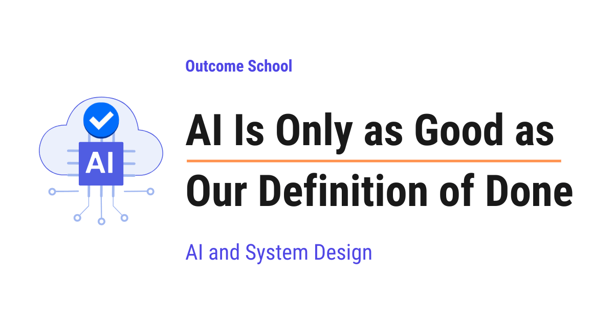

# AI Is Only as Good as Our Definition of Done

> **Module 11 · Lesson 11.4**  
> Source: [Outcome School](https://outcomeschool.com/blog/ai-is-only-as-good-as-our-definition-of-done) · Published: August 25, 2026 · Reading time: ~10 min · Tags: `llm`, `ai`, `system-design`

---



AI does its best work when we can clearly check whether a task is finished, and it struggles when only a human can judge the result. That clear check is our definition of done.

In this blog, we will learn about one simple idea, AI is only as good as our definition of done, which means the clear line we draw between a task that is finished and a task that is not. We will also see what a definition of done really is, why AI feels magical on the tasks that a machine can check, why it feels unreliable on the tasks that only a human can judge, how the loop that AI runs behind the scenes creates this exact gap, and how we can write a definition of done that turns a vague task into a checkable one.

We will cover the following:

- What is a definition of done?
- Tasks where the definition of done is exact
- Tasks where the definition of done is fuzzy
- Why AI is so strong exactly where we can measure
- How to write a better definition of done

Let's get started.

## What is a definition of done?

Whenever we give a task to AI, two things are involved.

The first thing is the goal. What do we want?

The second thing is the checker. How do we find out whether the AI actually did it?

**Definition of Done = Goal + A way to check the goal**

Most of the time, we give the goal and forget the checker. We say "build this feature", the AI gives us two hundred lines of code, and then we sit and read those lines to decide whether it is correct. In that case, we ourselves are the checker.

A checker, also called a verifier, is anything that can look at the output and say pass or fail without any opinion. A unit test is a checker. A compiler is a checker. A human reading the code is also a checker, but a slow one that gives a different answer on a tired day.

Here is the point of this blog. AI is extremely strong on the tasks that have a fast and exact checker, and unreliable on the tasks that do not have one. The difference is not in the intelligence of the model. It is in our definition of done.

## Tasks where the definition of done is exact

The best way to learn this is by taking an example.

Suppose we write the test first, like below:

```kotlin
@Test
fun `should return the discounted price`() {
    val price = calculateDiscountedPrice(1000, 20)
    assertEquals(800, price)
}
```

Now, we give the task to AI: write the `calculateDiscountedPrice` function so that this test passes.

Here, the definition of done is not a matter of opinion. Either the test is green or it is red. The AI can write the function, run the test, see the failure, fix the code, and run the test again. It repeats this loop on its own until the test passes.

Here, we can notice one important thing. We did not have to trust the AI. We just had to run the check.

Many tasks fall in this category:

- **The code must compile.** The compiler gives us a clear pass or fail.
- **A function must return an exact output for an exact input.** We compare, and we know.
- **A bug must stop reproducing.** We run the steps, and the crash is either there or it is gone.
- **A SQL query must produce this exact result.** We run it and compare the rows.
- **A math answer must match the known answer.** We check it directly.

In all of these, the machine checks the machine. There is a hard boundary between done and not done, and the AI can walk right up to it by itself.

This is why AI feels magical in these cases. Give it a failing test, and it will keep working until the test passes. The checker is doing the hardest job here, telling us the truth again and again.

## Tasks where the definition of done is fuzzy

Now, let's move to the other side.

We open the editor and type this: "Build the login feature."

The AI builds it. The code compiles. The screen opens. The user is able to log in.

Now, the big question. Is it done?

We do not know. And the reason is that we never said what done means.

Let's see what was hiding inside that one small sentence:

- What happens when the network fails in the middle?
- Is the token stored securely?
- What happens when the password field is empty?
- Is the error message good enough for a real user?
- Will this code be easy to change after six months?

Not a single one of these was written down. So not a single one can be checked. The AI produced something that looks complete, and looking complete is not the same as being complete.

But, here is the catch. In the unit test example, a red test told us clearly that we were not done. Here, nothing turns red. The absence of a failure is not the presence of correctness.

And there is one more trap. Sometimes the test exists and still it does not save us. If the test covers only the happy path, then green only proves that the happy path works. The AI will stop the moment the test turns green, because for the AI, green means done.

The same problem exists outside code:

- "Write a good summary for this content."
- "Design a clean architecture for this app."
- "Make this code more readable."

The words "good", "clean", and "readable" are doing all the work here, and not one of them can be checked by a machine.

So, in these tasks, the only checker left is a human being. And this is exactly why we cannot completely rely on the AI output here. Not because the AI is weak, but because nothing is standing between the output and us.

We have a detailed blog on [LLM as a Judge](https://outcomeschool.com/blog/llm-as-a-judge) that explains how we can use another model as the checker when no exact one exists.

## Why AI is so strong exactly where we can measure

Now, the question arises. Why is this difference so sharp?

The answer is in the loop.

AI does not write the perfect answer in one shot. It works in a [loop](https://outcomeschool.com/blog/ai-agent-loop). Try something, check the result, see the mistake, fix it, try again. This loop is where the real power is.

But this loop needs one thing to keep running. After every attempt, it needs an answer to a simple question: am I done or not?

**Where a checker exists, the loop runs on its own.**

The AI writes the function, runs the test, sees it red, reads the error, fixes the line, and runs the test again. It can repeat this ten times or fifty times without asking us anything. Every round gives it an honest signal, and every round brings it closer. The moment the test turns green, the loop stops by itself.

So, what we finally see is not the first attempt of the AI. It is the attempt that survived many rounds of checking.

**Where a checker does not exist, the loop dies after the first round.**

We ask for a clean architecture. The AI writes something. Now, there is nothing to run. Nothing turns red. Nothing turns green. No signal comes back, so the AI has no reason to try again, and it stops right there.

So, what we see here is only the first attempt. One guess, and we are reading it as a final answer.

**Wherever a cheap and exact checker exists, the AI gets many tries. Wherever it does not exist, the AI gets only one try.**

That is the whole difference we keep feeling as developers. Same model, same intelligence, but in one case it corrected itself fifty times before showing us the output, and in the other case it showed us the output straight away.

And when the checker is missing, we become the checker. We read the output, we find the problem, we ask for a change, and the AI tries again. The loop still runs, but now it runs at our speed, and it costs our time and attention on every single round.

## How to write a better definition of done

So, what do we do about it? The answer is simple to say and hard to do. **We move our tasks from the fuzzy side to the exact side.**

Let's see the practical ways.

**Write the test first, then give the task.** This is the biggest change we can make. The AI gets a target it can hit by itself, and we get a green or red answer instead of an opinion.

**Give the exact input and expected output.** Instead of "parse this date properly", we say: for the input `25-08-2026`, the output must be `2026-08-25`.

**Give the command that must run clean.** "The build command and the test command must both pass" is a definition of done. "Make sure it works" is not.

**Turn the edge cases into actual cases.** Do not write "handle the errors properly". Write the list. Empty input, network timeout, expired token, duplicate request. Every line in that list can now be checked.

**Turn a vague quality into a number.** "Make this API faster" cannot be checked. "The response must come under 200 ms for 1000 rows" can be checked.

We have a detailed blog on [Harness Engineering in AI](https://outcomeschool.com/blog/harness-engineering-in-ai) that explains how we build this checking layer around the model.

And then, one more step, which we usually skip.

**Be honest about what is still not checkable.** Some parts will always need our own judgement. Is this design right for where our product is going? No checker exists here, and pretending otherwise is how weak decisions enter our codebase quietly.

When we know which part has a checker and which part does not, we know exactly which part of the AI output we can accept and which part we must read ourselves. That is much better than reading everything with equal doubt.

The model is not the limit here. Our clarity is the limit. The sharper we can say what done means, the more work we can safely hand over.

So, before we give the next task to AI, let's ask one question first: how will I check this?

## Frequently Asked Questions

### What is a checker or verifier in AI coding?

A checker, also called a verifier, is anything that can look at the output and say pass or fail without any opinion. A unit test is a checker, and so is a compiler. A human reading the code is also a checker, but a slow one that can give a different answer on a tired day.

### Does a passing test mean the AI output is correct?

Not always. If the test covers only the happy path, then a green test only proves that the happy path works. The AI will stop the moment the test turns green, because for the AI, green means done. So, we turn the edge cases into actual test cases.

### Is AI weak at fuzzy tasks like clean architecture?

No. The model is not weak at these tasks. The difference is that no checker exists, so no signal comes back and the AI gets only one try. What we see is just its first attempt, while on tasks with a checker it may correct itself many times first.

### Can every part of a task be made checkable?

No. Some parts will always need our own judgement, like whether a design is right for where our product is going. We should be honest about what is still not checkable. Then we know which parts of the AI output we can accept and which parts we must read ourselves.
