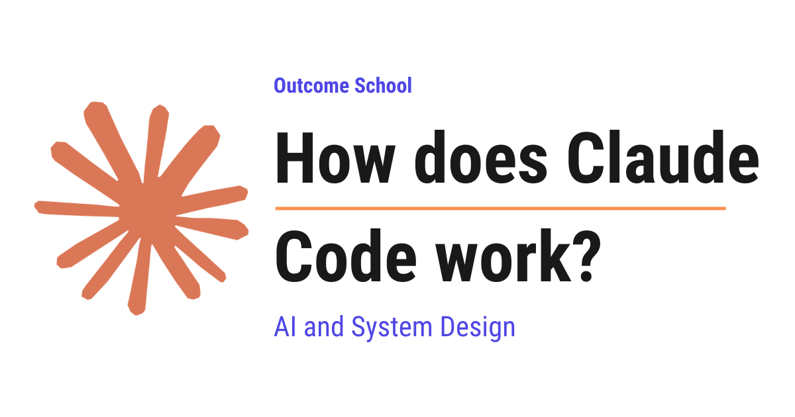

# How does Claude Code work?

> **Module 11 · Lesson 11.7**  
> Source: [Outcome School](https://outcomeschool.com/blog/how-does-claude-code-work) · Published: July 20, 2026 · Reading time: ~18 min · Tags: `llm`, `ai`, `system-design`

---



Claude Code is a coding agent from Anthropic that runs in the terminal. We give it a task in plain English, and it completes the task by reading our code, editing files, running commands, and checking its own work.

In this blog, we will learn about how Claude Code works. We will also see what Claude Code is, why a normal AI chatbot is not enough, how the agent loop drives it, what tools give it its eyes and hands, how it searches a big project and verifies its own work, and how CLAUDE.md, permissions, plan mode, subagents, and hooks fit together.

We will cover the following:

- What is Claude Code?
- The problem with a normal AI chatbot
- The agent loop
- The tools of Claude Code
- Example: Claude Code fixing a bug
- How does Claude Code search a big project?
- How does Claude Code verify its own work?
- CLAUDE.md: The project memory
- Permissions: How we stay in control
- Plan mode, subagents, and hooks
- Putting it all together

Let's get started.

## What is Claude Code?

**Claude Code is a coding agent from Anthropic that runs in the terminal. We give it a task in plain English, and it completes the task by reading our code, editing files, running commands, and checking its own work.**

Before we go further, we must understand two words used above: terminal and agent.

The **terminal** is the text window on our computer where we type commands. There are no buttons and no icons. We type a command, press enter, and the computer does the work and shows the result as text.

An **[agent](https://outcomeschool.com/blog/ai-agent)** is a program that does not just answer our question, it takes actions on its own to complete a goal.

In simple words, Claude Code is like a developer sitting inside our computer. We tell it what we want in normal English, and it does the actual work: it opens files, reads code, makes changes, runs the code, and confirms that everything works.

Let's say we hire a new developer for our team. On day one, we tell the developer: "There is a bug in the login page, please fix it." The developer does not ask us to copy and paste every file for them. They open the project, search for the login code, read it, fix it, run the tests, and tell us it is done. Claude Code works exactly like this developer.

At the center of Claude Code is **Claude**, an AI model created by Anthropic, trained on a huge amount of text and code, so it can read and write both. But a model alone can only talk. To understand why that is a problem, let's look at how we use a normal AI chatbot.

## The problem with a normal AI chatbot

Suppose we have a bug in our project and we ask a normal AI chatbot for help.

First, we copy the code from our project and paste it into the chat. Then, the chatbot replies with the fixed code. After that, we copy the fixed code back into our project. Finally, we run the tests ourselves to see if the fix works.

If the fix does not work, we copy the error, paste it into the chat, and repeat the whole cycle again.

Here, the chatbot has three big limitations:

- It cannot see our project. A real project has hundreds or thousands of files, and the chatbot only sees the small piece we paste.
- It cannot do anything. It can only produce text. We have to make every change with our own hands.
- It cannot verify its answer. It never knows if the code it suggested actually works.

We are working as a messenger between the chatbot and our computer. This is slow and painful.

The whole situation looks like below:

```
+--------------+   copy and paste   +--------+   copy and paste   +--------------+
|  AI chatbot  | <----------------> |   We   | <----------------> | Our computer |
|  only talks  |                    |        |                    |  runs code   |
+--------------+                    +--------+                    +--------------+
```

Here, we can see that we are sitting in the middle. The chatbot cannot reach our computer, and our computer cannot reach the chatbot. Everything passes through our hands, one copy and paste at a time.

So, here comes Claude Code to the rescue.

Claude Code gives the AI model the two things it never had: eyes and hands. The eyes and hands are called **tools**. The model is the brain that decides what to do, and the tools are what actually do it. Do not worry, we will learn about each tool in detail.

## The agent loop

The heart of Claude Code is the **[agent loop](https://outcomeschool.com/blog/ai-agent-loop)**.

When we give Claude Code a task, it works through three phases: **gather context**, **take action**, and **verify results**. And, it repeats these phases again and again until the task is complete.

The agent loop looks like below:

```
              +------------------+
              |   Your request   |
              +------------------+
                       |
                       v
              +------------------+
    +-------->|  Gather context  |
    |         +------------------+
    |                  |
    |                  v
    |         +------------------+
    |         |   Take action    |
    |         +------------------+
    |                  |
    |                  v
    |         +------------------+
    |         |  Verify results  |
    |         +------------------+
    |                  |
    +---- not done ----+
                       | done
                       v
              +------------------+
              |  Task complete   |
              +------------------+
```

Here, we can see the three phases of the loop:

- **Gather context:** Claude Code searches and reads the files of our project to understand the code before touching it.
- **Take action:** It edits files, creates new files, and runs commands to make the change.
- **Verify results:** It runs the tests or the program to check if the change actually works.

If the verification fails, it does not stop. It goes back, reads the error, and tries again. The loop continues until the work is done. Shaping that loop deliberately - the step budget, the error message fed back, and the exit conditions - is [Loop Engineering](https://outcomeschool.com/blog/what-is-loop-engineering).

One more thing to notice: we are part of this loop too. We can interrupt Claude Code at any point, correct it, or give it more information. It works on its own, but it always listens to us.

Now that we have understood the loop, it's time to learn about the tools that power each phase.

## The tools of Claude Code

A **tool** is one small ability that Claude Code gives to the model. The model cannot touch our computer directly. It can only request a tool, the tool does the work, and the result goes back to the model. Then, the model decides the next step based on that result. This request-and-respond mechanism, where the model asks for a tool and the result comes back, is called function calling. We have a detailed blog on [how Function Calling works in LLMs](https://outcomeschool.com/blog/how-does-function-calling-work-in-llms) that explains it in depth.

Claude Code has many tools, but six of them do most of the work. Let me tabulate them with a real-world comparison for your better understanding:

| Tool | What it does | Like a developer... |
| --- | --- | --- |
| `Read` | Reads a file and returns its content | Opening a file to read the code |
| `Grep` | Searches for a word or pattern inside all files | Using "Find in all files" in an editor |
| `Glob` | Finds files whose names match a pattern | Looking for a file by its name |
| `Edit` | Changes a specific part of a file | Editing a few lines of code |
| `Write` | Creates a new file or replaces a file | Creating a new file in the project |
| `Bash` | Runs any terminal command | Running the tests, building the app |

Here, `Grep` and `Glob` can look strange, so let me explain them in simple words.

`Grep` is a text search. If we ask it to search for the word `loginUser`, it looks inside every file of the project and tells us which files contain that word and on which lines. It is like pressing Ctrl+F, but for the entire project at once.

`Glob` is a filename search. A pattern like `*.js` means "all files whose names end with .js". So, `Glob` answers questions like "which test files exist in this project?" without opening a single file.

And, `Bash` is the most powerful tool. It can run any command we could type in the terminal ourselves: running tests, installing packages, using git, starting a server, and etc. This one tool is what lets Claude Code verify its own work.

The best way to learn how these tools work together is by taking an example.

## Example: Claude Code fixing a bug

Let's say one test in our project is failing. We open the terminal in our project folder and type as below:

```
claude
> Fix the failing login test
```

Here, the first line starts Claude Code, and the second line is our request in plain English. Notice that we did not tell it which file has the bug. We do not even know that ourselves.

Now, let's watch what Claude Code does, step by step.

**Step 1:** It uses `Bash` to run the test command of the project, for example `npm test`. The output says one test failed: "loginUser should return a token".

**Step 2:** It uses `Grep` to search for `loginUser` across the project. The search finds the function inside a file called `auth.js`.

**Step 3:** It uses `Read` to open `auth.js`. Now, the model can see the actual code and understand the bug. Let say the code forgets to return a value in one case.

**Step 4:** It uses `Edit` to fix those lines in `auth.js`.

**Step 5:** It uses `Bash` to run `npm test` again. All tests pass.

The whole journey looks like below:

```
Our request: "Fix the failing login test"
                          |
                          v
+---------------------------------------------------+
| Bash: run the tests      --> one test failed      |
| Grep: search "loginUser" --> found in auth.js     |
| Read: auth.js            --> understands the code |
| Edit: auth.js            --> fixes the bug        |
| Bash: run the tests      --> all tests passed     |
+---------------------------------------------------+
                          |
                          v
                    Task complete
```

Here, we can see that every tool result feeds the next decision. The failing test told it what to search. The search told it what to read. The reading told it what to edit. And, the final test run proved that the fix works.

It works perfectly.

This is the agent loop in action: gather context with `Bash`, `Grep`, and `Read`, take action with `Edit`, and verify results with `Bash` again.

## How does Claude Code search a big project?

Now, the question is: why does Claude Code search first instead of reading everything?

The answer is the **context window**. The context window is the working memory of the AI model. It can hold only a limited amount of text at a time. Everything the model knows about our conversation, our files, and our commands must fit inside it.

Suppose the context window is a whiteboard of a fixed size. Every file we read gets written on the whiteboard. When the whiteboard is full, old things must be erased to make room for new things.

A real project can have thousands of files. If Claude Code tried to read all of them, the whiteboard would overflow immediately. So, it does what a smart developer does: it searches first and reads only what matters.

Deciding what goes on this whiteboard and what stays off it is called context engineering. We have a detailed blog on [Context Engineering](https://outcomeschool.com/blog/context-engineering) that covers this end to end.

This is why `Grep` and `Glob` come into the picture. They are simple, fast text searches. They scan thousands of files in a moment and return only a small list of matching files and lines. That small list takes very less space on the whiteboard. Then, Claude Code reads only the two or three files that actually matter.

The search works like a funnel, like below:

```
+-----------------------------+
| Thousands of files          |
+-----------------------------+
               |
               |  Grep and Glob search them
               v
+-----------------------------+
| A few matching files        |
+-----------------------------+
               |
               |  Read opens only these
               v
+-----------------------------+
| Only the code that matters  |
| is on the whiteboard        |
+-----------------------------+
```

Here, we can see that the project gets narrowed down at every step. Thousands of files become a few files, and a few files become a small amount of code on the whiteboard. The whiteboard never overflows.

There is no magic database and no special index of our code. Claude Code finds its way through a project using the same simple text searches that developers have used for decades. The intelligence is not in the search tool. The intelligence is in the model deciding what to search for.

## How does Claude Code verify its own work?

I personally believe that this is the most important part of Claude Code.

The biggest weakness of a normal AI chatbot is that it cannot check its own answer. It writes code that looks correct, and looking correct is not the same as being correct.

Claude Code closes this gap by running the code. After making a change, it can:

- Run the tests of the project and read the results.
- Run the compiler or build and read the errors.
- Run the program itself and check the output.

If anything fails, the error message goes right back into the loop. The model reads the error, understands what went wrong, and fixes it. This can repeat many times without us doing anything.

This pattern, where an agent inspects its own output and corrects itself, is called reflection. We have a detailed blog on the [Reflection Agent](https://outcomeschool.com/blog/reflection-agent) that explains this step by step.

The verification loop looks like below:

```
        +-------------------+
        |   Make a change   |
        +-------------------+
                  |
                  v
        +-------------------+
+------>|   Run the tests   |
|       +-------------------+
|                 |
|       +---------+---------+
|       |                   |
|     failed              passed
|       |                   |
|       v                   v
| read the error       work is done
| and fix the code
|       |
+-------+
```

Here, we can see that a failed test does not end the work. The error goes back into the loop, the code gets fixed, and the tests run again. The loop only ends when the tests pass.

This is exactly how a good developer works. We never say "the bug is fixed" without running the code. Claude Code follows the same discipline.

And, we can help it here. If we give Claude Code [something to verify against](https://outcomeschool.com/blog/ai-is-only-as-good-as-our-definition-of-done), it performs much better. For example, we can say: "Write a failing test first, then fix the code, then run the tests." Now, it has a clear target, and it will keep looping until the target is hit.

## CLAUDE.md: The project memory

Every new Claude Code session starts with a fresh, empty context window. Remember the whiteboard? Each session begins with a clean whiteboard.

But, here is the catch. Our project has rules that never change: which language we use, how to run the tests, which folders must not be touched. Explaining these rules again in every session would be painful.

So, here comes **CLAUDE.md** into the picture.

CLAUDE.md is a simple text file that we keep in our project folder. Claude Code reads it automatically at the start of every session. Whatever we write in this file becomes standing instructions for Claude Code.

A small CLAUDE.md can look like below:

```markdown
# Project Notes
- We use Kotlin for all new code.
- Run the tests with: ./gradlew test
- Do not edit files inside the generated/ folder.
```

Here, we have written the language of the project, the exact test command, and one folder that must never be touched. Now, Claude Code knows all of this in every session without us repeating it.

Suppose a new developer joins our team and we hand them a one-page note: "Here is how our team works." CLAUDE.md is exactly that note, written for Claude Code. When one of those rules grows into a full procedure with its own steps and files, we keep it out of this always-loaded note and write it as an [Agent Skill](https://outcomeschool.com/blog/what-are-agent-skills) instead, which Claude Code loads only when a task actually needs it.

## Permissions: How we stay in control

Now, the next big question is: an agent that can edit files and run commands is powerful, so how do we stay safe?

The answer is **permissions**. By default, Claude Code asks for our approval before it edits a file or runs a command that changes something. We see a prompt like below:

```
Claude wants to run: npm test
Do you want to allow this?
> 1. Yes
  2. Yes, and do not ask again for this command
  3. No, and tell Claude what to do differently
```

Here, this is a simplified version of the prompt, just for the sake of understanding. Nothing changes on our computer until we say yes. And, if we trust a command like `npm test`, we can allow it permanently so Claude Code never asks for it again.

Claude Code also has different **permission modes** that we can switch between:

- **Manual:** Claude Code asks before every file edit and every command. This is the default.
- **Accept edits:** File edits are approved automatically, but other commands still need our approval. We use this when we already trust the direction of the work.
- **Plan:** Claude Code can only read and think. It cannot edit anything. We will learn about this mode in the next section.
- **Auto:** Claude Code works without asking, with safety checks running in the background. This is meant for automated setups where no human is sitting at the keyboard.

One more safety net exists: **checkpoints**. Before Claude Code edits any file, it saves a snapshot of that file. If we do not like the result, we can rewind everything back to how it was. Every file edit is reversible.

## Plan mode, subagents, and hooks

Till now, we have learned the core of Claude Code. Now, let's learn three features that make it even more useful.

### Plan mode

In **plan mode**, Claude Code is read-only. It explores the project, thinks, and then presents a plan: "Here is what I will change and why." It does not touch a single file.

We read the plan, correct it through conversation, and only then allow the implementation. It is like agreeing on the blueprint of a house before any construction starts. For big changes, this two-phase approach gives much better results than jumping straight to code.

### Subagents

Remember the whiteboard problem? Long tasks fill the context window quickly. A big exploration alone can fill the entire whiteboard.

So, here comes the **subagent** to the rescue.

A [subagent](https://outcomeschool.com/blog/ai-subagents) is a helper agent with its own fresh context window, which means its own separate whiteboard. The main agent gives it one focused task, the subagent does all the messy exploration on its own whiteboard, and then it returns only a short summary.

```
               +--------------------+
               |     Main agent     |
               +--------------------+
                   |            |
          +--------+            +-------+
          |                             |
          v                             v
+--------------------+        +--------------------+
|     Subagent 1     |        |     Subagent 2     |
| Explores the whole |        | Reads all the test |
| project in detail  |        | files in detail    |
+--------------------+        +--------------------+
          |                             |
          v                             v
  sends back a short            sends back a short
       summary                       summary
```

Here, the two subagents read a huge amount of code, but the main agent receives only two short summaries. The main whiteboard stays clean, and the subagents can even work at the same time.

Subagents are one way to keep the whiteboard clean. Another is to summarize the older history in place so it still fits - we have a detailed blog on [how context compaction works](https://outcomeschool.com/blog/how-does-context-compaction-work) that covers this end to end.

### Hooks

A **hook** is a small script that runs automatically when a specific event happens inside Claude Code. For example: after every file edit, run the code formatter.

The important difference is this: an instruction in CLAUDE.md is a request that the model follows, but a hook is a rule that the system enforces. A hook runs every single time, without exception. We use hooks when something must always happen.

## Putting it all together

Let's recap the complete picture.

Claude Code is a brain plus a body. The brain is the Claude model, which reads, reasons, and decides. The body is the set of tools: `Read`, `Grep`, `Glob`, `Edit`, `Write`, and `Bash`. The agent loop connects them: gather context, take action, verify results, and repeat until done.

CLAUDE.md gives it memory about our project. Permissions and checkpoints keep us in control. Plan mode separates thinking from doing. Subagents keep the working memory clean. Hooks enforce the rules that must never be skipped.

Now we must have understood how Claude Code works. The next time we watch it fix a bug from a single English sentence, we know there is no magic inside. There is a simple loop, the same loop every good developer follows: understand the code, change the code, and prove that the change works.

## Frequently Asked Questions

### What is the difference between Claude Code and a normal AI chatbot?

A normal AI chatbot can only produce text, while Claude Code can act on our project. The chatbot cannot see our project, cannot make changes, and cannot verify its answer. Claude Code gives the model tools to read files, edit code, run commands, and check its own work.

### Does Claude Code build a special index of our codebase?

No. There is no magic database and no special index of our code. Claude Code uses simple text searches like `Grep` and `Glob` to find the few files that matter. The intelligence is not in the search tool but in the model deciding what to search for.

### Can Claude Code change files without our approval?

Not by default. Claude Code asks for our approval before it edits a file or runs a command that changes something. We can switch modes, for example to approve file edits automatically. Before any file edit, it also saves a checkpoint, so every edit is reversible.

### What is the difference between a CLAUDE.md instruction and a hook?

An instruction in CLAUDE.md is a request that the model follows, while a hook is a rule that the system enforces. A hook is a small script that runs every single time a specific event happens, without exception. We use hooks when something must always happen.

### When should we use plan mode in Claude Code?

We should use plan mode for big changes. In plan mode, Claude Code is read-only. It explores the project and presents a plan without touching a single file. We correct the plan through conversation and only then allow the implementation, which gives much better results than jumping straight to code.
