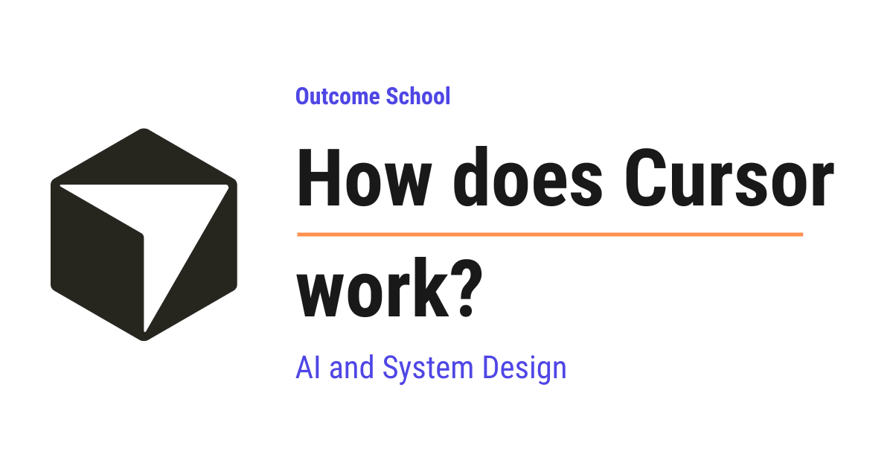

# How does Cursor work?

> **Module 11 · Lesson 11.8**  
> Source: [Outcome School](https://outcomeschool.com/blog/how-does-cursor-work) · Published: July 22, 2026 · Reading time: ~17 min · Tags: `llm`, `ai`, `system-design`

---



Cursor is an AI code editor. It is a place where we write our code, but with an AI helper that understands our whole codebase and can suggest, explain, and write code for us.

In this blog, we will learn about how Cursor works. We will also see what Cursor is, why it is a code editor with an AI brain on top, how it indexes our codebase into embeddings and searches it by meaning, how Tab autocomplete, Chat, and Agent mode work, how Cursor applies changes through a diff, why it uses different models for different jobs, and how it tries to keep our code private.

We will cover the following:

- What is Cursor?
- Cursor = Code Editor + AI
- The big idea behind Cursor
- How does Cursor understand our code?
- How does Cursor index our codebase?
- How does Tab autocomplete work?
- How does the Chat work?
- How does the Agent mode work?
- How does Cursor apply the changes?
- Why does Cursor use different models?
- How does Cursor keep our code private?
- The complete flow of Cursor

Let's get started.

## What is Cursor?

**Cursor is an AI code editor. It is a place where we write our code, but with an AI helper sitting right next to us.**

Let's say we are writing code. Normally, we type every single line by ourselves. We think, we type, we fix the mistakes, and we repeat. It takes time.

Now, imagine a smart friend sitting next to us. This friend has read a lot of code. When we start typing, the friend already guesses what we want to write next. When we get stuck, we simply ask the friend, and the friend writes the code for us. When we want to build a whole feature, we just describe it in plain English, and the friend does the work across many files.

That smart friend is Cursor.

So, Cursor is a code editor where an AI is always ready to help us read, write, and change our code.

## Cursor = Code Editor + AI

Let's understand both parts.

**Code Editor:** A code editor is a simple app where we open our files and write our code. Cursor is built on top of a very popular code editor called VS Code. So, if we have ever used VS Code, then Cursor will feel the same. All the buttons, the file explorer on the left, the tabs on the top, everything feels familiar.

**AI:** This is the special part. Cursor connects our editor to powerful AI models. These AI models are the same kind of models that power tools like ChatGPT. They can read text, understand it, and write text. And code is also just text. So, these AI models can read our code and write new code for us.

So, Cursor takes a normal code editor and adds a powerful AI brain on top of it. That is the whole idea.

## The big idea behind Cursor

Before jumping into the details, we must understand the big idea. It will make everything else easy.

The AI model does not live inside Cursor. The AI model lives on a big computer far away, called a server. This server belongs to companies that build these models.

So, Cursor is like a bridge. On one side, there is us and our code. On the other side, there is the powerful AI model on the server.

We can picture it like below:

```
                        sends our code + question
   +----------------+  ----------------------------->  +-------------------+
   |     Cursor     |                                   |     AI model      |
   |  (our editor   |                                   |  (on the server)  |
   |   + our code)  |  <-----------------------------   |                   |
   +----------------+       returns the answer          +-------------------+
```

Here, we can see that our code never runs the AI by itself. Cursor sends the needed pieces to the AI model and brings the answer back.

When we ask for help, Cursor does three things:

- **First,** it collects the right pieces of our code. This is called [context](https://outcomeschool.com/blog/context-engineering).
- **Then,** it sends our question along with that context to the AI model.
- **Finally,** it takes the answer from the AI model and puts it back into our code.

Here, the most important word is context. The AI model has never seen our project before. It does not know our files. So, Cursor must send the right pieces of our code to the AI model, so that the AI can give a useful answer.

Let's say we ask a doctor for advice over the phone. The doctor is very smart, but the doctor cannot see us. So, we must describe our problem clearly. The better we describe it, the better the advice.

In the same way, the AI model is very smart, but it cannot see our project. So, Cursor must describe our code clearly to the AI model. This is the real magic of Cursor. It is very good at picking the right pieces of our code and sending them to the AI.

Now, let's understand how Cursor does this.

## How does Cursor understand our code?

Let's say our project has a thousand files. When we ask a question, the AI model cannot read all thousand files at once. It is too much. It would be slow and very costly.

So, Cursor must find only the few files that matter for our question. This is the real problem to solve.

For example, we ask, "Where do we check the user's password?" Cursor must find the file that handles the password. It must not send the file that handles the app color or the file that handles the images.

So, how does Cursor find the right files? Here comes the indexing to the rescue. Let's understand it.

## How does Cursor index our codebase?

Indexing means Cursor reads all our files once and prepares them in a smart way, so that later it can search through them very fast.

Let's understand this step by step.

**Step 1:** Cursor breaks our code into small pieces. Each piece is called a [chunk](https://outcomeschool.com/blog/chunking-strategies-for-rag). A chunk is usually a small part of a file, like one function or a few lines that belong together.

**Step 2:** Cursor turns each chunk into a special list of numbers. This list of numbers is called an [embedding](https://outcomeschool.com/blog/what-are-embeddings).

Now, the word embedding sounds scary, so let's understand it in simple words.

**An embedding is a list of numbers that captures the meaning of a piece of text.**

The idea is beautiful. Two chunks that mean similar things get similar numbers. Two chunks that mean different things get very different numbers.

Let's say we have two chunks. One chunk is about checking a user's password. Another chunk is also about logging in a user. These two are about similar things. So, their numbers will be close to each other. But a chunk about changing the app color will have very different numbers.

**Step 3:** Cursor stores all these numbers in a special database. This database is very good at one job. Given some numbers, it can quickly find other numbers that are close to them.

So, now our whole codebase is turned into numbers and stored, ready to be searched.

We have a detailed blog on [how a Vector Database works](https://outcomeschool.com/blog/how-does-a-vector-database-work) that covers this in depth.

The whole indexing pipeline looks like below:

```
   Our code files
        |
        |  break into small pieces
        v
     Chunks        (one function, or a few related lines)
        |
        |  turn each chunk into numbers
        v
   Embeddings      (a list of numbers that captures the meaning)
        |
        |  store all the numbers
        v
   Vector database (ready to search by meaning)
```

Now, when we ask, "Where do we check the user's password?", here is what happens:

- Cursor turns our question into numbers, the same way it turned the code chunks into numbers.
- Then, it searches the database for the code chunks whose numbers are closest to our question's numbers.
- The closest chunks are most likely the ones that matter for our question.

This way, Cursor finds the right pieces of code without reading the whole project. This search by meaning is often called [semantic search](https://outcomeschool.com/blog/how-does-semantic-search-work).

**Note:** Cursor is careful here. For most plans, it does not store our actual code on its own servers. It mainly stores these numbers. We will talk more about this in the privacy section.

This is how Cursor understands our codebase. Now, let's move to the features we use every day.

## How does Tab autocomplete work?

The first feature we notice in Cursor is Tab. When we type code, Cursor shows a grey suggestion for the next lines. We press the Tab key, and the suggestion becomes real code.

But this is not a normal autocomplete. A normal editor only completes one word. Cursor predicts the next full edit. It can suggest many lines at once. It can even suggest changes a few lines away from where we are typing.

Let's understand how it works.

Cursor uses a special AI model that is trained for one job only, to predict the next edit. When we type, Cursor sends the model a few things:

- The code around our cursor, both above and below.
- The recent changes we just made.
- Some related pieces from the rest of our project.

The model looks at all this and guesses what we are most likely to write next. Then, it shows that guess as a grey suggestion.

Here, the important point is speed. This suggestion must appear in a fraction of a second. If it is slow, it becomes annoying. So, Cursor uses a smaller and faster model for Tab, not the big heavy model. This smaller model is quick, and it is trained to be very good at this one task.

Let's say we just wrote a line that creates a variable for the user's name. The model sees this. It guesses that our next line will probably use that name to greet the user. So, it suggests that line for us. We press Tab, and it is done.

This is how the Tab autocomplete makes our life easier. It removes the boring typing and lets us move fast.

## How does the Chat work?

The next feature is Chat. On the side of the editor, there is a chat box. We can ask any question about our code, and we get an answer.

For example, we can ask, "What does this function do?" or "Why is this test failing?" We can also ask it to write new code for us.

Here is how the Chat works, step by step.

**Step 1:** We type our question in the chat box.

**Step 2:** Cursor gathers the context. It uses the indexing we learned about above to find the code chunks that matter for our question. It also adds the file we are currently looking at. We can also point to specific files ourselves.

**Step 3:** Cursor builds a full message for the AI model. This message contains our question and the gathered context. This step of building a good message is called the prompt.

**Step 4:** Cursor sends this prompt to the big AI model on the server.

**Step 5:** The AI model reads everything and writes an answer. The answer comes back to Cursor and appears in the chat.

So, the Chat is just a smart conversation. But the reason it feels smart is the context. Because Cursor sends the right pieces of our code, the AI can answer about our actual project and not just talk in general.

This is how the Chat works.

## How does the Agent mode work?

Now, it's time to learn about the most powerful feature of Cursor, the Agent mode.

In the Chat, the AI only talks to us. In the Agent mode, the AI can do the work by itself. It can read files, write files, and even run commands. It keeps working step by step until the whole task is done.

Let's understand it with an example. We tell the Agent, "Add a dark mode to my app."

A normal chat would just tell us what to do. But the Agent actually does it. Here is how.

The AI model is given [a set of tools](https://outcomeschool.com/blog/how-does-function-calling-work-in-llms). A tool is simply an action that the AI is allowed to take. For example:

- A tool to read a file.
- A tool to search the codebase.
- A tool to make an edit in a file.
- A tool to run a command in the terminal.

Cursor can also reach tools beyond these built-in ones, like a database or an issue tracker, through an open standard called MCP. We have a detailed blog on [What is MCP (Model Context Protocol)?](https://outcomeschool.com/blog/what-is-mcp-model-context-protocol) that explains this step by step.

Now, the Agent works in a loop. Let's see the loop.

- **First,** the AI thinks about the task and decides the next step. Let's say it decides to first read the settings file.
- **Then,** it uses the read tool to open that file. Cursor runs the tool and gives the file content back to the AI.
- **After that,** the AI reads the content and decides the next step. Now, it decides to edit the file to add the dark mode option.
- **Then,** it uses the edit tool to make the change.
- **After that,** it may run the app to check if the change works.

This loop keeps going. Think, act, look at the result, think again. The AI repeats this until the task is complete. This [think-act-repeat loop](https://outcomeschool.com/blog/ai-agent-loop) is what makes it an agent. Designing that loop well - how many turns it gets, what it sees each turn, and when it must stop - is [Loop Engineering](https://outcomeschool.com/blog/what-is-loop-engineering).

We can picture the loop like below:

```
          +-----------------------+
    +----> |  Think about the      |
    |      |  next step            |
    |      +-----------------------+
    |                 |
    |                 v
    |      +-----------------------+
    |      |  Use a tool           |
    |      |  (read / edit / run)  |
    |      +-----------------------+
    |                 |
    |                 v
    |      +-----------------------+
    |      |  Look at the result   |
    +------|  Task not done yet?   |
    (loop) +-----------------------+
                      |
                      v  Task done!
          +-----------------------+
          |  Stop and show us     |
          |  the final result     |
          +-----------------------+
```

Here, we can see that the AI does not do everything in one shot. It works one small step at a time, and it checks the result after every step.

Here, we are still in control. Cursor can ask us for permission before it does something risky, like running a command. We can review every change before we accept it.

So, the Agent mode turns Cursor from a helper that talks into a helper that works. This is the beauty of Cursor.

## How does Cursor apply the changes?

Now, the next question is: when the AI writes new code, how does it go into our files?

Let's say the AI wants to change ten lines in a big file of five hundred lines. Sending the whole new file every time would be slow and wasteful.

So, Cursor is smart here. The big AI model does not rewrite the whole file. It only describes the change. It says something like, "In this function, replace these lines with these new lines."

Then, Cursor uses another small and fast model, called the Apply model. The only job of this model is to take that described change and merge it neatly into our real file.

After that, Cursor shows us the change as a diff. A diff is a simple view that shows the old lines in red and the new lines in green. So, we can clearly see exactly what will change.

We look at the diff. If we like it, we click Accept, and the change becomes real. If we do not like it, we click Reject, and nothing changes.

This is how Cursor applies the changes. We always stay in control, because nothing changes until we accept it.

## Why does Cursor use different models?

By now, we have noticed something. Cursor does not use only one AI model. It uses different models for different jobs. This is a smart choice.

The reason is simple. A big and heavy model is very smart, but it is slow and costly. A small and fast model is quick, but it is not as smart. So, Cursor uses the right model for the right job.

Let me tabulate these models for your better understanding so that the whole picture becomes clear.

| Job | Model used | Why |
| --- | --- | --- |
| Tab autocomplete | A small, fast model | The suggestion must appear instantly while we type. |
| Chat and Agent | A big, smart model | The hard thinking and code writing need the smartest model. |
| Applying the change | A small, fast Apply model | Merging a described change into a file is a simple, quick task. |

Here, we can see that each model has one clear job. The big model does the deep thinking. The small models handle the quick tasks. This mix makes Cursor both smart and fast.

## How does Cursor keep our code private?

Our code is important, so a natural question arises. Is our code safe?

Cursor has a setting called Privacy Mode. When Privacy Mode is on, our code is not stored by Cursor after our request is done. The code is used only to answer our question, and then it is not kept.

Here, we must understand one thing clearly. To answer our question, Cursor must send some pieces of our code to the AI model on the server. This is needed, because the AI lives on the server, not on our computer. But with Privacy Mode, that code is not saved for later.

Also, as we learned, the codebase index mostly stores numbers, the embeddings, and not our full code text. This adds another layer of safety.

So, Cursor gives us the power of AI, while still trying to protect our code.

## The complete flow of Cursor

Now that we have learned about all the parts, let's put the whole flow together in simple steps.

- **First,** Cursor reads our project once and turns it into numbers, the embeddings, and stores them. This is indexing.
- **Then,** when we type, the fast Tab model predicts our next edit and shows a grey suggestion.
- **After that,** when we ask a question in Chat, Cursor searches the index, finds the right code chunks, and builds a prompt.
- **Then,** it sends the prompt to the big AI model on the server, and shows us the answer.
- **In Agent mode,** the AI uses tools to read, edit, and run code in a loop until the task is done.
- **Finally,** the Apply model merges the AI's changes into our files, and we accept or reject each change through a diff.

So, Cursor is a bridge between our code and a powerful AI model. It is very good at picking the right pieces of our code, sending them to the AI, and putting the answer back into our files.

This is the beauty of Cursor. It makes our life easy by removing the boring work, while keeping us fully in control of every change.

Now, we must have understood how Cursor works.

## Frequently Asked Questions

### Is Cursor different from VS Code?

Cursor is built on top of VS Code, so it feels the same. The file explorer, the tabs, and the buttons all feel familiar. The difference is that Cursor connects the editor to powerful AI models, which can read our code, answer questions about it, and write new code for us.

### Does the AI model run on our own computer in Cursor?

No. The AI model lives on a server, not inside Cursor. Cursor works like a bridge. It collects the right pieces of our code, sends them with our question to the AI model, and puts the answer back into our code.

### Does Cursor send our whole project to the AI model?

No. Sending a thousand files would be slow and very costly. Cursor indexes our codebase into embeddings and searches it by meaning, so it can find only the few code chunks that matter for our question. It then sends just those pieces as context.

### What is the difference between Chat and Agent mode in Cursor?

In Chat, the AI only talks to us and answers our questions. In Agent mode, the AI does the work by itself. It uses tools to read files, search the codebase, edit files, and run commands in a loop until the whole task is done.

### Can Cursor change our code without our approval?

No. Cursor shows every change as a diff, with old lines in red and new lines in green. If we like it, we click Accept, and if not, we click Reject and nothing changes. In Agent mode, Cursor can also ask for permission before risky actions like running a command.
