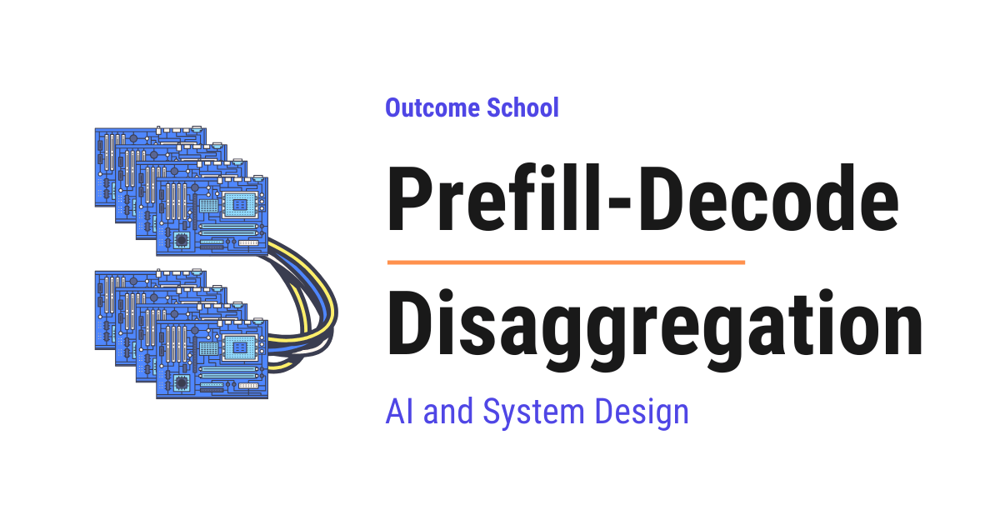

# What is Prefill-Decode Disaggregation in LLM Inference?

> **Module 12 · Lesson 12.3**  
> Source: [Outcome School](https://outcomeschool.com/blog/prefill-decode-disaggregation) · Published: September 13, 2026 · Reading time: ~21 min · Tags: `llm`, `ai`, `system-design`

---



Prefill-Decode Disaggregation is a way of running a large language model where the reading of the prompt (prefill) and the writing of the answer (decode) happen on separate machines, so that each one can be tuned for its own job.

In this blog, we will learn about Prefill-Decode Disaggregation, a way of running a large language model where the reading of the prompt and the writing of the answer happen on separate machines. We will also see how an LLM answers a request in two phases, what the KV Cache is, why the two phases need different things from the hardware, what goes wrong when both run on the same machine, how disaggregation solves it step by step, its advantages and disadvantages, and where it works well and where it is overkill.

We will cover the following:

- How an LLM answers a request
- What is the KV Cache?
- Prefill is compute-heavy, Decode is memory-heavy
- The problem when both run on the same GPU
- TTFT vs TPOT
- The naive approaches and their issues
- What is Prefill-Decode Disaggregation?
- How Prefill-Decode Disaggregation works
- Walkthrough of one request
- Advantages of Prefill-Decode Disaggregation
- Disadvantages of Prefill-Decode Disaggregation
- Where it works well and where it is overkill
- Co-located vs Disaggregated serving

Let's get started.

## How an LLM answers a request

Let's start from the very beginning.

An **LLM** (Large Language Model) is an AI model that reads text and writes text. When we type a question in a chat app, the LLM reads our question and writes an answer, one small piece at a time.

These small pieces are called [**tokens**](https://outcomeschool.com/blog/tokenization-in-llms). A token is a word or a part of a word. For the sake of understanding, we can think of a token as a word.

Now, here is the important part. The LLM does not answer a request in one shot. It answers in two phases.

**Phase 1: Prefill**

In the prefill phase, the LLM reads the complete prompt at once. The prompt is everything we sent to the model, our question, the previous chat messages, and any instructions. The model processes all these tokens together in one go and produces the very first token of the answer.

It is called prefill because the model fills up its memory with the prompt before it starts writing. We will see this memory in the next section.

**Phase 2: Decode**

In the decode phase, the LLM writes the answer one token at a time. It takes everything it has seen so far, produces the next token, adds it to the answer, and repeats. This continues until the answer is complete.

This is why we see the answer appearing word by word in a chat app. Each token is shown to us as soon as it is ready. This is called [**streaming**](https://outcomeschool.com/blog/how-does-token-streaming-work).

So, **Prefill = read the whole prompt at once**, and **Decode = write the answer one token at a time**.

Let's say our question is "What is the capital of India?" and we send it to the model. In the prefill phase, the model reads all the words of the question together. In the decode phase, it writes "The", then "capital", then "of", then "India", then "is", then "New", then "Delhi". One token per step.

This is how an LLM answers a request.

We have a detailed blog on [Prefill vs Decode](https://outcomeschool.com/blog/prefill-vs-decode-llm-inference-optimization) that explains these two phases in depth.

## What is the KV Cache?

Before jumping into the problem, we must know about the [KV Cache](https://outcomeschool.com/blog/kv-cache-in-llms), because the whole idea of disaggregation depends on it.

When the model reads the prompt in the prefill phase, it does a lot of calculation for every token. It figures out how each token is related to every other token. Now, in the decode phase, for every new token, the model needs this same information again. If it repeats the whole calculation for every new token, it will be very slow.

Here comes the KV Cache into the picture.

**KV Cache is the memory where the model keeps the notes it made while reading the prompt, so that it does not have to read the prompt again for every new token.**

In simple words, KV Cache = Notes.

Let's say we are reading a long book to answer questions on it. If we make notes while reading, we can answer every question by looking at the notes. We do not need to read the whole book again for every question. The KV Cache is exactly these notes.

The letters K and V stand for Key and Value. These are the two things the model stores for every token. Do not worry, we do not need to go deeper than that for this blog. Just remember: KV Cache is the notes the model makes during prefill, and it reads those notes during decode.

**Note:** The KV Cache is big. For a long prompt, it can take many gigabytes of memory. Keep this in mind, it will matter later.

## Prefill is compute-heavy, Decode is memory-heavy

Now, let's understand why these two phases are so different from each other.

The best way to learn this is by taking an example.

Consider a chef in a kitchen. A customer hands over a long recipe of ten pages.

First, the chef reads the entire recipe in one sitting and makes short notes. This needs a lot of thinking and focus, but very less walking around. The chef is sitting at one place and processing a lot of information. This is the prefill phase, and the notes are the KV Cache. It needs a lot of brain power.

Then, the chef starts cooking, step by step. Add salt, stir, wait, add oil, stir, wait. Each step is small and simple. But for each step, the chef walks to the shelf, looks at the notes, comes back, and does one small thing. Most of the time is spent walking to the shelf and back, not in the actual cooking. This is the decode phase. It needs very less brain power per step, but a lot of moving things around.

Now, let's map this to the GPU.

A [**GPU**](https://outcomeschool.com/blog/how-does-a-gpu-work-for-deep-learning) is the special chip that runs the LLM. It has two important parts, the compute units which do the maths, and the memory which stores the data.

**Prefill is compute-heavy.** The model processes thousands of prompt tokens at the same time. The compute units are fully busy doing the maths. The GPU is working at its full power.

**Decode is memory-heavy.** The model produces only one token per step. The maths for one token is very less. But for every single step, the GPU must read the entire model (billions of numbers that the model has learned, called weights) and the entire KV Cache from the memory. So, the compute units sit mostly idle, waiting for the data to arrive from the memory.

So, prefill keeps the GPU compute busy. Decode keeps the GPU memory busy. They stress two completely different parts of the same chip.

In simple words, prefill is limited by how fast the GPU can think, and decode is limited by how fast the GPU can fetch data from its memory.

This is the key insight of this whole blog. Keep it in mind.

## The problem when both run on the same GPU

Now, let's see what happens in the normal setup.

In the normal setup, one GPU does both prefill and decode for every request. This is called **co-located serving** because both phases are located on the same GPU.

Let's say our server is serving many users at the same time. To do this efficiently, the GPU handles many requests together in one go instead of one by one. This is called [**batching**](https://outcomeschool.com/blog/continuous-batching-in-llms).

Suppose ten users are in the middle of the decode phase. Their answers are being written one token at a time. Everything is smooth.

Now, an eleventh user sends a very long prompt, let's say a document of ten thousand tokens.

The GPU has to do a big prefill for this new user. This prefill is compute-heavy and takes a long time, say one full second.

But, here is the catch.

While the GPU is busy with this big prefill, the other ten users are waiting. Their next token does not come. Their answer freezes for one second in the middle of a sentence. Then it continues. Then another long prompt arrives and it freezes again.

This is called **generation stall** or **interference**. One user's prefill stalls the decode of everyone else.

The waiting time that a user experiences is called **latency**. Every time a long prompt arrives, the latency of everyone else spikes.

The reverse is also true. If the GPU is busy decoding for many users, a new user's prefill has to wait, and the first token of their answer arrives late.

So, the two phases keep fighting for the same GPU, and both of them lose.

## TTFT vs TPOT

To measure this problem properly, we need two simple terms.

**TTFT (Time To First Token)** is the time from when the user presses enter till the first token of the answer appears on the screen. This is mostly decided by the prefill phase.

**TPOT (Time Per Output Token)** is the time between one token and the next token while the answer is being written. This is decided by the decode phase.

In simple words, TTFT is how long we wait before the answer starts, and TPOT is how smoothly the answer flows once it starts.

For example, let's say TTFT is 500 milliseconds and TPOT is 30 milliseconds. Means, the answer starts in half a second, and after that around 30 tokens appear every second.

For a good user experience, we want both to be low. We want the answer to start quickly and flow smoothly.

But, in co-located serving, if we optimize for one, the other gets worse. If we give priority to prefill, TTFT becomes good but TPOT becomes bad because decode gets stalled. If we give priority to decode, TPOT becomes good but TTFT becomes bad because new users wait longer.

We needed a solution for that.

## The naive approaches and their issues

**Approach 1: Add more GPUs and let each GPU do both phases**

The simplest idea is to buy more GPUs. Each GPU does both prefill and decode, just like before, but now we have more of them, so the load per GPU goes down.

The issue with this approach is that the interference does not go away. Every GPU still has the same fight between prefill and decode inside it. We have only made the fight happen less often, at a very high cost. Also, we cannot tune the hardware for one phase, because every GPU must be good at both. Let's see how the next approach solve this issue.

**Approach 2: Chunked prefill**

Another idea is to break a long prefill into small chunks and mix a small chunk of prefill with the decode steps in every batch. This way, no single prefill blocks the decode for a long time.

This helps. It is used in many real systems. But the issue with this approach is that prefill and decode still share the same GPU. Every decode step now carries some extra prefill work, so TPOT increases a little for everyone. And the prefill takes longer to finish because it is done in pieces, so TTFT also increases. We have spread the pain instead of removing it.

Let's see how the next approach solve this issue.

## What is Prefill-Decode Disaggregation?

So, here comes Prefill-Decode Disaggregation to the rescue.

Let's break the name.

**Prefill-Decode Disaggregation = Prefill + Decode + Disaggregation**

- **Prefill**: the phase where the model reads the prompt.
- **Decode**: the phase where the model writes the answer.
- **Disaggregation**: a big word that simply means separating things that were joined together. Aggregation means joining. Disaggregation means un-joining.

So, **Prefill-Decode Disaggregation is the technique of running the prefill phase and the decode phase on separate GPUs, so that they never fight for the same hardware.**

In simple words, we have one group of GPUs whose only job is to read prompts, and another group of GPUs whose only job is to write answers.

Let's go back to our kitchen. Instead of one chef who reads the recipe and also cooks, we now have a reader who reads the recipe and makes the notes, and a cook who takes the notes and cooks. The reader never stops reading to cook. The cook never stops cooking to read. Both do one thing and do it well.

## How Prefill-Decode Disaggregation works

Now that we have learned what Prefill-Decode Disaggregation is, it's time to learn how it works.

There are four main parts in this setup.

**Router**: This is a small program that receives every request and decides which prefill worker and which decode worker will handle it.

**Prefill workers**: These are GPUs that only do prefill. They receive the prompt, process all the tokens at once, produce the first token, and build the KV Cache. They are tuned for heavy compute.

**Decode workers**: These are GPUs that only do decode. They receive the KV Cache, and generate the answer one token at a time. They are tuned for fast memory access and can serve many users at once.

**KV Cache transfer**: This is the bridge between the two. After the prefill worker builds the KV Cache, it sends the KV Cache to the decode worker over the network. The decode worker loads it into its own memory and continues from there.

We can write the flow as below:

```
Request
   |
   v
[Router] --> picks a Prefill worker and a Decode worker
   |
   v
[Prefill worker] --> reads the full prompt
                 --> builds the KV Cache
                 --> produces the first token
   |
   v  (KV Cache is sent over the network)
   |
[Decode worker]  --> loads the KV Cache
                 --> writes token 2, token 3, token 4 ...
   |
   v
Answer streamed to the user
```

Here, we have a router that decides which prefill worker and which decode worker will handle the request. The prefill worker does the heavy reading and hands over the notes. The decode worker does the light but repeated writing. The KV Cache transfer is the hand-over of the notes from the reader to the cook.

We can also write the same flow as a simple pseudo code as below:

```python
def handle_request(prompt):
    prefill_worker = pick_prefill_worker()
    decode_worker = pick_decode_worker()
    # Phase 1: Prefill on the prefill worker
    first_token, kv_cache = prefill_worker.prefill(prompt)
    send_to_user(first_token)
    # Hand-over: KV Cache goes over the network
    decode_worker.load(kv_cache)
    # Phase 2: Decode on the decode worker
    while not finished:
        next_token = decode_worker.decode_step()
        send_to_user(next_token)
```

Here, we have a function `handle_request` that takes the prompt. It picks one prefill worker and one decode worker. The prefill worker reads the prompt and returns the first token along with the KV Cache. We send the first token to the user right away. Then, the KV Cache is loaded into the decode worker, which means it travels over the network. After that, the decode worker keeps producing the next token in a loop till the answer is finished, and each token is sent to the user as soon as it is ready.

**Note:** The KV Cache transfer must be fast. If the transfer is slow, we lose all the benefit. So, real systems use very fast connections between the GPUs, like NVLink, InfiniBand, or RDMA, which are simply very fast cables and protocols that copy memory from one machine to another with very less delay. This fast connection between the machines is called the **interconnect**.

Serving systems like SGLang support this setup out of the box. We have a detailed blog on [how SGLang works](https://outcomeschool.com/blog/how-does-sglang-work) that covers this end to end.

## Walkthrough of one request

Let's take one complete request and see what happens at each step, with example numbers just for the sake of understanding.

Suppose a user sends a prompt of 4000 tokens and the answer will be 200 tokens long.

**Step 1: The request arrives at the router.** The router looks at the prefill workers and picks the one with the least load. It also reserves a slot on a decode worker.

**Step 2: Prefill worker reads the prompt.** All 4000 tokens are processed together. The compute units run at full power. This takes, say, 400 milliseconds. At the end, we have the first token of the answer and a KV Cache of, say, 2 GB.

**Step 3: The first token is sent to the user.** The user sees the answer start. Our TTFT is around 400 milliseconds.

**Step 4: The KV Cache is transferred.** The 2 GB KV Cache is copied over the fast network to the decode worker. With a fast interconnect, this takes, say, 20 to 50 milliseconds. Real systems often start this transfer in pieces while the prefill is still running, so that the wait is hidden.

**Step 5: Decode worker takes over.** It loads the KV Cache and starts producing token 2, token 3, and so on. Each token takes, say, 20 milliseconds. So, our TPOT is 20 milliseconds, and the 200 tokens take about 4 seconds.

**Step 6: The prefill worker is already free.** Once the prefill worker handed over the KV Cache, it moved on to the next user's prompt. It never waited for the decode of this user.

**Step 7: The decode worker is never interrupted.** While it is writing this user's answer, no big prefill comes and stalls it, because prefills do not happen on this GPU at all.

So, the user got a quick start (low TTFT) and a smooth flow (low TPOT), both at the same time. That's the beauty of Prefill-Decode Disaggregation.

The problem is solved.

This was all about how it works. Now, let's see its advantages and disadvantages.

## Advantages of Prefill-Decode Disaggregation

**Independent scaling**: If our users send very long prompts but want short answers, we add more prefill workers. If our users send short prompts but want long answers, we add more decode workers. We scale each phase based on our use case, not both together.

**No interference**: A long prefill from one user can never stall the decode of another user. TTFT and TPOT can both be tuned separately.

**Different hardware per phase**: Prefill workers can use GPUs with the strongest compute. Decode workers can use GPUs with faster and bigger memory, which are often cheaper. We are not forced to buy one expensive GPU that is good at everything.

**Better batching**: Decode workers can pack many users into one big batch, because all of them are doing the same small step. This makes the memory reads more efficient and the cost per token goes down.

**Predictable latency**: Because the two phases do not fight, the response time becomes stable. Users do not see random freezes in the middle of an answer.

## Disadvantages of Prefill-Decode Disaggregation

**KV Cache transfer cost**: The KV Cache must be moved over the network for every request. For long prompts, this is gigabytes of data. Without a fast interconnect, this transfer can take longer than the benefit we gained.

**Needs fast interconnect**: This technique needs high speed connections like NVLink or InfiniBand between the machines. Normal networks are too slow. This adds cost.

**More complexity**: Now we have a router, two kinds of workers, a transfer system, and failure handling for each of them. If a decode worker crashes mid-answer, the KV Cache is lost and the request must be redone. Building and operating this is much harder than one GPU doing everything.

**Idle capacity**: If at some moment there are no long prompts, the prefill workers sit idle while the decode workers are overloaded, or the other way round. We must monitor the traffic and balance the workers.

**Overkill for small scale**: If we are serving a small number of users, all of this machinery is not worth the effort.

## Where it works well and where it is overkill

**It works well when:**

- We are serving a large number of users at the same time, like a public chat product.
- Prompts are long, like documents, chat histories, or code files, and the answer is streamed to the user.
- Users care about both a quick start and a smooth flow.
- We have fast interconnect between GPUs, like inside a data center, which is a building full of servers.

**It is overkill when:**

- We are running a model on a single GPU or a laptop.
- We have very few users.
- Prompts are short and the KV Cache is tiny, so there is not much to separate.
- We do not have fast networking between machines.

For a small setup, chunked prefill on a single GPU is a simpler and good enough choice. For a large setup, disaggregation is the way to go.

Disaggregation is one of many techniques that make LLM serving fast. We have a detailed blog on [LLM Inference Optimization](https://outcomeschool.com/blog/llm-inference-optimization) that covers all of them step by step.

## Co-located vs Disaggregated serving

Let me tabulate the differences between co-located serving and disaggregated serving for your better understanding so that you can decide which one to use based on your use case.

| Point | Co-located Serving | Disaggregated Serving |
| --- | --- | --- |
| Where prefill runs | Same GPU as decode | Separate prefill workers |
| Where decode runs | Same GPU as prefill | Separate decode workers |
| Interference between phases | Yes, prefill stalls decode | No |
| TTFT and TPOT | Trade-off, improving one hurts the other | Both can be tuned separately |
| Scaling | Scale both phases together | Scale each phase independently |
| Hardware choice | One GPU type must do both jobs | Different GPU type for each phase |
| KV Cache transfer | Not needed | Needed for every request |
| Network requirement | None | Fast interconnect is a must |
| Complexity | Low | High |
| Best for | Small scale, single GPU, short prompts | Large scale, many users, long prompts |

Now we must have understood co-located vs disaggregated serving.

## Summary

An LLM answers in two phases. Prefill reads the whole prompt at once and is compute-heavy. Decode writes the answer one token at a time and is memory-heavy. When both run on the same GPU, they fight for it, and one user's long prefill stalls the decode of everyone else.

Prefill-Decode Disaggregation separates the two phases onto different GPUs. Prefill workers read the prompts and build the KV Cache. Decode workers receive the KV Cache over a fast network and write the answers. Each phase gets the hardware it needs, scales on its own, and never interrupts the other.

This is how Prefill-Decode Disaggregation makes large scale LLM serving fast for the user and efficient for the company running it.

## Frequently Asked Questions

### Does adding more GPUs fix the interference between prefill and decode?

No. If each GPU still does both prefill and decode, the interference does not go away. Every GPU still has the same fight inside it, we have only made the fight happen less often at a very high cost. We also cannot tune the hardware for one phase, because every GPU must be good at both.

### Is chunked prefill a good alternative to disaggregation?

For a small setup, yes. Chunked prefill on a single GPU is a simpler and good enough choice. But it spreads the pain instead of removing it, since every decode step carries some extra prefill work, so TPOT increases a little and TTFT also increases. For a large setup, disaggregation is the way to go.

### Why does disaggregation need a fast interconnect?

The KV Cache must be moved from the prefill worker to the decode worker for every request, and for long prompts this is gigabytes of data. If the transfer is slow, we lose all the benefit. So, real systems use very fast connections like NVLink, InfiniBand, or RDMA between the machines.

### Can prefill workers and decode workers use different GPUs?

Yes. Prefill workers can use GPUs with the strongest compute, since prefill is compute-heavy. Decode workers can use GPUs with faster and bigger memory, which are often cheaper, since decode is memory-heavy. We are not forced to buy one expensive GPU that is good at everything.

### What happens if a decode worker crashes in the middle of an answer?

The KV Cache on that worker is lost, and the request must be redone. This is part of the extra complexity of disaggregation, since we need failure handling for the router, both kinds of workers, and the transfer system.
