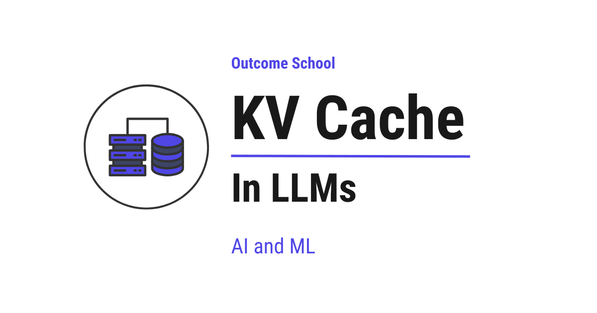

# KV Cache in LLMs

> **Module 12 · Lesson 12.4**  
> Source: [Outcome School](https://outcomeschool.com/blog/kv-cache-in-llms) · Published: March 27, 2026 · Reading time: ~11 min · Tags: `llm`, `ai`, `machine-learning`

---



KV Cache is a memory inside a Large Language Model (LLM) that saves the work already done for the earlier words, so that the model does not repeat the same work for every new word it generates. Here, K stands for Key and V stands for Value.

In this blog, we will learn about **KV Cache**. We will start with how LLMs generate text one token at a time, understand the role of Key, Value, and Query inside the model, see the problem of repeated computation through an example, and then walk through how KV Cache solves this problem by storing and reusing past results.

Let's get started.

## How LLMs Generate Text

Before we understand KV Cache, we first need to understand how LLMs generate text.

An LLM - Large Language Model - is a model that has been trained on a massive amount of text data. It can understand and generate human language. When we give it a sentence, it predicts what comes next.

LLMs generate text **one token at a time**. A token is a small piece of text - it can be a word, part of a word, or even a single character. For simplicity, let's treat each word as one token.

Let's say we give the model this input:

```
"I love"
```

The model looks at **"I"** and **"love"**, and predicts the next token: **"teaching"**.

Now the full sequence becomes:

```
"I love teaching"
```

The model looks at **"I"**, **"love"**, and **"teaching"**, and predicts the next token: **"AI"**.

Now the full sequence becomes:

```
"I love teaching AI"
```

This process continues, one token at a time, until the model [decides to stop](https://outcomeschool.com/blog/stop-tokens-in-llms).

The important thing to notice here is: every time the model predicts a new token, it needs to look at **all the previous tokens** to decide what comes next.

This token-by-token generation happens in two phases, prefill and decode, and the KV Cache is the bridge between them. We have a detailed blog on [Prefill vs Decode](https://outcomeschool.com/blog/prefill-vs-decode-llm-inference-optimization) that explains this step by step.

## What Happens Inside the Model

Now, let's understand what happens inside the model when it generates each token.

The model has a component called the **attention layer**, the heart of the [Transformer architecture](https://outcomeschool.com/blog/decoding-transformer-architecture). The job of the attention layer is to help the model figure out which previous tokens are important for predicting the next token. Not all previous tokens are equally useful. Some matter more than others.

Inside the attention layer, every token is converted into three things. Let's understand each of them with a simple analogy.

Imagine a classroom where a new student joins and wants to find out who can help with a specific topic:

- **Query (Q)**: The new student's question - "Who here knows about this topic?" Every token being predicted gets a Query. It represents what the token is looking for.
- **Key (K)**: The name tag each existing student wears that says what they know - "I know about math" or "I know about science." Every previous token gets a Key. It describes what information that token holds.
- **Value (V)**: The actual notes each student has. Once the new student finds the right person using their name tag (Key), the notes (Value) are what they actually use. Every previous token gets a Value. It carries the actual information.

So, the current token uses its **Query** to compare against the **Keys** of all previous tokens. This comparison produces **attention scores** - numbers that tell the model how much focus to give to each previous token. A higher score means that token is more relevant. A lower score means it is less relevant. The model then uses these scores to collect the **Values** from the relevant tokens. If we want to go deeper into how Q, K, and V are computed, we have a detailed blog on [Math behind Attention: Q, K, V](https://outcomeschool.com/blog/math-behind-attention-qkv).

This is how the attention layer works.

Now, let's see the problem.

## The Problem: Repeated Computation

Every time the model predicts the next token, it computes the Key, Value, and Query for **all tokens in the sequence** - not just the new one.

Let's see what happens step by step with our example:

**Step 1:** Input is **"I love"**

The model computes Key, Value, and Query for:

- "I"
- "love"

It uses these to predict the next token: **"teaching"**.

**Step 2:** Input is **"I love teaching"**

The model computes Key, Value, and Query for:

- "I" (already computed in Step 1, but computed again)
- "love" (already computed in Step 1, but computed again)
- "teaching" (new)

It uses these to predict the next token: **"AI"**.

**Step 3:** Input is **"I love teaching AI"**

The model computes Key, Value, and Query for:

- "I" (already computed in Step 1 and Step 2, but computed again)
- "love" (already computed in Step 1 and Step 2, but computed again)
- "teaching" (already computed in Step 2, but computed again)
- "AI" (new)

Do you see the problem?

The Key and Value for **"I"** were computed in Step 1. But the model computes them again in Step 2, and again in Step 3. The same goes for **"love"** and **"teaching"**.

**The model is repeating the same work for tokens it has already seen.** This is wasted computation.

As the sequence grows longer, this problem gets worse. If the model has already generated 100 tokens, then at the next step, it would recompute the Key and Value for all 100 previous tokens just to predict one new token. This makes text generation very slow.

## What is KV Cache?

**KV Cache is a memory where we save the Key and Value of every token that has already been processed, so that the model does not compute them again.**

So, here comes the KV Cache to the rescue. The idea behind **KV Cache** is simple: **compute the Key and Value for each token once, store them, and reuse them in every future step**.

Think of it like taking notes. Imagine you are in a meeting. Every time someone new speaks, instead of asking all the previous speakers to repeat what they said, you simply read from your notes and only listen to the new speaker. The notes are your cache.

Let's see how the same example works with KV Cache:

**Step 1:** Input is **"I love"**

The model computes Key, Value, and Query for:

- "I"
- "love"

It saves the Key and Value of **"I"** and **"love"** in the **KV Cache**.

It uses these to predict the next token: **"teaching"**.

**KV Cache now contains:** Key and Value for "I", "love"

**Step 2:** Input is only **"teaching"** (only the new token)

The model retrieves the Key and Value of **"I"** and **"love"** from the KV Cache. **No recomputation needed.**

It computes Key, Value, and Query only for the new token: **"teaching"**.

It saves the Key and Value of **"teaching"** in the KV Cache.

It uses all of these together to predict the next token: **"AI"**.

**KV Cache now contains:** Key and Value for "I", "love", "teaching"

**Step 3:** Input is only **"AI"** (only the new token)

The model retrieves the Key and Value of **"I"**, **"love"**, and **"teaching"** from the KV Cache. **No recomputation needed.**

It computes Key, Value, and Query only for the new token: **"AI"**.

It saves the Key and Value of **"AI"** in the KV Cache.

**KV Cache now contains:** Key and Value for "I", "love", "teaching", "AI"

So, instead of recomputing the Key and Value for every token at every step, the model computes them only for the **new token** and reuses the cached values for all previous tokens.

This is how **KV Cache** avoids repeated computation.

This same idea can be taken one step further by reusing the cached Keys and Values across many requests that share the same starting text. We have a detailed blog on [Prompt Caching](https://outcomeschool.com/blog/how-does-prompt-caching-work) that explains how this works.

## Why Only Key and Value Are Cached, Not Query

You would naturally ask: why do we cache only the Key and Value, and not the Query?

The Query is only needed for the **current token** - the one being generated right now. The current token uses its Query to compare against the Keys of all previous tokens to find which ones are relevant. Once the prediction is done, that Query is no longer needed.

But the Key and Value of every past token are needed at **every future step**, because every new token must look at all the previous tokens to make its prediction.

So, we only need to store the Keys and Values. This is why it is called **KV Cache** - it caches the **K**eys and **V**alues.

## How Much Faster Does It Get

Let's compare the two approaches side by side:

**Without KV Cache:**

```
Step 1: Compute K, V, Q for 2 tokens
Step 2: Compute K, V, Q for 3 tokens  (2 recomputed)
Step 3: Compute K, V, Q for 4 tokens  (3 recomputed)
Step 4: Compute K, V, Q for 5 tokens  (4 recomputed)
...
Step N: Compute K, V, Q for (N+1) tokens  (N recomputed)
```

The amount of computation keeps growing at every step.

**With KV Cache:**

```
Step 1: Compute K, V, Q for 2 tokens → Save K, V for 2 tokens in cache
Step 2: Compute K, V, Q for 1 token  → Reuse K, V for 2 tokens from cache
Step 3: Compute K, V, Q for 1 token  → Reuse K, V for 3 tokens from cache
Step 4: Compute K, V, Q for 1 token  → Reuse K, V for 4 tokens from cache
...
Step N: Compute K, V, Q for 1 token  → Reuse K, V for N tokens from cache
```

After the first step, the model computes only for **one new token** at each step instead of the entire sequence.

To put this into perspective: if the model is generating a sequence of 100 tokens, without KV Cache, the total number of Key and Value computations across all steps would be 2 + 3 + 4 + ... + 100 = **5,049 computations**. With KV Cache, it would be 2 + 1 + 1 + ... + 1 = **101 computations**. That is roughly **50 times fewer computations**. The longer the sequence, the bigger the savings.

This is what makes KV Cache so effective at speeding up text generation.

## The Trade-Off: Speed vs Memory

KV Cache makes generation faster, but it comes with a trade-off: it uses extra memory to store all the Key and Value information for every token that has been generated so far.

As the sequence gets longer, the cache grows larger. For very long sequences with thousands of tokens, the cache can consume a significant amount of memory.

For a chat that never ends, one common fix is to keep only a recent window of tokens plus the first few [attention sinks](https://outcomeschool.com/blog/how-do-attention-sinks-work), so that the cache stays at a fixed size. This is one of several [KV Cache Compression](https://outcomeschool.com/blog/kv-cache-compression) techniques that shrink this memory, and the others do it without throwing away a single token.

So, KV Cache is a trade-off: **we use more memory to save computation time**. For most use cases, this trade-off is well worth it, as the speed improvement is significant.

When serving an LLM to many users at once, managing this KV Cache memory efficiently becomes critical. We have a detailed blog on [vLLM](https://outcomeschool.com/blog/how-does-vllm-work) that explains how a serving system handles this end to end.

Now, we have understood the KV Cache in LLMs.

In the next blog, we will learn about **[Paged Attention](https://outcomeschool.com/blog/paged-attention-in-llms)** that solves the memory issue of KV Cache.

## Frequently Asked Questions

### Does the model still compute anything for the new token when KV Cache is used?

Yes. With KV Cache, the model still computes the Key, Value, and Query for the new token. It only skips the work for the previous tokens, whose Keys and Values it reads from the cache. Then it saves the Key and Value of the new token in the cache for future steps.

### Can the KV Cache be reused across different requests?

Yes. The same idea can be taken one step further by reusing the cached Keys and Values across many requests that share the same starting text. This is called Prompt Caching. It builds on the KV Cache idea of computing something once and reusing it.

### How do we stop the KV Cache from growing forever in a long chat?

One common fix is to keep only a recent window of tokens plus the first few attention sinks. This way, the cache stays at a fixed size. This is one of several KV Cache Compression techniques, and the others shrink the memory without throwing away a single token.

### Does KV Cache solve the memory problem of LLMs?

No. KV Cache saves computation time, but it uses extra memory, and the cache grows larger as the sequence gets longer. When serving an LLM to many users, managing this memory becomes critical. Paged Attention is the technique that solves the memory issue of KV Cache.
