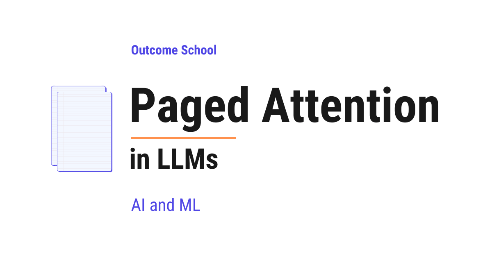

# What is Paged Attention in LLMs and How Does It Work?

> **Module 12 · Lesson 12.6**  
> Source: [Outcome School](https://outcomeschool.com/blog/paged-attention-in-llms) · Published: March 29, 2026 · Reading time: ~11 min · Tags: `llm`, `ai`, `machine-learning`

---



Paged Attention is a technique that manages the KV Cache memory more efficiently by breaking it into small, fixed-size blocks called pages. This removes the memory waste and lets LLMs serve many more users at the same time.

In this blog, we will learn about **Paged Attention**, a technique that solves the memory waste problem of KV Cache, allowing LLMs to serve many more users at the same time.

We will start with a quick recap of [KV Cache](https://outcomeschool.com/blog/kv-cache-in-llms), understand the memory problem it creates, see how traditional memory allocation wastes space through an example, and then walk through how Paged Attention solves this problem by borrowing an idea from how computers manage memory.

Let's get started.

## Quick Recap: KV Cache

When an LLM generates text, it predicts one token at a time. A token is a small piece of text. It can be a word, part of a word, or even a single character.

At each step, the model computes a Key and a Value for the new token and needs the Keys and Values of all previous tokens.

Without KV Cache, the model would recompute the Key and Value for every previous token at every step, wasting computation. KV Cache solves this by storing the Key and Value of each token after it is computed, so they can be reused in future steps.

KV Cache makes text generation much faster. But it comes with a trade-off: it uses memory to store all those Keys and Values.

Now, let's understand the memory problem this creates.

## The Problem: Memory Waste in KV Cache

When a user sends a request to an LLM, the system needs to set aside memory for the KV Cache of that request. But here is the challenge: **the system does not know in advance how long the response will be**.

A user can ask a simple question that results in a 20-token response, or a complex question that results in a 2,000-token response. The system has no way of knowing upfront.

In the traditional approach, the system reserves one large block of memory for each request - where all the slots are right next to each other - enough to handle the maximum possible response length. This means reserving memory for, say, 2,048 tokens, even if the actual response turns out to be only 50 tokens.

Let's understand this with an analogy.

### The Hotel Analogy

Imagine a hotel where guests check in but do not know how many nights they will stay. Some will stay 1 night, some will stay 30 nights.

**Traditional approach:** When a guest checks in, the hotel reserves 30 rooms in a row on the same floor, just in case the guest stays for 30 nights. Even if the guest stays for only 2 nights, all 30 rooms remain reserved and cannot be given to anyone else.

Now imagine 10 guests check in. The hotel reserves 30 × 10 = 300 rooms in a row. But if most guests stay only a few nights, hundreds of rooms sit empty and wasted.

This is exactly what happens with KV Cache memory in the traditional approach.

**The waste shows up in two ways:**

1. **Internal waste:** Memory is reserved but never used. If a request only generates 50 tokens but memory was reserved for 2,048 tokens, the remaining space for 1,998 tokens is wasted.
2. **External waste:** Because memory must be allocated in one large block with all slots next to each other, small gaps of free memory scattered around cannot be used, even if together they would be enough to serve a new request.

This memory waste is a serious problem. A large portion of the reserved memory is never actually used.

Because memory is limited, this waste means the system can serve fewer users at the same time. If the system could use memory more efficiently, it could handle many more requests simultaneously.

This is the problem that Paged Attention solves.

## What is Paged Attention?

**Paged Attention** is a technique that manages KV Cache memory more efficiently by breaking it into small, fixed-size blocks called **pages**. These pages do not need to be next to each other in memory.

The word "Paged" comes from a concept in operating systems. An operating system manages memory for all the programs running on the computer.

Instead of giving each program one large block of memory with all slots next to each other, the operating system breaks memory into small, fixed-size pieces called **pages**. Each program gets as many pages as it needs, and these pages can be scattered anywhere in memory. The operating system keeps track of where each page is using a **page table**, a simple list that maps each page of a program to its actual location in memory.

Paged Attention applies the same idea to KV Cache.

Let's go back to our hotel analogy to understand how this works.

### The Hotel Analogy: Paged Approach

**Paged approach:** Instead of reserving 30 rooms in a row for each guest, the hotel gives rooms **one at a time, as needed**. When a guest checks in, they get 1 room. When they need another night, they get another room, wherever one is available. It does not have to be next to the first room. The hotel keeps a list that tracks which rooms belong to which guest.

Now, if a guest stays for only 2 nights, only 2 rooms are used. The remaining rooms are free for other guests. No waste.

If 10 guests check in, each gets only the rooms they actually need. The hotel can serve far more guests with the same number of rooms.

This is how Paged Attention works with KV Cache.

## How Paged Attention Works

In Paged Attention, the KV Cache memory is divided into small, fixed-size blocks. Each block can store the Key and Value for a fixed number of tokens. For example, if the block size is 4, each block can store the Key and Value for 4 tokens.

Let's walk through an example.

### Without Paged Attention (Traditional Approach)

The system reserves one large block of memory for, say, 16 tokens upfront:

```
Memory: [__ __ __ __ __ __ __ __ __ __ __ __ __ __ __ __]
         Reserved for this request (16 slots)
```

As the model generates tokens, it fills the slots one by one:

```
Memory: [I  love  teaching  AI  and  Machine  Learning  at  Outcome  School  __  __  __  __  __  __]
         Used: 10 tokens                                                      Wasted: 6 slots
```

The remaining 6 slots are reserved but never used - wasted memory.

### With Paged Attention

The system allocates memory in small blocks of 4 tokens each, only when needed:

**Step 1:** The model starts generating. The system allocates **Block 1** from wherever available in memory:

```
Block 1: [I  love  teaching  AI]
```

**Step 2:** Block 1 is full. The system allocates **Block 2**. It does not have to be next to Block 1:

```
Block 1: [I  love  teaching  AI]
Block 2: [and  Machine  Learning  at]
```

**Step 3:** Block 2 is full. The system allocates **Block 3**:

```
Block 1: [I  love  teaching  AI]
Block 2: [and  Machine  Learning  at]
Block 3: [Outcome  School  __  __]
```

Only 2 slots are wasted in Block 3, compared to 6 in the traditional approach. And no memory was reserved upfront that went unused.

### The Block Table

But if the blocks are scattered across memory, how does the model find them?

The system keeps track of which blocks belong to which request using a **block table**, just like how an operating system uses a page table.

```
Block Table for Request 1:
  Block 0 → Location 5 in memory
  Block 1 → Location 12 in memory
  Block 2 → Location 3 in memory
```

The blocks are numbered in order (0, 1, 2) and each one points to its actual location in memory. When the model needs to read the Key and Value of a previous token, it uses the block table to find the right block.

This is how the model can access the Key and Value of any previous token, even though the blocks are scattered across memory.

## Why Paged Attention Is So Effective

Paged Attention solves the two types of memory waste we discussed earlier:

1. **Internal waste is nearly eliminated.** Memory is allocated only as needed, block by block. The only waste is in the last block, which will not always be completely full. In our example, only 2 out of 4 slots were wasted in the last block, compared to 6 out of 16 in the traditional approach.
2. **External waste is eliminated.** Because blocks do not need to be next to each other, any free block anywhere in memory can be used. There are no unusable gaps.

The result: Paged Attention can use memory much more efficiently. This means the system can serve significantly more requests at the same time with the same amount of memory.

Note that Paged Attention does not make the KV Cache itself smaller, it only stops the memory around it from being wasted. Shrinking the cache itself is the job of [KV Cache Compression](https://outcomeschool.com/blog/kv-cache-compression).

## Memory Sharing Across Requests

Paged Attention also enables an important optimization: **memory sharing**.

Let's say two users ask the same question. The input tokens (the question) are the same for both requests. With Paged Attention, both requests can share the same blocks for the input tokens, because the Key and Value for those tokens will be identical.

Instead of storing two copies, the system stores one copy and both requests point to the same blocks in their block tables. This saves even more memory.

This is especially useful in scenarios like:

- **Parallel sampling:** Sometimes we want the model to generate multiple different responses for the same question, so we can pick the best one. Since the question is the same for all responses, the input blocks can be shared across all of them.
- **Beam search:** Sometimes the model explores multiple possible completions at the same time to find the best one. Again, the shared input can be stored once and reused across all the parallel sequences.

In these cases, memory sharing significantly reduces the total memory needed.

This idea of sharing identical prefixes is taken even further by [SGLang](https://outcomeschool.com/blog/how-does-sglang-work), which organizes shared text in a radix tree to match shared prefixes even more precisely.

Paged Attention is the core idea behind vLLM, the popular high-throughput serving engine. We have a detailed blog on [vLLM](https://outcomeschool.com/blog/how-does-vllm-work) that explains how it works. The same block-based idea shows up in NVIDIA's engine under the name paged KV cache, and we have a detailed blog on [how TensorRT-LLM works](https://outcomeschool.com/blog/how-does-tensorrt-llm-work) that covers it end to end.

Now, we have understood Paged Attention and how it borrows the idea of paging from operating systems to manage KV Cache memory efficiently, eliminate waste, and serve more users at the same time.

In the next blog, we will learn about **[Continuous Batching](https://outcomeschool.com/blog/continuous-batching-in-llms)**, which pairs with Paged Attention to keep the GPU busy by adding new requests to the batch the moment any old request finishes.

## Frequently Asked Questions

### Does Paged Attention make the KV Cache smaller?

No. Paged Attention does not make the KV Cache itself smaller. It only stops the memory around it from being wasted. Shrinking the cache itself is the job of KV Cache Compression.

### Why can't the system reserve the exact memory needed for each request?

Because the system does not know in advance how long the response will be. A simple question may need a 20-token response, while a complex one may need 2,000 tokens. So, the traditional approach reserves memory for the maximum possible length, and a large portion of it goes unused.

### Does Paged Attention remove all memory waste?

Almost. External waste is eliminated, because blocks do not need to be next to each other and any free block can be used. Internal waste is nearly eliminated, since memory is allocated block by block. The only waste left is in the last block, which will not always be completely full.

### Is Paged Attention the same thing as vLLM?

No. Paged Attention is a technique, and vLLM is a popular high-throughput serving engine built on it. Paged Attention is the core idea behind vLLM. The same block-based idea also shows up in NVIDIA's TensorRT-LLM under the name paged KV cache.

### How does Paged Attention work with Continuous Batching?

Continuous Batching pairs with Paged Attention to keep the GPU busy. It adds new requests to the batch the moment any old request finishes. Paged Attention makes room for these extra requests by using memory much more efficiently.
