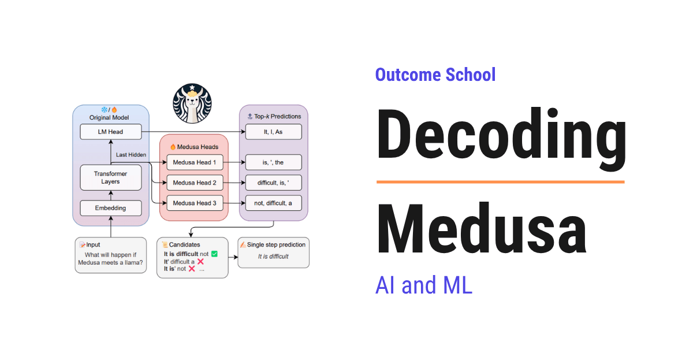

# What is Medusa? Multi-Head Speculative Decoding Explained

> **Module 12 · Lesson 12.10**  
> Source: [Outcome School](https://outcomeschool.com/blog/decoding-medusa) · Published: August 31, 2026 · Reading time: ~10 min · Tags: `llm`, `ai`, `machine-learning`

---



Medusa is a method that makes a language model generate text 2 to 3 times faster by adding a few extra heads to it. Each extra head guesses a token further ahead, so the model can produce several tokens in one step.

In this blog, we will learn about Medusa, a simple way to make a language model generate text 2 to 3 times faster by giving it several extra heads that guess multiple future tokens at once.

We will cover the following:

- What is Medusa?
- Why text generation is slow
- A quick recap of speculative decoding
- The problem with needing a draft model
- The big idea: many heads on one model
- How tree attention checks many guesses at once
- The math behind the speedup with small numbers
- The results
- How Medusa lives on today
- Quick Summary

Let's get started.

Medusa was introduced in 2024 in the famous research paper "Medusa: Simple LLM Inference Acceleration Framework with Multiple Decoding Heads" by Tianle Cai, Yuhong Li, Tri Dao, and their collaborators.

Medusa makes a model generate text much faster, without changing the model's answers, and without needing a second helper model. The name comes from the mythical Medusa with many heads, because this method adds several prediction heads to one model. So, let's decode it piece by piece.

## What is Medusa?

Medusa is a method to speed up text generation by adding extra prediction heads to a language model.

A normal model has one head that predicts the next token. Medusa adds a few more heads, where each one tries to predict a token further ahead. So instead of guessing just the next token, the model guesses the next few tokens all at once, and then quickly checks them.

In simple words, Medusa lets the model say "here is the next word, and here is my guess for the few words after it too", and if those guesses are right, we get several words for the price of one.

## Why text generation is slow

A language model generates text one token at a time. To produce a token, it runs a full forward pass through the whole network. Then it feeds that token back in and runs another full pass for the next token, and so on.

```
pass 1 -> token 1
pass 2 -> token 2
pass 3 -> token 3
...
```

So writing 100 tokens means 100 full passes, one after another. This is slow, and it is the main reason chatbots feel like they are typing.

The frustrating part is that a forward pass is not actually busy. Generating one token barely uses the GPU, because the GPU is built to do huge amounts of math in parallel, but we are asking it for just one token at a time. The hardware is mostly idle. We needed a way to make each pass produce more tokens. We needed a solution for that, and Medusa is one answer.

We have a detailed blog on [Prefill vs Decode: LLM Inference Optimization](https://outcomeschool.com/blog/prefill-vs-decode-llm-inference-optimization) that explains why this decode phase leaves the GPU waiting.

## A quick recap of speculative decoding

One earlier answer was [speculative decoding](https://outcomeschool.com/blog/speculative-decoding). The idea is to use a small, fast model to guess several tokens ahead, then let the big model check all those guesses in a single pass. If the guesses are right, the big model accepts them, and we get several tokens from one pass of the big model.

This works well, but it has a cost.

## The problem with needing a draft model

Speculative decoding needs a second model, the small draft model, to make the guesses. That brings problems.

- We have to find or train a small model that matches the big one well.
- We have to load and run two models, using more memory and adding complexity.

It would be much simpler if the big model could make its own guesses, with no separate draft model at all. That is exactly what Medusa does.

## The big idea: many heads on one model

Medusa adds a few small extra heads on top of the existing model. Each head is tiny, just a small layer. They all read the same internal state the model already computed.

- The original head predicts the next token, as usual. Call it the position 1 token.
- Medusa head 1 predicts the token at position 2.
- Medusa head 2 predicts the token at position 3.
- Medusa head 3 predicts the token at position 4.

```
                model's internal state
                  /     |     |     \
                 v      v     v      v
            [orig]  [head1][head2][head3]
              |        |      |      |
              v        v      v      v
           token1   token2 token3 token4   <- all guessed in ONE pass
```

So in a single forward pass, the model produces not just the next token, but a guess for the next several tokens too. The base model is frozen, and only these small heads are trained, which is cheap and fast.

Think of how you sometimes finish a friend's sentence before they do. If your guess is right, the conversation moves faster. If it is wrong, no harm done, they just say the real word. Medusa's heads are like that: they guess the next few words, and we keep the guesses only when they turn out to be correct.

But guesses can be wrong. So we need a way to check them and only keep the correct ones.

## How tree attention checks many guesses at once

Each head does not give just one guess. It gives its top few candidates. For example, head 1 might suggest two likely words, and head 2 might suggest two likely words. Combining them gives several possible continuations.

Medusa arranges all these candidate continuations into a **tree**, and then checks the entire tree in a single forward pass using a special [attention mask](https://outcomeschool.com/blog/causal-masking-in-attention) called tree attention. This mask lets every candidate path be verified at the same time, without them interfering with each other.

After verification, Medusa keeps the longest path whose tokens the model agrees with, and throws away the rest. So we always end up with tokens the model itself would have produced. The output is the same as normal generation, just produced faster.

## The math behind the speedup with small numbers

Let's see the speedup with simple numbers.

**Normal generation.** Each forward pass produces exactly 1 token.

```
to produce 1 token  -> 1 pass
to produce 6 tokens -> 6 passes
```

**Medusa.** In one pass, the original head plus 3 Medusa heads guess 4 tokens. Then one verification pass checks them. Suppose, on average, 3 of those guessed tokens are accepted each round.

```
round 1: 1 pass guesses 4 tokens, 3 are accepted  -> 3 tokens
round 2: 1 pass guesses 4 tokens, 3 are accepted  -> 3 tokens
```

So 2 passes produced 6 tokens, while normal generation would need 6 passes for the same 6 tokens. That is a 3 times speedup.

The speedup is simply the average number of tokens accepted per pass:

```
speedup = average accepted tokens per pass
```

If Medusa accepts about `2.5` tokens per pass on average, that is roughly a `2.5` times speedup. And crucially, since we only keep tokens the model agrees with, the final text is exactly what the model would have written anyway.

**Note:** Three extra heads and accepting 3 tokens are just for the sake of understanding, so we can calculate by hand. Real setups tune the number of heads and the tree shape. The idea stays exactly the same: more tokens per pass means faster generation.

## The results

Medusa sped up generation by about 2 to 3 times on popular models, with no change to the output quality, because every accepted token is verified against the model itself.

It is also simple to add. The base model is left frozen, and only the small heads are trained, which takes very little time and data. There is no separate draft model to manage. This simplicity is a big part of why Medusa became popular.

## How Medusa lives on today

Medusa pushed forward a whole line of fast-generation methods that need no draft model.

- It directly inspired methods like [**EAGLE**](https://outcomeschool.com/blog/decoding-eagle), which predict future tokens even more accurately by working at the level of the model's internal features, and now give some of the highest speedups available.
- The idea of extra heads that predict multiple future tokens also appears in training. [**Multi-Token Prediction**](https://outcomeschool.com/blog/decoding-deepseek-v4), used in models like DeepSeek-V3, trains a model with extra heads from the start, which both improves the model and gives a built-in way to speed up generation.
- Tree-based verification, where many candidate paths are checked in one pass, is now a common trick in fast inference systems like [TensorRT-LLM](https://outcomeschool.com/blog/how-does-tensorrt-llm-work).

So Medusa took the powerful idea of speculative decoding and made it simpler, by letting the model grow its own heads instead of leaning on a separate draft model.

Medusa is one of many tricks that make generation fast. We have a detailed blog on [LLM Inference Optimization](https://outcomeschool.com/blog/llm-inference-optimization) that covers these techniques end to end.

## Quick Summary

- **Medusa** speeds up text generation by adding several small extra heads to a model, each guessing a token further ahead.
- Normal generation is slow because it produces only **one token per forward pass**, leaving the GPU mostly idle.
- **Speculative decoding** sped things up but needed a separate **draft model**, which adds complexity.
- Medusa's big idea is to put **many heads on one model**, so a single pass guesses several future tokens, with the base model frozen and only the cheap heads trained.
- **Tree attention** checks many candidate continuations in one pass, and Medusa keeps the longest path the model agrees with, so the output is unchanged.
- The speedup equals the **average number of tokens accepted per pass**, often around 2 to 3 times.
- Medusa inspired later methods like EAGLE and the Multi-Token Prediction used in modern models.

Now, we have decoded Medusa piece by piece and understood how giving a model extra heads lets it generate several tokens at once.

## Frequently Asked Questions

### Does Medusa change the answers of the model?

No. Medusa does not change the model's answers. It keeps only the longest path of guessed tokens that the model agrees with and throws away the rest. So the final text is exactly what the model would have written with normal generation, just produced faster.

### Do we need to retrain the whole model to use Medusa?

No. The base model is left frozen, and only the small extra heads are trained. This takes very little time and data. This simplicity is a big part of why Medusa became popular.

### Is Medusa better than speculative decoding with a draft model?

Medusa is simpler than speculative decoding with a draft model. We do not need to find or train a small model that matches the big one, and we do not need to load and run two models. The big model makes its own guesses through its extra heads, which saves memory and complexity.

### What is the difference between Medusa and EAGLE?

Medusa guesses future tokens directly with extra heads, while EAGLE predicts future tokens by working at the level of the model's internal features. Medusa directly inspired EAGLE. Because EAGLE's guesses are more accurate, it now gives some of the highest speedups available.

### How much faster is Medusa than normal generation?

Medusa sped up generation by about 2 to 3 times on popular models. The speedup equals the average number of tokens accepted per pass. Since every accepted token is verified against the model itself, there is no change to the output quality.
