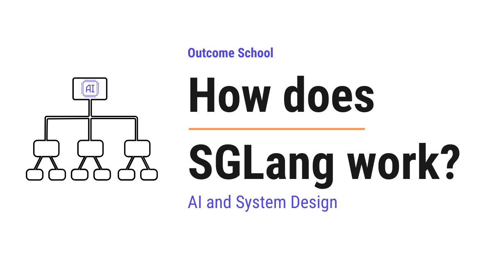

# How does SGLang work?

> **Module 12 · Lesson 12.17**  
> Source: [Outcome School](https://outcomeschool.com/blog/how-does-sglang-work) · Published: June 30, 2026 · Reading time: ~23 min · Tags: `llm`, `ai`, `system-design`

---



SGLang is a high-performance serving framework for large language models. It serves a model's answers to many users at the same time, as fast as possible, using clever ideas like RadixAttention to reuse past work.

In this blog, we will learn about how SGLang works. We will also see what problem it solves, how it makes serving large language models faster, and the clever ideas that make it special.

We will cover the following:

- What is SGLang?
- A quick recap of how an LLM generates text
- The problem SGLang solves
- RadixAttention: the heart of SGLang
- How RadixAttention reuses past work
- The frontend language of SGLang
- How the runtime and the frontend work together
- Continuous batching in SGLang
- Structured output and faster decoding
- A simple end-to-end picture
- More powerful features of SGLang
- How SGLang compares to vLLM

Let's get started.

### What is SGLang?

SGLang is a high-performance serving framework for large language models and multimodal models.

In simple words, it is a tool that takes a large language model and serves its answers to many users at the same time, as fast as possible.

The name SGLang comes from two parts.

SGLang = `SG` (Structured Generation) + `Lang` (Language).

So, the name itself tells us two things. It helps us generate structured output in a controlled way, and it gives us a small language to write our instructions.

Do not worry, we will learn about each of these parts in detail.

For now, just remember this. `SGLang` has two main pieces that deliver these two things. One piece is a **runtime**, which is the engine that actually runs the model fast and takes care of the structured output. The other piece is a **frontend language**, which is the small language we just mentioned, the friendly way for us to tell the model what to do.

Now, before we understand why `SGLang` is fast, we must first understand how an `LLM` generates text. Once we know that, the magic of `SGLang` will be very clear.

### A quick recap of how an LLM generates text

An `LLM` writes text one word at a time. To be precise, it writes one **token** at a time.

A **token** is a small piece of text. It can be a whole word, a part of a word, or even a single character. For the sake of understanding, we can think of a token as roughly one word.

So, the model reads our input, then it produces one token. Then it reads our input plus that new token, and it produces the next token. It keeps doing this until the answer is complete.

Let's say we ask the model, "The sky is".

First, the model reads "The sky is" and produces "blue".

Then it reads "The sky is blue" and produces "today".

Here, we can notice something important. To produce each new token, the model looks back at everything that came before.

Now, looking back at all the previous tokens again and again would be very slow. So, the model stores some helpful numbers from the previous tokens and reuses them. These stored numbers are called the **KV cache**.

The **KV cache** is the model's memory of the tokens it has already processed. It stands for the key and value cache. We do not need the deep math here. We just need this simple idea.

> The KV cache is the model's saved work for the tokens it has already seen, so it does not have to redo that work for every new token.

This [KV cache](https://outcomeschool.com/blog/kv-cache-in-llms) is very important. It is the key to understanding why `SGLang` is so fast. Keep this idea in mind.

### The problem SGLang solves

Now, let's understand the real problem.

In the real world, an `LLM` does not answer just one person. It answers thousands of people at the same time. And the same model is asked many similar things again and again.

Let's say we build a chatbot. Every single conversation begins with the same instruction, which is called a **system prompt**.

A **system prompt** is a fixed set of instructions we give the model before the user speaks. For example, "You are a helpful assistant.".

So, every user's request starts with this same instruction. The model has to process this same text again and again, for every user. This is wasted work.

Here is another example. Suppose we are building an [agent](https://outcomeschool.com/blog/ai-agent) that answers questions about a document. The document is the same for every question. But the model reads the whole document from scratch for each question.

This is like reading an entire book from page one, every single time someone asks you a small question about it. It is slow, and it wastes effort.

So, the problem is clear. The model repeats the same expensive work many times. We need a way to do that shared work only once and reuse it.

So, here comes `SGLang` to the rescue.

`SGLang` was built around one central idea. If two requests share the same starting text, they can share the saved work for that text. This saved work, as we learned, is the KV cache.

The technique that makes this sharing possible is called **RadixAttention**. This is the heart of `SGLang`.

### RadixAttention: the heart of SGLang

Let's break down this name first.

RadixAttention = `Radix` (a way to organize text by shared prefixes) + [`Attention`](https://outcomeschool.com/blog/self-attention-in-transformers) (the core operation an LLM uses to look back at previous tokens).

To understand `Radix`, we must first understand a **prefix**.

A **prefix** is the starting part that two pieces of text have in common.

For example, look at "The sky is blue" and "The sky is clear". They share the prefix "The sky is". After that, one says "blue" and the other says "clear".

Now, `SGLang` keeps a smart structure called a **radix tree** to store the KV cache of many requests.

A **radix tree** is a tree-like structure that groups text by its shared prefix. We can think of it as a family tree of sentences. Sentences that begin the same way share the same branch. They only split apart at the point where they become different.

Let's make this very concrete with a small example.

Suppose three users send these three requests:

- "You are a helpful assistant. What is the capital of France?"
- "You are a helpful assistant. What is the capital of Japan?"
- "You are a helpful assistant. Tell me a joke."

Here, we can see that all three share the same start, which is "You are a helpful assistant.".

Without `SGLang`, the model would process "You are a helpful assistant." three separate times.

With `SGLang`, the radix tree stores that shared part once. Its KV cache is computed only one time. Then each request continues from there. And wherever some requests still share even more text, that shared text becomes another branch that is also stored only once.

Let's see the radix tree as below:

```
              "You are a helpful assistant."
              (shared prefix, KV cache stored once)
                            |
              +-------------+--------------+
              |                            |
              v                            v
     "What is the capital of"       "Tell me a joke."
      (shared by two requests,        (unique tail)
       KV cache stored once)
              |
          +---+---+
          |       |
          v       v
      "France?"  "Japan?"
      (unique)   (unique)
```

Here, we can see that the common start, "You are a helpful assistant.", sits at the top as one shared branch. Its saved work is computed only once. Below it, the two requests that ask about a capital share even more text, which is "What is the capital of". So that part becomes another shared branch, and its saved work is also stored only once. Only at the very bottom do "France?" and "Japan?" split into their own unique parts. The "Tell me a joke." request shares only the top branch and then goes its own way. None of the shared branches are ever recomputed.

This is how RadixAttention saves a huge amount of work. The shared prefix is processed once, and that saved work is reused by other requests that share it, for as long as it stays in memory.

The problem is solved.

### How RadixAttention reuses past work

Now, let's understand the steps `SGLang` follows. This will make everything clear.

**Step 1:** A new request arrives. For example, "You are a helpful assistant. What is the capital of Italy?".

**Step 2:** `SGLang` looks at its radix tree. It checks how much of the start of this request already exists in the tree.

**Step 3:** It finds that "You are a helpful assistant. What is the capital of" is already there, because the earlier requests about France and Japan added it. So, it reuses the saved KV cache for that whole part. It does not recompute it.

**Step 4:** Only the new part, which is "Italy?", is processed fresh. The new saved work is then added as a new branch in the tree.

**Step 5:** The model generates the answer one token at a time, just like we learned earlier.

So, the more text different requests share, the more work `SGLang` saves. This sharing is automatic. We do not have to do anything special to enable it.

There is one more thing to understand. The memory that stores the KV cache is limited. It cannot hold everything forever.

So, `SGLang` must decide what to keep and what to throw away when the memory gets full. It uses a simple and smart rule. It removes the least recently used branches first. This means the branches that nobody has used for the longest time get removed first.

This is a clever choice. The popular shared prefixes, like the system prompt, stay in memory because they are used all the time. The rare one-off parts get removed when space is needed.

This is how `SGLang` keeps the most useful saved work and reuses it as much as possible.

We have a detailed blog on [how prompt caching works](https://outcomeschool.com/blog/how-does-prompt-caching-work) that explains this in depth.

### The frontend language of SGLang

Till now, we have learned about the engine. Now, it is time to learn about the friendly part, which is the **frontend language**.

The **frontend language** is a simple way for us to write our instructions to the model, right inside our `Python` code.

Why do we need this? Because real tasks are rarely a single question. A real task is often many steps.

Let's say we want the model to do this:

- Read a paragraph.
- Summarize it.
- Then translate the summary into French.

These are three steps that depend on each other. Writing all of this by hand, and keeping it fast at the same time, is hard.

So, the frontend language lets us describe these steps clearly. We can write a sequence of model calls, mix in our own text, and capture the model's output into variables.

Let's see a small example as below:

```python
import sglang as sgl
@sgl.function
def summarize_and_translate(s, paragraph):
    s += "Summarize this paragraph:\n" + paragraph + "\n"
    s += "Summary: " + sgl.gen("summary", max_tokens=64)
    s += "Now translate the summary to French.\n"
    s += "French: " + sgl.gen("french", max_tokens=64)
```

Here, we have defined a function that does two model calls in order.

- The variable `s` holds the growing conversation. We keep adding text to it.
- `sgl.gen("summary", ...)` asks the model to generate the summary and saves it under the name `summary`.
- After that, we ask the model to translate, and we save the result under the name `french`.

So, we describe the whole flow in plain steps, and `SGLang` runs it efficiently behind the scenes.

This is the beauty of the frontend language. We write our intent simply, and the runtime takes care of speed and sharing.

### How the runtime and the frontend work together

Now, let's connect the two pieces we have learned.

The frontend language is how we describe the task. The runtime is the engine that runs it fast using RadixAttention.

Here is the nice part. The frontend understands the structure of our program. It knows which parts are fixed and shared, and which parts are new.

So, when many requests run the same program, they naturally share the same prefixes. The runtime sees this and reuses the KV cache through the radix tree.

In simple words, the frontend and the runtime are designed to help each other. The frontend exposes the shared structure, and the runtime exploits it for speed.

This teamwork is the core reason `SGLang` is both easy to use and fast.

### Continuous batching in SGLang

Now, let's learn another idea that helps `SGLang` stay fast. This idea is not unique to `SGLang`. Many modern serving systems use it too. It is called **[continuous batching](https://outcomeschool.com/blog/continuous-batching-in-llms)**.

First, what is a **batch**? A **batch** is a group of requests that the model processes together at the same time. Processing many requests together is much more efficient than processing them one by one.

But there is a catch with simple batching. Different requests finish at different times. One user may want a short answer, and another may want a long one.

In old-style batching, we would wait for the whole group to finish before starting a new group. This means fast requests are stuck waiting for slow ones. That wastes time.

So, here comes **continuous batching** to the rescue.

**Continuous batching** means that as soon as one request in the group finishes, a new waiting request takes its place right away. We do not wait for the whole group to finish.

Let's say we have a batch of four requests. Request two finishes early. Instead of leaving an empty slot, `SGLang` immediately fills that slot with the next waiting request.

Let's see the difference as below:

```
Old-style batching (slot sits empty, time wasted):
  Slot 1: [ R1 running ............ ]
  Slot 2: [ R2 done ] [ empty, waiting for whole group ]
  Slot 3: [ R3 running ............ ]
  Slot 4: [ R4 running ............ ]
Continuous batching (empty slot filled right away):
  Slot 1: [ R1 running ............ ]
  Slot 2: [ R2 done ] [ R5 starts immediately ........ ]
  Slot 3: [ R3 running ............ ]
  Slot 4: [ R4 running ............ ]
```

Here, we can see that in old-style batching, the slot of the finished request stays empty until the whole group is done. In continuous batching, a new waiting request, R5, jumps into that slot right away. No slot sits idle.

So, the model is always kept busy. No slot sits empty. This keeps the hardware working at full power and serves more users in the same amount of time.

This is how continuous batching squeezes the most out of the machine.

One important point to remember. Continuous batching is a common technique, so it is not the part that makes `SGLang` special. The special part is that `SGLang` brings continuous batching and RadixAttention together. RadixAttention reuses the shared work through the radix tree, and continuous batching keeps the machine busy. This combination is what makes `SGLang` shine when many requests share a long common start.

### Structured output and faster decoding

Let's remember the name again. `SGLang` has the word "Structured Generation" in it. Now, we will finally understand that part.

Many times, we do not want free text from the model. We want the answer in a fixed format.

For example, we may want a `JSON` answer like below:

```json
{
  "name": "Italy",
  "capital": "Rome"
}
```

A **JSON** is a simple, common format used to store data as a set of names and values. Many programs read and write data in this format.

The problem is, a normal model may produce slightly broken `JSON`. It may forget a bracket or add extra words. Then our program cannot read it.

So, `SGLang` lets us force the output to follow a fixed shape. We give it a rule for the format, and `SGLang` makes sure every generated token follows that rule.

This is called **constrained decoding**.

**Constrained decoding** means the model is only allowed to pick tokens that keep the output valid for our chosen format. If a token would break the format, it is simply not allowed.

So, the output is always valid. We never get broken `JSON`. The problem is solved.

There is a bonus here. Because the format already fixes some parts of the output, `SGLang` can sometimes fill those fixed parts very quickly instead of asking the model for them one token at a time. This makes structured output faster too.

This is how `SGLang` gives us reliable, well-shaped answers, and gives them quickly.

### A simple end-to-end picture

Now, let's put the whole story together in one simple flow.

**Step 1:** We write our task using the `SGLang` frontend language. We describe the steps and the format we want.

**Step 2:** Our request goes to the `SGLang` runtime, which is the engine.

**Step 3:** The runtime looks at the radix tree and checks for any shared prefix, like the system prompt. If it is already there, it reuses the saved KV cache through RadixAttention.

**Step 4:** Only the new part of our request is processed fresh, and its saved work is added to the tree.

**Step 5:** Our request joins a batch. Thanks to continuous batching, the engine stays fully busy and serves many users together.

**Step 6:** The model generates the answer one token at a time. If we asked for a fixed format, constrained decoding keeps every token valid.

**Step 7:** We get our answer, fast and correctly shaped.

Here is the whole flow as below:

```
   We write the task (frontend language)
                 |
                 v
        SGLang runtime (engine)
                 |
                 v
     Check the radix tree for a shared prefix
                 |
        +--------+--------+
        |                 |
   found prefix       new part
        |                 |
        v                 v
  reuse saved KV    process fresh and
  cache (Radix      add to the tree
  Attention)             |
        +--------+--------+
                 |
                 v
   Join a batch (continuous batching keeps
            the engine busy)
                 |
                 v
   Generate one token at a time
   (constrained decoding keeps the format valid)
                 |
                 v
       Fast, well-shaped answer
```

Here, we can see the request flowing from our frontend code, into the runtime, through the radix tree where shared work is reused, into a batch that keeps the engine busy, and finally out as a valid answer.

This is how `SGLang` works from start to finish.

We have a detailed blog on [LLM inference optimization](https://outcomeschool.com/blog/llm-inference-optimization) that covers the broader landscape of these techniques.

### More powerful features of SGLang

We have now seen the full core flow of `SGLang`. But `SGLang` is a large and modern tool, and it does much more than the core. Let's look at its other powerful features in simple words. Many of these are also found in other modern serving tools, so they are not unique to `SGLang`.

Before we list them, we need one small idea. When a model answers, there are two stages. First, it reads the whole prompt in one go. This stage is called the [**prefill**](https://outcomeschool.com/blog/prefill-vs-decode-llm-inference-optimization). Then, it writes the answer one token at a time. This stage is called the **decode**. Many of the features below make these two stages faster.

**Chunked prefill.** Some prompts are very long, like a big document. Reading such a long prompt in one go can block everyone else. So, `SGLang` can break a long prompt into smaller chunks and read them bit by bit, mixed in with the answer writing. This keeps the work smooth for all users.

**[Speculative decoding](https://outcomeschool.com/blog/speculative-decoding).** Writing one token at a time is slow. So, `SGLang` can guess several tokens ahead using a small, fast helper model, and then check those guesses with the main model in one step. When the guesses are correct, we get many tokens at once. This makes the answer come out faster. `SGLang` also supports [EAGLE](https://outcomeschool.com/blog/decoding-eagle), which makes those guesses land more often by drafting at the model's internal feature level instead of the token level.

**[Prefill and decode disaggregation](https://outcomeschool.com/blog/prefill-decode-disaggregation).** The prefill stage and the decode stage need different things. Prefill needs a lot of raw computing power. Decode needs a lot of memory and quick back-and-forth. So, `SGLang` can run these two stages on separate machines, each tuned for its own job, and a smart router sends each request to the right place. This is often called PD disaggregation, and it helps `SGLang` run smoothly at a very large scale.

**Splitting a model across many GPUs.** Some models are too big to fit on one GPU. A GPU is the powerful chip that actually runs the model. So, `SGLang` can split a single model across many GPUs, so that it fits and runs fast. For very large [mixture-of-experts](https://outcomeschool.com/blog/mixture-of-experts) models, where the model is made of many smaller expert parts, `SGLang` can even spread these experts across many machines. This is how it serves some of the biggest models in the world.

**Quantization.** The numbers inside a model take up a lot of memory. [Quantization](https://outcomeschool.com/blog/how-does-model-quantization-work) shrinks these numbers into a smaller form, so the model uses less memory and runs faster, with almost no drop in quality. `SGLang` supports many of these smaller forms.

**Serving many custom versions at once.** Sometimes we have many small custom versions of the same base model, each trained for a different task. `SGLang` can serve many of these versions together in the same batch, instead of loading each one on its own machine. This saves a lot of resources.

**Understanding images and more.** `SGLang` is not only for text. It can also serve models that understand images, and it keeps adding support for more types, like video. This is why it is called a framework for large language models and multimodal models.

**A smart scheduler.** Continuous batching, which we saw earlier, keeps the slots full. The scheduler handles a different kind of waiting. The GPU does the heavy work, while the CPU, the part that plans the work, decides what to run next. `SGLang` does this planning while the GPU is still busy, so the GPU almost never has to wait for the next step.

**Cache-aware load balancing.** When `SGLang` runs on many machines, it tries to send each request to the machine that already has its shared work saved. This way, the reuse we learned about with RadixAttention keeps working even across many machines.

So, `SGLang` is much more than RadixAttention. It is a complete, modern serving tool with many features that work together to make serving large language models fast, affordable, and reliable.

### How SGLang compares to vLLM

[`vLLM`](https://outcomeschool.com/blog/how-does-vllm-work) is another tool for serving large language models. It is one of the most popular tools in the world for this job. So, it is natural to ask how `SGLang` is different from it. Let's look at the honest picture, without favoring either one.

Here is the most important truth first. `SGLang` and `vLLM` are both excellent, and over time they have become quite similar. Both are fast. Both serve many users at once. Both reuse the saved work, which is the KV cache, for shared text. Both can produce structured output like `JSON`. Both even offer the same style of simple API, so we can often move from one to the other without changing much code.

So, what is actually different?

The first difference is in how they reuse shared text. `SGLang` matches shared text very precisely, piece by piece, using its radix tree. `vLLM` matches shared text in fixed-size blocks. In simple words, `SGLang` can often catch sharing that `vLLM` would miss, especially in long back-and-forth chats where each turn adds a little more text. When many requests start with the exact same fixed text, both do very well. This block-based matching in `vLLM` is called PagedAttention, and we have a detailed blog on [PagedAttention](https://outcomeschool.com/blog/paged-attention-in-llms) that explains how it works.

The second difference is reach and maturity. `vLLM` has been around a little longer. It has the largest community and the longest track record in production, so for general serving it is often the default choice. `SGLang` is newer, but it has grown very fast and is now trusted at a very large scale, serving a huge number of requests every day at many big companies. Both run on a wide range of hardware, which means many kinds of chips from different companies. So, both are battle-tested in the real world. The one engine that deliberately goes the other way is [TensorRT-LLM](https://outcomeschool.com/blog/how-does-tensorrt-llm-work), which runs only on NVIDIA GPUs and gives up that reach in exchange for kernels tuned to each GPU generation.

The third difference is what `SGLang` adds on top. `SGLang` gives us the frontend language we saw earlier, which makes multi-step tasks easy to write. It also has very strong support for structured output, with very little slowdown. And it shines when many requests share a lot of text, like long chats, agents, or document question-answering.

What about raw speed? The honest answer is that it depends on the model, the workload, and the version of each tool. Sometimes one is a little faster, and sometimes the other. Both keep improving very quickly. So, there is no single winner on speed.

Let me tabulate the differences between `SGLang` and `vLLM` for your better understanding so that you can decide which one to use based on your use case.

| Point | `vLLM` | `SGLang` |
| --- | --- | --- |
| Reusing shared text | In fixed-size blocks | Piece by piece, using a radix tree |
| Track record and community | The longest and largest | Newer, but growing very fast |
| Best known for | General fast serving and maturity | Prefix sharing, the frontend language, and structured output |
| Great for | Many very different requests | Multi-turn chat, agents, and document question-answering |

So, how do we choose? For the largest community, the longest track record, and general serving with very different requests, `vLLM` is a great choice. For heavy text sharing, like multi-turn chat, agents, or document question-answering, and for strong structured output, `SGLang` is a great choice. For many everyday cases, both will serve us well.

So, now we have understood how `SGLang` works. It reuses shared work with RadixAttention, lets us write tasks with the frontend language, keeps the machine busy, and gives us reliable structured output. Together, these ideas let us serve large language models to many people quickly and reliably.

## Frequently Asked Questions

### Do we need to turn on prefix sharing manually in SGLang?

No. The sharing is automatic. When a new request arrives, SGLang checks its radix tree for how much of the start already exists, reuses the saved KV cache for that part, and processes only the new part. We do not have to do anything special to enable it.

### What happens when the KV cache memory in SGLang gets full?

SGLang removes the least recently used branches of the radix tree first. So the branches that nobody has used for the longest time are thrown away. Popular shared prefixes, like the system prompt, stay in memory because they are used all the time, while rare one-off parts are removed when space is needed.

### Is continuous batching unique to SGLang?

No. Continuous batching is a common technique that many modern serving systems use. What makes SGLang special is that it brings continuous batching and RadixAttention together. RadixAttention reuses shared work, and continuous batching keeps the machine busy, which helps a lot when many requests share a long common start.

### Does structured output slow down generation in SGLang?

Very little, and SGLang can even make it faster. With constrained decoding, the model is only allowed to pick tokens that keep the output valid, so we never get broken JSON. Because the format already fixes some parts of the output, SGLang can sometimes fill those parts quickly instead of generating them one token at a time.

### Can SGLang serve models that understand images?

Yes. SGLang is not only for text. It can also serve models that understand images, and it keeps adding support for more types, like video. This is why it is called a serving framework for large language models and multimodal models.
