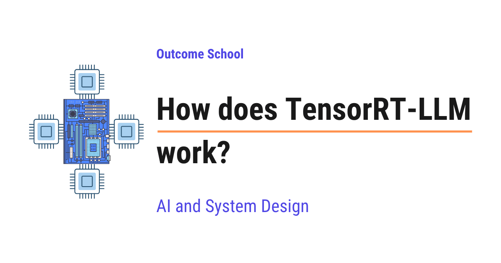

# How does TensorRT-LLM work?

> **Module 12 · Lesson 12.18**  
> Source: [Outcome School](https://outcomeschool.com/blog/how-does-tensorrt-llm-work) · Published: September 4, 2026 · Reading time: ~45 min · Tags: `llm`, `ai`, `system-design`

---



TensorRT-LLM is an open-source library from NVIDIA that makes large language models run as fast as possible on NVIDIA GPUs. We give it a finished model, and it gives us back a highly tuned, ready-to-run version for our GPU.

In this blog, we will learn about how TensorRT-LLM works, NVIDIA's own engine that squeezes the highest possible speed out of an NVIDIA GPU when it runs a large language model. We will also see what inference means, what a GPU kernel is, why a normal model run wastes a lot of the GPU's time, how TensorRT-LLM prepares the model ahead of time instead of figuring things out on the fly, how kernel fusion, quantization, the paged KV cache, in-flight batching, CUDA graphs, and speculative decoding each add speed, how one model is spread across many GPUs, and where it works well and where it fails.

We will cover the following:

- What is inference?
- What is a GPU and what is a kernel?
- The problem: the GPU spends its time on the wrong things
- What is TensorRT-LLM?
- The big idea: prepare the model ahead of time
- The build step: from a model to an engine
- Kernel fusion
- Quantization
- Custom attention kernels
- The paged KV cache
- In-flight batching
- CUDA graphs
- Speculative decoding
- Running one model across many GPUs
- How we actually serve the model
- The PyTorch backend, the newer and easier path
- The full journey of one request
- TensorRT-LLM vs vLLM
- Where it works well and where it fails

Let's get started.

### What is inference?

Let's start from the very beginning.

A **large language model**, or **LLM**, is the AI model behind tools like ChatGPT. We give it some text, and it gives us back some text.

An LLM has two very different parts of its life.

**The first part is training.** This is when the model learns. It reads a huge amount of text and slowly adjusts billions of internal numbers until it becomes good at predicting words. Training happens once, it takes a long time, and it is very expensive.

**The second part is inference.** This is when the model works. Training is finished, the numbers are frozen, and now we simply ask the model a question and it gives us an answer.

**Inference means using an already-trained model to produce an answer.**

In simple words, training is the student studying for years, and inference is the student answering our question today.

Now, here is why inference matters so much in the real world. Training happens once. Inference happens every single time any user types anything. Millions of times a day. So, even a small saving in inference time gets multiplied by millions.

This is the exact thing TensorRT-LLM is built for. It does not help us train a model. It makes inference as fast as it can possibly be.

### What is a GPU and what is a kernel?

Before we can understand what makes inference slow, we need two more simple ideas.

A **[GPU](https://outcomeschool.com/blog/how-does-a-gpu-work-for-deep-learning)** is a special chip that is extremely good at doing a huge amount of simple math at the same time. An LLM is basically a mountain of multiplications and additions, so a GPU is the perfect chip for it.

Let's understand the GPU with a comparison. A normal processor, called a **CPU**, is like one very clever person who solves problems one after another, very quickly. A GPU is like ten thousand ordinary people who all work at the same moment. If the job is one hard puzzle, the clever person wins. If the job is ten thousand small sums, the crowd wins by a mile. An LLM is ten thousand small sums, so the GPU wins.

Now, the second idea. The GPU does not do anything on its own. The CPU has to tell it what to do. It does that by sending small programs to the GPU.

**A [kernel](https://outcomeschool.com/blog/how-do-cuda-kernels-work) is a small program that runs on the GPU and does one specific piece of math.**

For example, there is a kernel that multiplies two big grids of numbers. There is another kernel that adds two lists of numbers. There is another kernel that applies a simple formula to every number in a list.

So, running an LLM means the CPU launches thousands of these kernels one after another, and the GPU runs each one. Launching a kernel is called a **kernel launch**.

We can picture it as below:

```
HOW A MODEL RUNS ON A GPU
   CPU (the manager)                    GPU (the ten thousand workers)
   ------------------                   -----------------------------
   "run kernel 1"        ------->       kernel 1 runs, result saved
   "run kernel 2"        ------->       kernel 2 runs, result saved
   "run kernel 3"        ------->       kernel 3 runs, result saved
        ...                                   ...
   (thousands of launches for a single token)
```

Here, we can see that the CPU is the manager sending instructions, and the GPU is the crowd of workers doing the actual math. For every single token the model writes, this whole conversation between the manager and the workers happens thousands of times.

Keep this picture in your mind. Almost everything TensorRT-LLM does is about making this picture cleaner and faster.

### The problem: the GPU spends its time on the wrong things

Now, let's see the real problem.

When we run a model in the normal way, using a standard deep learning framework, the framework figures out what to do while it is running. It reads the model layer by layer, and for each layer it picks a ready-made kernel and launches it.

This is very flexible and very convenient. We can change the model, print things in the middle, and experiment freely. That freedom is wonderful when we are building a model.

But that same freedom is expensive when we are only running a finished model millions of times. Let's see exactly where the time leaks away.

**The first leak is too many small kernels.** Each layer of the model is broken into many tiny steps, and each tiny step is its own kernel. A big multiplication is one kernel. Adding a small correction is another kernel. Applying a formula to every number is another kernel. Each of these kernels is small and finishes fast, but there are thousands of them.

**The second leak is memory traffic.** This one is the biggest, so let's understand it properly. The GPU has a large memory where all the numbers live, and a much smaller, much faster memory right next to the workers. Every kernel has to pull its numbers from the large memory, do its math, and push the answer back to the large memory. Pulling and pushing is slow. The math itself is fast.

So, when we run ten small kernels in a row, the same numbers get pulled out and pushed back ten times. The workers finish their sums almost instantly and then sit idle, waiting for the next delivery of numbers. The GPU looks busy, but it is mostly waiting.

**The third leak is launch overhead.** Every kernel launch costs a little bit of time on the CPU side. One launch is nothing. Thousands of launches for every single token, for every user, adds up into a real delay. Sometimes the CPU cannot even prepare the launches fast enough, and the powerful GPU sits idle waiting for its manager to speak.

**The fourth leak is generic kernels.** A ready-made kernel is written to work for every model, every size, and every GPU. Being general means it cannot be perfect for our exact model on our exact GPU. There is always a faster version possible.

Let's see the leak in a simple picture as below:

```
NORMAL RUN: many small kernels, numbers travel back and forth
big GPU memory:  [ numbers ]
                    |  ^        |  ^        |  ^
                    v  |        v  |        v  |
                 kernel 1     kernel 2    kernel 3
                 (multiply)   (add)       (apply formula)
   pull, compute, push  ->  pull, compute, push  ->  pull, compute, push
   the math is fast, the travelling is slow, the workers keep waiting
```

Here, we can notice that the numbers make the slow trip to and from the big memory three separate times, once for each kernel, even though the three kernels are doing one connected piece of work.

So, the problem is clear. The GPU has enormous power, and a normal run wastes a large part of it on travelling, launching, and general-purpose kernels instead of on math.

So, here comes TensorRT-LLM to the rescue.

### What is TensorRT-LLM?

Now that we understand the problem, let's understand the solution.

**TensorRT-LLM is an open-source library from NVIDIA that makes large language models run as fast as possible on NVIDIA GPUs.**

In simple words, we hand it a finished model, and it hands us back a highly tuned, ready-to-run version of that model that squeezes the most speed out of our specific GPU.

Let's break the name down.

**TensorRT-LLM = Tensor + RT + LLM.**

- **Tensor** is simply the name for a grid of numbers. A single number, a list of numbers, a table of numbers, and bigger versions of these are all tensors. Everything inside a model is tensors.
- **RT** stands for **Runtime**, which means the part that actually runs the model.
- **LLM** tells us this library is built specially for large language models.

TensorRT-LLM is built on top of an older NVIDIA tool called **TensorRT**, which does the same kind of speed work for all sorts of AI models. TensorRT-LLM adds everything that is special about large language models on top of it, like the [KV cache](https://outcomeschool.com/blog/kv-cache-in-llms), batching many users together, and splitting a giant model across several GPUs.

**TensorRT-LLM does its thinking ahead of time, so that at answer time the GPU does nothing but math.**

That single sentence is the heart of this blog.

To reach that speed, TensorRT-LLM uses a set of tricks that all work together:

- **Kernel fusion**, which merges many small pieces of math into one, so the numbers travel less.
- **Quantization**, which stores the model's numbers in a smaller form, so they take less space and move faster.
- **Custom attention kernels**, which are custom-written programs for the heaviest part of the model.
- **The paged KV cache**, which hands out memory in small blocks so nothing is reserved and wasted.
- **In-flight batching**, which keeps every slot on the GPU filled with live work at all times.
- **CUDA graphs**, which replay a whole recorded sequence of steps with a single instruction.
- **Speculative decoding**, which produces several tokens in the time normally taken by one.
- **Multi-GPU execution**, which splits a model too big for one GPU across many of them.

Most of these ideas are not NVIDIA-only. We have a detailed blog on [LLM Inference Optimization](https://outcomeschool.com/blog/llm-inference-optimization) that covers this whole family of techniques end to end.

Do not worry, we will learn about each of them in detail. Let's start with the idea that ties them all together.

### The big idea: prepare the model ahead of time

Let's understand the core idea with a simple comparison.

Suppose we open a restaurant. There are two ways to cook.

**The first way is cooking to order from scratch.** A customer orders, and only then do we open the recipe book, walk to the store, buy the vegetables, chop them, and start the stove. Every single order repeats all of this. It is very flexible, because we can cook literally anything a customer asks for. But every customer waits a long time.

**The second way is preparing everything in advance.** Before the restaurant opens, we decide the menu, chop all the vegetables, pre-mix the sauces, and arrange every tool exactly where the cook's hand will reach for it. Now when the order arrives, the cook only has to do the actual cooking. The food comes out very fast. The price we pay is that the menu is fixed. We prepared for these dishes, and cooking something completely different means preparing all over again.

A normal deep learning framework is the first restaurant. TensorRT-LLM is the second restaurant.

**Ahead of time, TensorRT-LLM studies the whole model, decides the fastest possible way to run every part of it on our exact GPU, and saves that plan. At answer time, it simply follows the saved plan.**

This preparation step is called the **build**, and what it produces is called an **engine**.

An **engine** is a single prepared file that holds the model's numbers along with the exact plan for running them fast on one specific kind of GPU. It is not a recipe book any more. It is a fully prepped kitchen.

Now, why does preparing ahead of time help so much? Because during the build, TensorRT-LLM has all the time in the world. It can try many different kernels for the same operation, actually time each one on the real GPU, and keep the winner. It can look at ten small operations sitting next to each other and decide to merge them into one. None of this is possible while a user is waiting for an answer.

So, we can now state the trade very simply. We spend a few minutes once, in exchange for speed on every request forever after.

### The build step: from a model to an engine

Now, let's walk through the build step by step, so that it feels real.

**Step 1: We start with the trained model.** This is the finished model as it comes from wherever we got it, with all its learned numbers, called **weights**. Weights are simply the numbers the model learned during training.

**Step 2: We describe the model to TensorRT-LLM.** TensorRT-LLM already has ready-made definitions for the popular model families, so most of the time we do not write anything. It reads the model and builds an internal map of every operation and how they connect.

**Step 3: TensorRT-LLM optimizes that map.** This is where the real work happens. It merges operations together, removes work that is not needed, and rearranges things into a faster shape. We will learn about these tricks in the next sections.

**Step 4: It picks the best kernel for every operation.** For each piece of math, it tries several kernel versions on our actual GPU, measures how long each one really takes, and keeps the fastest. This is called **kernel auto-tuning**. Notice that the answer can be different on different GPUs, which is exactly why the engine is tied to one GPU type.

**Step 5: It writes out the engine file.** The prepared plan and the weights are saved together into one file that we can load and run.

We can picture the whole build as below:

```
THE BUILD STEP
  trained model  --->  TensorRT-LLM build  --->  engine file
  (weights)            - merge operations         (weights + the exact
                       - remove extra work         plan to run them fast)
                       - try many kernels
                       - time them on the
                         real GPU, keep
                         the fastest
  happens ONCE, takes minutes        used for EVERY request after that
```

Here, we can see that all the thinking is pushed into the one-time build on the left, so that the right side, which happens millions of times, is left with pure math and nothing else.

**Note:** Because the plan was tuned for one specific GPU, one precision, and one set of size limits, an engine is not freely portable. If we move to a different GPU or want to allow much longer prompts, we build a new engine. This rigidity is the honest price of the speed, and we will come back to it at the end of the blog.

Now, let's learn the individual tricks that happen inside the build and inside the runtime.

### Kernel fusion

This is the most important trick, so let's understand it well.

**Kernel fusion means combining several small kernels into one bigger kernel, so that the numbers are pulled from memory once instead of many times.**

Remember the problem we saw earlier. The slow part is not the math. The slow part is the numbers travelling between the big GPU memory and the workers.

Let's take a concrete little example. Suppose the model needs to do three things in a row on the same numbers.

- Multiply the numbers by a big grid of weights.
- Add a small correction value to the result.
- Apply a simple formula to every number, the kind that turns negative values into zero.

Without fusion, these are three kernels. The numbers come out of the big memory, get multiplied, and go back. They come out again, get the addition, and go back. They come out a third time, get the formula, and go back. Three round trips.

With fusion, TensorRT-LLM writes one single kernel that does all three things while the numbers are still in the fast memory next to the workers. The numbers come out once, all three things happen, and they go back once. One round trip instead of three.

Let's see the difference as below:

```
WITHOUT FUSION (3 round trips)
 big memory -> multiply -> big memory -> add -> big memory -> formula -> big memory
WITH FUSION (1 round trip)
 big memory -> [ multiply + add + formula, all in fast memory ] -> big memory
```

Here, we can see that the actual math is exactly the same in both cases, and the answer is exactly the same too. The only thing that changed is how many slow trips the numbers had to make. We cut it from three to one.

Fusion also removes two kernel launches, so the CPU has less to do as well.

Now, multiply this saving by every layer of the model, and by every token of every answer, for every user. This is why fusion alone gives a large speed-up.

TensorRT-LLM fuses aggressively, and this is much easier for it than for a normal framework, because during the build it can see the whole model at once and it knows nothing is going to change later.

This is how kernel fusion turns many slow trips into one. Now, let's move to the next trick.

### Quantization

Now, let's learn the second big trick.

To understand it, we need to know how a model stores its numbers.

Every weight inside a model is a number with a decimal point, like `0.372`. The computer stores such a number using a fixed amount of space, measured in **bits**. A bit is the smallest unit of computer memory.

Models are usually trained using 16 bits or 32 bits for every single number. More bits means the number is stored more precisely.

**Quantization means storing the model's numbers using fewer bits.**

In simple words, we shrink every number into a smaller, rougher form.

Let's understand it with a comparison. Suppose we are writing down a price. We could write `19.9999999` or we could write `20`. The short version takes far less space to write, far less time to read, and for most purposes it is just as useful. Quantization is exactly this, applied to every number in the model.

So, we may take a model stored in 16 bits per number and store it in 8 bits per number, or even 4 bits per number. TensorRT-LLM supports several of these smaller forms, and NVIDIA's newer GPUs have special hardware that runs the small forms extremely fast.

Now, why does this help so much? There are three reasons, and all three matter.

**The first reason is less memory used.** A model in 8 bits takes about half the space of the same model in 16 bits. So, a model that did not fit on our GPU may now fit, and the space we saved becomes room for serving more users at once.

**The second reason is less travelling.** We already know that moving numbers is the slow part. If every number is half the size, then moving them takes about half the time. This is a direct speed-up on the exact thing that was the bottleneck.

**The third reason is faster math.** Modern NVIDIA GPUs have dedicated hardware for doing math on these smaller numbers, and it runs several times faster than the same math on bigger numbers.

But, here is the catch. Rounding numbers loses a little information. If we are careless, the model's answers get worse.

So, quantization is done carefully. Some sensitive parts of the model are kept at higher precision while the rest is shrunk. The rounding is calibrated by running a small amount of sample text through the model and observing the real range of the numbers, so that the rounding is tuned to what actually happens rather than guessed. TensorRT-LLM ships several well-tested [quantization methods](https://outcomeschool.com/blog/how-does-model-quantization-work) that do this properly.

**Note:** The KV cache can be quantized too, not just the weights, which is one of the [KV Cache Compression](https://outcomeschool.com/blog/kv-cache-compression) techniques. We will learn what the KV cache is in a moment, and it takes a huge amount of memory, so shrinking it lets us serve many more users at the same time.

So, done well, quantization gives us a smaller, faster model whose answers stay very close to the original. Done carelessly, it gives us a fast model that is not as good. This is why it must always be checked on real examples before we ship it.

This was all about quantization. Now, let's look at the single heaviest part of the model.

### Custom attention kernels

Now, let's look at the part of the model where TensorRT-LLM spends most of its effort.

Inside a large language model, the most important operation is called **[attention](https://outcomeschool.com/blog/self-attention-in-transformers)**. In simple words, attention is how the model looks back at all the earlier words to decide what the next word should be. When the model is about to write a word, attention is the step where it asks, "which of the earlier words matter most for what I am writing right now".

Attention is expensive, and it gets more expensive as the conversation gets longer, because there are more earlier words to look back at. So, attention is usually the single biggest consumer of time in the whole model.

Now, here is the important part. Attention is not one operation. Written out plainly, it is a chain of several operations, one after another, each with its own trip to the big memory. That is exactly the pattern we now know is wasteful.

So, TensorRT-LLM does not run attention as a chain. It uses **custom attention kernels**, which are custom-written kernels that do the entire attention step in one go, keeping the intermediate results in the fast memory next to the workers and never writing them out to the big memory at all.

The most famous kernel of this kind is Flash Attention, and we have a detailed blog on [Flash Attention](https://outcomeschool.com/blog/decoding-flash-attention) that explains how it works.

These kernels are written by engineers who know the GPU deeply, and there are different versions for different situations. There is one version tuned for reading a long prompt, and a different version tuned for writing one token at a time. There are versions tuned for each generation of NVIDIA GPU, because each generation has slightly different hardware.

This is one of the biggest reasons TensorRT-LLM is fast on NVIDIA hardware. NVIDIA makes the GPU, so NVIDIA knows exactly how to write a kernel that fits it perfectly.

Till now, we have learned how TensorRT-LLM speeds up the math. Now, it is time to learn how it manages memory while it is answering.

### The paged KV cache

To understand this, we must first understand the **KV cache**. Let's build it up slowly.

The model works with **[tokens](https://outcomeschool.com/blog/tokenization-in-llms)**. A token is a small chunk of text, roughly a word or part of a word. Our prompt is broken into tokens, and the answer is produced as tokens.

There are two phases in every answer. First, the model reads our entire prompt in one go, and this phase is called the **[prefill](https://outcomeschool.com/blog/prefill-vs-decode-llm-inference-optimization)**. Then it writes the reply one token at a time, and this phase is called the **decode**. Prefill is the model digesting our question, and decode is the model writing its answer.

Now, during decode, to write each new token, attention needs to look back at every token that came before. For that, the model computes a small set of values for every token, a kind of note about what that token means in context. If it threw those notes away, it would have to recompute the notes for the entire conversation before writing every single new word. That would be painfully slow.

So, it keeps them.

**The KV cache is the collection of these saved notes, one set per token, kept in GPU memory so the model never recomputes them.**

Here is the key fact. The KV cache keeps growing. Every new token adds one more set of notes. And every user being served has their own KV cache. So, all of these caches live together in the same limited GPU memory, and the amount of free KV cache memory is what decides how many users we can serve at the same time.

Now, the naive way to manage this memory is wasteful. Since we do not know in advance how long an answer will be, the naive engine reserves one big block of memory for the longest possible answer, for every request, right at the start. Most answers turn out to be short, so most of that reserved space is never used and cannot be given to anybody else.

So, TensorRT-LLM uses a **[paged KV cache](https://outcomeschool.com/blog/paged-attention-in-llms)** instead.

**A paged KV cache splits the memory into many small equal-sized blocks and hands them out one at a time, only when a request actually needs more room.**

The blocks do not have to sit next to each other in memory. A small table remembers which blocks belong to which request and in what order.

Let's see it as below:

```
PAGED KV CACHE
GPU memory:  [B1][B2][B3][B4][B5][B6][B7][B8][B9] ... one pool of equal blocks
Request A  ->  B1, B4, B7     (3 blocks, given one at a time as the answer grew)
Request B  ->  B2, B3         (2 blocks)
Request C  ->  B5             (1 block, just started)
free and ready to hand out:  B6, B8, B9
```

Here, we can see that nothing is reserved for an answer that may never arrive. Each request holds only the blocks it is genuinely using, and the moment a request finishes, all of its blocks go straight back into the free pool for the next user.

The problem is solved. There is no reserving space for an answer that may never come, and because every block is the same size, any free block fits any request, so almost nothing is wasted.

There is a beautiful bonus that comes free with blocks. Two requests that begin with exactly the same text can point at the very same blocks instead of each keeping a copy. Let's say every conversation in our product starts with the same long set of instructions. That identical beginning is stored once and shared by everybody. This is called **[prefix reuse](https://outcomeschool.com/blog/how-does-prompt-caching-work)**, and it saves both memory and the work of processing that beginning again.

So, the paged KV cache lets us pack far more users onto the same GPU. Now, let's see how the GPU is kept busy.

### In-flight batching

Now, let's learn how TensorRT-LLM keeps the GPU busy.

First, what is a **batch**? A batch is a group of requests that the GPU processes together in one go. A GPU is a crowd of ten thousand workers, so giving it one request at a time leaves most of the crowd idle. Batching is how we keep everyone working.

But the simple way of batching has a problem. In **static batching**, we collect a group of requests, run them all together, and wait for every one of them to finish before starting the next group.

Here is the catch. Answers have wildly different lengths. One user's answer is 20 tokens, another's is 800. In static batching, the short one finishes early and then its slot just sits there empty, waiting for the long one, because the whole group moves together. That empty slot is wasted GPU time, and it can be wasted for a very long time.

So, here comes **in-flight batching** to the rescue. This is TensorRT-LLM's name for the technique that other engines call [continuous batching](https://outcomeschool.com/blog/continuous-batching-in-llms).

**In-flight batching removes each finished request from the batch the moment it finishes and immediately pulls in a waiting request to take its place, without waiting for the rest of the batch.**

Remember that decode writes one token per step, so there are many small steps. At every step, TensorRT-LLM checks which requests just finished, drops them, frees their KV cache blocks, and pulls new requests from the waiting line into the freed slots. The batch is always kept full of live work.

Let's compare the two as below:

```
STATIC BATCHING: the whole batch waits for the slowest one
step:    1    2    3    4    5    6    7    8
Req A:   X    X    X   done  -    -    -    -      <- slot idle, wasted
Req B:   X    X    X    X    X    X    X   done
IN-FLIGHT BATCHING: a finished slot is refilled right away
step:    1    2    3    4    5    6    7    8
slot 1:  A    A    A    C    C    C    D    D      <- A finished, C jumped in, then D
slot 2:  B    B    B    B    B    B    B   done
```

Here, we can see that in static batching, request A finished at step 3 but its slot stayed empty for five whole steps. In in-flight batching, request C jumped into that slot immediately, and request D followed when C was done. The GPU never idles.

There is one more helpful idea that works alongside this, called **chunked prefill**. Reading a very long prompt in one shot is a big piece of work that would block everybody else for a moment. So, TensorRT-LLM can break that long prompt into smaller chunks and process them a chunk at a time, mixed in between the token-writing steps of other users. This keeps everyone's answer flowing smoothly instead of one huge prompt causing a hiccup for the whole server.

Chunked prefill spreads the work out, but the two phases still share one GPU. At a very large scale, serving systems go one step further and run prefill and decode on separate GPUs. We have a detailed blog on [Prefill-Decode Disaggregation](https://outcomeschool.com/blog/prefill-decode-disaggregation) that explains this step by step.

In-flight batching and the paged KV cache fit together perfectly. The paged KV cache frees a finished request's memory instantly, and in-flight batching immediately uses that freed memory and that freed slot for a new user. Together, they keep both the GPU memory and the GPU workers fully used.

### CUDA graphs

Now, let's fix the third leak we identified earlier, which was launch overhead.

Remember that the CPU has to launch every kernel on the GPU, and that launching costs a little time. When the model writes a token, thousands of kernels are launched. When the model is small or the batch is small, the GPU finishes each kernel so quickly that the CPU cannot keep up, and the GPU sits waiting for its next instruction.

**CUDA** is NVIDIA's system for programming the GPU, and a **CUDA graph** is a way to record a whole sequence of kernel launches once and then replay the entire sequence with a single instruction.

In simple words, instead of the manager shouting three thousand separate instructions at the workers for every token, the manager hands over one prepared checklist and says "do this whole list". The workers run the list themselves without waiting for the manager again.

Let's see it as below:

```
WITHOUT CUDA GRAPH                    WITH CUDA GRAPH
CPU: "run kernel 1"                   CPU: "run the recorded graph"
CPU: "run kernel 2"                          |
CPU: "run kernel 3"                          v
       ...                            GPU runs all 3000 kernels
CPU: "run kernel 3000"                on its own, back to back
(GPU waits between instructions)      (no waiting in between)
```

Here, we can see that the same three thousand kernels run in both cases, but in the second case the CPU spoke only once. All the small gaps between instructions disappear.

This works so well in TensorRT-LLM for one specific reason. Every step that writes a token does exactly the same sequence of operations as the last one, over and over. A repeated, unchanging sequence is precisely what a CUDA graph is good at recording.

Now that we have learned how TensorRT-LLM removes the waiting, it is time to learn how it produces more than one token at a time.

### Speculative decoding

Now, let's learn a trick that attacks a completely different problem.

Here is the problem. Writing one token at a time is fundamentally slow, and not because the GPU is weak. It is slow because each token must wait for the previous one. The model cannot write the fifth word until it has written the fourth. So, for each token, we pull the entire model's weights from memory just to produce one small piece of text. The ten thousand workers are barely breathing hard, and the whole cost is the trip to fetch the weights.

Here is the key realization. Producing five tokens at once would cost almost the same as producing one token, because the expensive part is fetching the weights, and we would fetch them once either way. The problem is only that we do not know what the next five tokens are.

So, here comes **[speculative decoding](https://outcomeschool.com/blog/speculative-decoding)** to the rescue.

**Speculative decoding guesses several tokens ahead using something cheap and fast, then checks all the guesses with the real model in a single step, keeping the guesses that were right.**

Let's walk through it.

**Step 1:** A cheap and fast guesser proposes the next few tokens, let's say four of them. The guesser can be a much smaller model, or a small extra piece attached to the main model, or even a [simple lookup of text patterns seen earlier](https://outcomeschool.com/blog/n-gram-speculation-in-llms).

**Step 2:** The big model checks all four guessed tokens in one single pass. This is the clever part. Checking four tokens together costs almost the same as producing one, because the weights are fetched once.

**Step 3:** The big model compares. It keeps every guessed token from the start that matches what it would have produced itself, and throws away everything from the first mistake onwards.

**Step 4:** If all four guesses were right, we just produced four tokens for roughly the price of one. If the second guess was wrong, we keep the first token, correct the second one ourselves, and start again from there.

Let's see it as below:

```
SPECULATIVE DECODING
guesser proposes:   [the]  [cat]  [sat]  [on]
big model checks all four in ONE pass
big model agrees:   [the]  [cat]  [sat]   X   <- disagreed here
kept: "the cat sat" (3 tokens) + the correct token the big model chose
cost: about one normal step
```

Here, we can see that three guessed tokens survived and one was rejected, so this single step produced four tokens in total instead of one.

Now, here is the most important promise of this technique. **The final answer is exactly what the big model would have written on its own.** Every guess is verified, and a wrong guess is thrown away. We are not trading quality for speed. We are only using the spare capacity that was sitting idle anyway.

TensorRT-LLM supports several styles of guessing, from using a small separate model to using extra prediction heads attached to the main model, as in [Medusa](https://outcomeschool.com/blog/decoding-medusa) and [EAGLE](https://outcomeschool.com/blog/decoding-eagle), so we can pick whichever suits our setup.

This is how speculative decoding uses the capacity that was going to waste anyway.

### Running one model across many GPUs

Now, let's handle the case where the model is simply too big for one GPU.

The largest models hold hundreds of billions of numbers. Even after quantization, no single GPU has enough memory to hold all of them. So, we must spread the model across several GPUs, and TensorRT-LLM has this built in.

There are two main ways to split a model, and TensorRT-LLM supports both, together if needed.

**The first way is tensor parallelism.** Here, we cut each individual layer of the model into pieces, and give one piece to each GPU. All the GPUs work on the same token at the same moment, each doing its own share of the math, and then they combine their partial answers into the complete one. Every GPU is busy at once, which makes this fast, but the GPUs must talk to each other after some steps to combine their pieces. That talking is fast when the GPUs sit inside one machine connected by high-speed links, and slow when they are in different machines over a normal network.

**The second way is pipeline parallelism.** Here, we do not cut any layer. Instead we give the first group of layers to the first GPU, the next group to the second GPU, and so on. The work flows through them like an assembly line. The GPUs barely need to talk, so this works better across machines, but a request passes through the GPUs one after another, so some GPUs wait while others work.

We can picture both as below:

```
TENSOR PARALLELISM              PIPELINE PARALLELISM
(cut each layer sideways)       (cut the stack of layers)
  layer 1: [GPU0 | GPU1]          layers  1-20 : GPU0
  layer 2: [GPU0 | GPU1]          layers 21-40 : GPU1
  layer 3: [GPU0 | GPU1]          layers 41-60 : GPU2
  both GPUs work on the           the work flows down the line,
  same token together, then       one GPU at a time for a
  combine their pieces            given request
```

Here, we can see that tensor parallelism cuts every layer sideways so all the GPUs share each step, while pipeline parallelism cuts the stack of layers into sections handled one after another.

In the classic engine path, the number of GPUs we want to use is decided at build time, because the engine has to be prepared with the model already split that way. This is another reason the engine is tied to a specific setup.

So, now we know how a model too big for one GPU is still served. Now, let's see how we put all of this in front of real users.

### How we actually serve the model

Once our model is ready to run, we need something that receives requests over the network, runs them, and sends the answers back. TensorRT-LLM gives us a few ways to do this.

**The simplest way is the built-in server.** TensorRT-LLM ships a command that starts a server around our model and exposes it over the network. This server speaks the same request-and-reply format that OpenAI's API uses.

This last point matters more than it sounds. A huge number of tools and applications are already written to talk to OpenAI's API. If our server speaks the same language, we can point those existing tools at our own server by changing only the address, without rewriting our application. We run our own model, on our own GPU, and our code barely notices the difference.

**The second way is through Triton Inference Server.** Triton is NVIDIA's general-purpose serving system, used to run all kinds of AI models in production. It has a backend for TensorRT-LLM, so we can serve our model inside Triton and get everything Triton offers, like health checks, metrics, running several models side by side, and standard deployment patterns.

**The third way is directly from our own code.** TensorRT-LLM offers a Python interface, so we can load a model and generate text right inside our own program. This is the easiest way to try things out.

Let's see the simplest use as below:

```python
from tensorrt_llm import LLM
llm = LLM(model="model-name-or-path")
output = llm.generate("What is inference in machine learning?")
print(output)
```

Here, we have loaded a model in one line and asked it a question in one more line. Behind these two simple lines, all the machinery we learned about is running, which means the fused kernels, the paged KV cache, in-flight batching, and everything else.

**Note:** There is also a hosted path. NVIDIA packages models into ready-made containers called **NIM**, which stands for NVIDIA Inference Microservice. Many of these containers use TensorRT-LLM inside, so a lot of people use it without ever building an engine by hand.

### The PyTorch backend, the newer and easier path

Now, we must talk about how TensorRT-LLM has changed, because this matters a lot for how we use it today.

Everything we described so far follows the original path, which is to build an engine ahead of time and then run it. That path gives excellent speed, but we saw its cost. Building takes time, the engine is tied to one GPU type and one set of size limits, and supporting a brand new model architecture takes work.

New models come out constantly. Waiting for a build every time is uncomfortable.

So, TensorRT-LLM added a second way of working, built directly on **[PyTorch](https://outcomeschool.com/blog/how-does-pytorch-work)**, which is the popular framework most models are written in. In the recent versions this PyTorch path has become the default.

**In this newer path, there is no separate ahead-of-time build. We point TensorRT-LLM at a model and it runs, applying its optimizations as it loads.**

Now, the obvious question is, do we lose the speed? Mostly, no. Let's see why. The biggest wins we learned about do not actually depend on the ahead-of-time build.

- The custom attention kernels are custom-written kernels, and they are used either way.
- The paged KV cache is a runtime memory manager, and it works either way.
- In-flight batching is a runtime scheduler, and it works either way.
- Quantization can be applied either way.
- CUDA graphs are recorded at runtime, and they work either way.
- Speculative decoding is a runtime technique, and it works either way.

What the ahead-of-time build uniquely gives is the deep whole-model fusion and the exhaustive kernel auto-tuning, where many kernel choices are actually timed on the real GPU and the winner is kept. Those are real gains, and for a stable, high-volume deployment on a fixed GPU they are worth the build.

So, we now have a clean way to choose. If we want the easiest path, the fastest support for new models, and freedom to change our setup, we use the PyTorch path. If we have one fixed model on one fixed GPU serving enormous traffic, and every last bit of speed matters, the ahead-of-time engine is still there for us.

### The full journey of one request

We have learned many separate ideas. Now, let's put them together and follow one single request from start to finish, so that the whole picture becomes clear.

**Before any user arrives:** We prepare the model. Either we build an engine ahead of time, or we let the newer PyTorch path load and optimize the model as it starts. Either way, by the end of this the fused kernels are chosen, the quantization is applied, the model is split across the GPUs we asked for, and the KV cache memory is set up as one pool of small blocks. The server is now listening.

**Step 1:** Our question arrives at the server. It is broken into tokens.

**Step 2:** The scheduler checks whether the beginning of our question is already sitting in the KV cache from an earlier request, for example the same long set of instructions everybody's conversation starts with. If it is, that part is reused instead of being processed again.

**Step 3:** Whatever is new gets processed, which is the prefill. If our prompt is very long, it is broken into chunks so it does not block the other users waiting for their next token.

**Step 4:** Our request joins the live batch. In-flight batching had a slot free, because some earlier request just finished and its blocks went back into the pool.

**Step 5:** Now the answer is written, one step at a time. In each step, the fused kernels and the custom attention kernels do the math, the whole recorded sequence is replayed as one CUDA graph so the CPU never becomes the bottleneck, and speculative decoding tries to produce several tokens instead of one. Our KV cache gets one more block whenever it fills up.

**Step 6:** Each token is [streamed back to us](https://outcomeschool.com/blog/how-does-token-streaming-work) as it is produced, so we start reading the answer before it is complete.

**Step 7:** Our answer is finished. Our request leaves the batch immediately, all of our blocks return to the free pool, and a waiting user takes our slot in the very next step.

Let's see the whole journey as below:

```
   our question
        |
        v
  +--------------------------------------------+
  |  server (built-in, or Triton)              |
  +--------------------------------------------+
        |
        v
  reuse the shared beginning from the KV cache?
        |
   +----+----+
   |         |
  yes        no
   |         |
   |         v
   |   process it (prefill, in chunks if long)
   |         |
   +----+----+
        |
        v
  join the live batch (in-flight batching)
        |
        v
  write one step at a time:
    fused + custom attention kernels  (less travelling)
    replayed as one CUDA graph        (no waiting on the CPU)
    speculative decoding              (several tokens per step)
    one more KV cache block when full (nothing reserved, nothing wasted)
        |
        v
  tokens streamed back to us
        |
        v
  finished: blocks freed, slot handed to the next user
```

Here, we can see that every idea we learned has its own place in the journey. The preparation happens once at the top, the memory tricks decide how many of us can be served together, and the speed tricks decide how fast each of our tokens comes out.

This is how TensorRT-LLM works from start to finish.

### TensorRT-LLM vs vLLM

[`vLLM`](https://outcomeschool.com/blog/how-does-vllm-work) is the other very popular engine for serving large language models, so it is natural to ask how the two compare. Let's look at the honest picture, without favoring either one.

Let's start with what they share, because it is a lot. Both serve many users at once. Both use a paged KV cache so that memory is not wasted. Both use continuous batching, which TensorRT-LLM calls in-flight batching, so no slot sits idle. Both support quantization, speculative decoding, chunked prefill, and splitting a model across many GPUs. Both offer an OpenAI-compatible server, so moving from one to the other usually means changing an address and very little else. Ideas have flowed in both directions between these projects, and they have grown closer over time.

Now, the differences.

**The first difference is who they are built for.** TensorRT-LLM is built by NVIDIA for NVIDIA GPUs, and it is willing to go all the way down to custom-written kernels tuned per GPU generation to win. vLLM is built to run well across a wide range of hardware from different companies. So, TensorRT-LLM trades portability for depth, and vLLM trades depth for reach.

**The second difference is how much preparation is expected.** The classic TensorRT-LLM path asks us to build an engine first, tied to our GPU and our size limits. vLLM asks for nothing ahead of time. We point it at a model and it serves. The newer PyTorch path in TensorRT-LLM has narrowed this gap a lot, but the ecosystem, the documentation, and the habits around vLLM are still simpler for someone starting today.

**The third difference is how quickly new models arrive.** vLLM has a very large open-source community, and support for a brand new model often appears there within days. TensorRT-LLM covers the important models well, and NVIDIA moves fast on the big releases, but the very newest or the very unusual model is more likely to run in vLLM first.

**The fourth difference is raw speed.** The honest answer is that it depends on the model, the GPU, the workload, and the version of each tool. On NVIDIA hardware with a well-tuned engine, TensorRT-LLM is often the fastest thing available, which is exactly what it was built for. But both projects improve every few weeks, and published comparisons go stale quickly. So, there is no permanent winner here, and the only comparison that truly matters is the one we run on our own model with our own traffic.

Let me tabulate the differences between TensorRT-LLM and vLLM for your better understanding.

| Point | TensorRT-LLM | vLLM |
| --- | --- | --- |
| Built by | NVIDIA, for NVIDIA GPUs | The open-source community, for many kinds of hardware |
| Preparation needed | An engine build in the classic path, none in the newer PyTorch path | None, we just point it at a model |
| Depth of tuning | Very deep, down to kernels tuned per GPU generation | Broad and strong, but built to stay portable |
| New model support | Good, and fast for major releases | Usually the earliest, thanks to a very large community |
| Easiest to start with | The newer PyTorch path made this much better | Simple from the first day |
| Best known for | The highest speed on NVIDIA hardware | Flexibility, reach, and the largest community |

So, how do we choose? If our whole fleet is NVIDIA, our model and setup are stable, our traffic is enormous, and speed directly decides our cost, TensorRT-LLM is a very strong choice. If we want to move fast, try many different models, run on mixed hardware, or keep our setup flexible, vLLM is a very strong choice. For many everyday cases, both will serve us well.

These two are not the only choices either. We have a detailed blog on [how SGLang works](https://outcomeschool.com/blog/how-does-sglang-work) that covers a third popular engine, built around precise prefix sharing with a radix tree.

### Where it works well and where it fails

Let's finish with an honest summary, because every tool has a shape that fits it and a shape that does not.

**Where it works well:**

- It gives excellent speed on NVIDIA GPUs, because NVIDIA is tuning its own hardware with custom-written kernels and measured kernel choices.
- It serves many users at the same time very efficiently, thanks to the paged KV cache and in-flight batching working together.
- It supports quantization very well, so we can fit bigger models into less memory and run them faster on hardware built for small number formats.
- It scales from one GPU to many GPUs and many machines, so even the largest models can be served.
- It plugs into a full production setup through Triton and the ready-made NIM containers, so it is not just a library but a complete deployment story.
- It lowers cost per request, because more users on the same GPU means the expensive hardware is spread across more people.

**Where it fails:**

- It runs only on NVIDIA GPUs. There is no portability to other hardware, and this is by design.
- In the classic path, the engine is tied to a specific GPU type, precision, and set of size limits, so changing any of these means building again.
- The build step takes time and adds a step to our deployment process, which is friction we do not have with a simpler engine.
- A brand new or unusual model architecture may not be supported on day one, and adding support ourselves is real work.
- Quantization is not free. If it is done without careful checking on our own examples, the answers can quietly get worse while the speed numbers look wonderful.
- Speculative decoding does not always help. If the guesser is often wrong, we pay for the guessing and throw away the results, and the speed can actually get worse. It needs to be measured on our real traffic.
- There are many settings to tune, like batch sizes, memory limits, and precision choices, and a badly tuned setup can easily be slower than a simple engine with sensible defaults.

Now, we must have understood how TensorRT-LLM works. It takes a finished model and does all the hard thinking ahead of time, merging small operations into big ones so the numbers travel less, shrinking the numbers so they travel faster, and actually timing many kernel choices on the real GPU to keep the fastest one.

Then, while it is answering, it hands out KV cache memory in small blocks so nothing is reserved and wasted, it swaps finished requests out and waiting ones in at every step so no slot sits idle, it replays whole recorded sequences of kernels so the CPU never becomes the bottleneck, and it guesses tokens ahead and verifies them in one pass so the spare capacity is finally used.

Every one of these ideas is attacking the same enemy, which is a GPU that is powerful but kept waiting. Remove the waiting, and the same chip serves many more people.

This way we can use TensorRT-LLM to solve the interesting problem of serving a large language model to a very large number of users, quickly and cheaply, on the hardware we already own.

## Frequently Asked Questions

### Can TensorRT-LLM be used to train a model?

No. TensorRT-LLM does not help us train a model. It is built only for inference, which means using an already-trained model to produce answers. Its whole job is to make that inference as fast as possible on NVIDIA GPUs.

### Does TensorRT-LLM run on GPUs from other companies?

No. TensorRT-LLM runs only on NVIDIA GPUs, and this is by design. It trades portability for depth, using custom-written kernels tuned for each NVIDIA GPU generation. If we need to run on mixed hardware from different companies, vLLM is built for that kind of reach.

### Can we move a TensorRT-LLM engine to a different GPU?

No, not in the classic path. The engine is tuned for one specific GPU type, one precision, and one set of size limits. If we move to a different GPU or want to allow much longer prompts, we must build a new engine. The newer PyTorch path avoids this separate build step.

### Does speculative decoding change the answers in TensorRT-LLM?

No. The final answer is exactly what the big model would have written on its own. Every guessed token is checked by the big model, and a wrong guess is thrown away. We are not trading quality for speed, but if the guesser is often wrong, the speed can actually get worse.

### Can apps built for the OpenAI API talk to a TensorRT-LLM server?

Yes. The built-in TensorRT-LLM server speaks the same request-and-reply format that OpenAI's API uses. So we can point existing tools at our own server by changing only the address, without rewriting our application.
