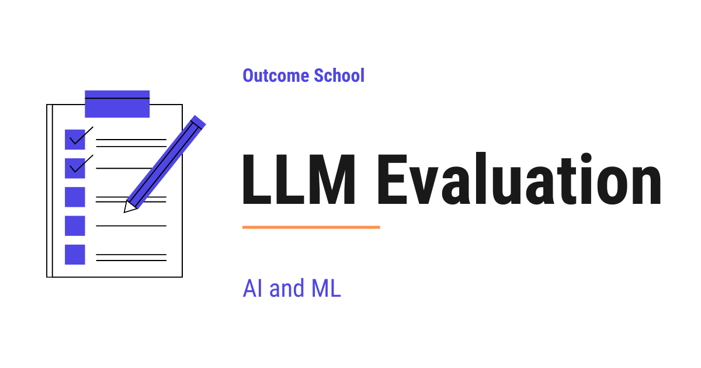

# What is LLM Evaluation? Metrics, Benchmarks, and Methods Explained

> **Module 13 · Lesson 13.1**  
> Source: [Outcome School](https://outcomeschool.com/blog/llm-evaluation) · Published: May 24, 2026 · Reading time: ~19 min · Tags: `llm`, `ai`, `machine-learning`

---



LLM Evaluation is the process of measuring how well a Large Language Model performs on the tasks we expect it to do. We check if its outputs are correct, helpful, safe, and useful for our use case.

In this blog, we will learn about LLM Evaluation. We will understand what it is, why we need it, the main types of evaluation, the automatic metrics and benchmarks we can use, human evaluation, LLM as a Judge, task-specific and safety evaluation, the common challenges, and the best practices to follow.

We will cover the following:

- What is LLM Evaluation?
- Why do we need LLM Evaluation?
- Types of LLM Evaluation
- Automatic Metrics
- Benchmarks
- Human Evaluation
- LLM as a Judge
- Task-Specific Evaluation
- Safety and Red-Teaming Evaluation
- Challenges in LLM Evaluation
- Best Practices
- When to use which method

Let's get started.

## What is LLM Evaluation?

**LLM Evaluation is the process of measuring how well a Large Language Model performs on the tasks we expect it to do.**

In simple words, we give the model some inputs, look at the outputs, and check if the outputs are correct, helpful, safe, and useful. This is how we decide whether a model is good enough for our use case.

Let's say we have built a chatbot using an LLM. Now, the question is: how do we know if our chatbot is actually good? Is it giving correct answers? Is it polite? Is it safe? Is it better than the older version we had last week? To answer all these questions, we need LLM Evaluation.

## Why do we need LLM Evaluation?

LLMs are very powerful, but they are not perfect. They can make mistakes. They can give wrong information. They can sound very confident even when they are wrong. This is called **[hallucination](https://outcomeschool.com/blog/why-do-llms-hallucinate-the-token-level-explanation)**, where the model makes up facts that are not true. They can also produce harmful or biased content.

So, before we ship an LLM to our users, we must know how it behaves. And after we ship it, we must keep checking it to make sure it does not get worse over time.

Here are the main reasons we need LLM Evaluation:

- To compare different models and pick the best one for our use case.
- To compare different versions of the same model after [fine-tuning](https://outcomeschool.com/blog/how-does-fine-tuning-work) or prompt changes.
- To find weak spots where the model fails so that we can fix them.
- To make sure the model is safe and does not produce harmful content.
- To track quality over time, so that we know if the model is getting better or worse.
- To build trust with our users, our team, and our stakeholders.

Without evaluation, we are just guessing. And guessing is not a good idea when real users depend on our product.

## Types of LLM Evaluation

There are four main types of LLM Evaluation. We will learn about each of them in detail.

- **Automatic Metrics** - We use formulas to score the model output against a reference answer.
- **Benchmarks** - We test the model on standard datasets that everyone uses.
- **Human Evaluation** - We ask humans to read the outputs and rate them.
- **LLM as a Judge** - We use another LLM to score the outputs.

Each of these has its own strengths and weaknesses. In real projects, we usually combine more than one of them.

Beyond these four core methods, there are two cross-cutting areas we will also cover later in this blog: **Task-Specific Evaluation** and **Safety Evaluation**. These are not separate methods. They reuse the four above.

Now, let's discuss each one.

## Automatic Metrics

**Automatic Metrics are simple formulas that compare the model output with a reference answer and give us a score.**

The best way to learn this is by taking an example. Suppose we ask the model to translate a sentence from English to French. We already have the correct French translation written by a human. The model gives its own French translation. Now, we want to know how close the model's translation is to the human translation. This is where automatic metrics come into the picture.

Here are the common ones:

**BLEU**

BLEU is used mostly for translation tasks. It is a precision-based metric. It asks: what fraction of small word groups (called n-grams) in the model output also appear in the reference answer? A higher BLEU score means the model output is closer to the reference. For example, if the reference is "The cat sat on the mat" and the model says "The cat sat on the mat", BLEU is very high. If the model says "A feline rested on the rug", BLEU is low even though the meaning is the same.

**ROUGE**

ROUGE is used mostly for summarization tasks. It asks: what fraction of n-grams in the reference summary are covered by the model summary? Just like BLEU, a higher score is better.

**BERTScore**

BERTScore uses contextual embeddings to compare the meaning of the model output with the reference. So, even if the words are different, if the meaning is close, the score is high. Going back to our earlier example, "A feline rested on the rug" would score high against "The cat sat on the mat" because the meaning is almost the same. This makes BERTScore much better than BLEU for tasks where the wording can vary a lot.

**METEOR**

METEOR is another metric that improves on BLEU by handling synonyms, stemming, and word order. It sits between pure surface matching and full semantic matching.

**Perplexity**

Perplexity measures how well the model predicts the next token. A lower perplexity means the model assigns a higher probability to the actual next token in the test data. This metric is mostly used during model training to track if the model is learning.

**Exact Match**

Exact Match is the simplest one. The score is 1 if the model output is exactly the same as the reference answer, and 0 otherwise. This is useful for tasks like math problems or short factual questions.

**Note:** In modern LLM evaluation, reference-based metrics like BLEU and ROUGE are mostly used in research papers and translation pipelines. For production LLM applications, we usually rely on LLM as a Judge or task-specific evaluation, which we will learn about soon.

**Advantage:**

- Fast and cheap to run.
- We can run them at scale on millions of examples.
- The scores are repeatable. Same input gives same score every time.

**Disadvantage:**

- They only check surface similarity. They do not understand meaning.
- A model can give a perfect answer in different words and still get a low score.
- They do not work well for open-ended tasks like creative writing or chat.

This was all about Automatic Metrics. Now, let's learn about Benchmarks.

## Benchmarks

**Benchmarks are standard datasets that the whole research community uses to test LLMs.**

When a new LLM is released, the team behind it usually publishes scores on popular benchmarks. This helps us compare it with other models in a fair way.

Different benchmarks test different skills. Let's group them by category, so that we know what each one is for.

**General Knowledge**

- **MMLU** - Tests general knowledge across 57 subjects like history, law, math, and medicine, using multiple-choice questions.
- **MMLU-Pro** - A harder version of MMLU with 10 answer choices and mandatory [chain-of-thought reasoning](https://outcomeschool.com/blog/how-does-chain-of-thought-prompting-work).

**Common Sense Reasoning**

- **HellaSwag** - The model has to pick the most likely ending to a short story.

**Coding**

- **HumanEval** - Tests coding ability with simple function-writing problems.
- **SWE-bench Verified** - Real GitHub issues from open-source projects. Tests whether a model can solve real-world software problems.
- **LiveCodeBench** - A coding benchmark that uses problems released after the model's training cutoff, so it is contamination-resistant.

**Math**

- **GSM8K** - Math word problems at the grade-school level.
- **MATH** - Harder competition-style math problems.
- **AIME** - Math olympiad problems used for advanced reasoning.

**Frontier Reasoning**

- **GPQA-Diamond** - PhD-level science questions used to separate strong reasoning models from average ones.
- **Humanity's Last Exam (HLE)** - Over 3,000 expert-level questions across many fields, used as a hard frontier challenge.

**Instruction Following**

- **IFEval** - Tests instruction-following with verifiable constraints, like "answer in exactly 3 bullet points".

**Tool Use**

- **BFCL (Berkeley Function-Calling Leaderboard)** - Tests how well a model can use tools and call functions, very relevant for agents.

**Long Context**

- **RULER** - Tests the [effective context window](https://outcomeschool.com/blog/lost-in-the-middle-problem-in-llms), which is more honest than the nominal context length the model claims.

**Truthfulness**

- **TruthfulQA** - Tests if the model gives truthful answers instead of repeating common false beliefs.

**Conversation Quality**

- **Chatbot Arena (LMArena)** - Real users chat with two anonymous models side by side and pick the better one. The models are then ranked using an Elo score, just like in chess.

Now that we have seen the categories, we must understand three important ideas that decide how useful a benchmark really is.

- **Saturation** - Over time, top models start scoring near the ceiling on a benchmark. When every model scores very high, the benchmark stops separating good from great. So, the research community keeps building harder benchmarks to take their place.
- **Data contamination** - The model may have seen the test questions during training, which makes the scores look higher than they really are. Contamination-resistant benchmarks try to fix this by using problems released after the model's training cutoff.
- **Qualification bar** - Older or easier benchmarks are not useless. They become a basic check that any serious model must pass before we even look at the harder ones.

**Advantage:**

- Easy to compare different models, because everyone uses the same dataset.
- Covers a wide range of skills.
- Backed by the research community.

**Disadvantage:**

- A high score on a benchmark does not always mean the model works well on our specific use case.
- A benchmark can be saturated, contaminated, or both, which makes the scores misleading.
- Public benchmarks rarely match the exact task we care about in our product.

This is how Benchmarks work. Now, let's move to Human Evaluation.

## Human Evaluation

**Human Evaluation is when real people read the model outputs and rate them.**

This is still the gold standard. Humans can judge things that formulas cannot, like tone, helpfulness, creativity, and safety.

Let's say we ask the model to write a short poem. There is no single correct answer here. A formula cannot tell us if the poem is good. But a human reader can.

Here are the common ways to do human evaluation:

- **Likert Scale Rating** - The human gives a score from 1 to 5 on quality, helpfulness, or safety.
- **Pairwise Comparison** - The human sees two outputs and picks the better one. This is used in tools like Chatbot Arena.
- **Error Annotation** - The human marks the exact mistakes in the output, so we know where the model failed.

**Advantage:**

- Humans can judge meaning, tone, and quality.
- Works for open-ended tasks where there is no single correct answer.
- Gives us deep insights into where the model fails.

**Disadvantage:**

- Very slow and expensive.
- Different humans may give different scores for the same output.
- Hard to scale to thousands or millions of examples.

One more thing to note. These same pairwise comparisons are also used to train models, not just to score them. We have a detailed blog on [Decoding InstructGPT](https://outcomeschool.com/blog/decoding-instructgpt) that shows how human rankings turn into a reward model.

This was all about Human Evaluation. Now, let's learn about LLM as a Judge.

## LLM as a Judge

**LLM as a Judge means we use a strong LLM to score the outputs of another LLM.**

Human evaluation is great but very expensive. So, here comes the LLM as a Judge to the rescue. We give a powerful model, like a top-tier LLM, the input prompt and the output, and we ask it to rate the output.

For the sake of understanding, let's see an example. Suppose we want to check if a chatbot's reply is helpful and polite. We can write a prompt like this:

```
You are an expert evaluator. Read the user question and the assistant reply.
Rate the reply on a scale of 1 to 5 for helpfulness and politeness.
Give a short reason for your rating.
User question: {question}
Assistant reply: {reply}
```

The judge LLM reads the prompt and gives us a score and a reason. We can then use this score just like a human score.

**Advantage:**

- Much cheaper and faster than human evaluation.
- Can scale to millions of examples.
- Works well for open-ended tasks where formulas fail.

**Disadvantage:**

- The judge LLM can have its own biases. The well-known ones are:
  - **Position bias** - The judge can favor the first option, or sometimes the second, when comparing two answers side by side.
  - **Verbosity bias** - The judge can favor longer answers, even when a shorter one is better.
  - **Self-preference bias** - The judge can favor outputs from its own model family.
- The judge is not perfect. It can also make mistakes.
- We must validate the judge by comparing its scores with human scores on a small sample.

If you want to learn more about this, I have a separate blog on [LLM as a Judge](https://outcomeschool.com/blog/llm-as-a-judge) that goes deeper into this topic.

This is how LLM as a Judge works. Now, it's time to learn about Task-Specific Evaluation.

## Task-Specific Evaluation

**Task-Specific Evaluation is a layer on top of the four types we just learned. It means we design our own evaluation based on the exact task our LLM is doing.**

Under the hood, task-specific evaluation usually uses automatic metrics or LLM as a Judge. But the questions we ask, the inputs we test on, and the things we score are all chosen based on our specific use case.

General benchmarks tell us how a model does on average. But, in our real product, we have a specific task. The evaluation must match that task.

Let's see a few common cases.

**RAG (Retrieval Augmented Generation)**

In RAG, the model uses a retrieved document to answer a question. So, we need to check two things: did the system retrieve the right document, and did the model use the document correctly to answer the question?

The standard here is the **RAGAS four-metric pattern**:

- **Context Precision** - Of the [chunks](https://outcomeschool.com/blog/chunking-strategies-for-rag) we retrieved, how many are actually relevant?
- **Context Recall** - Of all the relevant chunks in our corpus, how many did we manage to retrieve?
- **Faithfulness (Groundedness)** - Is the final answer supported by the retrieved context, or did the model make something up?
- **Answer Relevance** - Does the answer actually address the user's question?

Context Precision and Context Recall are the classic Precision and Recall metrics applied to retrieval. We have a detailed blog on [Precision vs Recall](https://outcomeschool.com/blog/precision-vs-recall) that explains both in depth.

There are popular frameworks that implement these metrics, like **RAGAS**, **DeepEval**. We do not need to learn all of them, but we must know that they exist so that we know what to search for when we build a real RAG system.

**Agents**

In agent systems, the model uses tools and takes many steps. So, we need to check:

- Did the agent pick the right tool?
- Did it pass the correct arguments?
- Did it finish the task?
- How many steps did it take?

Two popular agent benchmarks worth knowing:

- **τ-bench (tau-bench)** - Evaluates agents in realistic customer-service environments.
- **SWE-bench Verified** - For coding agents specifically, based on real GitHub issues.

Other names we will see are **GAIA** for general-assistant tasks, **WebArena** for browser agents, and **BFCL** for [function-calling](https://outcomeschool.com/blog/how-does-function-calling-work-in-llms) accuracy.

**Code Generation**

For code generation, we run the generated code against test cases. If the tests pass, the code is correct. This is much better than just comparing the code text.

**Customer Support Chatbots**

For chatbots, we check things like: did the bot answer the question, was the answer polite, did it follow our brand guidelines, and did it escalate to a human when needed.

This way we can use Task-Specific Evaluation to solve any problem in a very simple way.

## Safety and Red-Teaming Evaluation

**Safety Evaluation is its own category, where we test the model against adversarial and harmful inputs.**

So far, we have focused on whether the model gives correct and useful answers. But, there is one more important question: is the model safe?

In safety evaluation, we red-team the model with adversarial prompts. We try jailbreaks, [prompt injections](https://outcomeschool.com/blog/prompt-injection-in-llms), and harmful requests. We check if the model refuses correctly, if it leaks sensitive data, and if it shows bias on sensitive topics. We have a detailed blog on [How do LLM guardrails work?](https://outcomeschool.com/blog/how-do-llm-guardrails-work) that explains how these checks are enforced on the input and the output.

Here are some well-known safety benchmarks:

- **HarmBench** - Tests model behavior on harmful and adversarial requests.
- **AdvBench** - A standard set of adversarial prompts used to attack models.
- **TrustLLM** - A broad evaluation suite covering truthfulness, safety, fairness, robustness, privacy, and ethics.

In production, we also run continuous safety monitoring on real traffic, because new attack patterns appear all the time.

## Challenges in LLM Evaluation

LLM Evaluation is hard. Here are the main challenges:

- **Open-ended outputs** - There is no single correct answer for many tasks, so formulas do not work well. For example, there are a thousand ways to write a good email reply, and no formula can score all of them correctly.
- **Data contamination** - The model may have seen the test data during training, which makes the scores misleading.
- **Cost** - Human evaluation is expensive, and running large evaluation sets through powerful LLMs is also expensive.
- **Bias in the judge** - When we use LLM as a Judge, the judge can have its own preferences that do not match real users.
- **Drift over time** - The model behavior can change after fine-tuning, prompt updates, or even just because the provider updated the model on the backend. So, we must keep evaluating in production, not just before launch.
- **Edge cases** - The model may work well on average, but fail badly on rare but important cases. We must check for these and add them to our evaluation set.

Now, the next big question is: how do we deal with all these challenges? The answer is, we follow some best practices.

## Best Practices

Here are the best practices that I personally believe in for LLM Evaluation:

- **Build a custom evaluation set** - Do not rely only on public benchmarks. Build a small but high-quality dataset that matches our real use case.
- **Combine many methods** - Use automatic metrics for speed, LLM as a Judge for scale, and human evaluation for the final check.
- **Validate the judge** - When using LLM as a Judge, compare its scores with human scores on a small sample to make sure the judge is reliable.
- **Track over time** - Run evaluations every time we change the prompt, the model, or the system. Save the results so we can see trends.
- **Cover edge cases** - Add hard examples, adversarial examples, and safety examples to our evaluation set.
- **Keep humans in the loop** - Even with automated evaluation, review a small sample by hand every week to catch problems that the metrics miss.
- **Measure cost and latency too** - Quality is not the only thing that matters. We must also track how fast the model responds and how much each call costs. A perfect answer that takes 30 seconds is not useful in a real product.

This way we can use LLM Evaluation to solve the interesting problem of knowing if our LLM is actually good.

## When to use which method

Let me tabulate the differences between the four evaluation methods for your better understanding so that you can decide which one to use based on your use case.

| Method | Speed | Cost | Quality of Judgement | Best For |
| --- | --- | --- | --- | --- |
| Automatic Metrics | Very Fast | Very Low | Low | Translation, summarization, exact-answer tasks |
| Benchmarks | Fast | Low | Medium | Comparing models at the research level |
| Human Evaluation | Very Slow | Very High | Very High | Final quality check, open-ended tasks |
| LLM as a Judge | Fast | Medium | High | Scaling evaluation for chat, RAG, and agents |

Task-Specific and Safety Evaluation are not in this table, because they sit on top of these four methods. They decide what to test, and then they use these methods to do it.

In a real product, we usually combine all four. We use automatic metrics during training, benchmarks for model selection, LLM as a Judge for daily monitoring, and human evaluation for the final check before shipping.

This way we can use LLM Evaluation to build LLM applications that are reliable, safe, and useful for our users.

## Frequently Asked Questions

### What is the difference between BLEU and BERTScore?

BLEU checks word overlap, while BERTScore compares meaning. BLEU asks what fraction of n-grams in the model output also appear in the reference, so "A feline rested on the rug" scores low against "The cat sat on the mat". BERTScore uses contextual embeddings, so the same pair scores high because the meaning is almost the same.

### Does a high benchmark score mean the model will work well for our product?

No. A high score on a benchmark does not always mean the model works well on our specific use case. Public benchmarks rarely match the exact task we care about, and a benchmark can be saturated, contaminated, or both. So, we should build a small but high-quality evaluation set that matches our real use case.

### What is data contamination in LLM evaluation?

Data contamination means the model may have seen the test questions during training. This makes the scores look higher than they really are. Contamination-resistant benchmarks try to fix this by using problems released after the model's training cutoff.

### Is it enough to evaluate an LLM once before launch?

No. Model behavior can change after fine-tuning, prompt updates, or even when the provider updates the model on the backend. So, we must keep evaluating in production, not just before launch. We run evaluations every time we change the prompt, the model, or the system, and save the results to see trends.

### Should we only measure the quality of the answers?

No. Quality is not the only thing that matters. We must also track how fast the model responds and how much each call costs. A perfect answer that takes 30 seconds is not useful in a real product.
