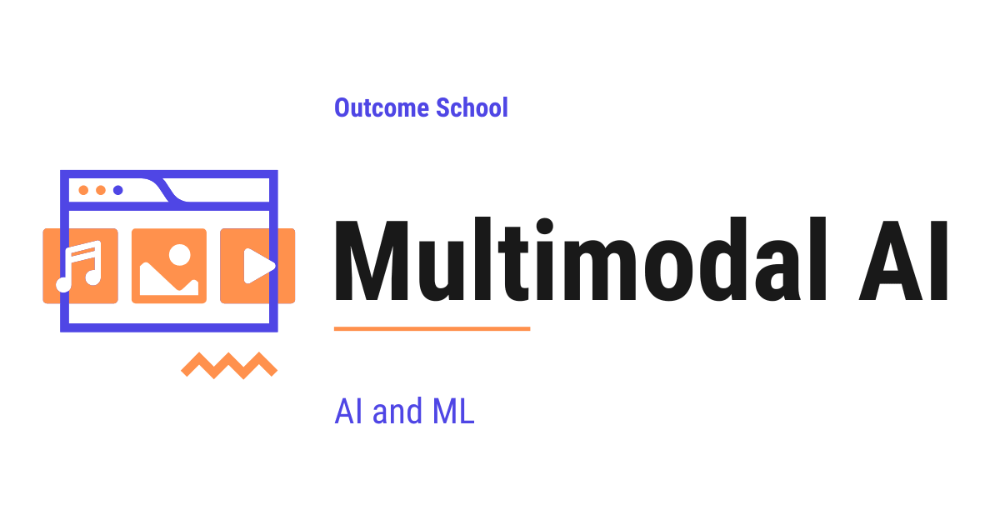

# What is Multimodal AI? How It Works and Where It Is Used

> **Module 15 · Lesson 15.1**  
> Source: [Outcome School](https://outcomeschool.com/blog/multimodal-ai) · Published: May 10, 2026 · Reading time: ~14 min · Tags: `ai`, `machine-learning`

---



Multimodal AI is AI that can understand and generate more than one type of data at the same time. A single multimodal model can read text, see images, hear audio, and watch video, and then respond in any of these forms.

In this blog, we will learn about Multimodal AI, what it means, why it matters, how it works, and where we use it in the real world.

We will cover the following:

- The Big Picture
- What is a Modality?
- Unimodal AI vs Multimodal AI
- Why Multimodal AI?
- How Multimodal AI Works
- Three Common Types of Multimodal AI
- Real Examples of Multimodal AI
- Use Cases of Multimodal AI
- Common Mistakes to Avoid
- Quick Summary

Let's get started.

## The Big Picture

For many years, AI models could only handle one type of data at a time. A text model could read text. An image model could see images. An audio model could listen to audio. Each model lived in its own small world, and these worlds did not talk to each other.

Multimodal AI breaks these walls.

In simple words:

**Multimodal AI = AI that can understand and generate more than one type of data at the same time.**

A single multimodal model can read text, see images, hear audio, and even watch video, all at once. Then it can respond in any of these forms.

Let's decompose the name:

**Multimodal = Multi + Modal**

Here, "Multi" means many, and "Modal" comes from "modality", which is just a fancy word for a type of data. So, Multimodal AI is simply AI that works with many types of data together.

The ability to create brand new content like this is what we call Generative AI, and we have a detailed blog on [What is Generative AI?](https://outcomeschool.com/blog/what-is-generative-ai) that explains it in depth.

## What is a Modality?

Before going deeper, we must understand what a "modality" means.

**Modality.** A specific form or channel through which information reaches us.

In simple words, a modality is just a type of data.

Common modalities are:

- **Text.** Words, sentences, source code, articles, chat messages.
- **Image.** Photos, charts, diagrams, scanned documents.
- **Audio.** Speech, music, ringtones, machine sounds.
- **Video.** Moving images, often with sound, like films and reels.
- **Other.** Sensor data, depth maps, 3D shapes, biometric signals.

A human is a natural multimodal system. We see, we hear, we read, we touch, we smell, and we mix all of these signals into one understanding of the world. A doctor checking a patient is doing exactly this, every single day.

Multimodal AI tries to do the same.

## Unimodal AI vs Multimodal AI

Let's understand the difference with a simple comparison.

**Unimodal AI** works with only one type of data.

For example:

- A spam classifier that reads only text.
- A face detector that sees only images.
- An image classifier that sees only images and tells if it is a cat or a dog.

Here, the output is just a label, a number, or a coordinate about the input. A label or a number is **not** a modality. The four modalities are text, image, audio, and video. So, even though the spam classifier prints the word "spam", it is not generating a piece of language - it is just attaching a tag to the input. The model is still unimodal.

**Multimodal AI** works with two or more types of data at the same time.

For example:

- A model that takes a photo and a question, and answers the question.
- A model that watches a video and writes a summary in text.
- A model that listens to a song and generates an album cover image.

Here is a simple picture of the difference:

```
       Unimodal AI                Multimodal AI
   Text or Image or Audio      Text   Image   Audio
   (only one at a time)            \    |     /
            |                       \   |    /
            v                     +-----v-----+
        +-------+                 |   Model   |
        | Model |                 +-----------+
        +-------+                       |
            |                           v
            v                         Output
          Output
```

Here, we can see that a unimodal model takes one type of input at a time, while a multimodal model takes many types of input together and produces one output.

Let me tabulate the differences between Unimodal AI and Multimodal AI for your better understanding so that you can decide which one to use based on your use case.

| Aspect | Unimodal AI | Multimodal AI |
| --- | --- | --- |
| Inputs | One type (text or image or audio) | Two or more types together |
| Understanding | Limited to one sense | Combined across senses |
| Use cases | Narrow tasks | Rich, real-world tasks |
| Example | Sentiment analysis on tweets | "Describe this image" assistant |
| Cost | Lower | Higher |

## Why Multimodal AI?

Now, the question is: why do we need Multimodal AI? The answer is simple - the real world is multimodal.

Let's say we walk into a doctor's clinic. The doctor:

- Reads our medical history (text).
- Looks at our X-ray (image).
- Listens to our heartbeat (audio).
- Watches how we walk (video).

The doctor combines all of these signals into one diagnosis. A doctor who could only read text would miss most of the picture.

The same is true for AI.

A model that can only read text cannot help us when we paste a screenshot of an error. A model that can only see images cannot answer a question about that image. A model that can only listen to audio cannot read the meeting notes that came along with the recording.

This is when Multimodal AI comes into the picture. By combining modalities, the model gets a much fuller view of the world, just like the doctor.

This is why Multimodal AI matters.

## How Multimodal AI Works

At the core, every Multimodal AI system follows the same recipe.

The idea behind Multimodal AI is simple: convert every type of input into a common numeric form the model can understand, and then process all of them together.

Here is the high-level anatomy:

```
   +-------+    +-------+    +-------+
   | Text  |    | Image |    | Audio |
   +---+---+    +---+---+    +---+---+
       |            |            |
       v            v            v
   +-------+    +-------+    +-------+
   | Text  |    | Image |    | Audio |
   |Encoder|    |Encoder|    |Encoder|
   +---+---+    +---+---+    +---+---+
       |            |            |
       +-----+------+------+-----+
             |
             v
       +-----------+
       | Shared    |
       | Embedding |
       |   Space   |
       +-----+-----+
             |
             v
       +-----------+
       | Multimodal|
       |   Model   |
       +-----+-----+
             |
             v
       +-----------+
       |  Output   |
       | (text,    |
       |  image,   |
       |  audio)   |
       +-----------+
```

Let's decode each step. We will keep our doctor analogy from the previous section to make every part easy to follow.

**1. Encoders for each modality.**

A model cannot understand raw text, raw pixels, or raw sound waves directly. It only understands numbers. So, we need a way to turn each input into numbers.

Each type of input needs its own encoder. An **encoder** is a small model that turns raw data into a list of numbers, called a **vector**.

Just like our doctor uses eyes for X-rays, ears for the heartbeat, and reading skills for the notes, the multimodal model uses different encoders for different modalities.

- A **Text Encoder** turns words into vectors.
- An **Image Encoder** turns pixels into vectors. This often uses a [Vision Transformer](https://outcomeschool.com/blog/decoding-vision-transformer-vit).
- An **Audio Encoder** turns sound waves into vectors.

These vectors are called **[embeddings](https://outcomeschool.com/blog/what-are-embeddings)**. An embedding is just a vector that captures the meaning of the input in a form the model can use.

**2. Shared Embedding Space.**

Here is the key trick of Multimodal AI.

All the encoders are trained together so that their outputs land in the **same vector space**. The training pulls matching pairs (a photo of a cat and the word "cat") close to each other, and pushes mismatched pairs (a photo of a cat and the word "car") apart.

So a photo of a cat and the word "cat" end up close to each other in this space, even though one came from pixels and the other came from letters.

Let's see this with a simple picture:

```
   Shared Embedding Space (simplified)
         ^
         |
         |   "cat"  *     * cat photo
         |
         |
         |
         |   "dog"  *     * dog photo
         |
         +----------------------------->
```

Here, we can see that the word "cat" and the photo of a cat sit near each other in the same space. Same for "dog" and the dog photo. The model now treats them as related, no matter the input type.

This shared space is what lets the model "compare" a photo to a sentence, or align a sound to a video frame. In our doctor analogy, this is the moment when the doctor combines the X-ray, the notes, and the heartbeat into one mental picture of the patient.

**3. The Multimodal Model.**

The shared embeddings are passed into a single model, usually a [Transformer](https://outcomeschool.com/blog/decoding-transformer-architecture), which is a kind of neural network that learns relationships between pieces of data. The model can now reason across all the inputs at once.

For example, if we give the model a photo of a kitchen and ask "How many chairs are there?", the model looks at both the [image embedding](https://outcomeschool.com/blog/how-do-image-embeddings-work) and the text embedding, and produces an answer.

Just like the doctor combines all the signals into one diagnosis, the multimodal model combines all the embeddings into one answer.

**4. The Output.**

The output can be text, image, audio, or even video, depending on the model and the task.

So, the recipe is: **encode every modality → align them in a shared space → reason → generate**.

Now, let's put this end to end with a quick example.

**Step 1:** We upload a photo of a kitchen and type the question "How many chairs are there?".

**Step 2:** The image encoder turns the photo into an image embedding. The text encoder turns the question into a text embedding.

**Step 3:** Both embeddings go into the multimodal model. The model looks at the image embedding and the text embedding together.

**Step 4:** The model produces the answer in text, for example "There are 4 chairs.".

This is how Multimodal AI works under the hood.

## Three Common Types of Multimodal AI

Now that we have learned how Multimodal AI works, it is time to learn the three common patterns we see in the real world.

**1. Multimodal Understanding.**

The model takes inputs in many modalities and replies in one modality, often text.

For example, we send a photo and ask "What is in this image?", and the model replies in text. GPT-4V, Gemini, and Claude (with vision) follow this pattern.

**2. Cross-Modal Generation.**

The model takes input in one modality and produces output in another.

For example, text in, image out (DALL-E, Midjourney). Text in, video out (Sora, Veo). Audio in, text out (Whisper).

**3. Cross-Modal Alignment.**

The model places two or more modalities in the same shared embedding space so we can compare them directly.

For example, CLIP places text and images in a shared space, so we can search images using a text query.

Every multimodal model uses a shared embedding space inside it. In Cross-Modal Alignment, that shared space is itself the product. The model is trained mainly to build this space and to expose it, so we can compare or search across modalities directly, without going through a generated answer.

These three patterns cover most Multimodal AI systems we see today. Many real models mix two or more of these patterns together.

## Real Examples of Multimodal AI

Now, let's put names to the three patterns. Here are some well-known multimodal models we may already know.

- **GPT-4 with Vision (GPT-4V).** Reads text and images, replies in text.
- **GPT-4o.** Reads text, images, and audio, and replies in text or audio in real time.
- **Google Gemini.** Reads text, images, audio, video, and code in one go.
- **Claude (with vision).** Reads text and images, answers in text.
- **CLIP ([Contrastive Language-Image Pretraining](https://outcomeschool.com/blog/contrastive-learning)).** Connects text and images in a shared embedding space.
- **DALL-E and Midjourney.** Take a text prompt and generate an image, powered by [diffusion models](https://outcomeschool.com/blog/diffusion-models).
- **Whisper.** Listens to audio and produces text.
- **Sora and Veo.** Take text and produce video.

Each of these is a real-world Multimodal AI system already in use today.

## Use Cases of Multimodal AI

- **Visual Question Answering (VQA).** Upload a photo, ask a question, get an answer.
- **Document Understanding.** Read a PDF that has text, tables, and charts together.
- **Medical Imaging.** Combine X-rays, scans, and patient notes for better diagnosis.
- **Self-Driving Cars.** Mix camera, radar, and **LIDAR (Light Detection and Ranging)** data to drive safely.
- **Accessibility.** Describe images for people who cannot see them. Read text aloud for people who cannot read.
- **Content Creation.** Generate images, videos, and music from a simple text prompt.
- **Customer Support.** Let the user send a screenshot or a voice note instead of typing a long message.
- **Education.** Explain a diagram, solve a handwritten math problem, or read a textbook page aloud.
- **Mobile Apps.** Snap a photo of a foreign menu and get an instant translation, with the dish names spoken aloud.

This is how Multimodal AI is quietly changing the way we use computers.

Since these systems can now produce text, images, audio, and video that look completely real, we also need a way to check where a piece of content came from. We have a detailed blog on [How Does LLM Watermarking Work?](https://outcomeschool.com/blog/how-does-llm-watermarking-work) that explains how a hidden signal is placed inside generated content step by step.

## Common Mistakes to Avoid

Let's look at a few common mistakes people make when thinking about Multimodal AI.

- **Treating it as just "text + image".** Multimodal means many modalities, not only two. Audio, video, sensor data, and 3D shapes also count.
- **Assuming one model fits all.** Some tasks still need a focused unimodal model. Multimodal is not always better.
- **Ignoring data quality.** A multimodal model is only as good as the alignment between its modalities. Bad pairings, like a wrong caption for a photo, lead to bad results.
- **Forgetting cost.** Multimodal models are heavier and slower than unimodal ones. We must use them where the extra signal is worth the cost.
- **Skipping evaluation per modality.** A model may be strong on text but weak on audio. We must test each modality on its own and also together.
- **Mixing too many modalities at once.** More modalities is not always better. Each new modality adds noise, latency, and risk. We must add a modality only when it brings clear value to the task.
- **Forgetting about bias.** Multimodal models can carry biases from each modality and from the training pairs. We must check the outputs for unfair patterns, just like we do for unimodal models.

## Quick Summary

Let's recap what we have learned about Multimodal AI:

- **Multimodal AI** is AI that can handle more than one type of data, like text, image, audio, and video, together.
- A **modality** is just a type of data.
- **Unimodal AI** works with one type of data. **Multimodal AI** works with many types together.
- Real-world tasks are multimodal in nature, and Multimodal AI fits them better.
- Just like a doctor combines reports, X-rays, and heartbeats into one diagnosis, a multimodal model combines all the embeddings into one answer.
- The core recipe is: **encode each modality → align in a shared space → reason → generate**.
- The three common patterns are **Multimodal Understanding**, **Cross-Modal Generation**, and **Cross-Modal Alignment**.
- Models like GPT-4V, Gemini, Claude, CLIP, DALL-E, and Whisper are all examples of Multimodal AI.

Now, we have understood Multimodal AI.

## Frequently Asked Questions

### Is a spam classifier that outputs the word "spam" multimodal?

No. A spam classifier reads only text, and its output is just a label. A label or a number is not a modality. Even though it prints the word "spam", it is not generating a piece of language, it is only attaching a tag to the input.

### Is Multimodal AI always better than Unimodal AI?

No. Some tasks still need a focused unimodal model. Multimodal models are heavier and slower than unimodal ones, so we must use them where the extra signal is worth the cost. More modalities also add noise, latency, and risk.

### Does multimodal just mean text plus images?

No. Multimodal means many modalities, not only two. Audio, video, sensor data, depth maps, and 3D shapes also count. For example, a self-driving car mixes camera, radar, and LIDAR data to drive safely.

### How does a model know that a photo of a cat and the word "cat" mean the same thing?

The encoders are trained together so that their outputs land in the same shared embedding space. The training pulls matching pairs, like a cat photo and the word "cat", close to each other, and pushes mismatched pairs apart. This shared space lets the model compare a photo to a sentence.

### Is Whisper an example of Multimodal AI?

Yes. Whisper listens to audio and produces text. It follows the Cross-Modal Generation pattern, where the model takes input in one modality and produces output in another.
