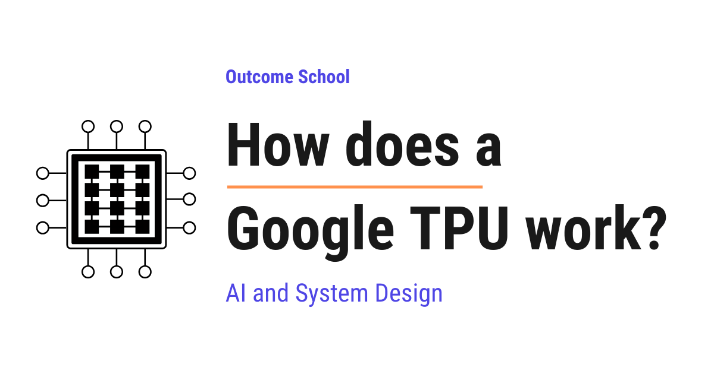

# How does a Google TPU work?

> **Module 16 · Lesson 16.3**  
> Source: [Outcome School](https://outcomeschool.com/blog/how-does-a-google-tpu-work) · Published: June 28, 2026 · Reading time: ~14 min · Tags: `ai`, `system-design`

---



A TPU (Tensor Processing Unit) is a special computer chip made by Google for machine learning. It uses a design called a systolic array to do matrix multiplication, the most important operation in machine learning, very fast.

In this blog, we will learn about how a Google TPU works. We will also see what a TPU is, why Google built it, how it is different from a CPU and a GPU, and how it makes machine learning fast.

We will cover the following:

- What is a TPU?
- Why Google built the TPU
- A quick refresher: CPU and GPU
- The one operation that matters most
- The big idea: Systolic Array
- How data flows through a TPU
- The full journey of a TPU computation
- Why a TPU is so fast and power efficient
- Where TPUs are used
- Limitations of a TPU

Let's get started.

### What is a TPU?

Let's start with the name itself.

**TPU = Tensor + Processing + Unit.**

A **TPU** is a special computer chip made by Google. Its full name is **Tensor Processing Unit**.

In simple words, a TPU is a chip built for one main job: doing the math that machine learning needs, and doing it very fast.

Now, you may be wondering what a **tensor** is.

A **tensor** is just a fancy word for a grid of numbers. A single number is a tensor. A list of numbers is a tensor. A table of numbers, with rows and columns, is also a tensor.

So, when we say "Tensor Processing Unit", we mean a unit that processes grids of numbers.

That is the whole idea. A TPU is a chip that eats grids of numbers and gives back new grids of numbers, very quickly.

### Why Google built the TPU

Let's understand the problem first. Then the solution will make sense.

Around the year 2013, Google noticed something worrying. People were using voice search, photo search, and translation more and more. All of these use **machine learning**.

**Machine learning** means teaching a computer to do a task by showing it many examples, instead of giving it exact step-by-step instructions.

Here, the worry was simple. Google did the math and realized that if every person used voice search for just a few minutes a day, Google would need to double the number of computers in its data centers. That would cost a huge amount of money.

So, Google needed a chip that could do machine learning math much faster and using much less power than normal chips.

Normal chips were not built for this job. They were built to do many different things reasonably well. But machine learning needs one kind of math done billions of times.

So, here comes the TPU to the rescue.

Google decided to build a brand new chip from scratch, designed for only one purpose: machine learning math. That chip is the TPU.

### A quick refresher: CPU and GPU

Before we go deeper into the TPU, we must understand two other chips. Do not worry, we will keep this simple.

A **CPU** is the **Central Processing Unit**. It is the main brain inside every laptop and phone. A CPU is like a very smart single worker. It can do almost any task, but it does one or a few things at a time. It is flexible, but not great when we need the same simple task done billions of times.

A **[GPU](https://outcomeschool.com/blog/how-does-a-gpu-work-for-deep-learning)** is the **Graphics Processing Unit**. It was first built to draw images and run games. A GPU is like a big team of workers. Instead of one smart worker, it has thousands of smaller workers doing many small tasks at the same time. This is called doing things in **parallel**, which means many tasks happening together.

Machine learning loves parallel work. So GPUs became very popular for machine learning.

But a GPU still tries to be flexible. It can do many different kinds of tasks. That flexibility has a cost in speed and power.

So, the question is: can we build a chip that gives up some flexibility, and in return becomes even faster and more power efficient for machine learning?

The answer is yes. That chip is the TPU.

### The one operation that matters most

To understand a TPU, we must first understand the one math operation that machine learning does again and again.

That operation is called [**matrix multiplication**](https://outcomeschool.com/blog/matrix-multiplication-in-neural-networks).

A **matrix** is simply a table of numbers, with rows and columns. So, matrix multiplication means combining two tables of numbers to produce a new table of numbers.

Let's see the idea with a tiny example.

Suppose we have a small list of input numbers, and a small table of **weights**.

A **weight** is just a number that the model learned during training. It decides how important each input is.

Now, the basic step inside matrix multiplication is this: we take each input, multiply it by its matching weight, and then add all those results together.

For example, let's say the inputs are `2, 3, 4` and the weights are `5, 6, 7`.

The result is computed like below:

```text
(2 × 5) + (3 × 6) + (4 × 7)
= 10 + 18 + 28
= 56
```

Here, we can see that the whole job is just "multiply, then add", done many times and the results added up. This pattern is called **multiply-and-accumulate**, because we multiply two numbers and accumulate, which means keep adding, the result into a running total.

A neural network does this multiply-and-accumulate step billions of times. So, if we can build a chip that does multiply-and-accumulate extremely fast, we win.

That is exactly what the TPU is built to do.

### The big idea: Systolic Array

Now we reach the heart of the TPU. This is the most beautiful idea in the whole design.

The main part of a TPU is called the **Matrix Multiply Unit**, often shortened to **MXU**. Inside this unit sits a special structure called a **Systolic Array**.

The word "systolic" comes from the word "systole", which is the squeezing beat of a heart that pushes blood through the body. The name was chosen because data moves through the chip in steady, rhythmic pulses, just like blood pumped by a heartbeat.

So, what is a Systolic Array?

A **Systolic Array** is a large grid of tiny calculators arranged in rows and columns. Each tiny calculator can do only one thing: multiply two numbers and add the result to a running total. That is the multiply-and-accumulate step we just learned.

Let's say the grid is 128 calculators wide and 128 calculators tall. That gives us 128 × 128, which is 16,384 tiny calculators all sitting together on one chip.

Here is the clever part. In a normal chip, after each calculation, the result is sent back to memory, and the next number is fetched from memory. Going to memory again and again is slow and wastes a lot of power.

In a Systolic Array, the calculators pass their results directly to their neighbors. The numbers flow from one calculator to the next, like water flowing down a series of steps. The data does not keep running back to memory. It just keeps moving forward through the grid.

This is the secret. The TPU keeps the data moving and the calculators busy, instead of wasting time talking to memory.

### How data flows through a TPU

Let's make the flow very concrete with a simple picture in words.

Imagine the grid of calculators. The weights are loaded into the grid first and they stay in place, one weight sitting in each calculator.

Now, the input numbers enter from the left side. They flow to the right, moving one step at a time, from one calculator to the next.

At the same time, the running totals flow from the top to the bottom.

So, at each calculator, three things meet at the right moment:

- An input number coming from the left
- A weight already sitting inside the calculator
- A running total coming from above

The calculator multiplies the input by its weight, adds that to the running total, and passes the new total downward to the next calculator.

Let's see it as below:

```
              running totals flow down
                       |   |   |
                       v   v   v
                  +---+---+---+---+
   inputs   --->  | C | C | C | C |  --->
   from left --->  +---+---+---+---+  ---> (inputs exit
   --->           | C | C | C | C |  --->  to the right)
   --->            +---+---+---+---+  --->
                  | C | C | C | C |
                   +---+---+---+---+
                       |   |   |
                       v   v   v
                  finished totals fall out
   Each C is a tiny calculator holding one weight.
   C = multiply (input x weight) + running total
```

Here, we can see that the inputs enter from the left and move right, the running totals move down, and each box C is one tiny calculator holding one weight. At every box, the input and the total meet, get combined, and move on. By the time the totals reach the bottom of the grid, the full matrix multiplication is finished. The answers simply fall out of the bottom.

Here, we can see the beauty. Thousands of multiply-and-accumulate steps happen at the same time, in a steady rhythm, with almost no trips back to memory.

This is how a TPU does in one smooth wave what a normal chip would do in many slow, separate steps.

### The full journey of a TPU computation

Let's now follow the complete journey from start to finish, step by step.

**Step 1:** The model and its data are prepared on a host computer. The host is just a normal computer that controls the TPU and feeds work to it.

**Step 2:** The weights and inputs are copied into the TPU's own fast memory. A TPU has memory built very close to the calculators, so data does not have to travel far. This closeness saves a lot of time and power.

**Step 3:** The weights are loaded into the Systolic Array. Each tiny calculator holds its own weight, ready and waiting.

**Step 4:** The input numbers start flowing into the grid from the left, pulse by pulse, like a heartbeat.

**Step 5:** Inside the grid, every calculator does its multiply-and-accumulate step and passes results to its neighbors. Thousands of these happen together.

**Step 6:** The finished totals come out of the bottom of the grid.

**Step 7:** These totals often pass through an **activation** step. An activation is a simple rule that decides how strong each result should be, for example turning negative numbers into zero. This helps the neural network learn complex patterns.

**Step 8:** The results are stored back, and they become the input for the next layer of the neural network. The cycle repeats for each layer until the model produces its final answer.

Here is the full flow:

```
   Host computer (prepares model and data)
                  |
                  v
   TPU fast memory (weights + inputs copied in)
                  |
                  v
   Weights loaded into the Systolic Array grid
                  |
                  v
   Inputs flow in from the left, pulse by pulse
                  |
                  v
   Grid does multiply-and-accumulate together
                  |
                  v
   Finished totals fall out of the bottom
                  |
                  v
   Activation step (for example, negatives -> zero)
                  |
                  v
   Stored back, becomes input for the next layer
                  |
                  +--- repeats for each layer --->
                  |
                  v
   Final answer (for example, "this is a cat")
```

Here, we can see the data travels in one direction, from the host computer, through the grid, and back out as a result, layer after layer, until the model gives its final answer. This is how a single prediction, such as recognizing a cat in a photo, travels through a TPU.

### Why a TPU is so fast and power efficient

Now that we understand the design, the reasons for its speed become clear.

**Reason 1: It does one job extremely well.** A TPU does not try to be flexible like a CPU. It is built for matrix multiplication. By giving up flexibility, it gains speed.

**Reason 2: Thousands of calculators work together.** With tens of thousands of tiny calculators in the grid, a huge amount of math happens at the same instant.

**Reason 3: Less talking to memory.** This is the big one. In normal chips, moving data to and from memory uses most of the time and most of the power. The Systolic Array keeps data moving between neighbors, so it avoids most of these slow memory trips.

**Reason 4: Simpler number math.** For many machine learning tasks, we do not need very precise numbers. A TPU can use smaller, simpler numbers, which means each calculation uses less energy and finishes faster. Simpler numbers also mean we can fit more calculators on the same chip.

Put these together, and the TPU does far more machine learning math per second, while using far less electricity, than a normal chip.

This is why Google can run huge models for billions of people without building a mountain of new data centers.

### Where TPUs are used

So, now we know how a TPU works. Let's see where it is actually used.

TPUs power many Google products that we use every day. Here are a few examples:

- **Search** uses TPUs to understand what we are really asking.
- **Google Translate** uses TPUs to convert text from one language to another.
- **Google Photos** uses TPUs to recognize faces, places, and objects in our pictures.
- **Voice assistants** use TPUs to understand our spoken words.

TPUs are also used to train very large models, including large language models, which are the models behind modern chatbots.

And, through **Google Cloud**, other companies can rent TPUs to train and run their own machine learning models, without buying any hardware themselves.

There is also a smaller cousin called the **Edge TPU**. This is a tiny TPU made to [run inside small devices](https://outcomeschool.com/blog/cloud-vs-on-device-model-deployment), such as cameras and sensors, so they can do machine learning right where they are, without sending data to a data center.

### Limitations of a TPU

A TPU is powerful, but it is not the right tool for every job. We must understand this clearly.

A TPU is built for machine learning math, mainly matrix multiplication. It is not a general-purpose chip.

So, we cannot use a TPU to run a normal program, browse the web, or play a regular game. For those everyday tasks, we still need a CPU.

A TPU also works best with large amounts of similar math done together. For small or irregular tasks, a CPU or GPU often does better.

Here, we can see the simple trade-off. A TPU gives up flexibility and, in return, gives us amazing speed and power efficiency for one specific kind of work.

Another chip pushes this specialization even further by dropping training altogether, and we have a detailed blog on [how an LPU works](https://outcomeschool.com/blog/how-does-an-lpu-work) that explains how it runs only already-trained language models.

And that one kind of work, machine learning math, happens to be exactly what modern artificial intelligence needs the most.

So, this is how a Google TPU works. It is a chip filled with thousands of tiny calculators, arranged in a grid, that pass numbers to each other in a steady heartbeat rhythm, doing the multiply-and-accumulate math of machine learning faster and with less power than any normal chip.

## Frequently Asked Questions

### Is a TPU better than a GPU for machine learning?

For large amounts of similar machine learning math, a TPU can be faster and more power efficient. A GPU still tries to be flexible, and that flexibility has a cost in speed and power. A TPU gives up flexibility to do matrix multiplication extremely well. For small or irregular tasks, a CPU or GPU often does better.

### Can we use Google TPUs without buying any hardware?

Yes. Through Google Cloud, other companies can rent TPUs to train and run their own machine learning models without buying any hardware themselves. TPUs also power many Google products, such as Search, Google Translate, and Google Photos.

### Are TPUs used to train large language models?

Yes. TPUs are used to train very large models, including large language models, which are the models behind modern chatbots. A neural network does the multiply-and-accumulate step billions of times, and the TPU is built to do exactly that step extremely fast.

### Does a TPU work on its own without a normal computer?

No. A host computer, which is just a normal computer, controls the TPU and feeds work to it. The model and its data are prepared on the host and then copied into the TPU's own fast memory. Also, a TPU cannot run a normal program or browse the web, so we still need a CPU for everyday tasks.

### What is an Edge TPU?

An Edge TPU is a tiny TPU made to run inside small devices, such as cameras and sensors. It lets these devices do machine learning right where they are, without sending data to a data center. It is the smaller cousin of the TPUs used in Google's data centers.
