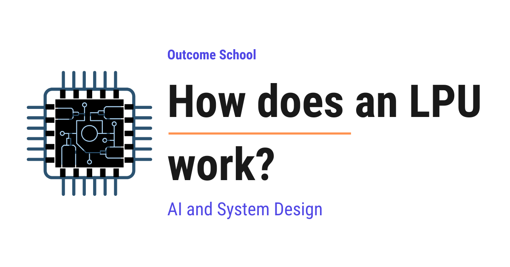

# How does an LPU work?

> **Module 16 · Lesson 16.4**  
> Source: [Outcome School](https://outcomeschool.com/blog/how-does-an-lpu-work) · Published: September 3, 2026 · Reading time: ~25 min · Tags: `llm`, `ai`, `system-design`

---



An LPU (Language Processing Unit) is a chip built for one single job: running a large language model that is already trained, and producing text as fast as possible.

In this blog, we will learn about how an LPU works, the chip that was built for one single job, running a large language model and printing words on our screen as fast as possible. We will also see what an LPU actually is, how a language model writes text one token at a time, why memory and not math is the real bottleneck, how an LPU keeps the model right next to the compute, how the compiler plans every single cycle in advance, how hundreds of chips work together like an assembly line, and where it works well and where it fails.

We will cover the following:

- What is an LPU?
- How an LLM writes text, one token at a time
- The real bottleneck is memory, not math
- Why a GPU struggles here
- Idea 1: Keep the model on the chip
- The problem with on-chip memory
- Idea 2: Remove all the guesswork
- Idea 3: A network that never waits
- The assembly line
- What happens when we send a prompt
- Why an LPU is fast, all in one place
- Where an LPU works well
- Where an LPU does not work well
- LPU vs GPU
- When to use which one

Let's get started.

## What is an LPU?

**An LPU is a chip that is built for one single job, running a large language model that is already trained, and producing text as fast as possible.**

LPU = Language Processing Unit.

In simple words, it is a processor that has been designed around the way a language model writes text, and around nothing else.

Let's compare it with the chips that we already know.

- A **CPU** is a general worker. It can do almost anything, but it does only a few things at a time.
- A **[GPU](https://outcomeschool.com/blog/how-does-a-gpu-work-for-deep-learning)** is a huge team of workers. It was made for graphics, and later we found that it is also very good at the heavy parallel math that machine learning needs.
- An **LPU** is a specialist. It was made only for running a language model that is already trained.

Google took a similar specialist route with its own chip for machine learning, and we have a detailed blog on [how a Google TPU works](https://outcomeschool.com/blog/how-does-a-google-tpu-work) that walks through that design step by step.

Here, two words are very important, "already trained". An LPU is built for **[inference](https://outcomeschool.com/blog/llm-inference-optimization)**, which means using a model that has already finished learning. It is not built for training a model.

The term LPU was introduced by a company called Groq, which builds these chips. But the ideas behind it are general, and those ideas are what we are going to understand here.

Now, the obvious question is, we already have GPUs, and they are extremely powerful, so why do we need a new chip at all?

To answer that, we must first understand what a language model actually does when it writes text. Once we understand that, the design of the LPU will feel obvious.

## How an LLM writes text, one token at a time

Before jumping into the hardware, we must know how a language model produces an answer.

A language model does not write the full answer in one shot. It writes one **[token](https://outcomeschool.com/blog/tokenization-in-llms)** at a time. A token is a small piece of text, sometimes a full word, sometimes a part of a word.

Let's say we ask the model, "The capital of France is".

- The model reads the whole sentence and produces one token, "Paris".
- Now the model reads "The capital of France is Paris" and produces the next token, ".".
- Now the model reads "The capital of France is Paris." and decides that the answer is over.

We can write this loop like below:

```
input = "The capital of France is"
loop:
    read the entire model
    compute the next token
    add that token to the input
    if the token means "the answer is over":
        stop
```

Here, we can notice the most important thing about this loop. Every token must wait for the token before it. We cannot compute token number five before we have token number four, because token number four is part of the input for token number five.

So, text generation is a chain.

This single sentence explains almost everything about the LPU. A chain cannot be made faster by adding more workers. It can only be made faster by making each link of the chain finish quicker.

Now, let's see what actually takes time inside one link of that chain.

## The real bottleneck is memory, not math

A language model is just a very large pile of numbers. These numbers are called **weights**, or **parameters**, and both words mean the same thing here. They were learned during training, and they are the entire knowledge of the model. When we hear "a 70B model", it simply means a model that carries 70 billion such numbers.

Each of these numbers takes up some space. If we store each one in 8 bits, which is 1 byte, then 70 billion numbers take around 70 GB of space. So, the model itself is a 70 GB pile of numbers sitting in memory.

Storing each weight in fewer bits shrinks this pile directly, and we have a detailed blog on [how Model Quantization works](https://outcomeschool.com/blog/how-does-model-quantization-work) that explains this in depth.

**To produce one single token, the chip must read every single weight of the model, from the first one to the last one.**

And what does the chip do with each weight? It multiplies it with a number and adds the result. That is one multiply and one add. That is all.

So, for every number that we move from memory into the chip, we do almost no work with it. We move a lot and we compute very less. The chip finishes the math and then sits idle, waiting for the next batch of numbers to arrive.

Let's take an analogy for the sake of understanding.

Suppose there is a chef in a kitchen. The chef is incredibly fast and can cook any dish in a few seconds. But all the recipe books are kept in a warehouse across the road. For every single dish, the chef must walk to the warehouse, carry all the books back, read one line from each book, and cook.

The cooking takes seconds. The walking takes minutes.

Making the chef faster will not help at all. The chef is not the problem. The distance to the books is the problem.

This is exactly the situation inside a chip that is running a language model. The math is not the bottleneck. Moving the weights is the bottleneck. In simple words, the work is **memory bound**, not **compute bound**.

Now that we have understood where the time actually goes, it is time to see why a GPU has a hard time with this.

## Why a GPU struggles here

A GPU is a wonderful machine, and it is the reason modern AI exists at all. But it was designed for a different shape of problem.

A GPU keeps the model weights in a memory called **HBM**, which stands for High Bandwidth Memory. HBM sits right beside the chip, on the same small board, and it is genuinely fast. But it is still outside the chip, and the numbers still have to travel across a wire to reach the **compute units**, which are the parts of the chip that actually do the multiplying and the adding.

Before we put numbers on it, we must know one word, **bandwidth**. Bandwidth is simply how many bytes the memory can hand over to the chip in one second. If a memory has a bandwidth of 3 TB per second, it can deliver 3,000 GB of data every second.

Now, let's put rough numbers on it, just for the sake of understanding.

```
Weights of a 70B model, stored in 8-bit = 70 GB
Weights that must be read per token     = 70 GB
HBM bandwidth on a modern GPU           = around 3 TB per second
Time for one token  = 70 / 3000 = 0.023 seconds = 23 milliseconds
Tokens in a second  = 1 / 0.023 = around 43 tokens
```

Here, we can see that even in the perfect case, where the GPU never wastes a single moment, one token takes around 23 milliseconds, and one user gets around 43 tokens per second. That is the ceiling. No amount of extra math power will push it higher, because the wire is the limit.

So, how does a GPU cope with this today? The answer is **[batching](https://outcomeschool.com/blog/continuous-batching-in-llms)**. The GPU waits for many users to arrive, and then it reads the model once and serves all of them together in the same trip. One walk to the warehouse, many dishes cooked.

**Advantage:** The total number of tokens per second, counting all the users together, becomes very high. This total is called **throughput**.

**Disadvantage:** Every individual user still waits, because their own chain of tokens is still moving at the same slow pace. And to fill a batch, the GPU sometimes has to wait for more users to show up, which adds even more delay.

So, batching gives us high throughput. It does not give us speed for one person.

There is one more thing to notice. A GPU is a flexible machine. It has caches that guess which data we will need next, schedulers that decide while running which work goes where, and waiting lines that reorder the instructions. All of this flexibility is very useful when we do not know what the program will look like. But it costs chip area, it costs power, and it makes the timing unpredictable.

So, we have two problems now. The model is too far away, and the chip spends a lot of its effort on guessing.

The LPU attacks both of these problems directly. Let's see how.

## Idea 1: Keep the model on the chip

The first idea is the simplest one to say and the hardest one to build.

**Do not keep the weights in a memory outside the chip. Keep them inside the chip itself.**

The memory that lives inside a chip is called **SRAM**. It sits right next to the compute units, so the numbers barely have to travel at all. Because there is no long wire and no separate memory chip to reach, SRAM is dramatically faster than HBM.

Let's redo our calculation with on-chip memory.

```
Weights that must be read per token = 70 GB
On-chip SRAM bandwidth              = around 80 TB per second
Time for one token  = 70 / 80000 = 0.000875 seconds = 0.875 milliseconds
Tokens in a second  = 1 / 0.000875 = around 1,100 tokens
```

Here, we can see that the same read now takes less than one millisecond instead of 23 milliseconds. That is roughly 26 times faster, and it turns 43 tokens per second into more than a thousand tokens per second, for a single user, without any batching at all.

**Note:** These are rough numbers used only to show the idea. The real numbers change with the model, with how the numbers are stored, and with the hardware generation. The point to remember is the gap between the two, not the exact digits.

To feel what this means, an average person reads around 5 words per second. So a model producing a thousand tokens per second is writing far faster than any of us can read. The words stop appearing one by one and start appearing in whole paragraphs.

The chef is no longer walking across the road. The recipe books are now lying open on the kitchen counter.

This is the single biggest reason an LPU feels so fast when we watch it write.

## The problem with on-chip memory

Now, if putting the model inside the chip is such a good idea, why does everyone not do it?

Because on-chip memory is tiny.

SRAM is expensive and it takes a lot of physical space on the chip itself, and the space on a chip is the most costly thing a chip designer has. An LPU chip carries around 230 MB of it, which is a very generous amount for on-chip memory, but it is nothing compared to what a large model needs.

```
Size of a 70B model in 8-bit = 70,000 MB
On-chip SRAM per LPU chip    = 230 MB
Chips needed = 70,000 / 230 = around 305 chips
```

So, one chip cannot hold the model. Not even close.

Here is the trade at the heart of the LPU. **It gives up memory size to gain memory speed.** A GPU chip can hold tens of GB but reads them slowly. An LPU chip holds only 230 MB but reads them incredibly fast. The LPU chose speed, and now it has to live with the consequence of that choice.

So, here comes a simple idea to the rescue. **We cut the model into slices and give one slice to each chip.**

A language model is made of layers stacked one after the other. So, chip number 1 holds the first few layers, chip number 2 holds the next few layers, and so on, until the last chip holds the final layers. Together, the hundreds of chips hold the whole model, and every chip holds its own slice permanently, right inside itself.

Now, the next big question is, if the model is spread across 300 chips, will they not spend all their time sending data to each other?

The answer is no, and the reason is simple.

The slice of weights sitting on a chip is huge, hundreds of megabytes. But the thing that travels from one chip to the next is not the weights. It is the **activation**, which is the small bundle of numbers that represents the sentence so far after passing through those layers. For one token, that bundle is only a few kilobytes.

So, the huge thing stays still, and only the tiny thing moves.

This is the trade that makes the whole design work. We accept that we need many chips, and in return we never have to move the model again.

This was all about keeping the model close to the compute. Now, let's learn about the second idea.

## Idea 2: Remove all the guesswork

The second idea is about the chip itself.

A normal processor decides things while it is running. It has a cache that guesses which data will be needed next. It has a branch predictor that guesses which way the program will turn. It has a scheduler that decides, while the program is running, which unit does which piece of work. All of this happens on the fly, thousands of times per second.

An LPU throws all of that away.

**In an LPU, the compiler decides everything before the chip is ever switched on.**

Here, a **compiler** is simply a program that takes our work and turns it into the exact instructions a chip will follow. On a normal machine, the compiler prepares the instructions and the chip still makes many decisions on its own. On an LPU, the compiler makes all of those decisions too, and it makes them in advance.

Here, one more word will help us, **clock cycle**. Every chip has an internal heartbeat, and each single beat is called a clock cycle. A modern chip beats more than a billion times per second, and every small action inside the chip happens on one of these beats.

Now, the compiler knows the model completely. It knows every layer, every multiplication, and every number that has to move. So it writes out a full plan that says which unit does what on which exact beat, and which piece of data sits on which wire on which exact beat.

The chip does not decide anything. It only follows the plan.

Let's take an analogy.

Consider a busy road crossing with traffic lights. Every car arrives whenever it wants. The lights react, cars wait, some cars slip through, some get stuck. It works, but nobody can tell you exactly when a particular car will reach the other side.

Now consider a railway timetable. The train leaves at 9:00, reaches the next station at 9:14, and leaves again at 9:15. Nothing is decided in the moment. Everything was decided months ago, and the whole network is built so that the plan holds.

A GPU is the traffic crossing. An LPU is the railway timetable.

This gives us two big wins.

**First**, all the chip space that would have gone into caches, predictors, and schedulers is now free. That space is given to more compute units and more SRAM instead. Nothing is spent on guessing.

**Second**, the timing becomes exact. If we ask an LPU how long a request will take, it can tell us the answer down to the clock cycle, before running it. This kind of predictability is very hard to get on a normal chip.

This approach is called **deterministic execution**, which simply means that the same work always takes exactly the same time, because nothing is left to chance. It is also described as software-defined hardware, because the software plan is doing the job that the hardware normally does by itself.

Till now, we have learned how one chip behaves. Now, it is time to learn how hundreds of them behave together.

## Idea 3: A network that never waits

We have hundreds of chips, and each of them holds one slice of the model. Now those chips have to talk to each other for every single token.

Normally, chips talk to each other the way computers talk on a network. One chip sends a message, the other chip replies to say that it has received the message, two messages sometimes arrive at the same moment and one of them has to wait, and the waiting line sometimes gets full. Every one of these little events adds a small delay, and nobody can say in advance how big that delay will be. When the data has to pass through hundreds of chips one after the other, these small delays pile up into a big delay.

An LPU handles this differently. All the chips run on a synchronized clock, and the compiler plans the movement between chips exactly the way it plans the movement inside a chip.

So, chip number 7 knows that on cycle number 4,120 the data from chip number 6 will arrive on a particular wire. It does not ask. It does not wait. It does not check. It simply reaches out at that cycle, and the data is there.

There is no handshake, no acknowledgement, and no retry, because there is nothing to be uncertain about.

This is how the machine keeps behaving like one big chip even though it is made of hundreds of small ones.

## The assembly line

Now that we have all three ideas, let's put them together and see the machine as a whole.

Think of a car factory assembly line. Station 1 fits the frame, station 2 fits the engine, station 3 fits the doors, and so on. The car moves from station to station, and every station has its own tools kept right beside it, permanently.

A group of LPU chips working together is exactly this.

- Every chip is a station.
- The slice of model weights is the set of tools kept permanently at that station.
- The activation, that small bundle of numbers, is the car moving down the line.
- The compiler is the factory schedule that says which station does what at which second.

The activation enters the first chip, passes through its layers, moves to the second chip, and keeps flowing forward until it comes out of the last chip as the next token.

And here is one more advantage. The moment chip number 1 has passed its work to chip number 2, chip number 1 is free. It does not sit idle waiting for the token to finish the whole journey. It immediately starts working on the next request. So, the line always stays full, exactly like a real assembly line.

This is how hundreds of small chips behave like one very fast machine. Now, let's walk through one actual request from start to end.

## What happens when we send a prompt

**Step 1: The model is loaded, once.**

Long before our request arrives, the compiler prepared the plan and the model was spread across the chips. Each chip loaded its slice into its own SRAM. This happens one time. After that, the weights never move again.

**Step 2: The prompt is read.**

We send "The capital of France is". All the words of this prompt are already known, so there is no chain to wait for, and every word can be pushed through the machine together. This first stage is called **[prefill](https://outcomeschool.com/blog/prefill-vs-decode-llm-inference-optimization)**.

Here, we can notice something important. Because many words travel together, one read of the weights does useful work for all of them at once. So prefill is not memory bound at all, it is compute bound, and even a GPU handles it well. We have a detailed blog on [Prefill-Decode Disaggregation](https://outcomeschool.com/blog/prefill-decode-disaggregation) that explains how large serving systems use this difference to run the two phases on separate machines.

**Step 3: The first token is produced.**

The numbers flow through chip 1, chip 2, chip 3, and onward through every chip in the line. Out of the last chip comes one token, "Paris". The time from our request to this first word is called **time to first token**, and the general word for such waiting time is **latency**. Lower latency means the answer starts arriving sooner.

**Step 4: The token is fed back in.**

Now "Paris" is added to the sentence, and the whole journey repeats to produce the next token. This stage, one token at a time, is called **decode**.

And decode is exactly the memory bound stage that we discussed earlier. One trip through the whole model produces only one word. This is the slow part on a GPU, and this is the part the LPU was built to fix.

There is also a software way to attack the very same problem, and we have a detailed blog on [Speculative Decoding](https://outcomeschool.com/blog/speculative-decoding) that explains how a model can produce several tokens in one trip.

**Step 5: The loop keeps going.**

Every trip through the line produces exactly one token. Because the weights are already sitting inside the chips and every movement was planned in advance, each trip is extremely short. So the words appear on our screen in a smooth, fast [stream](https://outcomeschool.com/blog/how-does-token-streaming-work).

**Step 6: The model stops.**

At some point the model produces a [special token that means the answer is over](https://outcomeschool.com/blog/stop-tokens-in-llms), and the loop ends.

## Why an LPU is fast, all in one place

Let's collect the reasons in one place.

- **The weights never travel.** They live inside the chip in SRAM, so the slowest step of the whole process is removed.
- **Only the small thing moves.** Activations are a few kilobytes, while the weights are gigabytes.
- **Nothing is spent on guessing.** There are no caches and no predictors, so all that chip space does real work instead.
- **The timing is planned, not discovered.** The compiler knows every cycle in advance, so no unit ever waits to find out what to do next.
- **The chips never negotiate.** They share one clock, so no chip ever asks another chip whether the data is ready, and no chip ever waits in a line.
- **The line stays full.** As soon as a chip finishes its part, it starts on the next request.

Put together, this is why a single user sees many hundreds of tokens per second instead of a few dozen, without waiting for any batch to fill up.

## Where an LPU works well

- **Chat applications**, where the answer should feel instant instead of slowly typed out.
- **[Voice assistants](https://outcomeschool.com/blog/design-a-real-time-voice-ai-agent) and live translation**, where a delay of even half a second is felt immediately.
- **[AI agents](https://outcomeschool.com/blog/ai-agent)**, where the model uses a tool such as a search or a calculator, reads the result, thinks again, and uses another tool. Here the model runs many times for one single task, so every millisecond saved gets multiplied many times over.
- **[Reasoning models](https://outcomeschool.com/blog/large-reasoning-models)**, which produce a long chain of thinking tokens before giving the final answer. A model that has to write 2,000 tokens of reasoning is exactly the case where token speed decides everything.
- **Workloads that need predictable timing**, because the compiler can tell us the exact latency in advance.

## Where an LPU does not work well

We must also be honest about the limits.

- **It cannot train models.** Training keeps changing the weights, and it also has to store a lot of extra bookkeeping numbers that record how each weight should be corrected. That needs far more memory, and the weights refuse to sit still. An LPU is built on the exact opposite assumption, that the weights never change.
- **It needs many chips for one model.** Because on-chip memory is small, a large model needs hundreds of chips before it can run at all. There is no small setup.
- **It is not flexible.** Everything is planned ahead of time. A new model, or even a change in how the numbers are stored, means the whole plan has to be built again. A GPU can accept almost anything we throw at it, right away.
- **Long conversations put pressure on memory.** While generating, the model also keeps a **[KV cache](https://outcomeschool.com/blog/kv-cache-in-llms)**, which is a saved summary of everything it has already read so that it does not have to read the past again. That cache lives in the same precious on-chip memory, and it grows with the length of the conversation.
- **Cost per token is a different question.** For a job where nobody is sitting and waiting, such as reading and labelling a million documents overnight, a GPU serving a very large batch can be cheaper for the same work. There, latency does not matter at all, and only the total output matters.

## LPU vs GPU

Let me tabulate the differences between an LPU and a GPU for your better understanding.

| Point | GPU | LPU |
| --- | --- | --- |
| Built for | Any parallel math, training and inference | Running a trained language model |
| Where the weights live | HBM, next to the chip | SRAM, inside the chip |
| Memory speed | Around 3 TB per second | Around 80 TB per second |
| Memory size per chip | Tens of GB | Around 230 MB |
| Chips needed for a large model | A few | Hundreds |
| Who plans the work | The hardware, while it is running | The compiler, before it ever runs |
| Caches and branch prediction | Present | Not present |
| Chip to chip talking | Messages, with waiting and replies | One shared clock, with no waiting |
| Timing | Varies from run to run | Exact and known in advance |
| Speed for a single user | Moderate | Very high |
| Batching | Needed to get good total output | Not needed to get good speed |
| Training support | Yes | No |
| Flexibility | Very high | Low, everything is planned ahead of time |

## When to use which one

**Use a GPU** when we are training a model, when we are experimenting and changing things often, when we need to run many different kinds of models on the same machine, or when we are running a large batch job where nobody is sitting and waiting for the output. When we do stay on the GPU, an engine like [TensorRT-LLM](https://outcomeschool.com/blog/how-does-tensorrt-llm-work) squeezes out most of what that hardware can give.

**Use an LPU** when the model is fixed and already trained, and when the speed of the answer is the thing our users actually feel. Chat, voice, agents, and reasoning models fall in this bucket.

The bigger lesson here goes beyond one chip. For years we made models faster by adding more math power. The LPU shows us that once a workload becomes memory bound, the win comes from moving data less, not from computing more. Shorten the distance between the numbers and the compute, plan every movement in advance, and the same math suddenly finishes many times faster.

Now we must have understood how an LPU works.

## Frequently Asked Questions

### Who created the LPU?

The term LPU was introduced by a company called Groq, which builds these chips. LPU stands for Language Processing Unit. The ideas behind it are general, though: keep the model weights inside the chip, let the compiler plan every step in advance, and run many chips on one shared clock.

### Does adding more compute power make LLM token generation faster?

No, not for one user. Generating a token is memory bound, not compute bound. To produce one token, the chip must read every weight of the model, but it does only one multiply and one add with each weight. So the chip finishes the math and waits for data, and the win comes from moving data less, not from computing more.

### Was the LPU built to speed up prefill or decode?

The LPU was built mainly to fix decode, where one trip through the whole model produces only one token. In prefill, all the words of the prompt are already known and travel together, so one read of the weights does useful work for all of them. That makes prefill compute bound, and even a GPU handles it well.

### Doesn't splitting a model across hundreds of LPU chips slow it down?

No. The weights never move between chips. Each chip keeps its slice of the model permanently in its own SRAM. The only thing that travels from one chip to the next is the activation, which is just a few kilobytes for one token. Since all chips share one clock and follow the compiler's plan, no chip waits for another.
