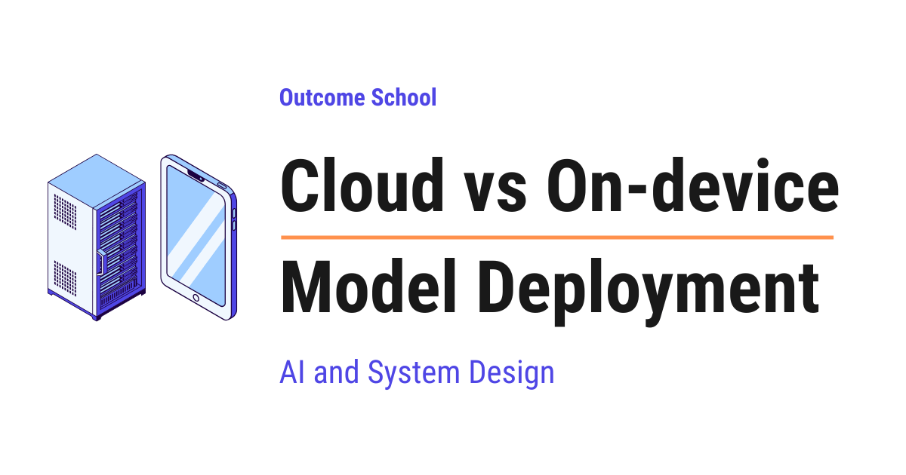

# Cloud vs On-device Model Deployment

> **Module 16 · Lesson 16.5**  
> Source: [Outcome School](https://outcomeschool.com/blog/cloud-vs-on-device-model-deployment) · Published: August 7, 2026 · Reading time: ~27 min · Tags: `ai`, `machine-learning`, `system-design`

---



In Cloud Deployment, the AI model runs on a powerful server, and the device sends the question over the internet to get the answer. In On-device Deployment, the model runs inside the device itself, without contacting any server.

In this blog, we will learn about Cloud vs On-device Model Deployment, the two places where an AI model can actually run and do its work. We will also see how Cloud Deployment and On-device Deployment differ from each other, how each one works with simple examples, why one of them is very powerful but far away while the other one is very close but limited, what the hybrid approach is, and when to use which one.

We will cover the following:

- What is deployment?
- Training and inference
- What is Cloud Deployment?
- What is On-device Deployment?
- The one big difference
- The round trip problem
- Where does our data go?
- How big can the model be?
- Who pays the bill?
- The shipping problem
- What happens when the network is gone?
- The hybrid approach
- Some real examples
- Let's tabulate the difference
- When to use which one?
- Summary

Let's get started.

## What is deployment?

Before jumping into Cloud vs On-device, we must know what deployment means.

Let's say we have built an AI model. Right now it is just a big file sitting on our computer. It cannot do anything for anyone. Nobody can use it.

**Deployment means putting the model somewhere it can run, so that real people can actually use it.**

In simple words:

**Deployment = A model + A place where it runs**

That place is the whole question of this blog. There are two choices.

We can keep the model on a powerful computer far away, in a data center, and let people reach it over the internet. This is called **Cloud Deployment**.

Or we can put the model directly inside the phone, the laptop, the car, or the camera that the person is using. This is called **On-device Deployment**. It is also called Edge Deployment, because the device sits at the edge of the network, close to the user.

**Note:** When we say device, we do not mean only a phone. A laptop, a smart watch, a car, a security camera, a smart speaker, and even a small sensor in a factory are all devices. The idea stays the same for all of them.

Do not worry, we will learn about each of them in detail.

Before that, we need to understand two words, training and inference.

## Training and inference

An AI model has two very different phases in its life.

**Training** is the phase where the model learns. We show it huge amounts of data, again and again, and it slowly adjusts itself until it becomes good at the task. This is extremely heavy work. It can take thousands of powerful machines running for weeks.

**Inference** is the phase where the model answers. The learning is already over. We give it one question, and it gives us one answer. This is much lighter work than training.

For the sake of understanding, we can think of it like a student. Training is the student studying for years. Inference is the student sitting in an exam and answering one question. Studying for years needs a whole college. Answering one question needs only a pen.

Here, we can notice one important thing. Training almost always happens in the cloud, because no phone can handle that kind of work.

So, when we talk about Cloud vs On-device Model Deployment, we are talking about **inference**. We are asking one simple question:

> Where does the model run when a real user asks it something?

Now that we know this, let's understand Cloud Deployment.

## What is Cloud Deployment?

**In Cloud Deployment, the model lives on a powerful server in a data center, and the device sends the question over the internet to get the answer.**

The device itself does almost nothing. It just collects the question, sends it, waits, and shows the answer.

The best way to learn this is by taking an example.

Let's say we open ChatGPT on our phone and type "Explain gravity to a child". The phone does not think. The phone packs our sentence into a network request and sends it to a server. That server holds a very large model. The model reads our sentence, produces the answer, and sends the answer back to our phone. The phone just displays it.

We can picture Cloud Deployment like below:

```
   Our phone                     Internet                    Cloud server
   ---------                     --------                    ------------
   [ Question ]  -------------------------------------->  [ Very big model ]
                                                                   |
                                                                thinking
                                                                   |
   [  Answer  ]  <--------------------------------------  [     Answer    ]
                    The thinking happens far away
```

Here, we can see that the phone is only a messenger. All the real work is done on the server.

This is how most AI products work today. ChatGPT, Claude, Gemini, image generation tools, and almost every AI feature inside a website are all deployed in the cloud.

We have a detailed blog on [vLLM](https://outcomeschool.com/blog/how-does-vllm-work) that explains how one such server handles thousands of users at the same time.

**Advantages:**

- The model can be as big as we want, because the server is very powerful.
- We can update the model any time, and every user gets the new version instantly. Nobody has to install anything.
- The same model serves every user, whether they have an old phone or a new one.
- We can watch what is happening, collect logs, and fix problems quickly.

**Disadvantages:**

- The user must have the internet. No internet means no answer.
- Every answer takes a round trip over the network, so there is a delay.
- The user's data leaves the device and goes to a server owned by someone else.
- We pay for every single request, forever. The bill never stops.
- If our server goes down, the feature stops working for every user at the same moment.

This was all about Cloud Deployment. Now, it's time to learn about On-device Deployment.

## What is On-device Deployment?

**In On-device Deployment, the model lives inside the device itself, and the device runs the model on its own hardware without contacting any server.**

There is no network request. There is no server. The question never leaves the device.

Let's take an example. When we unlock our phone with our face, the phone is running an AI model. That model looks at the camera image and decides whether this is the owner or not. It does this in a fraction of a second, even in flight mode, even in a basement with no signal.

We can picture On-device Deployment like below:

```
   Our phone
   -----------------------------------------------------
     [ Question ]  ---->  [ Small model ]  ---->  [ Answer ]
   -----------------------------------------------------
              Nothing ever leaves the device
```

Here, we can see that there is no arrow going outside. The whole loop is closed inside the device.

Many features we use every day are deployed on-device. The keyboard that predicts our next word, the noise cancellation in our calls, the "Hey" wake word that wakes up our assistant, offline translation, the photo app that finds all pictures of our dog, and the self-driving system inside a car are all running on the device.

We have a detailed blog on [how llama.cpp runs LLMs on everyday hardware](https://outcomeschool.com/blog/how-does-llama-cpp-run-llms-on-everyday-hardware) that covers how even a large language model is made to run on a normal laptop or phone.

**Advantages:**

- It works without the internet.
- It is very fast, because there is no network round trip.
- The user's data stays on the device, so privacy is much better.
- We do not pay a server bill for every request. The user's own hardware does the work.

**Disadvantages:**

- The model must be small, because a phone has limited memory and limited power.
- A smaller model is usually less capable than a huge cloud model.
- Running the model drains the battery and heats up the device.
- Every device is different, so we must make the model work on old phones as well as new ones.
- Updating the model means shipping an app update, and many users take weeks to update, or never update at all.
- We cannot easily see what went wrong, because everything happened inside the user's device.

Now that we have learned about both, let's understand the one big difference between them.

## The one big difference

Everything else comes from this single point:

> In Cloud Deployment, the data travels to the model. In On-device Deployment, the model travels to the data.

That is the whole idea.

We can picture both sides together like below:

```
   Cloud Deployment                      On-device Deployment
   ----------------                      --------------------
      [ One big model ]                  +--------+ +--------+ +--------+
        ^     ^     ^                    | User 1 | | User 2 | | User 3 |
        |     |     |                    | +model | | +model | | +model |
      data  data  data                   +--------+ +--------+ +--------+
        |     |     |
   [User 1][User 2][User 3]              No data leaves any box
   One model, the data moves             Many copies, nothing moves
```

Here, we can see the difference clearly. On the left, there is only one model, and every arrow points towards it. On the right, there are no arrows at all going outside, because each device carries its own copy of the model.

In the cloud, we ship one copy of the model to a data center, and then billions of pieces of user data travel to it, one request at a time.

On the device, we ship a copy of the model to every single device once, and then no data ever travels anywhere.

Once we understand this one line, every advantage and every disadvantage becomes obvious. Let's go through them one by one.

## The round trip problem

Let's talk about speed first, because this is where the difference is easiest to feel.

When we send a question to the cloud, our data has to physically travel. It goes from our phone to the mobile tower, from the tower through many cables, sometimes across an ocean, and finally reaches the server. Then the whole journey happens again in reverse for the answer.

We can see the journey like below:

```
   Phone  -->  Tower  -->  Cables  -->  Data center  -->  Model runs
                                                              |
   Phone  <--  Tower  <--  Cables  <--  Data center  <--   Answer
```

This journey costs time even before the model starts thinking. On a good connection it can be around 50 to 200 milliseconds. On a weak connection it can be much worse.

On the device, that entire journey does not exist. The question moves from one part of the phone to another part of the phone, and that takes almost no time.

For a chat app, 200 milliseconds is fine. Nobody notices it.

But now, let's take a real use case where it is not fine. Consider a self-driving car. The camera sees a child stepping onto the road. If the car sends that image to a cloud server and waits for the answer, the car keeps moving during the wait. At 100 kilometers per hour, a wait of 200 milliseconds means the car has already travelled about 5 meters with its eyes closed. And if the network drops for two seconds, the car is completely blind for more than 50 meters.

So, for this use case, sending the data away is not an option. The model must sit inside the car.

The same logic applies to noise cancellation during a call, live camera effects, keyboard suggestions, and face unlock. All of these must feel instant, so all of these are deployed on-device.

**This is the first rule: if the answer must be instant or the network cannot be trusted, we go on-device.**

## Where does our data go?

Now, let's discuss privacy.

In Cloud Deployment, the user's data leaves the device. Their voice, their photo, their message, or their medical report travels over the internet and lands on a machine owned by a company.

That company may be very careful. It may encrypt everything and delete it quickly. But the plain fact remains, the data left the user's hands.

In On-device Deployment, the data never leaves. There is nothing to intercept, nothing to leak, and nothing to store on a server.

This matters a lot in some situations. A hospital app reading patient reports, a bank app reading a customer's documents, a keyboard reading everything we type, and a photo app looking at our family pictures are all very sensitive. In many countries, there are also laws about where user data is allowed to travel.

Here, on-device gives us something the cloud cannot easily give. The user does not have to trust us, because we never received their data in the first place.

**Note:** There is a middle option too. A company can run the model on its own servers inside its own building. This is called on-premise deployment. The data still travels, but it travels only inside the company's own network and never reaches an outside company. Hospitals, banks, and government departments use this a lot. It gives the privacy of on-device with the power of the cloud, but the company has to buy and maintain all that expensive hardware itself.

We can compare how far the user's data travels in each option like below:

```
   On-device     [ Data ]                             The data never leaves
                                                      the device
   On-premise    [ Data ] ---> [ Company's own        The data leaves the device,
                                 server ]             but stays inside the company
   Cloud         [ Data ] ---> [ Another company's    The data leaves the device
                                 server ]             and also leaves the company
```

Here, we can notice that privacy is not a yes or no question. It is a distance. The shorter the journey of the data, the fewer places it can leak from.

**This is the second rule: if the data is deeply personal or the law restricts it from moving, we go on-device.**

## How big can the model be?

Now, let's talk about power, and this is where the cloud wins clearly.

A cloud server can have many [specialized chips](https://outcomeschool.com/blog/how-does-a-gpu-work-for-deep-learning) working together, with hundreds of gigabytes of fast memory, and a power supply that never worries about a battery. It can run a model with hundreds of billions of parameters.

**Note:** Parameters are the internal numbers that a model learns during training. More parameters usually means the model knows more and reasons better, but it also means the model file is bigger and needs more memory to run.

A phone is a completely different world. It has a small battery, limited memory shared with every other app, and it must not become hot in our hand. A model that runs comfortably on a phone is usually a few billion parameters at most, and even that has to be compressed to fit.

Let's put some numbers to it, just for the sake of understanding. A large cloud model can be hundreds of gigabytes in size. A model that fits on a phone is usually somewhere between a few hundred megabytes and a few gigabytes. That is a huge gap.

To make a model fit on a device, we use techniques like below:

- **[Quantization](https://outcomeschool.com/blog/how-does-model-quantization-work)** is storing the model's numbers with less precision, for example using 4 bits instead of 16 bits. This can shrink the model to a quarter of its size while keeping most of its quality.
- **Pruning** is removing the parts of the model that contribute very little, like trimming the branches of a tree that carry no fruit.
- **[Distillation](https://outcomeschool.com/blog/how-does-knowledge-distillation-work)** is training a small model to copy the behavior of a big model, like a student learning directly from a professor.

We can picture this shrinking like below:

```
   Big cloud model
   [##############################################]  hundreds of gigabytes
                        |
                        |  Quantization  - fewer bits for each number
                        |  Pruning       - remove the parts that do very little
                        |  Distillation  - train a small copy of the big model
                        v
   Small on-device model
   [##]                                              a few gigabytes at most
```

Here, we can see that the model has to pass through a squeezing process before it can sit inside a phone. Each technique removes some weight, and what comes out at the bottom is a much smaller file.

These techniques are very effective, but they cannot perform magic. A compressed small model will not match a huge cloud model on hard reasoning, long documents, or deep world knowledge.

Having said that, the gap is closing every year. [Small models](https://outcomeschool.com/blog/small-language-models-slms) are getting better, and phone chips are getting stronger. A small model today can already do many things that needed a giant cloud model a few years back. So, tasks that must go to the cloud today may run comfortably on the device tomorrow.

**This is the third rule: if the task needs maximum intelligence, we go to the cloud.**

## Who pays the bill?

Now, let's discuss cost, because this decision often comes down to money.

In Cloud Deployment, we pay for the servers, and we pay for every request. Ten users cost a little. Ten million users cost a lot. The cost grows with every new user and never stops. This is a running cost that we carry forever.

In On-device Deployment, the heavy cost is at the beginning. We spend engineering effort to shrink the model, to make it run on many different devices, and to test it everywhere. But once the app is shipped, each answer costs us nothing, because the user's own device does the work. Ten users and ten million users cost us the same.

We can see how the two costs behave like below:

```
   Cost to us
      ^
      |                                          /
      |                                       /      Cloud
      |                                    /         (grows with every user)
      |                                 /
      |  +---------------------------/-------------  On-device
      |  |                        /                  (paid once, then flat)
      |  |                     /
      |  |                  /
      |  |               /
      |  |            /
      +--+-----------------------------------------> Number of users
```

Here, we can notice that the two lines cross each other at one point. The on-device line starts high, because of that one time engineering cost, and then it stays flat forever. The cloud line starts near zero and keeps climbing with every new user. Before the crossing point, the cloud is cheaper. After the crossing point, the cloud becomes far more expensive, and it never stops growing.

There is one catch here. The cost does not disappear, it just moves to the user. The user pays it in battery life, in storage space, and in a warm phone. So we must be respectful about it and only run on-device when it is worth it.

**This is the fourth rule: if we have a huge number of users doing a simple, repeated task, on-device saves a lot of money.**

## The shipping problem

Now, let's discuss one more practical difference that many people forget while comparing the two.

In Cloud Deployment, the model sits on our own server. If we find a mistake in the model on Monday morning, we can replace the model and by Monday afternoon every user in the world is using the corrected version. The user does not even know that something changed. This is a very big advantage, and it is the reason teams that experiment a lot prefer the cloud.

In On-device Deployment, the model is inside the app that the user installed. Two problems come into the picture here.

**Problem 1:** The model has to be downloaded. If our model is 2 GB, then either our app becomes 2 GB, which almost nobody will install, or we download the model separately after the first launch, which means the user waits and spends their mobile data. Many users will abandon the app during that wait.

**Problem 2:** The model cannot be fixed quickly. We ship a new app version, and then we wait. Some users update the same day. Some update after a month. Some never update at all. So, an old and broken version of our model keeps running on real devices for a very long time, and we can do nothing about it.

Let's say we fix the model on Monday morning. The number of users who actually get our fix looks like below:

```
   Cloud
   Monday    [##################################################]  100%
   On-device
   Monday    [                                                  ]    0%
   Day 3     [###############                                   ]   30%
   Week 2    [###################################               ]   70%
   Month 2   [##########################################        ]   85%
   Later     [#############################################     ]   90%
                                                                    and it stops here
```

Here, we can see the real pain. In the cloud, the fix reaches everyone within minutes. On the device, the fix crawls out slowly over weeks, and it never reaches everyone, because some users simply never update their apps.

There is one more thing. The device itself is not under our control. A three year old budget phone and a brand new flagship phone are completely different machines, with different chips, different memory, and different speeds. Our model must work on all of them, and testing this properly takes real effort.

**This is the fifth rule: if we need to change the model often, or if we cannot afford a large download, the cloud is much safer.**

## What happens when the network is gone?

Let's think about a simple, everyday moment.

A traveler lands in a new country. There is no local SIM card yet, and the airport WiFi is not working. They point their phone camera at a sign written in a language they cannot read, and they need a translation right now.

If the translation feature is deployed in the cloud, nothing happens. The app shows a spinner and then an error. The user is stuck.

If the translation model is on the device, the phone reads the sign and shows the meaning right there. It works perfectly, with zero bars of signal.

We can see both situations like below:

```
   Zero bars of signal
   -------------------
   Cloud       [ Phone ]  --X-->  [ Server ]        Spinner, then an error
                          broken path
   On-device   [ Phone ]  ---->  [ Small model ]  ---->  Translation shown
                          everything inside the phone
```

Here, we can see that the cloud path has a broken link in the middle, and one broken link is enough to stop the whole feature. The on-device path has no link that can break.

The same thing happens in a village with weak signal, in a basement parking lot, inside a metro tunnel, and on an airplane.

So, availability is not a small detail. For some products, working offline is the entire reason the product is useful.

**This is the sixth rule: if the feature must keep working without the internet, it has to be on-device.**

## The hybrid approach

Till now, we have learned about cloud and on-device as two separate choices. But in the real world, we do not have to pick only one.

So, here comes the hybrid approach to the rescue.

**In the hybrid approach, a small model runs on the device and handles the easy work, and the big cloud model is called only when the task is genuinely hard.**

We can picture it like below:

```
        [ User's question ]
                |
                v
     [ Small model on the device ]
                |
        Can I handle this?
                |
        +-------+-------+
        |               |
       Yes              No
        |               |
        v               v
   [ Answer on     [ Send to the big
     the device ]    cloud model ]
                          |
                          v
                     [ Answer ]
```

Here, we can see that most questions get answered right on the device, quickly and privately. Only the difficult ones travel to the cloud.

Let's take a real use case. A [voice assistant](https://outcomeschool.com/blog/design-a-real-time-voice-ai-agent) works exactly like this. The wake word detection always runs on the device, listening quietly. When it hears the wake word, a small on-device model tries to handle simple commands like "set a timer for ten minutes" or "turn on the flashlight". These never touch the internet. But when we ask something like "write me a poem about the monsoon", the assistant sends that to the cloud, because the small model cannot do it well.

The hybrid approach gives us speed and privacy for the common case, and full intelligence for the rare hard case. It also gives us a safe fallback, because when the network is gone, the device can still handle the simple things instead of failing completely.

Almost all problems got solved. This is why most serious products end up here.

We have a detailed blog on [LLM Routing](https://outcomeschool.com/blog/llm-routing) that explains how a system decides which model should handle which request.

There is one more useful pattern worth knowing. Sometimes the model runs in the cloud, but the learning happens on the device. This is called **Federated Learning**. Each device learns a little from its own user's data, and only the small learned update is sent back, never the raw data itself. The keyboard on our phone improves this way.

We can picture Federated Learning like below:

```
     Phone 1            Phone 2            Phone 3
   [ user data ]      [ user data ]      [ user data ]     stays on the phone
        |                  |                  |
     learning           learning           learning        happens on the phone
        |                  |                  |
   [  update  ]      [  update  ]      [  update  ]        only this travels
        |                  |                  |
        +------------------+------------------+
                           |
                           v
             [ Improved model in the cloud ]
```

Here, we can notice that the user data box appears only at the top and never moves down. Only the small update travels to the cloud. So, the cloud model keeps becoming better without ever seeing what anybody typed.

Now, we have understood all three options. Let's look at some real examples before we summarize.

## Some real examples

The best way to make this concrete is by looking at features we already use every day and asking where each one runs, and why.

| Feature | Where it runs | Why |
| --- | --- | --- |
| Face unlock on a phone | On-device | Must be instant, must work offline, and a face is very personal data |
| Keyboard word prediction | On-device | Runs on every single keystroke, so a network trip is impossible |
| Noise cancellation in a call | On-device | Must process sound in real time, with no delay at all |
| Offline translation of a sign | On-device | The user often has no network exactly when they need it |
| Self-driving in a car | On-device | A network delay or drop can cause an accident |
| ChatGPT answering a long question | Cloud | Needs a very large model that cannot fit on a phone |
| Generating an image from text | Cloud | Very heavy work that would drain a phone battery quickly |
| Searching our own photos by words | On-device or hybrid | Photos are private, and the search index is already on the phone |
| A voice assistant | Hybrid | Wake word and simple commands on-device, hard questions in the cloud |
| A hospital reading patient reports | On-premise | The data is not allowed to leave the hospital's own network |

Here, we can notice a clear pattern. Anything that must be instant, private, or offline goes to the device. Anything that needs deep intelligence goes to the cloud. And anything that needs both ends up hybrid.

## Let's tabulate the difference

Let me tabulate the differences between Cloud Deployment and On-device Deployment for your better understanding so that you can decide which one to use based on your use case.

| Point | Cloud Deployment | On-device Deployment |
| --- | --- | --- |
| Where the model runs | On a server in a data center | Inside the user's device |
| Where the data goes | Travels over the internet to the server | Never leaves the device |
| Internet needed | Yes, always | No |
| Speed | Slower, because of the network round trip | Faster, no round trip at all |
| Model size | Very large, hundreds of billions of parameters | Small, usually a few billion at most, and compressed |
| Answer quality | Highest, since the model is the strongest available | Good enough for focused tasks, weaker on hard reasoning |
| Privacy | Weaker, since data leaves the user's hands | Stronger, since data stays with the user |
| Cost to us | Pay for every request, forever | Mostly a one-time engineering cost |
| Cost to the user | Only their internet data | Battery, storage, and heat |
| Updating the model | Instant for everyone, we just change the server | Needs an app update, and many users update late |
| Hardware differences | Only one machine type to worry about | Must work on thousands of different devices |
| Visibility for us | We can see logs and fix issues quickly | Very hard to see what happened on a user's device |
| Best for | Hard reasoning, long documents, generation, rich knowledge | Instant, private, repeated, offline tasks |

## When to use which one?

**Use Cloud Deployment when:**

- The task needs the strongest possible model, like deep reasoning, long document understanding, or high quality generation.
- The users are already online while using the feature, for example on a website.
- We want to improve the model often and push the change to everyone immediately.
- The number of users is small enough that the server bill is comfortable.
- The model is too large to ever fit on a device.
- We need to see logs, measure quality, and fix issues quickly.

**Use On-device Deployment when:**

- The answer must feel instant, like camera effects, keyboard suggestions, or a car reacting to the road.
- The data is very personal, like health records, private photos, or everything the user types.
- The feature must work without the internet.
- We have a very large number of users doing the same simple task, and the cloud bill would become too heavy.
- The task is narrow and focused, so a small model can do it well.

**Use the hybrid approach when:**

- Most requests are easy but a few are hard.
- We want privacy and speed for the common case, without giving up quality for the rare case.
- We need a safe fallback, so the feature keeps working in a basic way even when the network is gone.

**Use On-premise Deployment when:**

- The data is not legally allowed to leave the organization, like patient records or bank documents.
- We need the power of a big model, but we cannot send the data to an outside company.
- The organization is large enough to buy and maintain its own hardware.

## Summary

Let's do a quick recap of everything we have learned.

- Deployment means putting a model where it can run for real users. There are two places, the cloud and the device.
- Training almost always happens in the cloud. This blog is about inference, which is the model answering a real question.
- In Cloud Deployment, the data travels to the model. The model can be huge and very capable, but there is a network delay, an internet requirement, a privacy concern, and a bill for every request.
- In On-device Deployment, the model travels to the data. It is instant, private, offline-friendly, and free per request, but the model must be small and it uses the user's battery.
- The round trip is what makes the cloud slower. For self-driving cars, camera effects, and wake words, that delay is not acceptable.
- Quantization, pruning, and distillation are how we shrink a model to fit on a device.
- Shipping a model to devices is hard. It has to be downloaded, and once it is out there, we cannot fix it quickly.
- On-premise deployment is a middle option, where a company runs the model on its own servers inside its own building.
- The hybrid approach handles easy tasks on the device and sends only the hard ones to the cloud. Most real products end up here.
- Federated Learning lets the model learn from user data without that data ever leaving the device.

Now we must have understood Cloud vs On-device Model Deployment, and we can decide the right place to run our model based on our use case.

## Frequently Asked Questions

### What is Edge Deployment?

Edge Deployment is another name for On-device Deployment. The model runs directly inside the phone, laptop, car, or camera that the person is using. It is called edge because the device sits at the edge of the network, close to the user.

### Is On-device Deployment always cheaper than Cloud Deployment?

No. On-device Deployment has a heavy one-time engineering cost to shrink the model and make it run on many devices, so the cloud is cheaper until the number of users grows large enough. After that, the cloud bill keeps growing with every user. Also, the cost does not disappear on the device, it moves to the user as battery, storage, and heat.

### Can a small on-device model match a large cloud model?

No. Quantization, pruning, and distillation are very effective, but a compressed small model will not match a huge cloud model on hard reasoning, long documents, or deep world knowledge. Having said that, the gap is closing every year as small models get better and phone chips get stronger.

### Does a model ever learn on the device?

Yes, with Federated Learning. Training almost always happens in the cloud, but in Federated Learning each device learns a little from its own user's data. Only the small learned update is sent back, never the raw data itself. The keyboard on our phone improves this way.

### Is On-premise Deployment the same as On-device Deployment?

No. In On-premise Deployment, a company runs the model on its own servers inside its own building. The data still leaves the device, but it stays inside the company's own network. It gives the privacy of on-device with the power of the cloud, but the company must buy and maintain the hardware.
