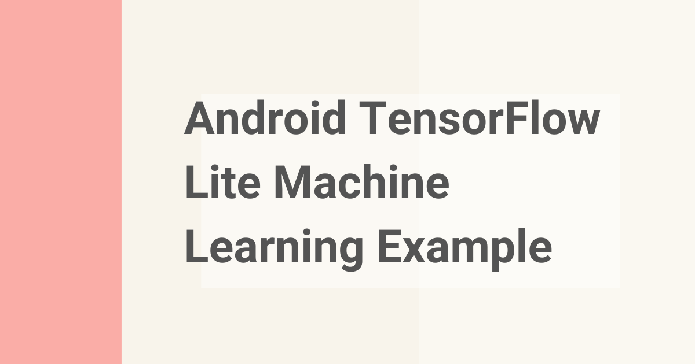

# Android TensorFlow Lite Machine Learning Example

> **Module 16 · Lesson 16.6**  
> Source: [Outcome School](https://outcomeschool.com/blog/android-tensorflow-lite-machine-learning-example) · Published: August 2, 2019 · Reading time: ~2 min · Tags: `machine-learning`, `android`

---

TensorFlow Lite is the lightweight version of TensorFlow for mobile and embedded devices. It lets us run a Machine Learning model on the Android device itself, which makes it fast.

In this blog, we will see Android TensorFlow Lite Machine Learning example.

Let's get started.

**Using TensorFlow Lite Library For Object Detection**

**TensorFlow Lite** is [TensorFlow](https://outcomeschool.com/blog/how-does-the-machine-learning-library-tensorflow-work)’s lightweight solution for mobile and embedded devices.

**TensorFlow Lite is better as:**

- TensorFlow Lite enables [on-device machine learning inference](https://outcomeschool.com/blog/cloud-vs-on-device-model-deployment) with low latency. Hence, it is fast.
- TensorFlow Lite takes small binary size. Hence, good for mobile devices.
- TensorFlow Lite also supports hardware acceleration with the Android Neural Networks API.

**TensorFlow Lite uses many techniques for achieving low latency such as:**

- Optimizing the kernels for mobile apps.
- Pre-fused activations.
- Quantized kernels that allow smaller and faster (fixed-point math) models.

## How to use TensorFlow Lite in an Android application?

The most important tricky part while using the TensorFlow Lite is to prepare the model(.tflite) which is different from the normal TensorFlow model.

In order to run the model with the TensorFlow Lite, you will have to convert the model into the model(.tflite) which is accepted by the TensorFlow Lite. Follow the steps from [here](https://developers.google.com/edge/litert/models/convert).

Now, you will have the model(.tflite) and the label file. You can start using these model and label files in your Android application to load the model and to predict the output using the TensorFlow Lite library.

I have created a complete running sample application using the TensorFlow Lite for object detection. **[Check out the project here.](https://github.com/amitshekhariitbhu/Android-TensorFlow-Lite-Example)**

Credit: The classifier example has been taken from Google TensorFlow example.

## Frequently Asked Questions

### Can we use a normal TensorFlow model directly with TensorFlow Lite?

No. The TensorFlow Lite model is different from the normal TensorFlow model. We must first convert the model into the .tflite format that TensorFlow Lite accepts. Preparing this model is the most important tricky part of using TensorFlow Lite.

### Why is TensorFlow Lite fast on mobile devices?

TensorFlow Lite runs machine learning inference on the device with low latency. It achieves this by optimizing the kernels for mobile apps, using pre-fused activations, and using quantized kernels that allow smaller and faster models. It also has a small binary size, which makes it good for mobile devices.

### Does TensorFlow Lite support hardware acceleration on Android?

Yes. TensorFlow Lite supports hardware acceleration with the Android Neural Networks API. This is one of the reasons it is a good fit for on-device machine learning in Android applications.
