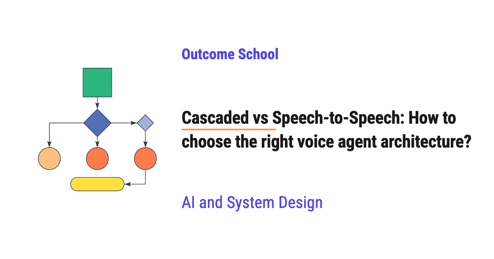

# Cascaded vs Speech-to-Speech: How to choose the right voice agent architecture?

> **Module 16 · Lesson 16.11**  
> Source: [Outcome School](https://outcomeschool.com/blog/cascaded-vs-speech-to-speech) · Published: October 21, 2026 · Reading time: ~14 min · Tags: `ai-agent`, `llm`, `ai`, `system-design`

---



Cascaded vs Speech-to-Speech is the choice between building a voice agent as a chain of three models (speech-to-text, then an LLM, then text-to-speech) or as one model that hears audio and speaks audio directly. We choose based on what matters most for our use case: control and accuracy, or speed and natural sound.

In this blog, we will learn about Cascaded vs Speech-to-Speech and how to choose the right voice agent architecture. We will also see how a cascaded voice agent works, how a speech-to-speech voice agent works, how the two differ in delay, tone, control, and cost, what a half-cascade in the middle looks like, and when to use which one.

We will cover the following:

- What is a voice agent architecture?
- What is a cascaded voice agent?
- Strengths and weaknesses of a cascaded voice agent
- What is a speech-to-speech voice agent?
- Strengths and weaknesses of a speech-to-speech voice agent
- The middle path: Half-Cascade
- Differences between Cascaded, Half-Cascade, and Speech-to-Speech
- How to choose the right voice agent architecture

Let's get started.

## What is a voice agent architecture?

A **voice agent** is an AI system that we can talk to with our voice, and it talks back to us with a voice. For example, a support agent can answer a phone call and help us book a doctor's appointment.

Every voice agent has to do three jobs on every turn:

- **Hear:** Understand what the user said.
- **Think:** Decide what to reply, and take an action if needed, like checking a calendar.
- **Speak:** Say the reply out loud.

The **voice agent architecture** is how we arrange the models that do these three jobs.

There are two main ways to arrange them:

- **Cascaded:** Three separate models, one for each job, connected in a chain.
- **Speech-to-Speech:** One model that does all three jobs together.

Both work, and both are used in real products. But they behave very differently, and picking the wrong one for our use case gives us a slow agent, a robotic agent, or an agent we cannot control.

So, let's understand each one first, and then we will learn how to choose.

## What is a cascaded voice agent?

**A cascaded voice agent is a chain of three models where the output of one model becomes the input of the next model.**

The word **cascade** means a series of steps where each step flows into the next one, like water flowing down from one step to the next.

The three models are:

- **STT (Speech-to-Text):** Converts the user's voice into text. It is also called ASR (Automatic Speech Recognition).
- **LLM (Large Language Model):** Reads that text and writes a reply in text.
- **TTS (Text-to-Speech):** Converts the reply text into voice.

Let's see the flow in a diagram as below:

```
User speaks: "Can I book an appointment for Monday?"
        ↓
+------------------------+
|  STT (Speech-to-Text)  |
+------------------------+
        ↓
Text: "Can I book an appointment for Monday?"
        ↓
+------------------------+
|          LLM           |
+------------------------+
        ↓
Text: "Sure. Monday at 10 AM is free. Shall I book it?"
        ↓
+------------------------+
|  TTS (Text-to-Speech)  |
+------------------------+
        ↓
Agent speaks the reply
```

Here, we can see that text is the language that connects the three models. The STT model hands text to the LLM, and the LLM hands text to the TTS model.

This is a very common way to build a voice agent, because each of the three parts is a mature and well-tested model on its own.

## Strengths and weaknesses of a cascaded voice agent

Let's start with what a cascaded voice agent does well.

**Strengths:**

- **We can see everything.** Since the middle of the chain is plain text, we can read exactly what the agent heard and exactly what it decided to say. When something goes wrong, we open the logs and find the problem.
- **We can pick the best model for each job.** We can use one company's STT, another company's LLM, and a third company's TTS. If a better TTS comes out tomorrow, we replace only that part.
- **Strong thinking and tool use.** The LLM in the middle can be any text LLM, including the most capable ones. Text LLMs are very good at following long instructions and at [deciding which tool to use](https://outcomeschool.com/blog/how-does-function-calling-work-in-llms), like "check the calendar" or "find the order". Our code then runs that tool and gives the result back to the LLM.
- **Easy safety checks.** Before the reply text goes to the TTS, we can [check it with our own rules](https://outcomeschool.com/blog/how-do-llm-guardrails-work). For example, we can block the agent from promising a refund it is not allowed to give.
- **Full control of the voice.** We can choose from many voices or use a custom voice, fix how a brand name is pronounced, and control the speed of speaking in the TTS step.

Now, let's see the weaknesses.

**Weaknesses:**

- **Delay adds up.** The user has to wait for the STT, then the LLM, then the TTS. Each step adds its own delay, and [the total delay is the sum of all of them](https://outcomeschool.com/blog/voice-agent-latency-budget). In a conversation, even a one-second gap feels slow.
- **Tone is lost.** The STT converts voice into text, and text has no tone. If the user says "Great..." in an angry voice, the LLM only sees the word "Great". It cannot tell that the user is upset.
- **Mistakes travel down the chain.** If the STT hears "two fifteen" as "two fifty", the LLM gets the wrong number and the agent books the wrong time. The LLM has no way to hear the original audio.
- **Turn-taking needs extra parts.** The agent has to decide when the user has finished speaking before it can start. In a cascaded agent, we add separate silence detection and [turn detection models](https://outcomeschool.com/blog/what-is-turn-taking-in-a-voice-ai-agent) for this.

Let's say, just for the sake of understanding, the STT takes 300 milliseconds to finish, the LLM takes 500 milliseconds to start its reply, and the TTS takes 200 milliseconds to start speaking. The user waits 300 + 500 + 200 = 1000 milliseconds, which is one full second, before hearing anything.

**Note:** Good cascaded systems reduce the delay by [streaming](https://outcomeschool.com/blog/how-does-token-streaming-work). The STT sends words as soon as it hears them, the LLM starts writing as soon as text arrives, and [the TTS starts speaking the first sentence while the LLM is still writing the rest](https://outcomeschool.com/blog/time-to-first-audio). This cuts the delay a lot, but some delay from the handoffs still remains.

Now, it's time to learn about the speech-to-speech voice agent.

## What is a speech-to-speech voice agent?

The two biggest problems of the cascaded voice agent are the added delay and the lost tone. In order to solve these two problems, here comes the speech-to-speech voice agent into the picture.

**A speech-to-speech voice agent uses one model that takes the user's audio as input and gives the reply as audio directly, without converting it to text in between.**

The hearing, thinking, and speaking all happen inside the same model.

Let's see the flow in a diagram as below:

```
User speaks: "Can I book an appointment for Monday?"
        ↓
+-----------------------------+
|   Speech-to-Speech Model    |
| (hears, thinks, and speaks) |
+-----------------------------+
        ↓
Agent speaks the reply
```

Here, we can see that there are no handoffs between separate models. The audio goes in, and the audio comes out.

How does one model do this? The model is trained on a large amount of speech. Usually, it converts the incoming audio into small pieces called **audio tokens**, which are like the words of sound. It understands these tokens directly and produces new audio tokens for the reply, which are then turned back into sound.

**Note:** Many speech-to-speech models also produce text inside, alongside the audio, to help them think better and to give us a transcript. But the voice we hear comes from the model itself, not from a separate TTS model.

## Strengths and weaknesses of a speech-to-speech voice agent

Let's start with what a speech-to-speech voice agent does well.

**Strengths:**

- **Lower delay.** There are no handoffs between three models, so the reply can start faster. The conversation feels closer to talking to a real person.
- **Tone is kept.** The model hears the actual voice, not just the words. It can notice if the user sounds angry, confused, or happy, and it can reply in a matching tone.
- **More natural speech.** Many such models can laugh, pause, change their speed, and sound warm, because they generate the voice as part of the reply instead of reading out a finished text.
- **Better handling of interruptions.** Some speech-to-speech models can listen while they speak. If the user [cuts in](https://outcomeschool.com/blog/what-is-barge-in-in-a-voice-ai-agent), the model notices it quickly and stops, without a separate system watching for it.
- **Simpler to set up.** We connect to one model instead of wiring three models together.

Now, let's see the weaknesses.

**Weaknesses:**

- **Harder to see inside.** Even when the model gives us a transcript, that text is a side output, not the exact thing the model used to decide its reply. So, when the agent says something wrong, it is harder to find out whether it misheard or misunderstood.
- **Less choice.** We cannot replace only the voice or only the thinking part. We get the voice and the thinking that come with that one model.
- **Often weaker at complex tasks.** The strongest text LLMs are often better than speech-to-speech models at following long instructions, careful reasoning, and reliably choosing the right tool.
- **Less control of the voice.** We usually get a fixed set of voices, and it is harder to force the exact pronunciation of a brand name or a medicine name.
- **Harder safety checks.** The audio is generated directly and starts playing quickly, so we cannot easily check the full reply before the user hears it.
- **Cost.** Audio tokens are usually priced higher than text tokens, so long calls can cost more. We must compare the total cost per minute of both setups for our expected call length.

Now that we have learned about both, here comes the middle path into the picture.

## The middle path: Half-Cascade

Between the two, there is a third option that is often called a **half-cascade**.

In a half-cascade, the model hears the user's audio directly, so it keeps the tone of the user's voice. But it writes its reply as text, and a TTS model turns that text into voice.

Let's see the flow in a diagram as below:

```
User speaks
        ↓
+----------------------------------+
| Audio-in Model (hears + thinks)  |
+----------------------------------+
        ↓
Reply as text
        ↓
+----------------------------------+
|       TTS (Text-to-Speech)       |
+----------------------------------+
        ↓
Agent speaks the reply
```

Here, the audio-in model is a model that [takes audio as input directly](https://outcomeschool.com/blog/multimodal-ai), understands it, and writes the reply as text. Then, the TTS speaks that reply.

This way, we get some benefits from both sides:

- The model hears the real voice, so the tone of the user is not lost.
- The reply is text, so we can check it, log it, and control how it is spoken.
- Tool calling is often more reliable than in a full speech-to-speech model, because the reply goes through a text step.

The trade-off is that the reply voice is usually less expressive than the voice of a full speech-to-speech model, and the TTS step adds back some delay.

## Differences between Cascaded, Half-Cascade, and Speech-to-Speech

Let me tabulate the differences between Cascaded, Half-Cascade, and Speech-to-Speech for your better understanding so that you can decide which one to use based on your use case.

| Point | Cascaded | Half-Cascade | Speech-to-Speech |
| --- | --- | --- | --- |
| Number of models | Three (STT, LLM, TTS) | Two (audio-in model, TTS) | One |
| Delay | Higher, adds up across steps | Medium | Lower |
| User's tone | Lost when audio becomes text | Kept | Kept |
| Naturalness of voice | Good, depends on the TTS | Good, depends on the TTS | Very natural and expressive |
| Seeing what happened | Easy, text at every step | Easy for the reply | Harder |
| Swapping parts | Easy, replace any one model | Can replace the TTS | Not possible |
| Complex reasoning and tools | Strong | Good | Often weaker |
| Voice and pronunciation control | Full | Full | Limited |
| Safety checks before speaking | Easy | Easy | Harder |

## How to choose the right voice agent architecture

Now, the next big question is: which one do we choose?

Before choosing, we must ask one question: for this agent, what is worse, a wrong answer or a slow and flat-sounding answer? If a wrong answer is worse, we lean towards cascaded. If a slow and flat-sounding answer is worse, we lean towards speech-to-speech.

The best way to learn this is by taking an example. Let's take three different voice agents.

**Example 1: A bank support agent.**

This agent must check account details, follow strict rules, and never say something wrong about money. A mistake here is costly. Here, control and accuracy matter more than a very natural voice. So, we choose **cascaded**. We can read every transcript, check every reply before it is spoken, and use the strongest LLM for deciding which tool to call.

**Example 2: A language practice partner.**

This agent chats casually with a learner. It must sound natural, react to how the learner speaks, and reply quickly so that the chat flows. There are very few tools and no strict rules. Here, speed and natural tone matter the most. So, we choose **speech-to-speech**.

**Example 3: A restaurant booking agent that must notice the caller's mood.**

This agent needs to call a booking tool reliably, but it must also notice when a caller sounds confused or annoyed. Here, a **half-cascade** is a good fit. It hears the caller's tone, and its reply text can still be checked and spoken with a voice we control.

From these examples, we can make simple rules.

We must choose **cascaded** when:

- The agent calls many tools or follows long, strict instructions.
- We must check or block replies before the user hears them.
- We need a specific voice, or the exact pronunciation of names and brands.
- We want to replace parts later, like moving to a better or cheaper TTS.

We must choose **speech-to-speech** when:

- Low delay and a natural, human-like conversation matter the most.
- The agent must react to the user's tone and emotion.
- The tasks are simple, with few tools and few strict rules.

We must choose **half-cascade** when:

- We want the agent to hear the user's tone.
- But we also want text replies that we can check and a voice we can control.
- The agent calls tools, but the user's mood also matters.

One more thing to notice: this choice is not forever. Speech-to-speech models are improving quickly at reasoning and tool calling. A good practice is to keep our tools, instructions, and test calls separate from the model, so that we can try the other architecture later and compare both on real calls.

We have a detailed blog on [Design a Real-Time Voice AI Agent](https://outcomeschool.com/blog/design-a-real-time-voice-ai-agent) that covers the full system end to end.

Now we must have understood Cascaded vs Speech-to-Speech, how each one works, and how to choose the right voice agent architecture for our use case.

## Frequently Asked Questions

### Why does a cascaded voice agent lose the user's tone?

A cascaded voice agent loses the user's tone because the STT converts the voice into text, and text has no tone. If the user says "Great..." in an angry voice, the LLM only sees the word "Great". It cannot tell that the user is upset, because it has no way to hear the original audio.

### Can streaming reduce the delay of a cascaded voice agent?

Yes. Streaming cuts the delay a lot. The STT sends words as soon as it hears them, the LLM starts writing as soon as text arrives, and the TTS starts speaking the first sentence while the LLM is still writing the rest. But some delay from the handoffs between the three models still remains.

### What are audio tokens in a speech-to-speech model?

Audio tokens are small pieces of audio that work like the words of sound. A speech-to-speech model usually converts the incoming audio into these tokens, understands them directly, and produces new audio tokens for the reply. These reply tokens are then turned back into sound, so no separate TTS model is needed.

### Is a speech-to-speech voice agent more expensive than a cascaded one?

It can be. Audio tokens are usually priced higher than text tokens, so long calls with a speech-to-speech model can cost more. Before choosing, we must compare the total cost per minute of both setups for our expected call length.

### Can we switch from a cascaded to a speech-to-speech voice agent later?

Yes. The choice is not forever, and speech-to-speech models are improving quickly at reasoning and tool calling. A good practice is to keep our tools, instructions, and test calls separate from the model, so that we can try the other architecture later and compare both on real calls.
