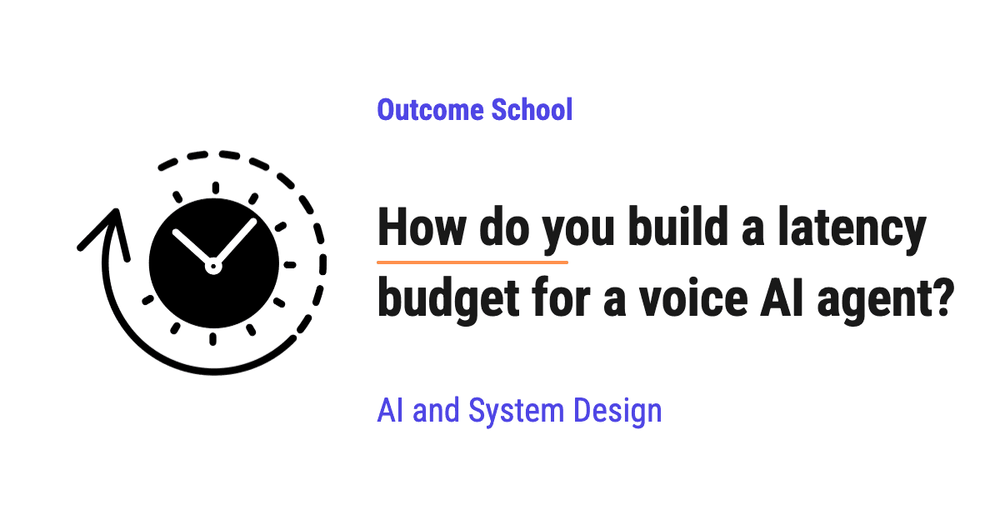

# How do you build a latency budget for a voice AI agent?

> **Module 16 · Lesson 16.12**  
> Source: [Outcome School](https://outcomeschool.com/blog/voice-agent-latency-budget) · Published: October 21, 2026 · Reading time: ~16 min · Tags: `ai-agent`, `llm`, `ai`, `system-design`

---



A latency budget for a voice AI agent is a plan that splits the total waiting time we allow for a reply into smaller pieces, one for each step of the agent, so that the agent always starts replying fast enough to feel natural.

In this blog, we will learn about how to build a latency budget for a voice AI agent. We will also see why a voice AI agent needs one, how to pick the total target and split it across every stage, how to measure the real numbers and cut the biggest delays first, how streaming and tool calls change the budget, and what trade-off we must accept.

We will cover the following:

- What is a latency budget?
- Why does a voice AI agent need a latency budget?
- Step 1: Pick the total target
- Step 2: List every stage of the pipeline
- Step 3: Give each stage its share of the time
- Step 4: Measure the real numbers
- Step 5: Cut the biggest delay first
- How streaming changes the budget
- How tool calls fit into the budget
- The trade-off we must accept

Let's get started.

## What is a latency budget?

Before jumping into the budget, we must know what latency means.

**Latency** is the waiting time between asking for something and getting it back.

For a voice AI agent, the latency that matters most is the time between the moment we stop speaking and the moment we hear the agent start to reply. This is often called **[voice-to-voice latency](https://outcomeschool.com/blog/voice-to-voice-latency)**.

Now, let's understand the budget part.

**A latency budget is a fixed total amount of time that we allow for one reply, divided into smaller amounts of time for each step that produces the reply.**

Let's say we have 30,000 rupees to spend in a month. We do not spend it randomly. We decide 12,000 for rent, 8,000 for food, 3,000 for travel, and 7,000 for savings, which adds up to 30,000. If one item goes over its share, we know exactly where the problem is, and we know that something else must shrink to keep the total the same.

A latency budget works in the same way. Only here, we spend milliseconds instead of rupees.

A millisecond is one-thousandth of a second, and we write it as `ms` for short.

## Why does a voice AI agent need a latency budget?

When two people talk, [each person speaks in turns](https://outcomeschool.com/blog/what-is-turn-taking-in-a-voice-ai-agent). A **turn** is one person's chance to speak. The gap between one person finishing their turn and the other person starting is very small. A well-known study of conversations in ten languages found that this gap is around 200 ms on average.

So, our brain is trained to expect a reply almost instantly. When a voice AI agent stays silent for 2 or 3 seconds, it feels broken. People start saying "Hello? Are you there?", and they [talk over the agent](https://outcomeschool.com/blog/what-is-barge-in-in-a-voice-ai-agent).

A voice AI agent is not one single program. It is a chain of steps. It listens, it decides that we have finished speaking, it turns our speech into text, it thinks of an answer, and it turns the answer back into speech. Every step takes some time.

If we do not plan the time for each step, every step gets built to be "fast enough" on its own. Then, all these "fast enough" pieces add up to a reply that is far too slow.

Here comes the latency budget into the picture. It gives every step a clear number to stay under, so that the total stays under our target.

Now, let's see how to build one, step by step.

## Step 1: Pick the total target

First, we need the total time we are allowed to spend. Reaching 200 ms is very hard for a voice AI agent, because the audio must pass through several models and travel across the network. So, in practice, many teams building voice AI agents aim for a voice-to-voice latency of around 800 ms or less. Replies that take well over a second start to feel slow.

For the sake of example, in this blog, we will use a total target of **800 ms**.

One more thing to notice here. We must decide **where the clock starts and where it stops**.

- The clock starts when the user stops speaking.
- The clock stops when the first sound of the agent's reply reaches the user's ear.

The clock does not stop when the full answer is ready. It stops when the user hears the first sound. We will see why this matters in the streaming section.

## Step 2: List every stage of the pipeline

Now, we need to list every step that sits between the start and the stop of the clock.

A typical [voice AI agent pipeline](https://outcomeschool.com/blog/design-a-real-time-voice-ai-agent) looks like below:

```
+--------------------------------------+
| User stops speaking                  |
+--------------------------------------+
                   ↓
+--------------------------------------+
| Network: user's audio to our server  |
+--------------------------------------+
                   ↓
+--------------------------------------+
| Endpointing: is the user done?       |
+--------------------------------------+
                   ↓
+--------------------------------------+
| STT: final text of what was said     |
+--------------------------------------+
                   ↓
+--------------------------------------+
| LLM: first token of the answer       |
+--------------------------------------+
                   ↓
+--------------------------------------+
| TTS: first chunk of audio            |
+--------------------------------------+
                   ↓
+--------------------------------------+
| Network: audio back to the user      |
+--------------------------------------+
                   ↓
+--------------------------------------+
| User hears the first sound           |
+--------------------------------------+
```

Let's understand each stage.

- **Network (going up):** The user's voice travels from their phone or browser to our server.
- **Endpointing:** The agent decides that the user has finished their turn. It usually does this by waiting for a short silence, or by using a model that predicts the end of the turn.
- **STT (Speech-to-Text):** A speech recognition model turns the audio into text.
- **LLM (Large Language Model):** The model reads the text and starts generating the answer, [one token at a time](https://outcomeschool.com/blog/how-does-token-streaming-work). The time until the first token comes out is called **time to first token**.
- **TTS (Text-to-Speech):** A speech model turns the answer text into audio. The time until the first chunk of audio is ready is called **time to first byte** or **time to first audio**.
- **Network (coming down):** The audio travels back from our server to the user, and the device starts playing it.

It is easy to miss a few stages while listing, especially the network and the endpointing wait. We must list them all, because the user feels all of them.

This chain of separate STT, LLM, and TTS models is called a cascaded pipeline. We have a detailed blog on [Cascaded vs Speech-to-Speech](https://outcomeschool.com/blog/cascaded-vs-speech-to-speech) that explains how to choose between this pipeline and a single speech-to-speech model.

## Step 3: Give each stage its share of the time

Now that we have the list, it's time to split our 800 ms across it.

These numbers are only for the sake of understanding. Real numbers depend on the models, the hardware, and where our servers are. Let's see one example budget as below:

| Stage | Budget |
| --- | --- |
| Network (going up) | 50 ms |
| Endpointing | 200 ms |
| STT final text | 100 ms |
| LLM time to first token | 300 ms |
| TTS time to first audio | 100 ms |
| Network (coming down) | 50 ms |
| **Total** | **800 ms** |

Here, we can notice a few important things.

First, the LLM has the biggest share, 300 ms, because thinking of an answer is the heaviest work in the whole pipeline. But this is not the time to write the full answer. This is only the time to produce the first token. The rest of the answer keeps generating while the user is already hearing the beginning.

Second, the endpointing stage has the next biggest share. The agent spends a large part of the budget just waiting, to make sure that the user has really finished speaking.

Third, the STT gets only 100 ms. This is possible because a streaming STT model has already been turning the speech into text while the user was still talking. When the user stops, it needs to finish the last few words.

A good way to split the budget is to start from the stages that we cannot change much, like the network, and then give the rest to the stages that we control.

## Step 4: Measure the real numbers

A budget on paper is not useful if we do not measure what really happens.

So, we must record a timestamp at the boundary of every stage, for every single turn of every conversation. Then, we can compare the real time of each stage with its budget.

We have a detailed blog on [AI Agent Observability](https://outcomeschool.com/blog/ai-agent-observability) that explains how traces, spans, and metrics record this kind of data step by step.

Let's see the code for a simple version of this, as below:

```python
import time
BUDGET_MS = {
    "endpointing": 200,
    "stt": 100,
    "llm_first_token": 300,
    "tts_first_audio": 100,
}
marks = {}
def mark(name):
    marks[name] = time.monotonic() * 1000  # time in ms
def report():
    stages = ["user_stopped", "endpointing", "stt", "llm_first_token", "tts_first_audio"]
    for prev, curr in zip(stages, stages[1:]):
        spent = marks[curr] - marks[prev]
        status = "OK" if spent <= BUDGET_MS[curr] else "OVER BUDGET"
        print(f"{curr}: {spent:.0f} ms (budget {BUDGET_MS[curr]} ms) {status}")
```

Here, we have done the following:

- `BUDGET_MS` holds the budget for each stage that runs on our server.
- `mark()` saves the current time when a stage finishes. We call `mark("user_stopped")` at the moment the user's speech stops in the audio, `mark("endpointing")` when the agent decides the turn is over, `mark("stt")` when the final text is ready, and so on.
- `report()` finds the time spent between each pair of marks and compares it with the budget.

It will print something like the following:

```
endpointing: 210 ms (budget 200 ms) OVER BUDGET
stt: 85 ms (budget 100 ms) OK
llm_first_token: 520 ms (budget 300 ms) OVER BUDGET
tts_first_audio: 95 ms (budget 100 ms) OK
```

Now, we can see exactly which stage is taking more than its share. In this example, the LLM is the biggest problem, 220 ms over its budget.

**Note:** The network stages are hard to measure from the server alone. To capture them, we must also record the time on the user's device, or measure the full voice-to-voice time from a test call that records both sides.

### Look at the slow replies, not only the normal ones

One measurement is not enough. Every turn takes a different amount of time.

So, we look at **percentiles**.

- **p50** is the time that half of the replies stay under. It tells us the normal case.
- **p95** is the time that 95 out of 100 replies stay under. It tells us about the slow cases.

Let's say our p50 is 750 ms, but our p95 is 2000 ms. Means, 5 out of every 100 replies take 2 seconds or more. In a long call with many turns, the user is likely to hit some of these slow replies, and each one feels like a long, awkward silence.

So, we must set the budget for p95 as well, not only for p50.

One more thing to notice. Adding up the p95 of every stage does not give the exact p95 of the total, because the slow moments of different stages do not always happen in the same turn. So, we must also measure the total voice-to-voice time directly and track its p95 on its own.

## Step 5: Cut the biggest delay first

Now that we know which stage is over budget, we fix it.

We always fix the biggest number first. Saving 20 ms on the network does not help much when the LLM is 220 ms over.

Here are common ways to cut each stage:

- **Endpointing:** Use a turn detection model that understands when a sentence is complete, instead of always waiting for a long silence. This lets the agent reply sooner when the user has clearly finished.
- **STT:** Use a streaming STT model, so that most of the text is ready before the user stops speaking.
- **LLM:** Use a [smaller or faster model](https://outcomeschool.com/blog/small-language-models-slms), keep the prompt short, reuse the saved work for the part of the prompt that repeats in every turn ([prompt caching](https://outcomeschool.com/blog/how-does-prompt-caching-work)), and run the model close to the user.
- **TTS:** Use a [streaming TTS model](https://outcomeschool.com/blog/streaming-tts) that starts producing audio from the first short phrase, instead of waiting for the full answer.
- **Network:** Run the servers in a region close to the users, and keep the connection open instead of opening a new one for every turn.

After every fix, we measure again. Then, we pick the next biggest number and repeat. This loop continues until the total stays under the target, at p95 as well.

## How streaming changes the budget

Let's first see the slow way. Suppose each stage waits for the previous stage to finish completely. For the sake of example, the times look like below:

- The agent waits for a long silence to be sure the user is done: 800 ms
- STT transcribes the full recording: 500 ms
- LLM writes the full answer: 2000 ms
- TTS turns the full answer into audio: 1000 ms

The total is 4300 ms before the user hears anything, and we have not even added the network.

Now, let's see the streaming way.

- STT turns the speech into text while the user is still talking.
- As soon as the LLM produces the first short phrase, [it goes to the TTS](https://outcomeschool.com/blog/sentence-chunking-for-tts).
- As soon as the TTS produces the first chunk of audio, it goes to the user.
- While the user hears the first sentence, the LLM and the TTS keep working on the next sentences.

So, the stages overlap. They work like an assembly line, not like a queue where everyone waits for the person in front to finish.

This is why our budget counts only the **first** token of the LLM and the **first** chunk of the TTS. In practice, the TTS needs a short phrase to start, so the first few tokens must also come out quickly. The rest of the work happens while the user is already listening, so it does not add to the waiting time.

We have a detailed blog on [why the time-to-first-audio matters more than total response time](https://outcomeschool.com/blog/time-to-first-audio) that covers this end to end.

## How tool calls fit into the budget

Many voice AI agents need to look up information in the middle of a reply. For example, a support agent needs to check the status of an order.

Here, the LLM [recommends a tool and its input](https://outcomeschool.com/blog/how-does-function-calling-work-in-llms), like "check order status for order 1234". Then, the agent (our code) runs that tool, gets the result, and gives it back to the LLM. Only then can the LLM write the real answer.

This adds new stages to the pipeline:

- The LLM's time to produce the tool request
- The time for the tool itself to run, for example a database lookup or an outside service
- A second LLM call to turn the result into an answer

These stages can add anywhere from a few hundred milliseconds to a few seconds, which can push the reply far beyond our 800 ms target.

So, we must handle tool calls with their own budget. Common ways are:

- Keep the tools fast, and set a timeout so that a slow tool cannot freeze the conversation.
- Let the agent say a short phrase first, like "Let me check that for you.", while the tool runs in the background. The user hears something within the budget, and the conversation does not go silent.
- Load the data that is often needed at the start of the call, so that no tool call is needed during the turn.

## The trade-off we must accept

The endpointing stage holds a difficult trade-off.

If the agent waits a long time before replying, it rarely cuts the user off. But every reply feels slow.

If the agent waits only a short time, every reply feels fast. But it starts cutting people off when they pause to think in the middle of a sentence.

So, we cannot make the endpointing share as small as we like. We must find the smallest wait that still does not cut people off too often, and we must measure both the latency and the number of interruptions together.

The same idea applies to the LLM stage. A bigger model usually gives better answers but takes longer to produce the first token. A smaller model is faster but often makes more mistakes. The latency budget makes this choice clear, because now we know exactly how many milliseconds we can afford to spend on quality.

Now we must have understood how to build a latency budget for a voice AI agent, how to split it across every stage, and how to keep the whole reply under the target.

## Frequently Asked Questions

### What is voice-to-voice latency?

Voice-to-voice latency is the time between the moment we stop speaking and the moment we hear the voice AI agent start to reply. The clock starts when the user stops speaking and stops when the first sound of the reply reaches the user's ear. It does not stop when the full answer is ready.

### Which stage takes the biggest share of a voice AI agent's latency budget?

The LLM usually takes the biggest share, because thinking of an answer is the heaviest work in the whole pipeline. In our example budget of 800 ms, the LLM gets 300 ms, but only to produce its first token, not the full answer. The endpointing wait takes the next biggest share.

### Why should we track p95 latency and not only p50?

We should track p95 because p50 only tells us the normal case, while p95 tells us about the slow replies. If p50 is 750 ms but p95 is 2000 ms, then 5 out of every 100 replies take 2 seconds or more. In a long call, the user is likely to hit some of these awkward silences.

### Can we add up the p95 of every stage to get the p95 of the total?

No. Adding up the p95 of every stage does not give the exact p95 of the total, because the slow moments of different stages do not always happen in the same turn. So, we must also measure the total voice-to-voice time directly and track its p95 on its own.

### How do we measure the network part of the latency?

The network stages are hard to measure from the server alone. To capture them, we must also record the time on the user's device, or measure the full voice-to-voice time from a test call that records both sides.
