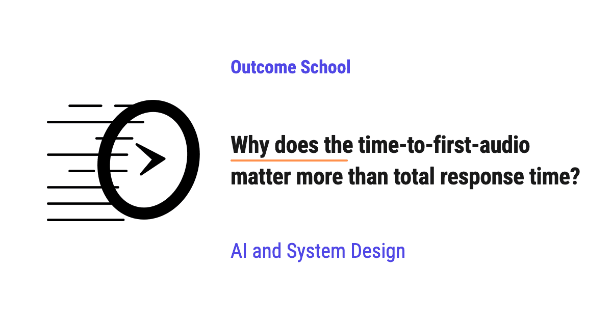

# Why does the time-to-first-audio matter more than total response time?

> **Module 16 · Lesson 16.14**  
> Source: [Outcome School](https://outcomeschool.com/blog/time-to-first-audio) · Published: October 22, 2026 · Reading time: ~13 min · Tags: `ai-agent`, `llm`, `ai`, `system-design`

---



Time-to-first-audio matters more than total response time because a person on a voice call feels only the silence before the agent starts speaking. Once the agent starts speaking, the person is busy listening, and the rest of the reply can keep being prepared in the background.

In this blog, we will learn about why the time-to-first-audio matters more than total response time. We will also see what each of these two times measures, how people experience silence in a conversation, how streaming lets an agent start speaking before the full reply is ready, which steps decide the time-to-first-audio, and when the total response time still matters.

We will cover the following:

- What is time-to-first-audio?
- What is total response time?
- How do people experience waiting on a voice call?
- Why does the time-to-first-audio matter more?
- An example with two voice agents
- How does streaming bring the first audio early?
- What decides the time-to-first-audio?
- The rest of the reply must keep up
- When does the total response time still matter?

Let's get started.

## What is time-to-first-audio?

Before jumping into the two times, we must know what a voice AI agent does.

A **[voice AI agent](https://outcomeschool.com/blog/design-a-real-time-voice-ai-agent)** is a system that listens to our voice, understands what we said, thinks of an answer, and speaks the answer back to us. A common way to build it is a [chain of three steps](https://outcomeschool.com/blog/cascaded-vs-speech-to-speech):

- **Speech-to-Text (STT):** It turns our voice into text.
- **LLM (Large Language Model):** It reads that text and writes a reply in text.
- **Text-to-Speech (TTS):** It turns the reply text back into a voice.

Now, let's define the first time.

**Time-to-first-audio is the time between the moment the user stops speaking and the moment the user hears the very first sound of the agent's reply.**

It is also called **[voice-to-voice latency](https://outcomeschool.com/blog/voice-to-voice-latency)**. Latency means waiting time. We measure it in milliseconds, which we write as `ms`. One second is 1000 ms.

Let's say we ask the agent, "What time does the store close today?" We stop speaking at 0 ms. The agent says "The store closes at 9 PM." The first sound of the word "The" reaches our ear at 700 ms. So, the time-to-first-audio is 700 ms.

## What is total response time?

**Total response time is the time between the moment the user stops speaking and the moment the agent finishes preparing the complete reply.**

For a voice agent, this means the LLM has written the full reply text, and the TTS has produced the full reply audio.

In the same example, let's say the agent finishes producing the audio for the whole sentence at 1500 ms. So, the total response time is 1500 ms.

Here, we can notice that the total response time is always equal to or larger than the time-to-first-audio, because the first sound is a part of the full reply.

Now, the question is: which of these two numbers does the user feel? To answer this, we need to understand how people experience waiting in a conversation.

## How do people experience waiting on a voice call?

When two people talk, they [take turns](https://outcomeschool.com/blog/what-is-turn-taking-in-a-voice-ai-agent). A **turn** is one person's chance to speak. A well-known study of conversations in ten languages found that the gap between one person finishing and the other person starting is usually only a fraction of a second, often around 200 ms.

So, our brain expects a reply almost instantly.

On a voice call, there is nothing to look at. There is no loading spinner and no "typing..." dots. There is only sound or silence.

- When there is silence, the user does not know what is happening. Did the agent hear me? Has the call dropped? Should I repeat myself?
- When there is sound, the user knows the agent is replying, and the user starts listening.

Hence, the user feels every moment of this silence. If the silence goes on for 2 or 3 seconds, the user often says "Hello?" or starts speaking again, and now the agent and the user [talk over each other](https://outcomeschool.com/blog/what-is-barge-in-in-a-voice-ai-agent).

But once the agent starts speaking, the waiting is over for the user. The user is now busy listening to the words.

## Why does the time-to-first-audio matter more?

Now, let's connect this silence to the two times.

The user feels only one waiting period: the silence before the first sound. That silence is the time-to-first-audio.

The rest of the total response time happens while the user is already listening. The user does not experience it as waiting.

The best way to learn this is by taking an example.

Suppose a friend asks us for directions. We say, "Okay, so first you go straight..." and while we are saying this, we are still thinking about the next road to take. Our friend does not feel that we are slow, because we started speaking quickly. Our friend has no idea that the second half of the directions was not ready yet when we started.

A voice agent works in the same way. It can start speaking the first part of the reply while the later parts are still being written and turned into audio.

There is one more reason. Speaking is slow compared to how fast a computer produces text and audio. In a normal conversation, a person speaks roughly 150 words per minute, which is about 2 to 3 words per second. An LLM often writes tens of tokens per second, and a [token](https://outcomeschool.com/blog/tokenization-in-llms) is a word or a piece of a word. A good TTS model produces one second of audio in much less than one second.

Means, once the agent starts speaking, the system usually stays ahead of the playback. The audio for the next words is ready before the current words finish playing. So, the user never notices the rest of the work.

This is why the time-to-first-audio is the number that decides whether the agent feels fast or slow.

## An example with two voice agents

Let's say we have two voice agents, Agent A and Agent B. Both give the same answer, which takes 5 seconds to speak.

**Agent A** waits for everything to finish. It waits for the full transcript, then the full LLM reply, then the full TTS audio. Only then does it start playing.

**Agent B** passes each small piece forward as soon as it is ready. It starts playing the first short part of the audio, called a chunk, while the rest is still being prepared.

For the sake of understanding, let's use simple numbers. We will also assume that the audio takes 50 ms to travel over the network to the user.

| What happens | Agent A (waits for all) | Agent B (streams pieces) |
| --- | --- | --- |
| Final transcript ready | 300 ms | 300 ms |
| LLM writes reply | 300 ms to 1500 ms | first sentence at 600 ms |
| TTS produces audio | 1500 ms to 2300 ms | first chunk at 700 ms |
| User hears first sound | 2350 ms | 750 ms |
| Full reply audio is ready | 2300 ms | about 2000 ms |
| User hears the last word | 7350 ms | about 5750 ms |

Here, we can see that the total response time of both agents is close, around 2 seconds. But the user of Agent A sits in silence for 2.35 seconds. The user of Agent B hears the first sound in 0.75 seconds.

The user of Agent A often thinks that the call has dropped.

Here, we can also notice that in Agent B, the full reply audio is ready at about 2000 ms, but the user is still listening to it until about 5750 ms. The total response time is hidden inside the listening time.

## How does streaming bring the first audio early?

The technique that Agent B uses is called [streaming](https://outcomeschool.com/blog/how-does-token-streaming-work).

**Streaming means each step sends its output to the next step in small pieces as soon as each piece is ready, instead of waiting for the whole output.**

Let's see how each step streams:

- **STT:** It transcribes our speech while we are still speaking. So, when we stop, most of the text is already available.
- **LLM:** It writes the reply one token at a time. The agent does not wait for the full reply. It [collects tokens until it has the first sentence or a short phrase](https://outcomeschool.com/blog/sentence-chunking-for-tts).
- **TTS:** It starts turning that first sentence into audio right away. It sends the audio out in small chunks, and the first chunk starts playing while the next chunks are being made.

We can draw the path of the first piece as a diagram like below:

```
User stops speaking
        ↓
Agent decides the user has finished
        ↓
STT gives the final transcript
        ↓
LLM writes the first sentence
        ↓
TTS makes the first audio chunk
        ↓
User hears the first sound
```

While the user hears the first sound, the LLM keeps writing the second sentence, and the TTS keeps making audio for it. All the steps work at the same time on different parts of the reply.

This is how streaming makes the time-to-first-audio depend only on the first small piece, not on the whole reply.

## What decides the time-to-first-audio?

Now, let's understand [which steps add up to the time-to-first-audio](https://outcomeschool.com/blog/voice-agent-latency-budget). Only the steps on the path of the first piece count:

- **Endpointing:** The agent must decide that the user has finished speaking. If it waits too long after the user stops, that wait adds directly to the silence. If it decides too early, it cuts the user off.
- **Final transcript:** The STT must finish the last few words.
- **LLM [time to first token (TTFT)](https://outcomeschool.com/blog/prefill-vs-decode-llm-inference-optimization):** The LLM must read the conversation and produce its first token. A longer prompt or a bigger model often makes it slower.
- **First sentence:** The LLM must write enough tokens for the TTS to start, usually the first sentence or phrase.
- **TTS time to first audio chunk:** The TTS must produce its first chunk of audio.
- **Network:** The audio must travel from the server to the user's phone or browser.

Here, we can see that the length of the full reply does not appear in this list. A reply of 10 words and a reply of 100 words have nearly the same time-to-first-audio, if everything streams.

To make an agent feel faster, we must shorten the steps on this path. Making the full reply faster helps very less if the first piece is still slow.

A few common ways to do this:

- Run the servers close to the user and keep the model loaded, so that the network time and the startup time stay small.
- Keep the prompt short, so that the LLM's first token comes quickly.
- Send the first short phrase to the TTS instead of waiting for a long first sentence.
- Use a [TTS model that starts producing audio from a small amount of text](https://outcomeschool.com/blog/streaming-tts).
- Tune the endpointing so that the agent does not wait longer than needed after the user stops.

## The rest of the reply must keep up

Now, let's discuss the condition behind all of this.

The time-to-first-audio matters more only if the rest of the reply keeps up with the playback. If the audio runs out in the middle of the reply, the user hears a gap. A gap in the middle of a sentence often sounds like the call broke, and the user starts to doubt the agent again.

So, two things must stay true after the first sound:

- The LLM must write tokens faster than the agent speaks them. As we saw, this is usually easy, because speaking is slow.
- The TTS must produce audio faster than real time. Means, it must produce one second of audio in less than one second. This is often measured as the **real-time factor**, which is the time taken to produce the audio divided by the length of the audio. A real-time factor below 1 is needed.

If both are true, the audio waiting to be played never runs out, and the user hears one smooth reply.

## When does the total response time still matter?

The total response time does not disappear. It still matters in a few cases:

- **When the agent must act before it can answer.** Let's say the user asks for their account balance. The LLM [recommends a tool](https://outcomeschool.com/blog/how-does-function-calling-work-in-llms) to fetch the balance, our code runs that tool, and the real answer cannot start until the tool returns. Here, the agent often speaks a short line like "Let me check that for you." This brings the first audio early, but the user still waits for the actual answer.
- **When the reply is very long.** The user must listen until the last word to get the full answer. So, for voice, we must keep the replies short and put the main answer in the first sentence.
- **When the user interrupts.** If the user cuts in, the agent must stop speaking and throw away the rest of the reply. The work done for the unspoken part is wasted, but the servers still spent time and money on it.
- **When we count cost and capacity.** The servers do the full work for every reply. The total work still decides how many calls one machine can handle and how much each call costs.

Now we must have understood why the time-to-first-audio matters more than total response time, how streaming brings the first sound early, which steps decide it, and when the total response time still matters.

## Frequently Asked Questions

### Is time-to-first-audio the same as voice-to-voice latency?

Yes. Time-to-first-audio is also called voice-to-voice latency. It is the time between the moment the user stops speaking and the moment the user hears the very first sound of the agent's reply. We measure it in milliseconds.

### Does a longer reply increase the time-to-first-audio?

No. If every step streams, a reply of 10 words and a reply of 100 words have nearly the same time-to-first-audio. Only the steps on the path of the first small piece count, and the length of the full reply is not one of them.

### What is the real-time factor of a TTS model?

The real-time factor is the time taken to produce the audio divided by the length of the audio. A TTS model needs a real-time factor below 1, which means it produces one second of audio in less than one second. Otherwise, the audio runs out in the middle of the reply and the user hears a gap.

### Why does a voice agent say "Let me check that for you"?

A voice agent says a short line like this when it must run a tool before it can answer, for example to fetch an account balance. The short line brings the first audio early, so the user does not sit in silence. But the user still waits for the actual answer until the tool returns.

### Why should a voice agent put the main answer in the first sentence?

Because the user must listen until the last word to get the full answer. When the reply is very long, the total response time starts to matter again. So, for voice, we keep the replies short and put the main answer in the first sentence.
