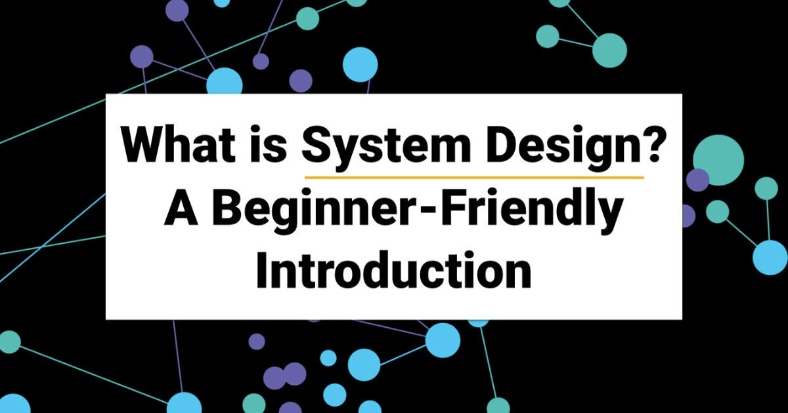

# What is System Design?

> **Module 16 · Lesson 16.15**  
> Source: [Outcome School](https://outcomeschool.com/blog/system-design) · Published: March 19, 2020 · Reading time: ~5 min · Tags: `system-design`, `backend`

---

System Design is the process of defining the components, API, database tables, and etc. for a system to satisfy the specified functional and non-functional requirements.

Today, we are going to learn "What is System Design?". The goal is to make you understand what is System Design which means that there are few simplifications done while writing this. If you understand what System Design is, then my mission will be accomplished. If you read this article completely, I am sure my mission will be accomplished.

If you are looking for Android System Design: Refer to [Android System Design Interviews](https://outcomeschool.com/blog/android-system-design-interviews)

The timeline for this blog:

- What is System Design?
- Why do we need it?
- What are the required concepts?

Let's get started.

## What is System Design?

System Design is the process of defining the components, API, database tables, etc for a system to satisfy the specified functional and non-functional requirements.

It might be difficult to understand the above definition. Let's break it down and understand.

**System Design = System + Design**

**System:** Assembly of different components for the specified requirements.

**Design:** How efficiently the assembly of different components is done.

For example, if we have to build large applications like Facebook, Uber, Instagram, WhatsApp, YouTube, etc. First, we note down all the requirements.

While noting down the requirements generally, we categories the requirements as **functional and non-functional requirements**.

Let's understand this by taking a few examples. Also, I must mention that this article is not about designing a particular application, we are just learning what is System Design by taking some examples.

Now, we will take examples to understand the functional requirements:

If we take the example of Instagram, the functional requirements can be like these:

- Upload Image
- Like
- Share
- Comment
- And etc.

Similarly, we take the example of YouTube, the functional requirements can be like these:

- Upload Video
- View
- Like
- Comment
- Search
- Subscribe to a channel
- And etc.

These were examples of functional requirements.

Now, let’s take a look at the non-functional requirements.

If we take the example of Instagram, the non-functional requirements can be like these:

- Any image uploaded by a user should not be lost.
- There should be no downtime.
- The system should be easily scalable.

Similarly, we can do it for other applications. This was an example of non-functional requirements.

Here we should also understand that based on the requirement we decide what is important, what is not, and where we can do tradeoffs and where not. It's all about balancing things.

For example, in the case of Instagram:

- Fast Image Rendering on a user device is **important** because Instagram is all about Image.
- The number of comments on a post might **not be important**. We can have the trade-off here, having no real-time sync across multiple same types of servers. So, on multiple servers, we can have a different number of comments for a particular post. At the user end, the number of comments might differ. Although it will get synced gradually.

Now, let’s move to our next thing that is “Why do we need it?”

## Why do we need it?

We need it because we want our whole system designed in such a way so that, we can:

- Scale our system easily, we should be able to add a new machine or increase the size of the current machine when required. This comes when our number of users starts growing.
- The system should have no downtime. Any request to the server should not fail.
- Our system should have low latency. API should be fast.
- Our system should have multiple copies of the server. In the case of hardware failure, it should be easily able to up with almost no downtime.
- The system should be able to sync across multiple same types of servers for data consistency.
- The load should be evenly distributed across all the servers.
- Our components in the system should be reusable.
- All components in our system should work together as a system.
- And each component should work at its best efficiency.

So, these were the things which we want to achieve, so we design the system and try to assemble all the components efficiently. It is really very interesting.

## What are the required concepts?

Basically, we engineer our system in such a way that all our requirements are fulfilled. We use the concepts of Computer Science such as

- Computer Network
- Distributed Systems
- Parallel Computing

By using the concepts, we do the following:

- Do the estimation
- Design the database
- Design the API
- Decide the Storage System
- Implement Caching
- Integrate the load-balancing
- And many more things.

These things are very interesting. We will learn all of these in the coming articles.

So, In the next article in this series, I will be coming up with the complete system design of **Instagram, Uber, WhatsApp, YouTube, Facebook**, and etc so that we can learn all the concepts easily and implement them. For a focused deep-dive on real-time media, see [How do Voice And Video Call Work?](https://outcomeschool.com/blog/voice-and-video-call)

This was all about System Design.

I think we have received a good amount of knowledge today. Thank you so much for your time.

Watch the video format: [What is System Design?](https://www.youtube.com/watch?v=i4YWRY3hsdA)

## Frequently Asked Questions

### What is the difference between functional and non-functional requirements?

Both are categories we use while noting down the requirements of a system. For Instagram, functional requirements can be upload image, like, share, and comment. Non-functional requirements can be that no uploaded image should be lost, there should be no downtime, and the system should be easily scalable.

### How do we decide what is important in System Design?

We decide based on the requirements. It's all about balancing things, which means choosing what is important, what is not, and where we can do trade-offs. For Instagram, fast image rendering on a user device is important because Instagram is all about images.

### Is it okay for different servers to show different data?

Yes, sometimes it is an acceptable trade-off. In the case of Instagram, the number of comments on a post might not be important. So without real-time sync across servers, users might see a different number of comments for a post, although it will get synced gradually.
