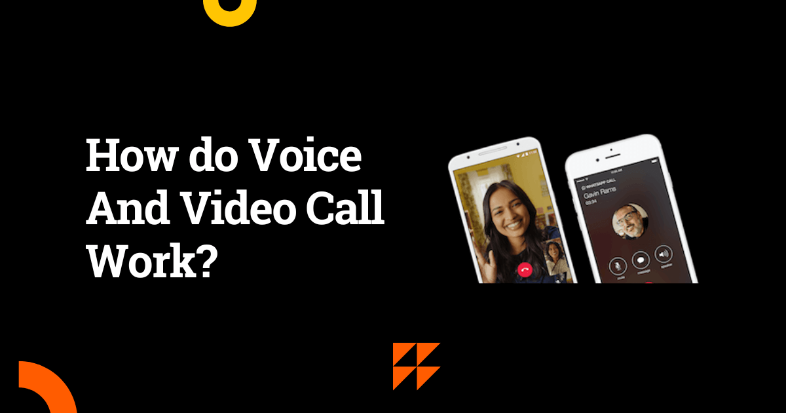
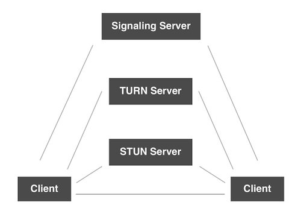

# How do Voice And Video Call Work?

> **Module 16 · Lesson 16.17**  
> Source: [Outcome School](https://outcomeschool.com/blog/voice-and-video-call) · Published: November 10, 2017 · Reading time: ~5 min · Tags: `system-design`

---

Voice and video calls work by streaming media between two clients using WebRTC. First, the clients exchange details through signaling, then they connect peer-to-peer using a STUN server, and if that fails, a TURN server passes the data between them.

This blog is all about how voice and video call works on a high level.

Let's get started.

Voice over Internet Protocol (VoIP) is one of the most popular standards for voice and video calling over the web.

We all use voice and video on various platforms like WhatsApp, Skype, Messenger, Facebook, etc.

Both voice and video calls depend on how we stream media between the two clients which are connected to each other. So, there must be something that can do the work of media streaming from one client to another client.

For media streaming, we need to know about WebRTC.

WebRTC is a free, open project that provides browsers and mobile applications with Real-Time Communications (RTC) capabilities via simple APIs. The WebRTC components have been optimized to best serve this purpose.

But there are many other things that we need to do as WebRTC is not enough for complete implementation.

Other things are:

- Signaling
- STUN Server
- TURN Server

## Signaling

What is Signaling?

In order to set up a call between two clients, both clients must conform to each other by sending key data, messages, and metadata about the media. Over signaling, we do these things.

We can use [WebSocket](https://outcomeschool.com/blog/http-request-long-polling-websocket-sse) for the purpose of signaling.

Signaling is just used to know that these two clients want to connect to each other for the call.

## Peer-to-Peer Connection

After signaling, we need to connect both the client peer to peer. And for connecting, we must have the public IP address of both clients.

So, in order to get the public IP address, we use the STUN Server.

## STUN Server

STUN Server is used to get the public IP address.

Why do we need a public IP address?

A **Public** IP Address is an IP address that is globally unique across the Internet. Only one device may be in possession of a public IP address.

A **Private** IP Address is an IP address that is not globally unique and may exist simultaneously on many different devices. A private IP address is never directly connected to the Internet.

The NAT(Network Address Translation) provides the local IP address of the device which can't be used publicly to connect peer to peer. And for WebRTC, we need to have a public IP address. STUN Server provides that.

If everything is fine, we get the public IP addresses of both clients, and then, we connect both clients through WebRTC to start the call. WebRTC handles all the media streaming.

> The real-world connectivity is not ideal.

In case, we are not able to get the public IP address of both clients. Then we can't connect peer to peer. In that case, we need the TURN Server.

## TURN Server

TURN Server is used to connect both clients if peer-to-peer fails by acting as a mediator. Basically, it takes the data from one client and sends it to another client. So, its job is to relay the media.

This way, the two clients start talking to each other.

The other small data which are not related to media like a client cuts the call, any setting changes, messages and etc are sent over the signaling process.

The following question arises.

**Why WebRTC can't do signaling?**

Answer: To avoid redundancy and to maximize compatibility with established technologies, the signaling methods and protocols are not specified by the WebRTC Standards.

WebRTC is optimized for media.

So, this way the voice and video call works.

We have a detailed blog on [Design a Real-Time Voice AI Agent](https://outcomeschool.com/blog/design-a-real-time-voice-ai-agent) that explains how the same WebRTC audio stream is used to talk to an AI instead of a person.

## Frequently Asked Questions

### Is WebRTC enough to build a voice or video call?

No. WebRTC handles the media streaming between the two clients, but it is not enough for a complete implementation. We also need signaling to set up the call, a STUN server to get the public IP addresses, and a TURN server for cases where the peer-to-peer connection fails.

### What is the difference between a STUN server and a TURN server?

A STUN server gives us the public IP address of a client so that the two clients can connect peer to peer. A TURN server is used when that peer-to-peer connection fails. It acts as a mediator that takes the media from one client and relays it to the other client.

### Do we always need a TURN server for a call?

No. If we get the public IP addresses of both clients, we connect them directly through WebRTC and do not need a TURN server. Since real-world connectivity is not ideal, we need the TURN server only when we cannot get the public IP addresses and the peer-to-peer connection is not possible.

### How are non-media events like ending a call sent?

They are sent over the signaling process. WebRTC is optimized for media, so it handles the voice and video streaming. Other small data that is not related to media, such as a client cutting the call, setting changes, or messages, goes through signaling, which we can build using WebSocket.
