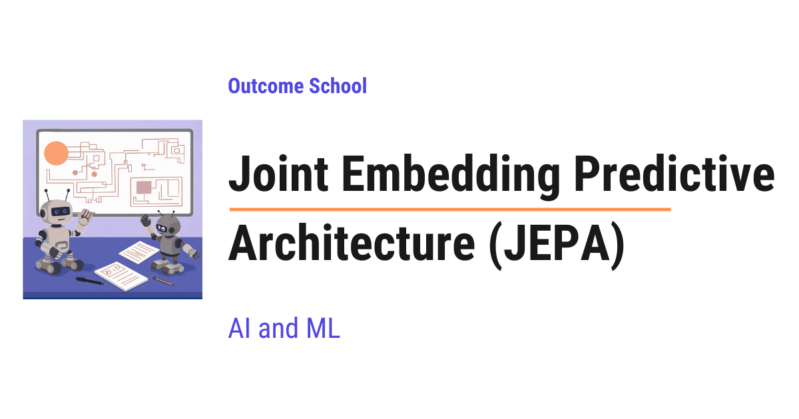

# What is Joint Embedding Predictive Architecture (JEPA) and How Does It Work?

> **Module 17 · Lesson 17.1**  
> Source: [Outcome School](https://outcomeschool.com/blog/joint-embedding-predictive-architecture-jepa) · Published: June 7, 2026 · Reading time: ~26 min · Tags: `ai`, `machine-learning`

---



Joint Embedding Predictive Architecture (JEPA) is an idea from Yann LeCun where a model learns by predicting the hidden part of the data from the visible part. It makes this prediction in the embedding space, which means on short summaries, not on raw pixels.

In this blog, we will learn about Joint Embedding Predictive Architecture (JEPA).

This is one of the most exciting ideas in modern AI, and it comes from Yann LeCun, one of the most respected researchers in the field. Do not worry, we will learn about each part of it slowly, in very simple words. By the end, a complete beginner will understand every single word.

We will cover the following:

- How humans and animals learn by observing the world
- Yann LeCun's vision of autonomous machine intelligence
- A simple everyday analogy to build the intuition
- What does JEPA mean?
- What is an embedding or representation space?
- The problem with predicting raw pixels
- The problem with contrastive methods
- The core idea of JEPA
- The building blocks of JEPA
- The energy-based view in simple words
- How I-JEPA works (for images)
- V-JEPA and the world-model vision
- When and why JEPA matters

Let's get started.

## How humans and animals learn by observing the world

Before jumping into JEPA, we must know how we, as humans, learn in the first place.

Let's say a small baby is sitting at a table. The baby slowly pushes a glass towards the edge. At first, the glass stays on the table. But when the baby pushes it a little more, the glass falls down.

The baby just learned something deep. The baby learned that objects fall when they go off an edge.

Nobody taught this with words. Nobody handed the baby a textbook. The baby simply observed the world and figured out how the world works.

This is how humans and animals learn most things. We watch. We observe. And we build an understanding of the world inside our head.

A cat knows that if it jumps, it will land somewhere. A child knows that if a ball rolls behind a sofa, the ball still exists. We all carry a kind of inner sense of how the world behaves.

This inner sense lets us imagine what will happen next, before it even happens. And this simple human ability is the seed from which the whole idea of JEPA grows.

Now, the question is: can a machine also learn like this? Can a machine learn how the world works just by observing, the way a baby does?

This is exactly the dream that researchers are chasing.

## Yann LeCun's vision of autonomous machine intelligence

**Yann LeCun** is one of the most respected researchers in Artificial Intelligence. He served as Chief AI Scientist at Meta, where this JEPA research was done, and he is now building [world models](https://outcomeschool.com/blog/how-do-world-models-work) at his own venture, Advanced Machine Intelligence (AMI) Labs.

In June 2022, he wrote a paper called "A Path Towards Autonomous Machine Intelligence."

In this paper, he shared a big vision. He wants to build machines that learn a model of the world by observation, just like a baby does. Such a machine could then imagine the result of its actions and plan towards a goal.

He calls this **autonomous machine intelligence**, which means a machine that learns on its own from observation and acts with common sense.

For this dream, he needed a core building block, a way for a machine to learn by predicting. And the building block he proposed is JEPA.

So, here comes JEPA into the picture. Let's slowly understand it, starting with a simple everyday picture in our head.

## A simple everyday analogy

Let's say we are looking at a photo of a street.

We can see the left half of the photo clearly. There is a dog, some grass, and a tree. The right half of the photo is covered with a sheet of paper. We cannot see it.

Let's picture it as below:

```
  ┌─────────────────────┬─────────────────────┐
  │  dog, grass, tree   │  covered by paper   │
  │  (we can SEE this)  │  (HIDDEN from us)   │
  └─────────────────────┴─────────────────────┘
     visible left half       hidden right half
```

Here, we can see the photo split into two halves. The left half is visible, so we can see the dog, the grass, and the tree. The right half is hidden behind a sheet of paper. We can still guess the gist of what is hidden, but not the exact pixels.

Now, the question is: can we guess what is behind that paper?

Yes, we can. Our brain says, "There is probably more grass, maybe more of the tree, and the dog's tail."

But here is the important part. We do not guess the exact pixels. We do not know the exact shade of every blade of grass. We do not know the exact position of every leaf. We do not know the tiny shadows or the exact lighting.

We only guess the gist. The idea of what is hidden. "More grass, a tail, a bit of tree."

This is exactly how JEPA thinks.

JEPA looks at one part of the data, and it predicts the gist of the hidden part, not every exact pixel. This single idea is the heart of everything we will learn today.

Now, let's understand the name.

## What does JEPA mean?

JEPA stands for **Joint Embedding Predictive Architecture**.

The name sounds heavy, so let's break it into small pieces.

> JEPA = Joint + Embedding + Predictive + Architecture

Let's understand each word in plain language.

**Joint** means two things working together. Here, we have two inputs. One is the part we can see (the context). The other is the part we want to guess (the target). Both are handled together, side by side.

**Embedding** means a short, meaningful summary of something. We will explain this properly in the next section, because it is the most important word here.

**Predictive** means guessing. The model predicts the summary of the hidden part from the summary of the visible part.

**Architecture** simply means the design, or the structure of how the pieces are connected. It is the blueprint of the system.

So, in simple words, JEPA is a design where the model takes a summary of the visible part and predicts the summary of the hidden part.

Now, the word "summary" is doing a lot of work here. So, before going further, we must know what an embedding really is.

## What is an embedding or representation space?

This is the most important idea in the whole blog. So, let's go slow.

**An embedding is a short list of numbers that captures the meaning of something.**

In simple words, [an embedding](https://outcomeschool.com/blog/what-are-embeddings) is a compact summary.

Let's say we have a photo of a dog. The raw photo is millions of tiny colored dots called **pixels**. A pixel is just one tiny dot of color in an image. A normal photo has millions of them.

These millions of pixels are very detailed and very messy. Most of that detail does not matter. The exact noise in the background, the exact lighting, the exact texture of the fur, these tiny things do not really tell us "this is a dog."

Now, instead of millions of pixels, suppose we describe the photo with a short list of numbers that captures the meaning: "this is a dog, it is brown, it is on grass, it is facing left."

That short, meaningful list of numbers is called an **embedding**.

The space where all these summaries live is called the **representation space** or **embedding space**. Means, it is the world of summaries, instead of the world of raw pixels.

Here is the key benefit. In the embedding space, similar things sit close together. The [embedding of a dog photo](https://outcomeschool.com/blog/how-do-image-embeddings-work) and the embedding of another dog photo will be close to each other. The embedding of a dog and the embedding of a car will be far apart.

So, an embedding throws away the messy, unimportant details and keeps the meaning.

Here, the raw pixels are the messy full detail, and an embedding is the clean meaningful summary.

Now that we understand embeddings, let's see the problem that JEPA is trying to solve.

## The problem with predicting raw pixels

For a long time, many AI models learned by predicting the raw input.

Let's understand this with an example. We cover half of an image, and we ask the model to redraw the missing half, pixel by pixel. The model that does this is called a [**generative model**](https://outcomeschool.com/blog/what-is-generative-ai), because it generates, or creates, the actual content.

We have a detailed blog on [diffusion models](https://outcomeschool.com/blog/diffusion-models), a popular family of generative models, that explains how they create images in depth.

This sounds nice, but here is the catch.

To redraw the missing half perfectly, the model must guess every tiny detail. The exact texture of the grass. The exact noise in the sky. The exact lighting on every leaf.

But these tiny details are unpredictable. There is no way to know the exact random noise. So the model wastes a huge amount of effort trying to guess details that nobody can guess.

For the sake of understanding, predicting raw pixels is like being asked to redraw a photograph from memory, perfectly, including every random speck of dust. That is a hopeless task.

So, this approach spends most of its energy on the wrong thing. It focuses on the unpredictable detail instead of the predictable meaning.

The issue with this approach is wasted effort on details that do not matter. Let's see how the next approach tries to solve this issue.

## The problem with contrastive methods

So, researchers thought of another approach, called [**contrastive learning**](https://outcomeschool.com/blog/contrastive-learning).

In simple words, contrastive learning shows the model two versions of the same image and teaches it, "these two are the same thing, pull them close." Then it shows two different images and teaches it, "these two are different, push them apart."

The "different" examples are called **negative examples**. They are the things the model must push away.

This works, but here is the catch.

To work well, this method usually needs a lot of these negative examples. We have to keep collecting and comparing many "this is not a match" pairs. That is extra work, and it can be hard to manage.

It also often needs **data augmentation**, which means we manually create new versions of an image by cropping it, flipping it, or changing its colors. Designing these tricks by hand is fiddly, and they may not fit every kind of data.

So, contrastive learning learns by comparing, but it carries the burden of many negative examples and hand-made tricks.

The issue with this approach is the extra burden of negative examples and hand-made tricks. We needed a solution for that, and JEPA was introduced to solve this problem.

## The core idea of JEPA

Let's put the two problems side by side. Generative models predict raw pixels, which wastes effort on unpredictable detail. Contrastive models compare images, which needs many negative examples and hand-made tricks.

JEPA takes a smarter path.

**JEPA predicts in the embedding space, not in the pixel space.**

In simple words, JEPA does not redraw the hidden part. It only predicts the summary of the hidden part.

Let's go back to our street photo. The left half is visible. The right half is hidden.

A generative model would try to redraw the right half, pixel by pixel. That is hard and wasteful.

JEPA does something different. It looks at the visible left half, makes a summary of it, and then predicts the summary of the hidden right half. It never redraws the pixels. It only guesses the meaning.

Let's picture this difference as below:

```
  Generative model:
  visible part ─► model ─► redraw every hidden PIXEL   (hard, wasteful)
  JEPA:
  visible part ─► model ─► predict the SUMMARY only    (clean, efficient)
```

Here, we can see the key difference in one picture. A generative model must redraw every hidden pixel, which is hard and wasteful. JEPA only predicts the summary of the hidden part, which is clean and efficient. Same input, but a much simpler goal.

This is powerful for one big reason. When we predict only the summary, we are allowed to ignore the messy, unpredictable details. We do not have to guess the exact random noise. We only have to guess the meaning, which is the part that can actually be guessed.

This is why JEPA is called **non-generative**. It does not generate, or create, the hidden content. It only predicts the abstract summary of it.

So, JEPA keeps the good part of both older methods and drops their pain.

From the generative method, JEPA keeps the good part. It learns the relationship between the visible part and the hidden part, by predicting the hidden part from the visible part. But it drops the pain of that method, which was redrawing every raw pixel and wasting effort on unpredictable detail.

From the contrastive method, JEPA keeps the good part. It works in the clean world of summaries, instead of the messy world of raw pixels. But it drops the pain of that method, which was the need for many negative examples and hand-made tricks like cropping and flipping.

So, in simple words, JEPA predicts the hidden part from the visible part, just like a generative model, but it does this prediction in the clean world of summaries, just like contrastive learning, without carrying the burden of either one.

Now, let's understand the building blocks that make this happen.

## The building blocks of JEPA

JEPA has a few simple parts. Let's meet each one.

We will call the visible part **x** (the context), and the hidden part **y** (the target).

**The x-encoder.** An **encoder** is a machine that takes a raw input and turns it into an embedding, which is the summary we learned about earlier. The x-encoder takes the visible context x and produces its summary. We call this summary `s_x`.

**The y-encoder.** Similarly, the y-encoder takes the hidden target y and produces its summary. We call this summary `s_y`.

**The predictor.** This is the guessing machine. It takes the summary of the visible part, `s_x`, and predicts the summary of the hidden part. We call this prediction `s_y-hat`. The little "hat" just means "our guess of it."

But here, a small question arises. There can be many hidden parts, sitting in different places. So how does the predictor know which hidden part to guess right now? This is why we also give the predictor the **position** of the hidden part.

The position simply means the location of the hidden part, like the top-right corner or the bottom-left block. It tells the predictor, "guess the summary for this exact spot." We feed the same visible summary `s_x`, but we change the position to ask about each hidden part one by one.

A simple way to picture it. Imagine we cover a few windows of a house and ask a friend to guess what is behind each one. The friend's view of the rest of the house stays the same, but we must point and say "guess this window" or "guess that window." That pointing is the position.

So the flow is simple. The x-encoder summarizes what we see. The predictor, told which position to look at, guesses the summary of what is hidden there. Then we compare our guess `s_y-hat` with the real summary `s_y` from the y-encoder. If they are close, we did well.

Now, there is one more clever piece.

**The latent variable z.** Sometimes, the hidden part has information that the visible part simply cannot tell us. For example, from the left half of a photo, we cannot know whether it is raining in the right half. That information is just not there in the context.

So how can the predictor guess something it has no clue about? The answer is the latent variable z.

The latent variable z is like a small extra note that carries the missing clue. It tells the predictor, "by the way, in the hidden part, it is raining." With this small note, the predictor can handle situations where the hidden part is not fully decided by the visible part.

In simple words, z handles uncertainty. It lets the model say, "the hidden part could be this, or it could be that," instead of being forced into one fixed answer.

Now, we have understood the parts: the x-encoder, the y-encoder, the predictor, the position of the hidden part, and the latent variable z.

Let's put all of these parts together into one simple picture as below:

```
  Visible x ─► x-encoder ─► s_x
                             │
                             ▼
       z + position ─► Predictor ─► s_y-hat
                                       │
                                       ▼
                                   compare ─► gap
                                       ▲
                                       │
  Hidden y  ─► y-encoder ─► s_y ───────┘
```

Here, we can see the two tracks of JEPA in one picture. On the top track, the visible part `x` goes into the x-encoder and becomes its summary `s_x`. This summary, together with the latent variable `z` and the position of the hidden part, goes into the predictor, which produces the guessed summary `s_y-hat`. On the bottom track, the hidden part `y` goes into the y-encoder and becomes the real summary `s_y`. Finally, we compare our guess `s_y-hat` with the real summary `s_y`. The gap between them is the error, and the whole job of training is to make this gap small. In the next section, we will see that this gap even has a name.

**Note:** This two-track picture is the simple, conceptual view of JEPA. It shows the hidden part `y` going into the y-encoder, just to keep the core idea clear. In a real model like I-JEPA, which we will see soon, the y-encoder actually looks at the whole image first and then picks out the summary of the hidden part from its output. The end result is the same, a summary `s_y` of the hidden part, so the picture stays true to the idea.

Let's now look at one more way researchers describe JEPA, because it is simple and useful.

## The energy-based view in simple words

JEPA is also described as an **energy-based model**.

Think of energy as a **wrongness score**.

A low score means "these two fit well together." A high score means "these two do not fit together."

In JEPA, the energy is simply the gap between our guessed summary `s_y-hat` and the real summary `s_y`. Both of these summaries come from parts of the same input, for example two regions of one image, not from matching an image to some text.

A small gap means our guess was good, which means low energy. A big gap means our guess was bad, which means high energy.

**Note:** Please remember, low energy means a good, matching pair. High energy means a bad, mismatched pair.

Just for the sake of a general intuition about energy-based models, low energy is given to things that belong together, and high energy is given to things that do not. In JEPA specifically, "belong together" means the predicted summary `s_y-hat` is close to the real summary `s_y`. Training the model means making this gap small for real, matching pairs.

So, in plain words, training JEPA means teaching it to give a low wrongness score to pairs that truly belong together.

This is how JEPA learns. Now, let's see a real model that actually puts all of this into practice.

## How I-JEPA works (for images)

The first real version of JEPA for images is called **I-JEPA**, where the "I" stands for Image. It was released by Meta AI in 2023.

Before that, we must know one simple idea behind all of this, called **self-supervised learning**. In simple words, self-supervised learning means the model teaches itself by hiding a part of the data and then trying to predict that hidden part. Nobody has to sit and label the data by hand. The data itself becomes the teacher. This is exactly what lets these models learn from huge amounts of raw images and videos.

Now, let's understand I-JEPA step by step, using everything we have learned.

First, I-JEPA takes one image. It cuts the image into small square pieces called **patches**, and treats them like a sequence. The model that processes these patches is called a [**Vision Transformer**](https://outcomeschool.com/blog/decoding-vision-transformer-vit), often shortened to ViT. We do not need the deep details. We can simply think of it as the engine that reads the image patches.

Then, I-JEPA picks the parts to work with. It chooses one larger visible block, called the **context block**. This is our x, the part we can see. It also chooses a few hidden blocks, called **target blocks**. These are our y, the parts we must predict. To make the task fair and not too easy, any patch that appears in a target block is removed from the context block.

Let's picture this as below:

```
  One image, cut into small patches:
  ┌───┬───┬───┬───┬───┐
  │   │ T │ T │   │   │
  ├───┼───┼───┼───┼───┤
  │   │ C │ C │ C │   │
  ├───┼───┼───┼───┼───┤
  │   │ C │ C │ C │   │
  ├───┼───┼───┼───┼───┤
  │ T │   │   │   │ T │
  └───┴───┴───┴───┴───┘
  C = visible context     T = hidden targets to predict
```

Here, we can see one image cut into small patches. The patches marked `C` form the context block, which is the visible part we feed to the context encoder. The patches marked `T` are the target blocks, which are the hidden parts the model must predict. Notice that the target patches are kept out of the context, so the model cannot simply copy the answer. This picture is simplified just for the sake of understanding, but the idea is exactly this.

After that, three pieces go to work, and we will recognize them.

The **context encoder** takes the visible context block and produces its summary. This is our x-encoder.

The **target encoder** runs over the whole image and produces a summary for every patch. The summaries for the chosen target blocks are then picked out from this output. This is our y-encoder. One important detail here is that the target blocks are taken from the encoder's output, not by hiding patches at the input. The encoder always sees the full image first, and only afterward do we select the parts we care about.

The **predictor** takes the context summary, along with the position of each hidden block, and predicts the summary of each target block. It never draws any pixels. It only predicts summaries, exactly as we discussed.

Finally, the model compares its predicted summaries with the real summaries from the target encoder. If they are close, the model is doing well. The model learns by making them closer over time.

Now, there is one very clever trick we must understand. It is called avoiding **collapse**.

Here is the danger. If both encoders are free to learn anything, they can cheat. They can decide to output the same boring summary for everything. Then the prediction always matches, the wrongness score is always low, and the model has learned nothing useful. This lazy cheating is called **representation collapse**.

So, how does I-JEPA stop this cheating? The answer is a smart, uneven design.

The context encoder learns normally and updates quickly at every step. But the target encoder does not learn directly. Instead, its values slowly follow the context encoder, like a calm, slow copy of it. This slow following is called an **exponential moving average**, often shortened to EMA. Means, the target encoder updates a little bit at a time, very gently.

On top of this, I-JEPA uses a **stop-gradient** on the target side. In simple words, this means the learning signal is not allowed to flow into the target encoder. The target encoder acts like a fixed answer key during the lesson. The student cannot secretly change the answer key to make its own answers look correct.

Let's picture this uneven design as below:

```
  context encoder  ─►  learns fast, updates every step
        │
        │  slow copy (EMA), no learning flows back (stop-gradient)
        ▼
  target encoder   ─►  follows gently, acts as a fixed answer key
```

Here, we can see the uneven design that stops the collapse. The context encoder learns fast and updates at every step. The target encoder does not learn on its own. It only follows the context encoder slowly through the EMA, and the stop-gradient makes sure no learning signal flows back into it. Because the target encoder stays a step behind and acts as a fixed answer key, the two encoders cannot agree to cheat together, so the collapse is avoided.

This uneven design, a fast context encoder plus a slow target encoder with a stop-gradient, is what stops the collapse. And here is the beautiful part. It does all this without any negative examples and without any hand-made data augmentation. It avoids the burden that contrastive methods carry.

There is one more reason to love I-JEPA. Because it predicts summaries and not pixels, it is very efficient. A large I-JEPA model was trained on the well-known ImageNet dataset, which is a huge collection of images used to train and test vision models. During this training, I-JEPA used only the raw images and not their labels, because it teaches itself in the self-supervised way we learned about. It was trained using sixteen powerful computer chips called GPUs, in under seventy-two hours. That is far less effort than many older methods. The summaries it learns are strong and useful, and they transfer well to many other tasks like recognizing objects, counting objects, and judging depth.

This is how I-JEPA brings the JEPA idea to life for images.

This was all about images. Now, let's move to video and the bigger vision.

## V-JEPA and the world-model vision

After images, the same idea was extended to video. This version is called **V-JEPA**, where the "V" stands for Video. It was released by Meta AI in February 2024.

The idea is the same. V-JEPA hides some regions of a video and predicts their summaries from the visible regions, all in the embedding space, never in pixels. It learned from a very large collection of unlabeled videos. Unlabeled simply means nobody had to sit and tag what is in each video, so the model learns from raw video at a huge scale.

Then came **V-JEPA 2**, released by Meta in June 2025. This one is bigger, and it points toward a deeper goal called a **world model**.

So, what is a world model? Let's understand with a simple example.

Suppose we are pouring water into a glass. Before the glass overflows, we already know in our head that it is about to overflow, so we stop. We did not have to actually spill the water to know it. We have an internal sense of how the world works.

A world model is exactly that, but inside a machine. It is an internal sense of how the world behaves, so the machine can imagine the result of an action before doing it.

V-JEPA 2 takes a step toward this. A special version of it, trained on a small amount of robot video, was able to control a real robot arm to pick up objects and place them, in labs where it had never trained before, just by being given a goal image. Means, we show the robot a picture of the finished result, and it plans the steps to get there by imagining the outcomes in the embedding space.

This connects back to the bigger vision we started with. This is exactly what Yann LeCun described in his 2022 paper, "A Path Towards Autonomous Machine Intelligence," a step toward machines that have common sense. The idea is that a machine can learn how the world works just by watching, predict what will happen next, and then plan toward a goal, just like the baby with the glass.

**Note:** JEPA is not a magic replacement for everything. On hard physical and reasoning tests, these models still do not match humans. JEPA is meant to be complementary, adding the kind of intuitive understanding of the world that text-only models often lack.

There is a whole family growing from this idea. Beyond images and video, there are versions for other kinds of data too, like audio, motion, and more. They all share the same heart: predict the summary of the hidden part from the summary of the visible part.

## When and why JEPA matters

Now, let's bring it all together and see why this matters.

JEPA matters because it focuses on meaning, not on messy detail. By predicting summaries in the embedding space, it skips the impossible task of guessing every unpredictable pixel, and it spends its effort on the part that can actually be learned.

It matters because it is efficient. Predicting summaries is lighter work than redrawing pixels, so it trains faster and cheaper.

It matters because it is clean. It avoids the heavy burden of negative examples and hand-made augmentations that older methods needed.

It also matters because it learns a different kind of knowledge. Large language models, like the ones that power chat assistants, read a huge amount of text. But text alone often misses simple physical sense, like the fact that a glass falls when it goes off a table. JEPA learns this kind of intuitive understanding by watching the world. So, JEPA is complementary to large language models, not a replacement for them.

And it matters because it points toward a bigger dream. By learning how the world works from simple observation, JEPA is a step toward machines that can imagine, plan, and act with a bit of common sense.

So, let's recall the one idea we started with. We look at part of a scene, and in our head we predict the gist of the hidden part, not every exact pixel. That simple human intuition is the soul of JEPA, and that is what makes it such a beautiful idea in modern AI.

## Frequently Asked Questions

### Is JEPA a generative model?

No. JEPA is non-generative. It does not redraw or create the hidden content pixel by pixel. It only predicts the summary of the hidden part in the embedding space. This lets it ignore the messy, unpredictable details and focus on the meaning, which is the part that can actually be guessed.

### Does JEPA need labeled data to learn?

No. JEPA learns in a self-supervised way. It hides a part of the data and tries to predict the summary of that hidden part, so the data itself becomes the teacher. For example, I-JEPA was trained on ImageNet using only the raw images, not their labels.

### Does JEPA need negative examples like contrastive learning?

No. JEPA avoids collapse without any negative examples and without hand-made data augmentation. In I-JEPA, a fast context encoder and a slow target encoder that follows it through an exponential moving average, along with a stop-gradient, stop the model from cheating.

### Will JEPA replace large language models?

No. JEPA is complementary to large language models, not a replacement for them. LLMs learn from a huge amount of text, but text alone often misses simple physical sense. JEPA adds the kind of intuitive understanding of the world that comes from watching it.

### Do JEPA models understand the physical world as well as humans?

No. On hard physical and reasoning tests, these models still do not match humans. JEPA is not a magic replacement for everything. It is a step toward machines that can learn how the world works by observation, then imagine and plan with a bit of common sense.
