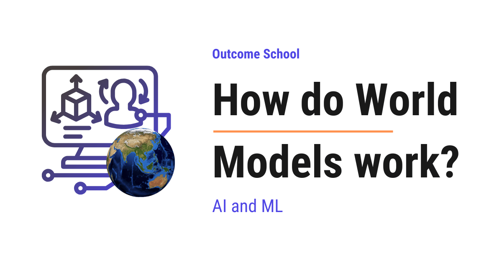

# How do World Models work?

> **Module 17 · Lesson 17.2**  
> Source: [Outcome School](https://outcomeschool.com/blog/how-do-world-models-work) · Published: June 20, 2026 · Reading time: ~21 min · Tags: `ai`, `machine-learning`

---



A World Model is an AI that learns an approximate internal copy of how an environment behaves, so that it can predict what happens next, given the current state and an action.

In this blog, we will learn about how World Models work. We will also see why we need them, how they actually learn an internal picture of an environment, and where they are used in real systems like robotics, game-playing, and video generation.

We will cover the following:

- What is an environment, a state, and an action?
- What is a World Model?
- The human analogy: imagining a move before making it
- Why we need a World Model
- How a World Model learns: predicting the next state
- The latent state: compressing what we see
- Imagining the future: rolling out without touching the real world
- Dreamer-style agents that plan inside the model
- World Models and predicting the future
- World Models in the real world

Let's get started.

### What is an environment, a state, and an action?

Before we talk about World Models, we must first understand three simple words: environment, state, and action. These three words come up again and again, so let's make them very clear.

**An environment is the world that our AI lives in and interacts with.**

In simple words, the environment is the surroundings. For a robot, the environment is the room it walks around in. For a game-playing AI, the environment is the game itself. For a self-driving car, the environment is the road, the other cars, and the traffic lights.

**A state is a snapshot of the environment at one moment in time.**

In simple words, the state is "how things are right now". Let's say we are playing a video game. The state is the current screen: where our character is standing, where the enemies are, and how much health we have left. If anything moves, we get a new state.

**An action is a choice the AI makes that changes the state.**

In simple words, an action is a move. In a game, an action could be "jump", "move left", or "shoot". For a robot, an action could be "turn the wheel" or "lift the arm".

So, here is the simple loop that ties them together. The AI looks at the current state, picks an action, and the environment gives back a new state. Then it looks at the new state, picks another action, and so on.

We can picture this loop as below:

```
   +-->  current state  -->  AI picks an action  -->  environment  --+
   |                                                                 |
   |                                                                 v
   +-----------------------  next state  <---------------------------+
                          (the loop repeats)
```

Here, we can see that the AI and the environment keep taking turns. The AI acts, the environment responds with a new state, and this continues step after step. This loop is the foundation we needed. Now we are ready to understand the problem.

### What is a World Model?

Now that we know what a state and an action are, let's understand a World Model.

**A World Model is an AI that learns an approximate internal copy of how an environment behaves, so that it can predict what happens next, given the current state and an action.**

Let's decompose the term to make it stick.

**World Model = World + Model.**

The "world" is the environment we just talked about. A "model" is simply a small internal copy or imitation of something real. So a World Model is an approximate internal copy of the world that lives inside the AI. It is not a perfect copy, but it is good enough to be useful.

In simple words, a World Model is a little simulator that the AI builds inside its own head. We can ask it a question like "if I am in this state and I take this action, what happens next?" and it gives back an answer: the next state, and how good or bad that outcome is.

Before we go further, let's quickly understand one more word: **reward**. A reward is a number that tells the AI how good an outcome is. A high reward means "that was good, do more of that". A low or negative reward means "that was bad, avoid it". For a game, scoring a point gives a reward. Falling into a pit gives a negative reward.

So, a World Model takes two things as input, the current state and an action. From these, it predicts what comes next. The main thing it predicts is the next state. Many World Models, especially the ones used in [Reinforcement Learning](https://outcomeschool.com/blog/reinforcement-learning), also predict the reward. In this blog, we will focus on these, so from here on we will talk about predicting the next state and the reward together.

This is how a World Model works at a high level. Now, let's make it feel real with an everyday example.

### The human analogy: imagining a move before making it

The best way to learn this is by taking an example. And the best example is something we all do every single day, without even thinking about it.

Let's say we are playing chess. Before we actually touch a piece, what do we do? We imagine. We think, "If I move my knight here, then my opponent will probably move their bishop there, and then I will be in trouble." We play the move in our head first. We look at the imagined outcome. And only if it looks good, we make the real move.

We did not touch the board to find this out. We ran a little simulation inside our mind.

That little simulation inside our mind is exactly a World Model.

Let's take one more example. Suppose we are about to pour water into a glass. Before we tilt the bottle, we already have a rough idea of what will happen: the water will flow out, the level in the glass will rise, and if we tilt too much, it will overflow. We know all of this without spilling a single drop, because we carry an internal model of how water behaves.

So, a World Model gives an AI this same ability: the power to imagine the outcome of an action before taking it in the real world.

This is the heart of the whole idea. Now, the question is, why do we even need this? Let's see.

### Why we need a World Model

To understand why we need a World Model, let's first look at how an AI learns without one.

The usual way for an AI to learn a task is by trial and error. It tries an action, sees what happens, and slowly figures out which actions are good and which are bad. This way of learning by trial and error and rewards is called **Reinforcement Learning**.

In simple words, Reinforcement Learning is learning from experience: try something, get a reward or a penalty, and remember what worked.

But here is the catch. To learn this way, the AI has to actually try things in the real environment, again and again, thousands or even millions of times. And that brings real problems.

This causes three real problems:

- **It is slow.** Trying millions of actions in the real world takes a very long time.
- **It is expensive.** If our AI is a real robot, every trial means real motors moving, real battery used, and real wear and tear.
- **It is risky.** A real robot that learns by random trial and error can fall, break things, or hurt itself while figuring things out.

So, learning directly in the real world is wasteful and sometimes dangerous.

We can compare the two ways of learning as below:

```
  WITHOUT a World Model            WITH a World Model
  ---------------------            ------------------
  AI                               AI
   |                                |
   | try in REAL world              | try inside the MODEL
   v                                v
  real environment                 internal simulator
   |                                |
   | slow, expensive, risky         | fast, cheap, safe
   v                                v
  new state + reward               predicted state + reward
   |                                |
   | repeat millions of times       | repeat millions of times
   | (in the slow real world)       | (all in imagination)
   v                                v
  learned behavior                 learned behavior
```

Here, we can notice that both paths reach the same goal of a learned behavior, but the path on the left keeps paying the slow, costly, risky price of the real world on every single try, while the path on the right does all that practice inside a cheap, safe internal simulator.

Now, think back to the chess example. We did not move real pieces a million times to learn. We imagined moves in our head and learned from those imagined outcomes. That is the trick we want to give the AI.

So, here comes the World Model to the rescue. Once the AI has an internal model of the world, it can practice inside that model instead of practicing in the real world. We will see exactly how this saves so much effort in a moment.

### How a World Model learns: predicting the next state

Now, let's understand how a World Model actually learns. This is simpler than it sounds.

The World Model learns by watching experience and learning to predict what comes next.

Let's walk through it step by step.

**Step 1:** First, we let the AI interact with the environment for a while and record what happens. Each recorded piece is a small story: "I was in this state, I took this action, and then this next state happened, and I got this reward." We collect many such stories.

**Step 2:** Then, we train the World Model on these recorded stories. We show it the state and the action, and we ask it to guess the next state and the reward. At first, its guesses are wrong.

**Step 3:** After that, we compare its guess with what actually happened. If the guess is wrong, we nudge the model to do better next time. We repeat this for all the recorded stories, over and over.

**Finally,** after enough practice, the World Model becomes good at this. Given a state and an action, it predicts the next state and reward accurately. And the best part is that it works even for situations it has not seen exactly before, because it has learned the general rules of the environment rather than just memorizing each recorded story.

We can picture what the trained World Model does as below:

```
   INPUT                          WORLD MODEL                 OUTPUT
  current state  ----\
                      >----->  [ learned simulator ]  ----->  next state
  action  -----------/                                        + reward
```

Here, we can see that the World Model takes the current state and the action on the left, runs them through what it learned, and produces the predicted next state and reward on the right. It has essentially learned the rules of the environment, just by watching enough examples, and that too without anyone hand-coding those rules.

This is how a World Model learns. Now, there is one more clever piece that makes it really powerful. Let's understand it.

### The latent state: compressing what we see

Here is a small problem we must deal with first.

In many environments, what the AI actually sees is raw and huge. For example, a game screen or a camera image is just a giant grid of pixels. A single image can have millions of numbers in it, one for each tiny color dot. Predicting the next full image, pixel by pixel, would be enormous and wasteful.

Most of those pixels do not even matter. In a game, the color of the sky in the background does not change what we should do. What matters is where our character is, where the enemies are, and a few other important details.

So, the World Model does something smart. It compresses the raw observation into a small, compact summary that keeps the important information and throws away the rest. One thing to note here is that the World Model decides for itself what is important. It keeps whatever helps it predict the future well, which is mostly, but not always, the same as what we humans would have picked.

This compact summary is called the **latent state**.

In simple words, the latent state is a short description of "what is really going on", squeezed down from the big raw image into a small set of numbers.

Let's understand it with an analogy. Suppose a friend watches a football match and then describes it to us in two sentences: "Our team is attacking, the striker has the ball near the goal, and the defender is closing in." Our friend did not repeat every single frame of the match. They compressed the whole scene into a tiny, meaningful summary. The latent state is exactly that kind of tiny, meaningful summary.

We can picture the compression as below:

```
   raw observation                          latent state
   (millions of pixels)        ----->       (a small set of numbers)
   +-----------------------+                 +----------------+
   |  full game screen     |    compress     | character pos  |
   |  every pixel, sky,    |   =========>    | enemy pos      |
   |  clouds, background   |   (keep only    | health, etc.   |
   |  millions of numbers  |   what matters) +----------------+
   +-----------------------+
```

Here, we can see that the World Model takes the huge raw screen on the left and squeezes it into a tiny latent state on the right that holds only the things that matter for predicting what comes next. Because the latent state is small, the model can work with it quickly and cheaply.

So, from now on, the World Model does its predicting in this compact latent space. It takes a latent state and an action, and it predicts the next latent state and the reward. This makes everything faster and easier to learn.

This idea of squeezing a raw observation down into a small set of meaningful numbers is exactly what an encoder learns to do in a Variational Autoencoder - we have a detailed blog on [Variational Autoencoders](https://outcomeschool.com/blog/variational-autoencoders) that explains how that compression works.

This is how a World Model handles big, messy inputs like images. Now, let's get to the most exciting part: imagining the future.

### Imagining the future: rolling out without touching the real world

Now we have all the pieces. Let's bring them together for the big payoff.

Once the World Model can predict the next latent state from a current latent state and an action, we can chain these predictions together.

In simple words, we can imagine a whole sequence of future steps, all inside the model, without touching the real environment even once.

Predicting the future directly in this compact latent space, rather than in raw pixels, is also the core idea behind JEPA - we have a detailed blog on [Joint Embedding Predictive Architecture (JEPA)](https://outcomeschool.com/blog/joint-embedding-predictive-architecture-jepa) that covers this in depth.

This chaining of predicted steps is called a **rollout**. A rollout is just "imagine step one, then step two, then step three, and so on", entirely in imagination.

Let's walk through how a rollout works.

**Step 1:** We start with the current latent state.

**Step 2:** We pick an action. We feed the latent state and the action into the World Model, and it predicts the next latent state and the reward.

**Step 3:** Now we take that predicted next state, pick another action, and feed it into the World Model again. It predicts the state after that.

**Finally,** we keep repeating this for many steps. We have now imagined a full future, several moves ahead, without taking a single real action.

We can picture a rollout as below:

```
  IMAGINED FUTURE (all inside the World Model, no real environment)
  latent state 0
        | action A
        v
  latent state 1  (+ reward)
        | action B
        v
  latent state 2  (+ reward)
        | action C
        v
  latent state 3  (+ reward)   ...and so on
```

Here, we can see that starting from the current latent state, the model keeps predicting the next state for each chosen action, building a chain of imagined moments. At every step it also predicts the reward, so the AI can see how good this imagined path turned out to be.

This is the same thing we did with chess. We imagined a sequence of moves and their outcomes in our head before playing for real.

And here is the huge benefit. Because all of this imagining happens inside the model, the AI can practice millions of times very quickly and cheaply, without breaking any real robots and without waiting for the slow real world. This property is called being **sample-efficient**. In simple words, sample-efficient means the AI learns a good behavior from very few real experiences, because it squeezes a lot of extra practice out of its imagination.

But, here is one catch we must keep in mind. The World Model is not perfect, so every prediction it makes carries a small error. When we chain many predictions together in a long rollout, these small errors add up step after step. So the further into the future we imagine, the less reliable our imagined future becomes. This is why, in practice, these rollouts are usually kept short, and the AI keeps going back to the real environment to check and correct its model.

So, the main problem is largely solved. The AI no longer needs to learn everything the slow, costly, risky way. It first learns the model from a little real experience, then practices inside the model as much as it wants, while still checking back with the real world to keep its imagination honest.

### Dreamer-style agents that plan inside the model

Now, let's connect this to a real family of AI agents that use this exact idea. They are called **Dreamer** agents.

The name "Dreamer" is a perfect fit, because these agents literally learn by dreaming. They build a World Model, and then they train themselves on imagined experiences inside that model, just like we described with rollouts.

In simple words, a Dreamer agent keeps repeating a simple cycle of a few steps.

**First,** it interacts with the real environment a little and records what happens.

**Then,** it uses those recordings to improve its World Model, so the internal simulator becomes more accurate.

**After that,** it imagines many rollouts inside the World Model and uses those imagined futures to practice and improve its decision-making, learning which actions lead to high rewards.

**Finally,** it goes back to the real environment with its improved behavior, gathers a bit more real experience, and the cycle repeats.

We can picture the Dreamer cycle as below:

```
   real environment            World Model (imagination)
   ----------------            -------------------------
   act a little, record  --->  improve the model
                                      |
                                      v
                               imagine many rollouts
                                      |
                                      v
                               practice and learn here
                                      |
   come back smarter  <----------------
   (then repeat)
```

Here, we can see that the agent spends only a small amount of time in the real environment to gather experience, and most of its learning happens inside the World Model through imagination. This is why Dreamer-style agents can learn complex behaviors while using very little real-world interaction. They plan and practice inside the model, which is exactly the sample-efficient idea we just learned.

So, Dreamer agents are a clear, real example of planning and learning inside a World Model.

### World Models and predicting the future

Let's pause and notice the simple idea sitting at the center of everything we have learned.

A World Model is, at its core, a machine that predicts the future. Given where we are now and what we do next, it tells us what comes after.

This is exactly how we humans move through the world. Before we cross a road, we predict where the cars will be. Before we throw a ball to a friend, we predict where they will be standing. We are constantly running a little prediction of the near future, and we act based on that prediction.

A World Model gives an AI this same gift. When an AI can predict the future, it can plan. It can compare different actions by imagining where each one leads, and then choose the action that leads to the best outcome.

So, the ability to predict the future is the real superpower here. Everything else, the latent states, the rollouts, the Dreamer cycle, is built on top of this one ability.

This is how predicting the future turns into smart behavior.

### World Models in the real world

Now, let's see where World Models are used in real systems.

World Models are used across several important areas.

The first is **Reinforcement Learning and game-playing**. As we learned, instead of learning purely by slow trial and error in the real game, an agent learns a World Model of the game and then practices inside it. This lets it master games while using far fewer real game steps. Dreamer-style agents have learned to play many different games this way.

The second is **robotics**. Real robots are slow, expensive, and breakable. A World Model lets a robot imagine the outcome of its movements before doing them, so it can practice safely in imagination and only perform the good moves in the real world. This makes learning much safer and far more sample-efficient.

The third is **self-driving and planning systems**. A driving system can use a World Model to imagine how the traffic around it will move in the next few seconds. By predicting these futures, it can plan a safe path before committing to it.

The fourth is **video generation**. This connection is beautiful. A model that generates video learns how a scene changes from one frame to the next, which is the same kind of skill as predicting the next state of an environment. So modern video generation models and World Models are closely related, because both are learning how the world unfolds over time. We have a detailed blog on [Diffusion Models](https://outcomeschool.com/blog/diffusion-models) that explains how many of these video generation models actually generate frames.

But here we must be careful. Not every video generator is a full World Model. A plain video generator only continues the video in a likely-looking way, and we do not tell it which action we want to take. A true World Model is action-conditioned, which means we can ask it "if I take this action, what happens next?". So the tightest link is with interactive video models that take our action as input and then show what happens. These action-conditioned video models are the ones that truly act as World Models.

So, anywhere an AI needs to understand how an environment changes and plan ahead, World Models help us a lot.

This is how World Models work. The AI learns an internal simulator of its environment, it compresses what it sees into a small latent state, and then it imagines many possible futures inside that model to decide what to do, all without touching the real world until it is sure. When the learned model is accurate enough, this makes learning faster, cheaper, safer, and far more sample-efficient than learning by raw trial and error. And when the model is not yet accurate, the AI simply goes back to the real world, gathers a little more experience, and improves the model again.

## Frequently Asked Questions

### Is every video generation model a World Model?

No. A plain video generator only continues the video in a likely-looking way, and we do not tell it which action we want to take. A true World Model is action-conditioned, so we can ask it what happens next if we take a given action. Interactive video models that take our action as input are the ones that truly act as World Models.

### Why are imagined rollouts in a World Model kept short?

Rollouts are kept short because every prediction carries a small error, and these errors add up step after step in a long rollout. So, the further into the future we imagine, the less reliable the imagined future becomes. This is why the AI keeps going back to the real environment to check and correct its model.

### Does an AI with a World Model still need the real environment?

Yes, but much less. The AI first learns the World Model from a little real experience, then does most of its practice inside the model. When the model is not accurate enough, the AI goes back to the real world, gathers a bit more experience, and improves the model again.

### Who decides what information goes into the latent state?

The World Model decides for itself. It keeps whatever helps it predict the future well and throws away the rest, like the color of the sky in a game background. This is mostly, but not always, the same as what we humans would have picked.

### What does sample-efficient mean for a World Model?

Sample-efficient means the AI learns a good behavior from very few real experiences. It does this by squeezing a lot of extra practice out of its imagination inside the World Model. This is why Dreamer-style agents can learn complex behaviors while using very little real-world interaction.
