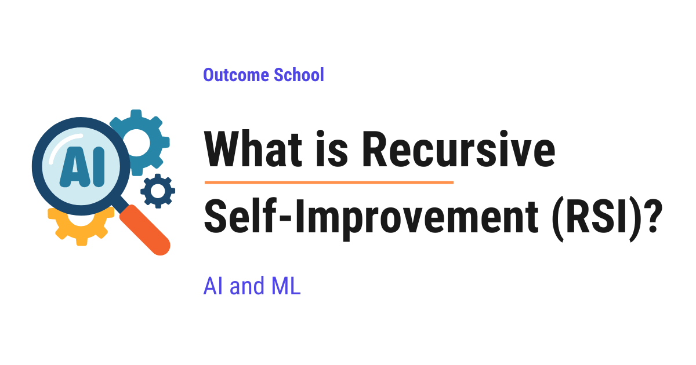

# What is Recursive Self-Improvement (RSI)?

> **Module 17 · Lesson 17.3**  
> Source: [Outcome School](https://outcomeschool.com/blog/what-is-recursive-self-improvement-rsi) · Published: September 15, 2026 · Reading time: ~22 min · Tags: `ai`, `machine-learning`

---

Recursive Self-Improvement (RSI) is a process in which an AI system improves its own abilities, and then the improved version improves itself further, and this cycle keeps repeating.

In this blog, we will learn about Recursive Self-Improvement (RSI), the idea of an AI system that makes itself smarter, and then uses that new smartness to make itself even smarter, again and again. We will also see why it matters, how an AI gets better today, how the self-improvement loop works step by step, a simple example with numbers, what already exists in the real world today, why people talk about an intelligence explosion, where it works well and where it fails, and why keeping humans in the loop is very important.

We will cover the following:

- What is Recursive Self-Improvement?
- Why does Recursive Self-Improvement matter?
- How does an AI get better today?
- How does Recursive Self-Improvement work?
- A simple example with numbers
- Two kinds of improvement
- What exists in the real world today?
- Intelligence explosion
- Where it works well and where it fails
- Keeping humans in the loop
- Recursive Self-Improvement vs Normal Training

Let's get started.

## What is Recursive Self-Improvement?

**Recursive Self-Improvement is a process in which an AI system improves its own abilities, and then the improved version improves itself further, and this cycle keeps repeating.**

In simple words, it is an AI that makes itself better, again and again, without waiting for a human to do it.

Here, AI means Artificial Intelligence, which is a computer program that can [learn from data](https://outcomeschool.com/blog/machine-learning) and do tasks that normally need human thinking.

Let's break the term into parts.

**Recursive Self-Improvement = Recursive + Self + Improvement**

- **Improvement**: Getting better at something. For an AI, this means solving more problems correctly, making fewer mistakes, or working faster.
- **Self**: The AI does the improving by itself. No human is sitting there and fixing it.
- **Recursive**: The result of one round becomes the starting point of the next round. The improved AI is the one that does the next improvement.

The word "recursive" is the most important word here. So, let's understand it with a simple example.

Let's say there is a student preparing for an exam.

A normal student studies from the notes given by the teacher. The teacher finds the weak topics of the student and tells the student what to study. Here, the teacher is doing the work of improvement.

A self-improving student finds the weak topics on their own and studies them without the teacher. Here, the student is doing the work of improvement.

Now, a recursively self-improving student does one more thing. After each round of study, the student not only knows more but also becomes better at the act of studying. The student learns how to find weak topics faster, how to make a better study plan, and how to remember things for longer. So, the next round of study is better and faster than the last one.

Means, the student is not only getting better at the subject, the student is getting better at getting better.

This is the heart of Recursive Self-Improvement. **The AI improves not just its skills, but also its ability to improve.**

Now, let's see why this idea matters so much.

## Why does Recursive Self-Improvement matter?

Today, making an AI better is slow and expensive work.

Every improvement needs a team of human researchers, months of time, and a lot of computers. Humans are the bottleneck. A bottleneck is the narrow neck of a bottle that slows down the flow of water. Here, the human is the narrow part that slows down the flow of progress.

Now, imagine that the AI could do this research work itself. It could find its own weaknesses, try new ideas, test them, and keep the ones that work. And, it could do this day and night, thousands of times, without getting tired.

If this works, the speed of AI progress will no longer depend on how many human researchers we have. It will depend on how fast the AI can improve itself.

And, this is not just an idea on paper. The top AI labs in the world are already working on this. They use their own AI models to help with their AI research, and some of them have openly said that their goal is to build an AI that can do AI research on its own. So, Recursive Self-Improvement is not a far-away dream. People are building the pieces of it right now.

This is why Recursive Self-Improvement is one of the most discussed ideas in the world of AI. Some people see it as the path to the most powerful technology ever built. Some people see it as the biggest risk ever. Do not worry, we will see both sides in this blog.

## How does an AI get better today?

Before jumping into the self-improvement loop, we must know the traditional way of improving an AI, so that we can understand what changes with Recursive Self-Improvement.

First, two simple words that we will use again and again.

**Model**: In AI, the model is the program that has learned from data. For the sake of understanding, think of the model as the brain of the AI.

**Training**: Training is the process of teaching the model from data. The model looks at millions of examples and learns patterns from them.

Traditionally, an AI like a large language model, which is the type of AI behind chat apps like ChatGPT, gets better through the following steps:

**Step 1: Collect data.** Humans collect a huge amount of text, images, or examples for the model to learn from.

**Step 2: Design the model.** Humans decide the structure of the model, how big it must be, and how it must be trained.

**Step 3: Write the training code.** Humans write the code that teaches the model from the data. Code is the set of instructions that tells a computer what to do.

**Step 4: Train the model.** Big computers run the training code for days or weeks. The model learns patterns from the data.

**Step 5: Test the model.** Humans check the model on many questions and find where it fails.

**Step 6: Fix and repeat.** Humans go back, collect better data, change the design, fix the code, and train again.

Here, we can notice that in this traditional way, almost every step needs humans. Only Step 4 is done fully by machines.

One full round of this loop can take months. And, after every round, the humans are the same humans with the same speed. They do not become ten times faster after each round.

Now, this is already changing. Today, AI labs use their own AI models to help in many of these steps. AI helps to create the training data in Step 1, AI writes a big part of the code in Step 3, and AI helps to run the tests in Step 5. So, the human is no longer doing everything alone. But, the human is still the one who decides what to try next and approves every change. The AI is a helper, not the one in charge. Do not worry, we will see these real-world examples in detail later in this blog.

Here comes Recursive Self-Improvement into the picture. It goes one step further and lets the AI run the whole loop itself.

## How does Recursive Self-Improvement work?

The idea is simple. We replace the human in the loop with the AI itself.

Let's see the loop step by step.

**Step 1: Evaluate.** The AI tests itself on a set of problems and records its score. Let's say it gets 60 questions right out of 100.

**Step 2: Find the weakness.** The AI looks at the 40 questions it got wrong and finds a pattern. Let's say it notices that it fails on problems that need many steps of thinking.

**Step 3: Propose a change.** The AI writes a change that can fix this weakness. The change can be anything: new training examples for multi-step problems, a better way of training, or a change in how the model thinks before it answers.

**Step 4: Train and test the new version.** The AI applies the change, trains a new version of itself, and tests the new version on the same 100 problems.

**Step 5: Keep or discard.** If the new version scores higher, it becomes the current version. If not, the change is thrown away and the AI tries something else.

**Step 6: Repeat.** Now, the new and better version goes back to Step 1 and does the whole loop again.

Step 6 is where the "recursive" part comes in. In programming, recursion means a process that uses its own result to run again. Here, the AI that runs the next round is not the old AI. It is the improved AI. And, because it is improved, it is better at finding weaknesses, better at proposing changes, and better at testing them.

So, each round of the loop is done by a smarter worker than the last round.

The very first version that starts this loop is sometimes called a **seed AI**. Like a seed, it is small at the start, but it can grow into something much bigger.

This is how Recursive Self-Improvement works.

## A simple example with numbers

The best way to learn this is by taking an example. The numbers here are just for the sake of understanding.

Let's say we have an AI whose score is 60 out of 100.

**Round 1:** Version 1 finds a weakness, proposes a change, and trains Version 2. Version 2 scores 63. The improvement is 3 points.

**Round 2:** Now, Version 2 runs the loop. Version 2 is a little smarter, so it finds a better weakness and proposes a better change. Version 3 scores 68. The improvement is 5 points.

**Round 3:** Version 3 runs the loop. Version 4 scores 76. The improvement is 8 points.

**Round 4:** Version 4 runs the loop. Version 5 scores 88. The improvement is 12 points.

Here, we can notice something interesting. The improvement in each round is bigger than the previous round: 3, then 5, then 8, then 12.

Why? Because the worker doing the improvement is getting smarter every round. A smarter worker finds bigger improvements.

This is different from the normal way. In the normal way, the humans doing the improvement stay the same, so the improvement in each round does not grow like this.

This is why Recursive Self-Improvement is so powerful.

**Note:** In real life, the numbers do not always grow like this. We will see why in the section about where it fails.

Now, let's understand why the worker gets smarter in each round.

## Two kinds of improvement

To understand Recursive Self-Improvement properly, we must understand that there are two different kinds of improvement.

**First kind: Getting better at the task.**

This is when the AI becomes better at math, better at writing code, or better at answering questions. This is what most people think of when they hear "the AI improved".

**Second kind: Getting better at improving.**

This is when the AI becomes better at the work of improvement itself. Better at finding its weaknesses. Better at writing training code. Better at creating useful training data. Better at designing tests.

The first kind alone is not recursive. An AI that only becomes better at math will not make the next round of improvement any faster.

The second kind is what makes the loop recursive. When the AI gets better at improving, the next round is faster and better than the last one. This is what gives the growing numbers we saw in the example.

So, whenever we hear about Recursive Self-Improvement, we must ask: Is the AI getting better at the task only, or is it also getting better at improving? Only when the second kind is present, we have true Recursive Self-Improvement.

This was all about the two kinds of improvement. Now, let's see what exists in the real world today.

## What exists in the real world today?

Now, the big question is: Does this exist today?

The answer is: Partially. There is no AI today that fully improves itself without humans. But, this is not just a theory. People are actively working on it. Many pieces of this loop already work, and AI labs are building the remaining pieces right now. Let's see them.

**Self-play in games**

In 2017, DeepMind, which is the AI research lab of Google, built a system called AlphaGo Zero to play the board game Go. It started by knowing only the rules and playing random moves. Then, it played millions of games against itself. Each new version learned from the games played by the previous version. Within a few weeks, it became stronger than any human player in history.

Here, the AI improved itself, and the improved version created the training data for the next version. This is a form of Recursive Self-Improvement, but only inside one game with fixed rules. Humans designed the system, and the AI could not change its own design.

The method behind AlphaGo Zero is reinforcement learning, and we have a detailed blog on [Reinforcement Learning](https://outcomeschool.com/blog/reinforcement-learning) that explains it in depth.

**AI creating training data for the next AI**

Modern large language models are partly trained on data that was written, filtered, or checked by earlier AI models. This is called synthetic data. Synthetic means made by a machine, not collected from the real world. The old model helps to teach the new model. So, one piece of the loop, which is collecting data, is already done partly by AI.

**AI writing code for AI research**

[AI coding assistants](https://outcomeschool.com/blog/how-does-claude-code-work) are now used by AI researchers to write and fix the code for training and testing models. Some AI labs have openly said that a large part of the code inside their company is now written by their own AI models. Means, the AI models are helping to write the code that builds their own next version. Some labs also use [AI agents](https://outcomeschool.com/blog/ai-agent), which are AI programs that can take actions on their own, to run experiments, read the results, and try the next experiment. So, the steps of writing code and running tests are also becoming partly automated.

**AI discovering better algorithms**

An algorithm is a step-by-step method to solve a problem, like a recipe. In 2025, DeepMind built a system called AlphaEvolve. It uses Gemini, which is the AI model made by Google, to write and improve code. It found a faster way to do one of the most important math operations inside AI training, called [matrix multiplication](https://outcomeschool.com/blog/how-does-a-gpu-work-for-deep-learning). Matrix multiplication is a way of multiplying big tables of numbers, and AI training does this billions of times. This faster method was used to reduce the training time of Gemini itself.

Here, an AI found an improvement that was used to train the very AI family that powers it. This is the closest thing to Recursive Self-Improvement in the real world today.

But, here is the catch. In all these examples, humans are still in the loop. Humans decide what to run, check the results, and approve the changes. The AI is a very fast helper, not an independent improver.

Still, the direction is clear. Every year, the AI does a bigger share of the work, and the human does a smaller share. The AI labs are openly working towards the day when the AI can run the full research loop on its own. So, Recursive Self-Improvement is not a far-away idea. It is a work in progress.

## Intelligence explosion

Now that we have seen what exists today, it's time to learn about the big idea that comes from this loop.

In 1965, a mathematician named I. J. Good wrote about an "ultraintelligent machine". He said that if a machine could design better machines, then those better machines could design even better machines, and this would lead to an "intelligence explosion". After that, he said, the intelligence of humans would be left far behind.

Let's understand this with money.

Let's say we put money in a bank that gives interest. In the first year, the money earns some interest. In the second year, the money plus the interest from the first year earns interest. So, the interest earns interest. This is called compound interest, and it grows slowly at first and then very fast.

Recursive Self-Improvement is like compound interest for intelligence. Intelligence earns more intelligence. Each round is done by the improved version, so the gain from one round is added to the worker of the next round, just like the interest is added to the money. The smarter the AI becomes, the faster it becomes even smarter.

This is why some people believe that once real Recursive Self-Improvement starts, AI could go from human level to far beyond human level in a very short time. This is the intelligence explosion.

But, this is a prediction, not a fact. Many smart people disagree about how fast this will happen, or if it will happen at all. Let's see why.

## Where it works well and where it fails

First, let's see where it works well.

Recursive Self-Improvement works well in closed worlds with clear rules and clear scores, like games, math, and code. In these worlds, the AI can check its own answer. A game is won or lost. A math answer is right or wrong. Code either passes the tests or fails them. So, the test is good, and the loop runs fast. This is why the biggest real-world successes we saw above are in games, math, and code. We have a detailed blog on [AI Is Only as Good as Our Definition of Done](https://outcomeschool.com/blog/ai-is-only-as-good-as-our-definition-of-done) that explains this idea step by step.

Now, let's see where it fails.

Recursive Self-Improvement sounds like a machine that runs forever and keeps getting better. But, in the real world, there are many walls that slow it down or stop it. Let's see them one by one.

**Wall 1: Compute**

Compute means computing power, which is the number of computers we have and the electricity needed to run them. Every new idea must be tested by training a new version. Training a big model needs thousands of computers running for weeks. A smarter AI can think of better ideas faster, but it still needs the same computers to test them. So, the speed of the loop is limited by the number of computers we have, not just by how smart the AI is.

**Wall 2: Data and the real world**

Some knowledge cannot be found by thinking harder. It can be found only by looking at the real world. For example, to know if a new medicine works, someone must test it on real patients, and that takes years. No amount of intelligence can skip that waiting time.

**Wall 3: The evaluation problem**

Evaluation means checking how good the new version is. This is the most important wall. In Step 5 of the loop, the AI keeps the new version if it scores higher on the test. But, what if the test is not good?

Let's say a student is given the answer key of the exam. The student memorizes the answer key and scores 100. Did the student become smarter? No. The student became better at that one test only.

The same thing can happen with an AI. If the AI improves itself only to score higher on the test, it can learn tricks to pass the test without actually becoming better. This problem is so common that it has a name. **Goodhart's Law** says: "When a measure becomes a target, it stops being a good measure."

**Very important:** A Recursive Self-Improvement loop is only as good as its test. And, making a good test for "is this AI actually smarter?" is a very hard problem that is not solved yet.

We have a detailed blog on [LLM Evaluation](https://outcomeschool.com/blog/llm-evaluation) that covers how these tests are built and where they break.

**Wall 4: Errors pile up**

Let's say Version 2 has a small mistake in the way it thinks. Now, Version 2 builds Version 3. The mistake goes into Version 3, and Version 3 adds its own small mistake. This is like taking a photocopy of a photocopy of a photocopy. Each copy gets a little worse. In the same way, small errors can grow in each round, and the AI can get worse instead of better without anyone noticing.

**Wall 5: Diminishing returns**

Diminishing returns means that each new effort gives less result than the one before. The easy improvements are found first. After that, each improvement is harder to find. This is like squeezing a lemon. The first squeeze gives a lot of juice. The tenth squeeze gives almost nothing. So, the growing numbers we saw in our example can slow down after some rounds.

Because of these walls, many researchers believe that Recursive Self-Improvement will be a steady climb rather than an explosion. But, nobody knows for sure. And, that is exactly why we must be careful.

## Keeping humans in the loop

Now, let's discuss the most serious part.

When an AI changes itself, the new version is not the same as the old one. The old version was tested and trusted by humans. The new version was built by the AI. What if the new version cares about different things than what we wanted?

For example, we want the AI to be honest and helpful. But, the AI changes itself to score higher on a test. The new version learns that it scores higher when it gives confident answers, even when it is wrong. Now, we have a more confident AI, but a less honest one. And, this new version will build the next version.

This is called the [alignment problem](https://outcomeschool.com/blog/reinforcement-learning-from-human-feedback-rlhf). **Alignment means making sure that the goals of the AI stay the same as the goals of the humans who built it.** In Recursive Self-Improvement, this problem becomes harder with every round, because every round moves the AI further away from the version that humans checked.

So, how can we handle this? The answer is: keep humans in the loop.

Few important points:

- **Human approval:** Every change proposed by the AI must be checked and approved by a human before it is applied.
- **Sandbox:** The AI must improve itself inside a closed and safe environment, called a sandbox, where it cannot reach the outside world.
- **Good tests:** Test not only for skill, but also for honesty, safety, and behavior. A new version that is smarter but less safe must be rejected.
- **Logs:** Record every change, so that if something goes wrong, we can go back to the last good version.
- **Limits:** Put a limit on how much the AI can change itself in one round, and on how much compute it can use.

This is how the AI labs are approaching Recursive Self-Improvement today. The AI does more and more of the work, but the human keeps the final say.

## Recursive Self-Improvement vs Normal Training

Let me tabulate the differences between Recursive Self-Improvement and Normal Training for your better understanding.

|  | Normal Training | Recursive Self-Improvement |
| --- | --- | --- |
| Who finds the weaknesses | Humans | The AI itself |
| Who proposes the changes | Humans | The AI itself |
| Who tests the new version | Humans | The AI itself |
| Who does the next round | Same humans, same speed | The improved AI, smarter every round |
| Time for one round | Weeks to months | Hours to days |
| Main risk | Slow progress | Losing control and bad tests |
| Where we are today | Fully in use | Actively being built, with humans in the loop |

Now, we must have understood Recursive Self-Improvement.

Recursive Self-Improvement is an AI that gets better at getting better. Today, we have many pieces of the loop working, like self-play, synthetic data, AI writing research code, and AI discovering faster algorithms. But, the full loop, where the AI improves itself without any human, does not exist yet, and the AI labs are actively working towards it. The walls of compute, real-world data, bad tests, growing errors, and diminishing returns slow it down. And, the alignment problem tells us that even if the loop works, we must keep a human hand on it at every round.

## Frequently Asked Questions

### What is the difference between self-improvement and recursive self-improvement?

A self-improving AI finds and fixes its own weaknesses without a human. A recursively self-improving AI also gets better at the act of improving itself. So, each round is done by a smarter worker than the last round, and the next round becomes faster and better. In simple words, it gets better at getting better.

### What is a seed AI?

A seed AI is the very first version that starts the recursive self-improvement loop. Like a seed, it is small at the start, but it can grow into something much bigger. Each round, the improved version takes over and runs the next round of evaluating, finding weaknesses, proposing changes, and testing.

### Is AlphaGo Zero an example of recursive self-improvement?

Yes, but only in a limited form. AlphaGo Zero played millions of games against itself, and each new version learned from the games of the previous version. However, this happened only inside one game with fixed rules. Humans designed the system, and the AI could not change its own design.

### Will recursive self-improvement definitely cause an intelligence explosion?

No. The intelligence explosion is a prediction, not a fact, and many smart people disagree about how fast it will happen, or if it will happen at all. Walls like compute, real-world data, bad tests, growing errors, and diminishing returns slow the loop down, so many researchers expect a steady climb instead.

### Why does Goodhart's Law matter for recursive self-improvement?

It matters because the loop keeps a new version only if it scores higher on a test. Goodhart's Law says that when a measure becomes a target, it stops being a good measure. So, the AI can learn tricks to pass the test without actually becoming better. A self-improvement loop is only as good as its test.
